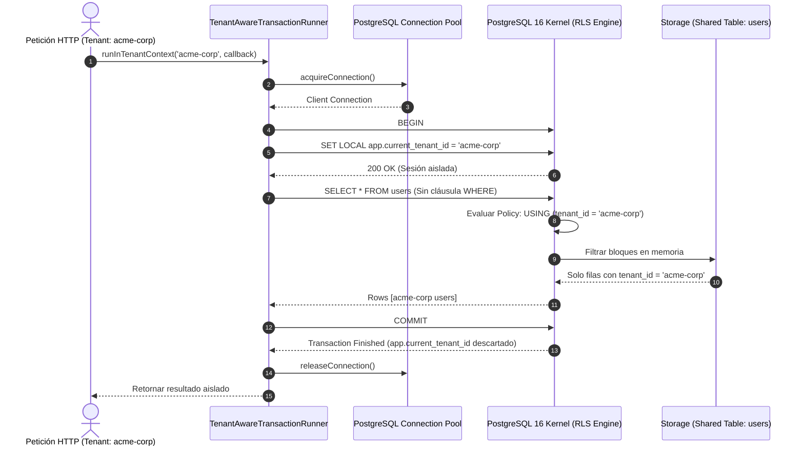

# 🛡️ Epic 03: Tenant Isolation & Zero-Trust Access

[](#)
[](#)
[-blue.svg)](#)
[](#)

Este capítulo documenta y demuestra el núcleo del modelo de seguridad del sistema: **El Aislamiento Multi-Inquilino de Grado Bancario**. En arquitecturas SaaS empresariales con bases de datos compartidas (*Shared Database, Shared Schema*), el aislamiento de datos jamás debe depender exclusivamente de la disciplina del desarrollador al escribir cláusulas `WHERE tenant_id = ?`.

El servicio delega la barrera de contención final directamente al motor de base de datos mediante **PostgreSQL 16 Row-Level Security (RLS)** y transacciones delimitadas con `SET LOCAL app.current_tenant_id`.

---

## 📌 Historias de Usuario

| Historia | Descripción | Estado |
| :--- | :--- | :---: |
| **US-05** | Aislamiento a Nivel de Fila con PostgreSQL 16 Row-Level Security (RLS) | ✅ En Producción |
| **US-06** | Guardia Cross-Tenant Zero-Trust y Prevención de Fugas de Contexto | 🔄 Próximo Paso |

---

## 🔒 US-05: PostgreSQL Row-Level Security (RLS) & Sesión Transaccional

### 1. Arquitectura de Aislamiento a Nivel de Kernel de Base de Datos

Conforme a la decisión de arquitectura **ADR-0005 (PostgreSQL RLS Strategy)**:

1. **Forzado Irreversible de RLS:** La tabla `users` tiene configurado `ENABLE ROW LEVEL SECURITY` y `FORCE ROW LEVEL SECURITY`. Esto obliga a que **incluso el propietario de la tabla** esté sujeto a las políticas de seguridad.
2. **Rol de Aplicación no Superusuario (`identity_app`):** El servicio backend se conecta a PostgreSQL mediante el rol restringido `identity_app`, el cual tiene revocado explícitamente el atributo `BYPASSRLS` (`NOBYPASSRLS`).
3. **Variable de Sesión Transaccional (`SET LOCAL`):** Antes de ejecutar cualquier consulta de lectura o escritura, el componente `TenantAwareTransactionRunner` abre una transacción (`BEGIN`) e inyecta la variable local de sesión:
   ```sql
   SET LOCAL app.current_tenant_id = 'acme-corp';
   ```
   Al utilizar `SET LOCAL`, la variable expira automáticamente al invocar `COMMIT` o `ROLLBACK`, evitando fugas de contexto cuando la conexión se devuelve al pool (`pg.Pool`).
4. **Política Simétrica (USING + WITH CHECK):**
   ```sql
   CREATE POLICY tenant_isolation_policy ON users
     FOR ALL
     USING (tenant_id = current_setting('app.current_tenant_id', true)::text)
     WITH CHECK (tenant_id = current_setting('app.current_tenant_id', true)::text);
   ```



---

### 2. Evidencia Forense en Vivo: Terminal SQL de PostgreSQL 16

Las siguientes evidencias fueron capturadas directamente ejecutando consultas interactivas con `psql` sobre el contenedor Docker `identity-db` en ejecución:

#### Demostración 1: Filtrado Transaccional por Inquilino

Al establecer `app.current_tenant_id = 'acme-corp'`, una consulta abierta `SELECT id, email, tenant_id FROM users;` devuelve exclusivamente los usuarios de `acme-corp`:

```bash
docker compose exec -T db psql -U identity_app -d identity_db -c "
BEGIN;
SET LOCAL app.current_tenant_id = 'acme-corp';
SELECT id, email, tenant_id FROM users LIMIT 3;
COMMIT;
"
```

##### Salida Real de PostgreSQL:
```text
BEGIN
SET
                  id                  |                     email                      | tenant_id 
--------------------------------------+------------------------------------------------+-----------
 2d7787ee-67fa-407c-abe0-1acba23c8191 | showcase.architect.1794919730773@acme-corp.com | acme-corp
 e258cb9d-4bed-47e2-bc37-c337f78b765e | showcase.verify.1794919986@acme-corp.com       | acme-corp
 14f52980-5920-4e73-acd6-a78580b40bbe | showcase.architect.1794922057608@acme-corp.com | acme-corp
(3 rows)

COMMIT
```

---

#### Demostración 2: Principio Fail-Closed (Seguridad por Defecto)

Si un actor malicioso o un error en la aplicación ejecuta una consulta directa sin configurar la variable de sesión de inquilino:

```bash
docker compose exec -T db psql -U identity_app -d identity_db -c "
SELECT id, email, tenant_id FROM users;
"
```

##### Salida Real de PostgreSQL (Cero Filas Retornadas):
```text
 id | email | tenant_id 
----+-------+-----------
(0 rows)
```

> [!IMPORTANT]
> **Garantía Fail-Closed:** Si `current_setting('app.current_tenant_id', true)` es `NULL` o vacío, la condición `USING` evalúa a falso para todas las filas. Es **imposible** leer registros sin una sesión multi-tenant explícitamente inicializada.

---

#### Demostración 3: Protección de Integridad `WITH CHECK` (Anti-Inyección Cross-Tenant)

Si dentro de una sesión legítima del inquilino `alpha-corp`, un atacante intenta forzar la inserción de un registro asignado a `beta-corp`:

```bash
docker compose exec -T db psql -U identity_app -d identity_db -c "
BEGIN;
SET LOCAL app.current_tenant_id = 'alpha-corp';
INSERT INTO users (id, tenant_id, email, password_hash, created_at, updated_at)
VALUES ('hacked-uuid', 'beta-corp', 'hacker@beta.com', 'dummy_hash', NOW(), NOW());
COMMIT;
"
```

##### Rechazo Categórico a Nivel de Kernel:
```text
BEGIN
SET
ERROR:  new row violates row-level security policy for table "users"
```

PostgreSQL rechaza la transacción con código de error **42501 (insufficient_privilege)**, abortando el bloque y protegiendo la base de datos contra contaminación de datos.

---

### 3. Cobertura de Pruebas Automatizadas

El motor de políticas RLS y el runner de transacciones están certificados por suites de pruebas de integración dedicadas:

```bash
npx jest tests/integration/security/test_rls_policies.ts tests/integration/security/test_tenant_aware_transaction_runner.ts
```

- **Aislamiento SELECT:** Valida que las consultas retornan solo registros que coinciden con el inquilino activo.
- **Fail-Closed:** Confirma que consultas fuera de contexto devuelven 0 filas.
- **Validación INSERT (WITH CHECK):** Verifica que inserciones cruzadas arrojan excepción 42501.
- **Aislamiento UPDATE & DELETE:** Asegura que mutaciones solo afecten registros del inquilino activo.
- **Ciclo de Vida de Conexión:** Valida `acquire -> begin -> set local -> execute -> commit -> release` con rollback automático ante excepciones.

---

[⬅️ Volver al Hub Principal de Showcase](./README.md)
