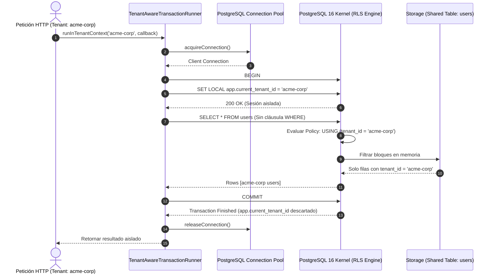
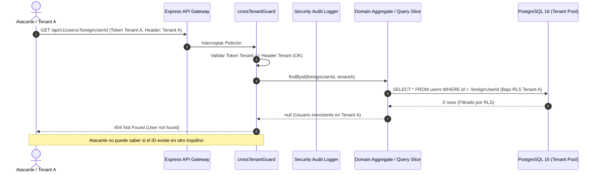

# 🛡️ Epic 03: Tenant Isolation & Zero-Trust Access

[](#)
[](#)
[-blue.svg)](#)
[](#)
[](#)

Este capítulo documenta y demuestra el núcleo del modelo de seguridad del sistema: **El Aislamiento Multi-Inquilino de Grado Bancario**. En arquitecturas SaaS empresariales con bases de datos compartidas (*Shared Database, Shared Schema*), el aislamiento de datos jamás debe depender exclusivamente de la disciplina del desarrollador al escribir cláusulas `WHERE tenant_id = ?`.

El servicio delega la barrera de contención final directamente al motor de base de datos mediante **PostgreSQL 16 Row-Level Security (RLS)** y transacciones delimitadas con `SET LOCAL app.current_tenant_id`, complementado por una guardia de borde **Zero-Trust** que intercepta cualquier discrepancia antes de invocar la capa de persistencia.

---

## 📌 Historias de Usuario

| Historia | Descripción | Estado |
| :--- | :--- | :---: |
| **US-05** | Aislamiento a Nivel de Fila con PostgreSQL 16 Row-Level Security (RLS) | ✅ En Producción |
| **US-06** | Guardia Cross-Tenant Zero-Trust y Prevención de Fugas de Contexto | ✅ En Producción |

---

## 🔒 US-05: PostgreSQL Row-Level Security (RLS) & Sesión Transaccional

### 1. Arquitectura de Aislamiento a Nivel de Kernel de Base de Datos

Conforme a la decisión de arquitectura **ADR-0005 (PostgreSQL RLS Strategy)**:

1. **Forzado Irreversible de RLS:** La tabla `users` tiene configurado `ENABLE ROW LEVEL SECURITY` y `FORCE ROW LEVEL SECURITY`. Esto obliga a que **incluso el propietario de la tabla** esté sujeto a las políticas de seguridad.
2. **Rol de Aplicación no Superusuario (`identity_app`):** El servicio backend se conecta a PostgreSQL mediante el rol restringido `identity_app`, el cual tiene revocado explícitamente el atributo `BYPASSRLS` (`NOBYPASSRLS`).
3. **Variable de Sesión Transaccional (`SET LOCAL`):** Antes de ejecutar cualquier consulta de lectura o escritura, el componente `TenantAwareTransactionRunner` abre una transacción (`BEGIN`) e inyecta la variable local de sesión:
   ```sql
   SET LOCAL app.current_tenant_id = 'acme-corp';
   ```
   Al utilizar `SET LOCAL`, la variable expira automáticamente al invocar `COMMIT` o `ROLLBACK`, evitando fugas de contexto cuando la conexión se devuelve al pool (`pg.Pool`).
4. **Política Simétrica (USING + WITH CHECK):**
   ```sql
   CREATE POLICY tenant_isolation_policy ON users
     FOR ALL
     USING (tenant_id = current_setting('app.current_tenant_id', true)::text)
     WITH CHECK (tenant_id = current_setting('app.current_tenant_id', true)::text);
   ```



#### A. Glosario de Actores y Componentes (Cajas del Diagrama)

| Participante / Caja | Tipo | Rol Arquitectónico y Frontera de Seguridad |
| :--- | :--- | :--- |
| **`Request` (Petición HTTP Tenant Context)** | `actor` | Petición entrante asociada a un inquilino específico (e.g. `acme-corp`) autenticada por el gateway. |
| **`Runner` (TenantAwareTransactionRunner)** | `participant` | Orquestador transaccional en la capa de infraestructura. Garantiza que toda operación de base de datos se ejecute dentro de una sesión delimitada con `SET LOCAL`. |
| **`Pool` (PostgreSQL Connection Pool)** | `participant` | Gestor del pool de conexiones físicas (`pg.Pool`). Reutiliza conexiones y exige la limpieza absoluta del estado de sesión al liberarlas. |
| **`PG` (PostgreSQL 16 Kernel RLS Engine)** | `participant` | Motor interno de PostgreSQL encargado de forzar las políticas declarativas de seguridad a nivel de fila (`FORCE ROW LEVEL SECURITY`). |
| **`Disk` (Storage: Shared Table `users`)** | `participant` | Almacenamiento en disco físico con esquema compartido (*Shared Database, Shared Schema*) donde coexisten datos de múltiples inquilinos. |

#### B. Desglose Secuencial del Flujo (Pasos 1 al 15)

1. **Paso 1 (`Request -> Runner`):** El caso de uso invoca `runInTenantContext('acme-corp', callback)` para iniciar la transacción delimitada.
2. **Paso 2 (`Runner -> Pool`):** Se solicita una conexión dedicada del pool de PostgreSQL.
3. **Paso 3 (`Pool -> Runner`):** El pool asigna un cliente de conexión limpio (`pg.Client`).
4. **Paso 4 (`Runner -> PG`):** Se emite la sentencia `BEGIN` para abrir formalmente una transacción.
5. **Paso 5 (`Runner -> PG`):** Se ejecuta la directiva `SET LOCAL app.current_tenant_id = 'acme-corp'`. El modificador `LOCAL` asegura que la variable solo viva durante la transacción activa.
6. **Paso 6 (`PG -> Runner`):** El motor confirma la fijación del contexto de sesión en el kernel de la base de datos.
7. **Paso 7 (`Runner -> PG`):** Se ejecuta la consulta de negocio (e.g., `SELECT * FROM users`), intencionalmente redactada sin cláusulas `WHERE tenant_id = 'acme-corp'`.
8. **Paso 8 (`PG -> PG`):** El planificador y ejecutor del motor PostgreSQL reescribe internamente la consulta aplicando la política RLS: `USING (tenant_id = current_setting('app.current_tenant_id', true)::text)`.
9. **Paso 9 (`PG -> Disk`):** El motor lee los bloques de datos desde almacenamiento.
10. **Paso 10 (`Disk -> PG`):** El motor descarta automáticamente cualquier registro cuyo `tenant_id` no sea `'acme-corp'`.
11. **Paso 11 (`PG -> Runner`):** Se devuelven exclusivamente las filas que superaron la política de seguridad a nivel de kernel.
12. **Paso 12 (`Runner -> PG`):** Se emite `COMMIT` para cerrar la transacción.
13. **Paso 13 (`PG -> Runner`):** Al finalizar la transacción, PostgreSQL descarta automáticamente el valor de `app.current_tenant_id`, evitando fuga de contexto en conexiones reutilizadas.
14. **Paso 14 (`Runner -> Pool`):** Se devuelve la conexión limpia al pool común.
15. **Paso 15 (`Runner -> Request`):** Se entrega el resultado aislado al flujo de la aplicación.

---

### 2. Evidencia Forense en Vivo: Terminal SQL de PostgreSQL 16

Las siguientes evidencias fueron capturadas directamente ejecutando consultas interactivas con `psql` sobre el contenedor Docker `identity-db` en ejecución:

#### Demostración 1: Filtrado Transaccional por Inquilino

Al establecer `app.current_tenant_id = 'acme-corp'`, una consulta abierta `SELECT id, email, tenant_id FROM users;` devuelve exclusivamente los usuarios de `acme-corp`:

```bash
docker compose exec -T db psql -U identity_app -d identity_db -c "
BEGIN;
SET LOCAL app.current_tenant_id = 'acme-corp';
SELECT id, email, tenant_id FROM users LIMIT 3;
COMMIT;
"
```

##### Salida Real de PostgreSQL:
```text
BEGIN
SET
                  id                  |                     email                      | tenant_id 
--------------------------------------+------------------------------------------------+-----------
 2d7787ee-67fa-407c-abe0-1acba23c8191 | showcase.architect.1794919730773@acme-corp.com | acme-corp
 e258cb9d-4bed-47e2-bc37-c337f78b765e | showcase.verify.1794919986@acme-corp.com       | acme-corp
 14f52980-5920-4e73-acd6-a78580b40bbe | showcase.architect.1794922057608@acme-corp.com | acme-corp
(3 rows)

COMMIT
```

---

#### Demostración 2: Principio Fail-Closed (Seguridad por Defecto)

Si un actor malicioso o un error en la aplicación ejecuta una consulta directa sin configurar la variable de sesión de inquilino:

```bash
docker compose exec -T db psql -U identity_app -d identity_db -c "
SELECT id, email, tenant_id FROM users;
"
```

##### Salida Real de PostgreSQL (Cero Filas Retornadas):
```text
 id | email | tenant_id 
----+-------+-----------
(0 rows)
```

> [!IMPORTANT]
> **Garantía Fail-Closed:** Si `current_setting('app.current_tenant_id', true)` es `NULL` o vacío, la condición `USING` evalúa a falso para todas las filas. Es **imposible** leer registros sin una sesión multi-tenant explícitamente inicializada.

---

#### Demostración 3: Protección de Integridad `WITH CHECK` (Anti-Inyección Cross-Tenant)

Si dentro de una sesión legítima del inquilino `alpha-corp`, un atacante intenta forzar la inserción de un registro asignado a `beta-corp`:

```bash
docker compose exec -T db psql -U identity_app -d identity_db -c "
BEGIN;
SET LOCAL app.current_tenant_id = 'alpha-corp';
INSERT INTO users (id, tenant_id, email, password_hash, created_at, updated_at)
VALUES ('hacked-uuid', 'beta-corp', 'hacker@beta.com', 'dummy_hash', NOW(), NOW());
COMMIT;
"
```

##### Rechazo Categórico a Nivel de Kernel:
```text
BEGIN
SET
ERROR:  new row violates row-level security policy for table "users"
```

PostgreSQL rechaza la transacción con código de error **42501 (insufficient_privilege)**, abortando el bloque y protegiendo la base de datos contra contaminación de datos.

---

### 3. Cobertura de Pruebas Automatizadas

El motor de políticas RLS y el runner de transacciones están certificados por suites de pruebas de integración dedicadas:

```bash
npx jest tests/integration/security/test_rls_policies.ts tests/integration/security/test_tenant_aware_transaction_runner.ts
```

- **Aislamiento SELECT:** Valida que las consultas retornan solo registros que coinciden con el inquilino activo.
- **Fail-Closed:** Confirma que consultas fuera de contexto devuelven 0 filas.
- **Validación INSERT (WITH CHECK):** Verifica que inserciones cruzadas arrojan excepción 42501.
- **Aislamiento UPDATE & DELETE:** Asegura que mutaciones solo afecten registros del inquilino activo.
- **Ciclo de Vida de Conexión:** Valida `acquire -> begin -> set local -> execute -> commit -> release` con rollback automático ante excepciones.

---

## 🛡️ US-06: Guardia Cross-Tenant Zero-Trust & Prevención de Fugas

### 1. Arquitectura de Defensa en Profundidad (Defense in Depth)

Mientras que PostgreSQL RLS (US-05) constituye la última línea de defensa en la capa de persistencia, la **US-06** implementa una barrera perimetral proactiva en el middleware Express (`crossTenantGuard`) y en los Value Objects del dominio:

1. **Defensa Anti-Enumeración de Usuarios:** Si un usuario de `acme-corp` intenta consultar o mutar un recurso cuyo `userId` pertenece a `beta-corp`, la API responde con **`HTTP 404 Not Found`** en lugar de `403 Forbidden`. Esto impide que atacantes determinen la existencia de cuentas ajenas mediante escaneo de IDs.
2. **Consistencia Criptográfica Token-to-Header:** Se exige coincidencia bit a bit entre el claim inmutable `tenantId` embebido en el JWT y la cabecera `X-Tenant-ID`. Si difieren, la petición se bloquea con **`HTTP 403 Forbidden`**.
3. **Inmunidad a SQL Injection en Parámetros de Tenant:** La cabecera `X-Tenant-ID` es validada por el Value Object inmutable `TenantId` (expresión regular estricta `^[a-z0-9-_]+$`). Payloads que contengan comillas, caracteres de escape o sentencias SQL son rechazados de inmediato con **`HTTP 400 Bad Request`** antes de llegar al pool de base de datos.
4. **Registro de Auditoría Forense Inmutable:** Cada intento de acceso trans-inquilino emite un evento estructurado NDJSON clasificado como `CROSS_TENANT_VIOLATION` con severidad `ALERT` para análisis en SIEM / SOC.



#### A. Glosario de Actores y Componentes (Cajas del Diagrama)

| Participante / Caja | Tipo | Rol Arquitectónico y Frontera de Seguridad |
| :--- | :--- | :--- |
| **`Attacker` (Atacante / Tenant A)** | `actor` | Usuario legítimo de un inquilino (Tenant A) que intenta adivinar o acceder a identificadores de recursos pertenecientes a un inquilino ajeno (Tenant B). |
| **`Gateway` (Express API Gateway)** | `participant` | Entrada HTTP perimetral que recibe la solicitud con credenciales y cabeceras contextuales. |
| **`Guard` (crossTenantGuard)** | `participant` | Middleware perimetral de inspección profunda. Comprueba la coincidencia estricta entre el claim `tenantId` del JWT y la cabecera `X-Tenant-ID`, rechazando discrepancias antes de tocar la base de datos. |
| **`Audit` (Security Audit Logger)** | `participant` | Logger estructurado que emite eventos NDJSON clasificados como `CROSS_TENANT_VIOLATION` con severidad `ALERT` para SIEM / SOC. |
| **`Domain` (Domain Aggregate / Query Slice)** | `participant` | Capa de dominio y casos de uso. Ejecuta las consultas delimitando estrictamente el contexto del inquilino autenticado. |
| **`DB` (PostgreSQL 16 Tenant Pool)** | `participant` | Base de datos con Row-Level Security activo bajo el inquilino autenticado (Tenant A), haciendo invisible cualquier dato ajeno. |

#### B. Desglose Secuencial del Flujo (Pasos 1 al 8)

1. **Paso 1 (`Attacker -> Gateway`):** El usuario de Tenant A realiza una consulta (`GET /api/v1/users/:foreignUserId`) enviando su token válido de Tenant A y la cabecera `X-Tenant-ID: tenant-a`.
2. **Paso 2 (`Gateway -> Guard`):** El Gateway transfiere la petición a la guardia perimetral `crossTenantGuard`.
3. **Paso 3 (`Guard -> Guard`):** La guardia verifica la coherencia entre el token y la cabecera (ambos pertenecen a Tenant A, por lo que la petición perimetral es admitida).
4. **Paso 4 (`Guard -> Domain`):** Se invoca el caso de uso `findById(foreignUserId, tenantA)` vinculando explícitamente la consulta al contexto de Tenant A.
5. **Paso 5 (`Domain -> DB`):** Se lanza la consulta a PostgreSQL bajo la sesión aislada de Tenant A (`SET LOCAL app.current_tenant_id = 'tenant-a'`).
6. **Paso 6 (`DB -> Domain`):** El motor RLS filtra a nivel de kernel las filas del Tenant B. La base de datos responde con `0 rows`, exactamente igual que si el ID no existiera en ningún sitio.
7. **Paso 7 (`Domain -> Guard`):** La capa de dominio concluye que el recurso es inexistente (`null`) para ese contexto de inquilino.
8. **Paso 8 (`Guard -> Attacker`):** Se responde con **`HTTP 404 Not Found`** (`{"error":"User not found"}`) en lugar de `403 Forbidden`. De este modo, el atacante no puede discernir si el ID consultado pertenece a otra empresa o si es un UUID ficticio, neutralizando vectores de ataque por fuerza bruta o escaneo de usuarios.

---

### 2. Ejecución en Vivo & Verificación Interactiva Paso a Paso

Puedes reproducir los tres vectores de ataque directamente contra el entorno en vivo utilizando la CLI oficial o `cURL`:

#### Paso 0: Obtención del Token de Autenticación para `acme-corp` (`$TOKEN_ACME`)

Para ejecutar los vectores de prueba de seguridad, primero obtenemos un token JWT Bearer emitido legítimamente para un usuario del inquilino `acme-corp`:

**Comando CLI Oficial en Tubería UNIX (`./bin/identity`):**

```bash
export TOKEN_ACME=$(./bin/identity auth register \
  --tenant acme-corp \
  --email "security.tester.$(date +%s)@acme-corp.com" \
  --password "EnterprisePassword2026!" \
  --raw-json | jq -r .accessToken)

echo "TOKEN_ACME=$TOKEN_ACME"
```

<details>
<summary><b>Ver Receta Equivalente con cURL</b></summary>

```bash
export TOKEN_ACME=$(curl -s -X POST http://localhost:4000/api/v1/auth/register \
  -H "Content-Type: application/json" \
  -H "X-Tenant-ID: acme-corp" \
  -d "{
    \"email\": \"security.tester.$(date +%s)@acme-corp.com\",
    \"password\": \"EnterprisePassword2026!\"
  }" | jq -r .accessToken)

echo "TOKEN_ACME=$TOKEN_ACME"
```
</details>

##### Inspección del Payload Criptográfico del JWT:
Al inspeccionar el JWT emitido, se observa cómo el claim `tenantId` queda fijado criptográficamente en el payload mediante la firma del servidor:

```json
{
  "userId": "3e80505f-0375-422d-bd58-4ddc3ea54f49",
  "email": "security.tester.1794938792@acme-corp.com",
  "tenantId": "acme-corp",
  "iat": 1794938793,
  "exp": 1794942393
}
```

> [!TIP]
> Si abres una nueva ventana o pestaña de terminal para probar los vectores siguientes, asegúrate de ejecutar primero el bloque del **Paso 0** para inicializar la variable de entorno `$TOKEN_ACME`.

---

#### Vector 1: Prevención de Enumeración de Usuarios (HTTP 404 Not Found)

Un usuario legítimo del inquilino `acme-corp` intenta actualizar o consultar un ID de usuario que pertenece al inquilino `beta-corp`:

**Comando CLI Oficial (`./bin/identity`):**

```bash
./bin/identity auth update-user \
  --tenant acme-corp \
  --token "$TOKEN_ACME" \
  --user-id "4476ffac-2423-444b-8342-efbfe4dbaeba" \
  --name "Intento de Mutacion Ajena"
```

<details>
<summary><b>Ver Receta Equivalente con cURL</b></summary>

```bash
curl -i -X PATCH http://localhost:4000/api/v1/users/4476ffac-2423-444b-8342-efbfe4dbaeba \
  -H "Authorization: Bearer $TOKEN_ACME" \
  -H "X-Tenant-ID: acme-corp" \
  -H "Content-Type: application/json" \
  -d '{"name": "Intento de Mutacion Ajena"}'
```
</details>

##### Respuesta Real Obtenida (HTTP 404 Not Found):
```text
HTTP/1.1 404 Not Found [166ms]
PATCH http://localhost:4000/api/v1/users/4476ffac-2423-444b-8342-efbfe4dbaeba

{
  "error": "User not found"
}
```

---

#### Vector 2: Intento de Suplantación de Inquilino / Token Divergence (HTTP 403 Forbidden)

Un usuario autenticado de `acme-corp` presenta su token pero declara en la cabecera `X-Tenant-ID: beta-corp`:

**Comando CLI Oficial (`./bin/identity`):**

```bash
./bin/identity auth me \
  --tenant beta-corp \
  --token "$TOKEN_ACME"
```

<details>
<summary><b>Ver Receta Equivalente con cURL</b></summary>

```bash
curl -i -X GET http://localhost:4000/api/v1/auth/me \
  -H "Authorization: Bearer $TOKEN_ACME" \
  -H "X-Tenant-ID: beta-corp"
```
</details>

##### Respuesta de Seguridad Obtenida (HTTP 403 Forbidden):
```text
HTTP/1.1 403 Forbidden [37ms]
GET http://localhost:4000/api/v1/auth/me

{
  "error": "Forbidden: Token does not belong to the requested tenant context"
}
```

---

#### Vector 3: Inyección SQL en Cabecera de Inquilino (HTTP 400 Bad Request)

Un atacante intenta inyectar sentencias SQL para eludir el aislamiento en `X-Tenant-ID`:

```bash
curl -i -X GET http://localhost:4000/api/v1/auth/me \
  -H "Authorization: Bearer $TOKEN_ACME" \
  -H "X-Tenant-ID: alpha-corp'; DROP TABLE users; --"
```

##### Respuesta de Validación Obtenida:
```http
HTTP/1.1 400 Bad Request
Content-Type: application/json; charset=utf-8

{"error":"Invalid tenantId format in x-tenant-id header"}
```

---

### 3. Registro Forense de Auditoría Emitido (PCI-DSS & SOC 2)

Ante la detección de una anomalía o discrepancia cross-tenant, el sistema emite el siguiente log NDJSON estructurado:

```json
{
  "timestamp": "2026-11-17T17:31:07.926Z",
  "logType": "SECURITY_AUDIT",
  "eventType": "CROSS_TENANT_VIOLATION",
  "severity": "ALERT",
  "tenantId": "acme-corp",
  "actor": {
    "userId": "6e26511e-3a74-4b6b-9212-c1789efc53a3",
    "type": "USER",
    "ip": "127.0.0.1"
  },
  "trace": {
    "requestId": "878fb245-d0f0-41d0-97e0-d7768937c1e1",
    "correlationId": "878fb245-d0f0-41d0-97e0-d7768937c1e1",
    "traceId": "d194a4f6a10d26e9a36f7784ed318543",
    "spanId": "2eac577ec93cadd9",
    "traceparent": "00-d194a4f6a10d26e9a36f7784ed318543-2eac577ec93cadd9-01"
  },
  "compliance": {
    "pciRequirement": "10.2.5",
    "soc2Criteria": "CC7.2",
    "retentionCategory": "AUDIT_IMMUTABLE"
  },
  "action": "cross_tenant_access_denied",
  "status": "DENIED",
  "details": {
    "reason": "CROSS_TENANT_VIOLATION",
    "activeTenantId": "acme-corp",
    "attemptedTenantId": "beta-corp",
    "path": "/api/v1/auth/me",
    "method": "GET"
  }
}
```

---

### 4. Cobertura de Pruebas Automatizadas

La suite de penetración y pruebas de estrés valida los 5 vectores de ataque:

```bash
npx jest tests/integration/security/test_cross_tenant_penetration.ts
```

- **Vector 1 (User Enumeration):** Verifica que consultas a usuarios ajenos retornan `404 Not Found`.
- **Vector 2 (Mutation Blocking):** Bloquea actualizaciones cruzadas con `403 Forbidden` y log de alerta.
- **Vector 3 (Header Spoofing):** Detecta divergencia entre JWT claims y `X-Tenant-ID`.
- **Vector 4 (SQL Injection):** Rechaza payloads maliciosos (`UNION SELECT`, subconsultas, `DROP TABLE`, `../path`).
- **Vector 5 (Domain Assertions):** Valida que el agregado de dominio arroja `CrossTenantContextViolationError`.

---

[⬅️ Volver al Hub Principal de Showcase](./README.md)
