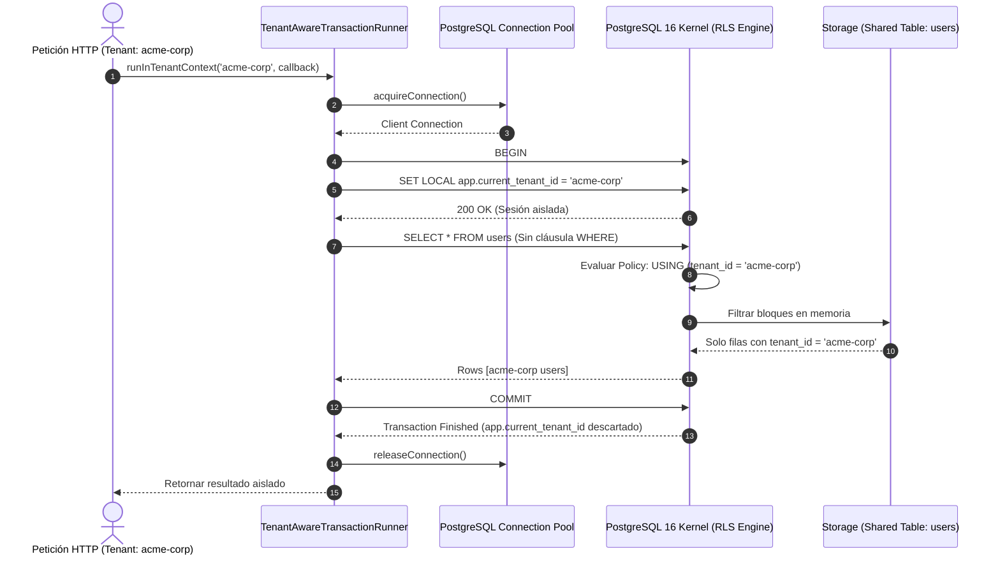
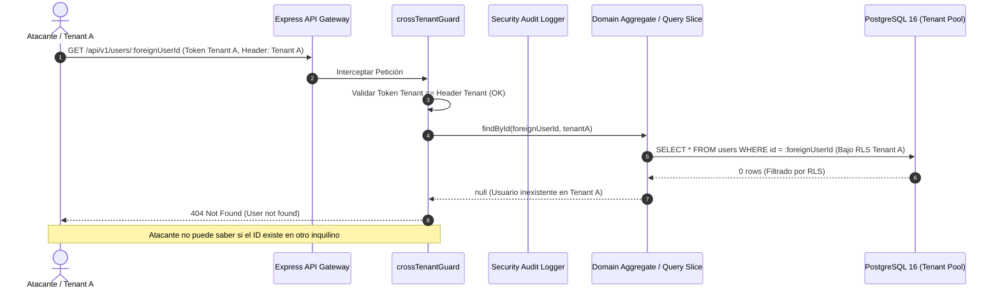
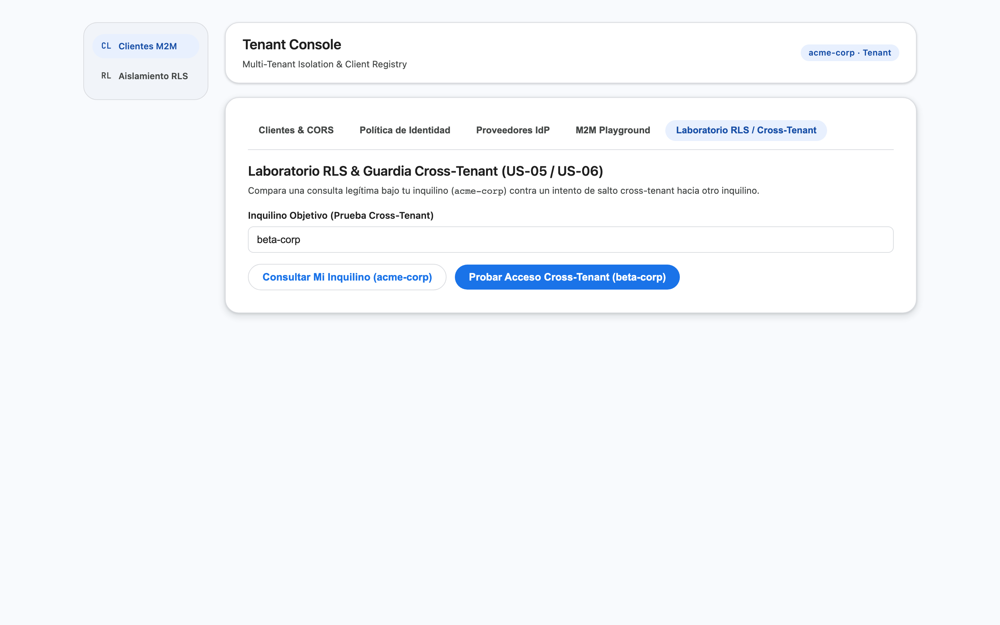

# 🛡️ Epic 03: Tenant Isolation & Zero-Trust Access

[](#)
[](#)
[-blue.svg)](#)
[](#)
[](#)

Este capítulo documenta y demuestra el núcleo del modelo de seguridad del sistema: **El Aislamiento Multi-Inquilino de Grado Bancario**. En arquitecturas SaaS empresariales con bases de datos compartidas (*Shared Database, Shared Schema*), el aislamiento de datos jamás debe depender exclusivamente de la disciplina del desarrollador al escribir cláusulas `WHERE tenant_id = ?`.

El servicio delega la barrera de contención final directamente al motor de base de datos mediante **PostgreSQL 16 Row-Level Security (RLS)** y transacciones delimitadas con `SET LOCAL app.current_tenant_id`, complementado por una guardia de borde **Zero-Trust** que intercepta cualquier discrepancia antes de invocar la capa de persistencia.

---

## 📌 Historias de Usuario

| Historia | Descripción | Estado |
| :--- | :--- | :---: |
| **US-05** | Aislamiento a Nivel de Fila con PostgreSQL 16 Row-Level Security (RLS) | ✅ En Producción |
| **US-06** | Guardia Cross-Tenant Zero-Trust y Prevención de Fugas de Contexto | ✅ En Producción |

---

## 🔒 US-05: PostgreSQL Row-Level Security (RLS) & Sesión Transaccional

### 1. Arquitectura de Aislamiento a Nivel de Kernel de Base de Datos

Conforme a la decisión de arquitectura **ADR-0005 (PostgreSQL RLS Strategy)**:

1. **Forzado Irreversible de RLS:** La tabla `users` tiene configurado `ENABLE ROW LEVEL SECURITY` y `FORCE ROW LEVEL SECURITY`. Esto obliga a que **incluso el propietario de la tabla** esté sujeto a las políticas de seguridad.
2. **Rol de Aplicación no Superusuario (`identity_app`):** El servicio backend se conecta a PostgreSQL mediante el rol restringido `identity_app`, el cual tiene revocado explícitamente el atributo `BYPASSRLS` (`NOBYPASSRLS`).
3. **Variable de Sesión Transaccional (`SET LOCAL`):** Antes de ejecutar cualquier consulta de lectura o escritura, el componente `TenantAwareTransactionRunner` abre una transacción (`BEGIN`) e inyecta la variable local de sesión:
   ```sql
   SET LOCAL app.current_tenant_id = 'acme-corp';
   ```
   Al utilizar `SET LOCAL`, la variable expira automáticamente al invocar `COMMIT` o `ROLLBACK`, evitando fugas de contexto cuando la conexión se devuelve al pool (`pg.Pool`).
4. **Política Simétrica (USING + WITH CHECK):**
   ```sql
   CREATE POLICY tenant_isolation_policy ON users
     FOR ALL
     USING (tenant_id = current_setting('app.current_tenant_id', true)::text)
     WITH CHECK (tenant_id = current_setting('app.current_tenant_id', true)::text);
   ```



#### A. Glosario de Actores y Componentes (Cajas del Diagrama)

| Participante / Caja | Tipo | Rol Arquitectónico y Frontera de Seguridad |
| :--- | :--- | :--- |
| **`Request` (Petición HTTP Tenant Context)** | `actor` | Petición entrante asociada a un inquilino específico (e.g. `acme-corp`) autenticada por el gateway. |
| **`Runner` (TenantAwareTransactionRunner)** | `participant` | Orquestador transaccional en la capa de infraestructura. Garantiza que toda operación de base de datos se ejecute dentro de una sesión delimitada con `SET LOCAL`. |
| **`Pool` (PostgreSQL Connection Pool)** | `participant` | Gestor del pool de conexiones físicas (`pg.Pool`). Reutiliza conexiones y exige la limpieza absoluta del estado de sesión al liberarlas. |
| **`PG` (PostgreSQL 16 Kernel RLS Engine)** | `participant` | Motor interno de PostgreSQL encargado de forzar las políticas declarativas de seguridad a nivel de fila (`FORCE ROW LEVEL SECURITY`). |
| **`Disk` (Storage: Shared Table `users`)** | `participant` | Almacenamiento en disco físico con esquema compartido (*Shared Database, Shared Schema*) donde coexisten datos de múltiples inquilinos. |

#### B. Desglose Secuencial del Flujo (Pasos 1 al 15)

1. **Paso 1 (`Request -> Runner`):** El caso de uso invoca `runInTenantContext('acme-corp', callback)` para iniciar la transacción delimitada.
2. **Paso 2 (`Runner -> Pool`):** Se solicita una conexión dedicada del pool de PostgreSQL.
3. **Paso 3 (`Pool -> Runner`):** El pool asigna un cliente de conexión limpio (`pg.Client`).
4. **Paso 4 (`Runner -> PG`):** Se emite la sentencia `BEGIN` para abrir formalmente una transacción.
5. **Paso 5 (`Runner -> PG`):** Se ejecuta la directiva `SET LOCAL app.current_tenant_id = 'acme-corp'`. El modificador `LOCAL` asegura que la variable solo viva durante la transacción activa.
6. **Paso 6 (`PG -> Runner`):** El motor confirma la fijación del contexto de sesión en el kernel de la base de datos.
7. **Paso 7 (`Runner -> PG`):** Se ejecuta la consulta de negocio (e.g., `SELECT * FROM users`), intencionalmente redactada sin cláusulas `WHERE tenant_id = 'acme-corp'`.
8. **Paso 8 (`PG -> PG`):** El planificador y ejecutor del motor PostgreSQL reescribe internamente la consulta aplicando la política RLS: `USING (tenant_id = current_setting('app.current_tenant_id', true)::text)`.
9. **Paso 9 (`PG -> Disk`):** El motor lee los bloques de datos desde almacenamiento.
10. **Paso 10 (`Disk -> PG`):** El motor descarta automáticamente cualquier registro cuyo `tenant_id` no sea `'acme-corp'`.
11. **Paso 11 (`PG -> Runner`):** Se devuelven exclusivamente las filas que superaron la política de seguridad a nivel de kernel.
12. **Paso 12 (`Runner -> PG`):** Se emite `COMMIT` para cerrar la transacción.
13. **Paso 13 (`PG -> Runner`):** Al finalizar la transacción, PostgreSQL descarta automáticamente el valor de `app.current_tenant_id`, evitando fuga de contexto en conexiones reutilizadas.
14. **Paso 14 (`Runner -> Pool`):** Se devuelve la conexión limpia al pool común.
15. **Paso 15 (`Runner -> Request`):** Se entrega el resultado aislado al flujo de la aplicación.

---

### 2. Evidencia Forense en Vivo: Terminal SQL & CLI de PostgreSQL 16

Ejecuta este bloque una sola vez para inicializar las variables de sesión interactivas utilizadas en las demostraciones de **US-05** y **US-06**:

```bash
# ==============================================================================
# Variables de Sesión Interactiva para Aislamiento RLS & Cross-Tenant Guard
# ==============================================================================
export BASE_URL="http://localhost:4000"
export TENANT_A="acme-corp"
export TENANT_B="beta-corp"
export USER_PASS='EnterprisePassword2026!'
```

Las siguientes evidencias se ejecutan mediante la CLI oficial `./bin/identity tenant` conectándose directamente con el rol restringido **`identity_app`** (`NOSUPERUSER NOBYPASSRLS`) sobre PostgreSQL 16:

#### Demostración 1: Filtrado Transaccional por Inquilino

Al consultar usuarios declarando `--tenant "${TENANT_A}"`, la CLI abre una transacción y fija `app.current_tenant_id` mediante consulta parametrizada; el kernel PostgreSQL devuelve exclusivamente los usuarios de `${TENANT_A}`:

**Comando CLI Oficial (`./bin/identity`):**

```bash
./bin/identity tenant list-users \
  --tenant "${TENANT_A}" \
  --limit 3
```

<details>
<summary><b>Ver Receta Equivalente con psql (Docker)</b></summary>

```bash
docker compose exec -T db psql -U identity_app -d identity_db -c "
BEGIN;
SET LOCAL app.current_tenant_id = '${TENANT_A}';
SELECT id, email, tenant_id FROM users LIMIT 3;
COMMIT;
"
```

</details>

##### Salida Real Obtenida (PostgreSQL RLS):
```text
PostgreSQL RLS Query [role: identity_app | 13ms]
Session Context: app.current_tenant_id = 'acme-corp'

 id                                   | email                                   | tenant_id
--------------------------------------+-----------------------------------------+-----------
 e351637a-65da-42aa-970d-1b68769624ac | lead.architect.1795118663@acme-corp.com | acme-corp
(1 row)
```

---

#### Demostración 2: Principio Fail-Closed (Seguridad por Defecto)

Si se ejecuta la misma acción `list-users` **omitiendo la bandera `--tenant`** (sin inicializar la variable de sesión `app.current_tenant_id`):

**Comando CLI Oficial (`./bin/identity`):**

```bash
./bin/identity tenant list-users
```

<details>
<summary><b>Ver Receta Equivalente con psql (Docker)</b></summary>

```bash
docker compose exec -T db psql -U identity_app -d identity_db -c "
SELECT id, email, tenant_id FROM users;
"
```

</details>

##### Salida Real Obtenida (Cero Filas Retornadas):
```text
PostgreSQL RLS Query [role: identity_app | 6ms]
Session Context: <unset> (Fail-Closed RLS)

 id | email | tenant_id
----+-------+-----------
(0 rows)
```

> [!IMPORTANT]
> **Garantía Fail-Closed:** Si `current_setting('app.current_tenant_id', true)` es `NULL` o vacío, la condición `USING` evalúa a falso para todas las filas. Es **imposible** leer registros sin una sesión multi-tenant explícitamente inicializada.

---

#### Demostración 3: Protección de Integridad `WITH CHECK` (Anti-Inyección Cross-Tenant)

Si dentro de una sesión legítima del inquilino `${TENANT_A}` se intenta insertar un registro asignado a `${TENANT_B}`:

**Comando CLI Oficial (`./bin/identity`):**

```bash
./bin/identity tenant insert-user \
  --session-tenant "${TENANT_A}" \
  --tenant "${TENANT_B}" \
  --email "hacker@beta-corp.com"
```

<details>
<summary><b>Ver Receta Equivalente con psql (Docker)</b></summary>

```bash
docker compose exec -T db psql -U identity_app -d identity_db -c "
BEGIN;
SET LOCAL app.current_tenant_id = '${TENANT_A}';
INSERT INTO users (id, tenant_id, email, password_hash, created_at, updated_at)
VALUES ('hacked-uuid', '${TENANT_B}', 'hacker@beta-corp.com', 'dummy_hash', NOW(), NOW());
COMMIT;
"
```

</details>

##### Rechazo Categórico a Nivel de Kernel:
```text
✖ PostgreSQL Kernel Rejection [42501] [role: identity_app | 7ms]
Session Context: app.current_tenant_id = 'acme-corp'
Target Row Tenant: 'beta-corp'
ERROR: new row violates row-level security policy for table "users"
```

PostgreSQL rechaza la transacción con código de error **42501 (insufficient_privilege)**, abortando el bloque mediante `ROLLBACK` y protegiendo la base de datos contra contaminación de datos.

---

#### 🌐 Demostración Interactiva en la UI (Navegador — `US-05`)

1. **Prerrequisitos:** Backend (`npm run dev:api` en `:4000`) y Vite (`npm run dev:web` en `:3000`) activos, con una sesión comercial (`acme-corp`) guardada en `localStorage` (`identity_session`).
2. **Flujo Positivo (Aislamiento RLS en Mismo Inquilino):**
   - Abre [`http://localhost:3000/tenant`](http://localhost:3000/tenant) y selecciona la pestaña **`Laboratorio RLS / Cross-Tenant`**.
   - Pulsa **`Consultar Mi Inquilino (acme-corp)`** → invoca `GET /api/v1/users/<userId>` con `X-Tenant-ID: acme-corp`, devolviendo `200 OK` y mostrando `M3AlertBanner` **`200 OK — Aislamiento RLS Verificado`**.
3. **Verificación Técnica (`Network` & `traceparent`):** Inspecciona **Evidencia de Aislamiento RLS / Zero-Trust** (`M3JsonViewer`) confirmando `requestedTenant: "acme-corp"` y la cabecera W3C `traceparent` / `X-Request-ID` en DevTools.
4. **Trazabilidad E2E:** `tests/e2e/web/tenant_console.spec.tsx` (Scenario 4) y `tests/e2e/security/tenant_rls_isolation.spec.ts`.

---

### 3. Cobertura de Pruebas Automatizadas

El motor de políticas RLS y el runner de transacciones están certificados por suites de pruebas de integración dedicadas:

```bash
npx jest tests/integration/security/test_rls_policies.ts tests/integration/security/test_tenant_aware_transaction_runner.ts
```

- **Aislamiento SELECT:** Valida que las consultas retornan solo registros que coinciden con el inquilino activo.
- **Fail-Closed:** Confirma que consultas fuera de contexto devuelven 0 filas.
- **Validación INSERT (WITH CHECK):** Verifica que inserciones cruzadas arrojan excepción 42501.
- **Aislamiento UPDATE & DELETE:** Asegura que mutaciones solo afecten registros del inquilino activo.
- **Ciclo de Vida de Conexión:** Valida `acquire -> begin -> set local -> execute -> commit -> release` con rollback automático ante excepciones.

---

## 🛡️ US-06: Guardia Cross-Tenant Zero-Trust & Prevención de Fugas

### 1. Arquitectura de Defensa en Profundidad (Defense in Depth)

Mientras que PostgreSQL RLS (US-05) constituye la última línea de defensa en la capa de persistencia, la **US-06** implementa una barrera perimetral proactiva en el middleware Express (`crossTenantGuard`) y en los Value Objects del dominio:

1. **Defensa Anti-Enumeración de Usuarios:** Si un usuario de `acme-corp` intenta consultar o mutar un recurso cuyo `userId` pertenece a `beta-corp`, la API responde con **`HTTP 404 Not Found`** en lugar de `403 Forbidden`. Esto impide que atacantes determinen la existencia de cuentas ajenas mediante escaneo de IDs.
2. **Consistencia Criptográfica Token-to-Header:** Se exige coincidencia bit a bit entre el claim inmutable `tenantId` embebido en el JWT y la cabecera `X-Tenant-ID`. Si difieren, la petición se bloquea con **`HTTP 403 Forbidden`**.
3. **Inmunidad a SQL Injection en Parámetros de Tenant:** La cabecera `X-Tenant-ID` es validada por el Value Object inmutable `TenantId` (expresión regular estricta `^[a-z0-9-_]+$`). Payloads que contengan comillas, caracteres de escape o sentencias SQL son rechazados de inmediato con **`HTTP 400 Bad Request`** antes de llegar al pool de base de datos.
4. **Registro de Auditoría Forense Inmutable:** Cada intento de acceso trans-inquilino emite un evento estructurado NDJSON clasificado como `CROSS_TENANT_VIOLATION` con severidad `ALERT` para análisis en SIEM / SOC.



#### A. Glosario de Actores y Componentes (Cajas del Diagrama)

| Participante / Caja | Tipo | Rol Arquitectónico y Frontera de Seguridad |
| :--- | :--- | :--- |
| **`Attacker` (Atacante / Tenant A)** | `actor` | Usuario legítimo de un inquilino (Tenant A) que intenta adivinar o acceder a identificadores de recursos pertenecientes a un inquilino ajeno (Tenant B). |
| **`Gateway` (Express API Gateway)** | `participant` | Entrada HTTP perimetral que recibe la solicitud con credenciales y cabeceras contextuales. |
| **`Guard` (crossTenantGuard)** | `participant` | Middleware perimetral de inspección profunda. Comprueba la coincidencia estricta entre el claim `tenantId` del JWT y la cabecera `X-Tenant-ID`, rechazando discrepancias antes de tocar la base de datos. |
| **`Audit` (Security Audit Logger)** | `participant` | Logger estructurado que emite eventos NDJSON clasificados como `CROSS_TENANT_VIOLATION` con severidad `ALERT` para SIEM / SOC. |
| **`Domain` (Domain Aggregate / Query Slice)** | `participant` | Capa de dominio y casos de uso. Ejecuta las consultas delimitando estrictamente el contexto del inquilino autenticado. |
| **`DB` (PostgreSQL 16 Tenant Pool)** | `participant` | Base de datos con Row-Level Security activo bajo el inquilino autenticado (Tenant A), haciendo invisible cualquier dato ajeno. |

#### B. Desglose Secuencial del Flujo (Pasos 1 al 8)

1. **Paso 1 (`Attacker -> Gateway`):** El usuario de Tenant A realiza una consulta (`GET /api/v1/users/:foreignUserId`) enviando su token válido de Tenant A y la cabecera `X-Tenant-ID: tenant-a`.
2. **Paso 2 (`Gateway -> Guard`):** El Gateway transfiere la petición a la guardia perimetral `crossTenantGuard`.
3. **Paso 3 (`Guard -> Guard`):** La guardia verifica la coherencia entre el token y la cabecera (ambos pertenecen a Tenant A, por lo que la petición perimetral es admitida).
4. **Paso 4 (`Guard -> Domain`):** Se invoca el caso de uso `findById(foreignUserId, tenantA)` vinculando explícitamente la consulta al contexto de Tenant A.
5. **Paso 5 (`Domain -> DB`):** Se lanza la consulta a PostgreSQL bajo la sesión aislada de Tenant A (`SET LOCAL app.current_tenant_id = 'tenant-a'`).
6. **Paso 6 (`DB -> Domain`):** El motor RLS filtra a nivel de kernel las filas del Tenant B. La base de datos responde con `0 rows`, exactamente igual que si el ID no existiera en ningún sitio.
7. **Paso 7 (`Domain -> Guard`):** La capa de dominio concluye que el recurso es inexistente (`null`) para ese contexto de inquilino.
8. **Paso 8 (`Guard -> Attacker`):** Se responde con **`HTTP 404 Not Found`** (`{"error":"User not found"}`) en lugar de `403 Forbidden`. De este modo, el atacante no puede discernir si el ID consultado pertenece a otra empresa o si es un UUID ficticio, neutralizando vectores de ataque por fuerza bruta o escaneo de usuarios.

---

### 2. Ejecución en Vivo & Verificación Interactiva Paso a Paso

Puedes reproducir los tres vectores de ataque directamente contra el entorno en vivo utilizando la CLI oficial o `cURL`:

#### Paso 0: Registro Dinámico Multi-Tenant (`${TOKEN_ACME}` & `${USER_BETA_ID}`)

> [!TIP]
> Si ya ejecutaste el bloque inicial de variables de **US-05** en esta misma terminal, `${BASE_URL}`, `${TENANT_A}`, `${TENANT_B}` y `${USER_PASS}` ya están cargadas. Si abres una nueva ventana, vuelve a exportarlas antes de continuar.

Para comprobar que el aislamiento RLS no depende de UUIDs ficticios sino de entidades reales en la base de datos, registramos un usuario en `${TENANT_A}` y otro usuario legítimo en `${TENANT_B}`:

**1. Registrar Usuario en Tenant A (`${TENANT_A}`) y extraer `${TOKEN_ACME}` y `${USER_ACME_ID}`:**

```bash
export USER_A_EMAIL="security.tester.$(date +%s)@acme-corp.com"

USER_A_RESP=$(./bin/identity auth register \
  --tenant "${TENANT_A}" \
  --email "${USER_A_EMAIL}" \
  --password "${USER_PASS}" \
  --raw-json)

export TOKEN_ACME=$(echo "${USER_A_RESP}" | jq -r .accessToken)
export USER_ACME_ID=$(echo "${USER_A_RESP}" | jq -r .userId)

echo "TOKEN_ACME=${TOKEN_ACME}"
echo "USER_ACME_ID=${USER_ACME_ID}"
```

**2. Registrar Usuario Legítimo en Tenant B (`${TENANT_B}`) y extraer `${USER_BETA_ID}`:**

```bash
export USER_B_EMAIL="victim.user.$(date +%s)@beta-corp.com"

USER_B_RESP=$(./bin/identity auth register \
  --tenant "${TENANT_B}" \
  --email "${USER_B_EMAIL}" \
  --password "${USER_PASS}" \
  --raw-json)

export TOKEN_BETA=$(echo "${USER_B_RESP}" | jq -r .accessToken)
export USER_BETA_ID=$(echo "${USER_B_RESP}" | jq -r .userId)

echo "USER_BETA_ID=${USER_BETA_ID} (Usuario real persistido en Tenant B)"
```

<details>
<summary><b>Ver Receta Equivalente con cURL</b></summary>

```bash
# 1. Tenant A
export USER_A_EMAIL="security.tester.$(date +%s)@acme-corp.com"

USER_A_RESP=$(curl -s -X POST "${BASE_URL}/api/v1/auth/register" \
  -H "Content-Type: application/json" \
  -H "X-Tenant-ID: ${TENANT_A}" \
  -d "{
    \"email\": \"${USER_A_EMAIL}\",
    \"password\": \"${USER_PASS}\"
  }")

export TOKEN_ACME=$(echo "${USER_A_RESP}" | jq -r .accessToken)
export USER_ACME_ID=$(echo "${USER_A_RESP}" | jq -r .userId)

# 2. Tenant B
export USER_B_EMAIL="victim.user.$(date +%s)@beta-corp.com"

USER_B_RESP=$(curl -s -X POST "${BASE_URL}/api/v1/auth/register" \
  -H "Content-Type: application/json" \
  -H "X-Tenant-ID: ${TENANT_B}" \
  -d "{
    \"email\": \"${USER_B_EMAIL}\",
    \"password\": \"${USER_PASS}\"
  }")

export TOKEN_BETA=$(echo "${USER_B_RESP}" | jq -r .accessToken)
export USER_BETA_ID=$(echo "${USER_B_RESP}" | jq -r .userId)

echo "TOKEN_ACME=${TOKEN_ACME}"
echo "USER_BETA_ID=${USER_BETA_ID}"
```

</details>

##### Inspección del Payload Criptográfico del JWT:
Al inspeccionar el JWT emitido, se observa cómo el claim `tenantId` queda fijado criptográficamente en el payload mediante la firma del servidor:

```json
{
  "userId": "3e80505f-0375-422d-bd58-4ddc3ea54f49",
  "email": "security.tester.1794938792@acme-corp.com",
  "tenantId": "acme-corp",
  "iat": 1794938793,
  "exp": 1794942393
}
```

> [!TIP]
> Si abres una nueva ventana o pestaña de terminal para probar los vectores siguientes, asegúrate de ejecutar primero el bloque del **Paso 0** para inicializar las variables `$TOKEN_ACME` y `$USER_BETA_ID`.

---

#### Vector 1: Prevención de Enumeración de Usuarios (HTTP 404 Not Found)

Un usuario legítimo del inquilino `${TENANT_A}` intenta actualizar el perfil del usuario `${USER_BETA_ID}` (que existe en PostgreSQL bajo `${TENANT_B}`):

**Comando CLI Oficial (`./bin/identity`):**

```bash
./bin/identity auth update-user \
  --tenant "${TENANT_A}" \
  --token "${TOKEN_ACME}" \
  --user-id "${USER_BETA_ID}" \
  --name "Intento de Mutacion Ajena"
```

<details>
<summary><b>Ver Receta Equivalente con cURL</b></summary>

```bash
curl -i -X PATCH "${BASE_URL}/api/v1/users/${USER_BETA_ID}" \
  -H "Authorization: Bearer ${TOKEN_ACME}" \
  -H "X-Tenant-ID: ${TENANT_A}" \
  -H "Content-Type: application/json" \
  -d '{"name": "Intento de Mutacion Ajena"}'
```

</details>

##### Respuesta Real Obtenida (HTTP 404 Not Found):
```text
HTTP/1.1 404 Not Found [166ms]
PATCH http://localhost:4000/api/v1/users/4476ffac-2423-444b-8342-efbfe4dbaeba

{
  "error": "User not found"
}
```

---

#### Vector 2: Intento de Suplantación de Inquilino / Token Divergence (HTTP 403 Forbidden)

Un usuario autenticado de `${TENANT_A}` presenta su token pero declara en la cabecera `X-Tenant-ID: ${TENANT_B}`:

**Comando CLI Oficial (`./bin/identity`):**

```bash
./bin/identity auth me \
  --tenant "${TENANT_B}" \
  --token "${TOKEN_ACME}"
```

<details>
<summary><b>Ver Receta Equivalente con cURL</b></summary>

```bash
curl -i -X GET "${BASE_URL}/api/v1/auth/me" \
  -H "Authorization: Bearer ${TOKEN_ACME}" \
  -H "X-Tenant-ID: ${TENANT_B}"
```

</details>

##### Respuesta de Seguridad Obtenida (HTTP 403 Forbidden):
```text
HTTP/1.1 403 Forbidden [37ms]
GET http://localhost:4000/api/v1/auth/me

{
  "error": "Forbidden: Token does not belong to the requested tenant context"
}
```

---

#### Vector 3: Inyección SQL en Cabecera de Inquilino (HTTP 400 Bad Request)

Un atacante intenta inyectar sentencias SQL para eludir el aislamiento en `X-Tenant-ID`:

**Comando CLI Oficial (`./bin/identity`):**

```bash
export SQLI_PAYLOAD="alpha-corp'; DROP TABLE users; --"

./bin/identity auth me \
  --tenant "${SQLI_PAYLOAD}" \
  --token "${TOKEN_ACME}"
```

<details>
<summary><b>Ver Receta Equivalente con cURL</b></summary>

```bash
export SQLI_PAYLOAD="alpha-corp'; DROP TABLE users; --"

curl -i -X GET "${BASE_URL}/api/v1/auth/me" \
  -H "Authorization: Bearer ${TOKEN_ACME}" \
  -H "X-Tenant-ID: ${SQLI_PAYLOAD}"
```

</details>

##### Respuesta de Validación Obtenida (HTTP 400 Bad Request):
```text
HTTP/1.1 400 Bad Request [36ms]
GET http://localhost:4000/api/v1/auth/me

{
  "error": "Invalid tenantId format in x-tenant-id header"
}
```

---

### 3. Registro Forense de Auditoría Emitido (PCI-DSS & SOC 2)

Ante la detección de una anomalía o discrepancia cross-tenant, el sistema emite el siguiente log NDJSON estructurado:

```json
{
  "timestamp": "2026-11-17T17:31:07.926Z",
  "logType": "SECURITY_AUDIT",
  "eventType": "CROSS_TENANT_VIOLATION",
  "severity": "ALERT",
  "tenantId": "acme-corp",
  "actor": {
    "userId": "6e26511e-3a74-4b6b-9212-c1789efc53a3",
    "type": "USER",
    "ip": "127.0.0.1"
  },
  "trace": {
    "requestId": "878fb245-d0f0-41d0-97e0-d7768937c1e1",
    "correlationId": "878fb245-d0f0-41d0-97e0-d7768937c1e1",
    "traceId": "d194a4f6a10d26e9a36f7784ed318543",
    "spanId": "2eac577ec93cadd9",
    "traceparent": "00-d194a4f6a10d26e9a36f7784ed318543-2eac577ec93cadd9-01"
  },
  "compliance": {
    "pciRequirement": "10.2.5",
    "soc2Criteria": "CC7.2",
    "retentionCategory": "AUDIT_IMMUTABLE"
  },
  "action": "cross_tenant_access_denied",
  "status": "DENIED",
  "details": {
    "reason": "CROSS_TENANT_VIOLATION",
    "activeTenantId": "acme-corp",
    "attemptedTenantId": "beta-corp",
    "path": "/api/v1/auth/me",
    "method": "GET"
  }
}
```

---

### 4. Teardown y Limpieza de Recursos Multi-Tenant

Para no dejar usuarios de prueba huérfanos en las particiones de PostgreSQL ni en la memoria caché Redis, procedemos al borrado físico de los usuarios creados en ambos inquilinos utilizando sus respectivos tokens de contexto:

**1. Borrar Usuario de Inquilino A (`${TENANT_A}`):**

```bash
./bin/identity auth delete-user \
  --tenant "${TENANT_A}" \
  --token "${TOKEN_ACME}" \
  --user-id "${USER_ACME_ID}"
```

**2. Borrar Usuario de Inquilino B (`${TENANT_B}`):**

```bash
./bin/identity auth delete-user \
  --tenant "${TENANT_B}" \
  --token "${TOKEN_BETA}" \
  --user-id "${USER_BETA_ID}"
```

<details>
<summary><b>Ver Recetas Equivalentes con cURL</b></summary>

```bash
# Borrar Usuario en Tenant A
curl -i -X DELETE "${BASE_URL}/api/v1/users/${USER_ACME_ID}" \
  -H "Authorization: Bearer ${TOKEN_ACME}" \
  -H "X-Tenant-ID: ${TENANT_A}"

# Borrar Usuario en Tenant B
curl -i -X DELETE "${BASE_URL}/api/v1/users/${USER_BETA_ID}" \
  -H "Authorization: Bearer ${TOKEN_BETA}" \
  -H "X-Tenant-ID: ${TENANT_B}"
```

</details>

Ambas operaciones retornan `HTTP/1.1 204 No Content`, garantizando que la base de datos PostgreSQL y la caché Redis quedan libres de residuos sin afectar el aislamiento de ningún otro inquilino.

---

#### 🌐 Demostración Interactiva en la UI (Navegador — `US-06`)

1. **Prerrequisitos:** En [`http://localhost:3000/tenant`](http://localhost:3000/tenant) → pestaña **`Laboratorio RLS / Cross-Tenant`**, con sesión activa de `acme-corp`.
2. **Flujo Negativo / Defensa Zero-Trust (Salto Cross-Tenant `403 Forbidden`):**
   - En el campo **Inquilino Objetivo (Prueba Cross-Tenant)**, mantén `beta-corp` (o ingresa cualquier otro inquilino distinto a `acme-corp`).
   - Pulsa **`Probar Acceso Cross-Tenant (beta-corp)`** → el middleware detecta la divergencia entre el claim `tenantId` del JWT (`acme-corp`) y la cabecera `X-Tenant-ID: beta-corp`, abortando con `403 Forbidden` y registrando `CROSS_TENANT_VIOLATION`.
   - En pantalla se despliega `M3AlertBanner` **`403 Forbidden — Bloqueo Zero-Trust Activado`** y el payload de rechazo en **Evidencia de Aislamiento RLS / Zero-Trust** (`M3JsonViewer`).
3. **Trazabilidad E2E:** `tests/e2e/web/tenant_console.spec.tsx` (Scenario 4).



---

### 5. Cobertura de Pruebas Automatizadas

La suite de penetración y pruebas de estrés valida los 5 vectores de ataque:

```bash
npx jest tests/integration/security/test_cross_tenant_penetration.ts
```

- **Vector 1 (User Enumeration):** Verifica que consultas a usuarios ajenos retornan `404 Not Found`.
- **Vector 2 (Mutation Blocking):** Bloquea actualizaciones cruzadas con `403 Forbidden` y log de alerta.
- **Vector 3 (Header Spoofing):** Detecta divergencia entre JWT claims y `X-Tenant-ID`.
- **Vector 4 (SQL Injection):** Rechaza payloads maliciosos (`UNION SELECT`, subconsultas, `DROP TABLE`, `../path`).
- **Vector 5 (Domain Assertions):** Valida que el agregado de dominio arroja `CrossTenantContextViolationError`.

---

[⬅️ Volver al Hub Principal de Showcase](./README.md)
