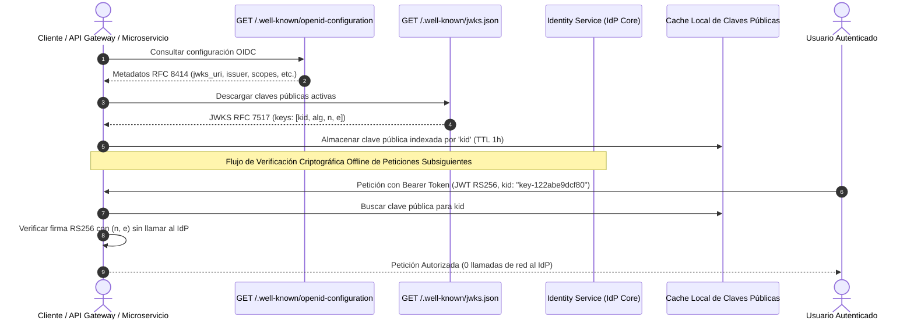
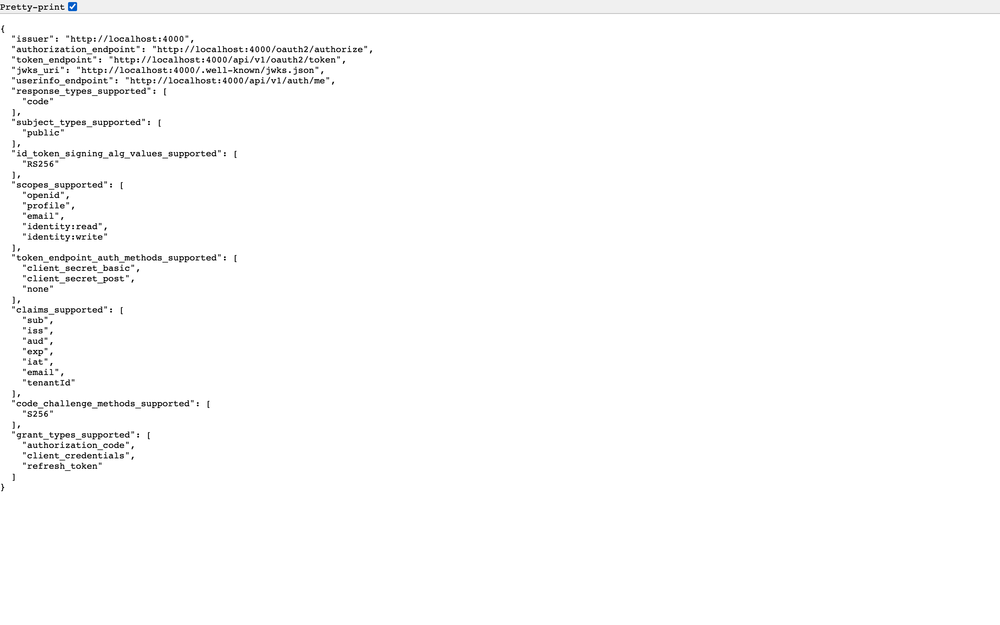
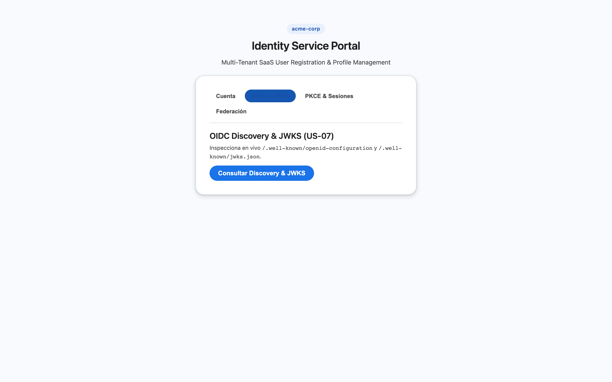
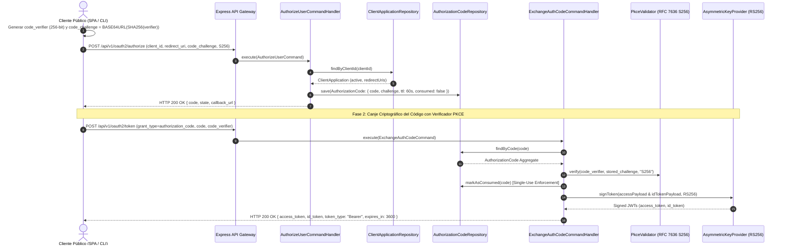
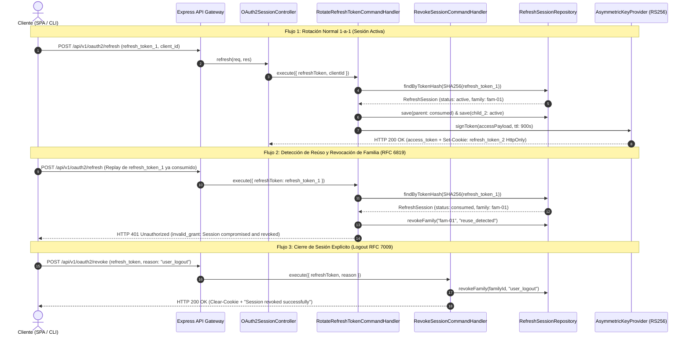
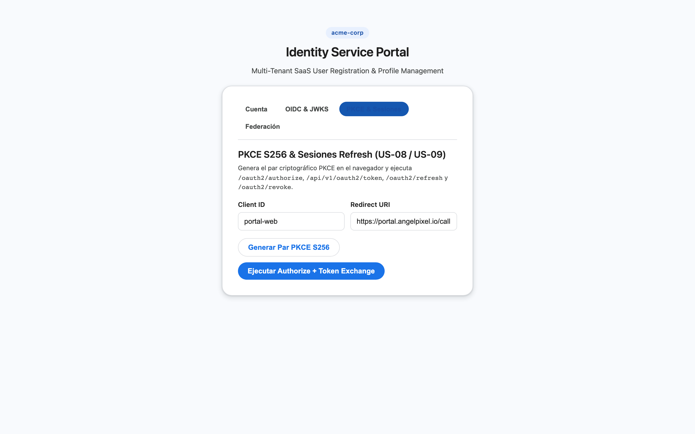

# Capítulo 04: Servidor OIDC & Gestión de Sesiones Distribuidas

[](#)
[](#)
[](#)
[](#)
[](#)

Este capítulo documenta la implementación de `identity-service` como un **Proveedor de Identidad OpenID Connect (IdP / OIDC Authorization Server)** conforme a los estándares de la industria. Provee interoperabilidad completa sin acoplamiento técnico, delegando la emisión y verificación de identidades en primitivas criptográficas asimétricas y flujos de autorización modernos.

---

## 🧭 Historias de Usuario del Épico 04

| Historia | Descripción | Estado |
| :--- | :--- | :---: |
| **US-07** | Servidor OIDC, Gestión Criptográfica de Claves y Endpoints de Descubrimiento JWKS | ✅ En Producción |
| **US-08** | Flujo de Autorización OAuth2 con PKCE y Consentimiento de Usuario | ✅ En Producción |
| **US-09** | Rotación Deslizante de Refresh Tokens con Cookies Seguras HttpOnly | ✅ En Producción |

---

## 🔐 US-07: Servidor OIDC, Gestión Criptográfica de Claves y Endpoints JWKS

### 1. Arquitectura Criptográfica & Handshake de Descubrimiento

En arquitecturas distribuidas basadas en microservicios y API Gateways, la verificación de autenticidad de un token JWT jamás debe requerir que cada servicio consulte a la base de datos del IdP ni que comparta secretos simétricos pre-compartidos (*shared secrets* HMAC).

`identity-service` resuelve este desafío implementando el estándar **OpenID Connect Discovery (RFC 8414)** junto con **JSON Web Key Sets (RFC 7517)**:

1. **Firma Asimétrica RS256:** El Identity Provider genera y custodia de forma aislada un par de claves RSA de **2048 bits**. Los tokens (Access Tokens e ID Tokens) son firmados exclusivamente con la clave privada.
2. **Descubrimiento Autónomo (`/.well-known/openid-configuration`):** Cualquier cliente o microservicio obtiene la configuración del IdP (URLs de autorización, token, JWKS, algoritmos soportados y scopes).
3. **Catálogo de Claves Públicas (`/.well-known/jwks.json`):** Expone las claves públicas en formato JWK estándar (`kty: "RSA"`, `alg: "RS256"`, `use: "sig"`, `n`, `e`, `kid`).
4. **Verificación sin Estado (Stateless Non-Repudiation):** Los servicios consumidores descargan la clave pública y verifican localmente la firma criptográfica en microsegundos, sin llamadas de red recurrentes al IdP gracias al cacheo HTTP (`Cache-Control: public, max-age=3600`).



#### A. Glosario de Actores y Componentes (Cajas del Diagrama)

| Participante / Caja | Tipo | Rol Arquitectónico y Frontera de Seguridad |
| :--- | :--- | :--- |
| **`Client` (Cliente / API Gateway / Microservicio)** | `actor` | Consumidor downstream de identidades (por ejemplo, Kong, Envoy o un microservicio interno). Requiere validar tokens sin acoplarse a la base de datos del IdP. |
| **`Discovery` (`GET /.well-known/openid-configuration`)** | `participant` | Endpoint público RFC 8414 expuesto por `identity-service`. Provee metadatos de configuración autodescriptivos para autoconfiguración de clientes OIDC. |
| **`JWKS` (`GET /.well-known/jwks.json`)** | `participant` | Endpoint público RFC 7517 que expone el conjunto de claves públicas activas en formato JSON Web Key Set (JWKS), excluyendo parámetros privados. |
| **`IdP` (Identity Service IdP Core)** | `participant` | Núcleo de identidad responsable de generar pares de claves RSA 2048-bit, custodiar la clave privada (`[REDACTED]`) y firmar los tokens en RS256. |
| **`LocalMemory` (Cache Local de Claves)** | `participant` | Almacenamiento en memoria volátil en el cliente o API Gateway con TTL configurable (1 hora) que evita la sobrecarga de consultas de red al IdP. |
| **`User` (Usuario Autenticado)** | `actor` | Usuario o sistema que presenta un JWT firmado para acceder a recursos protegidos en el ecosistema. |

#### B. Desglose Secuencial del Flujo (Pasos 1 al 9)

1. **Paso 1 (`Client -> Discovery`):** El cliente o API Gateway consulta `GET /.well-known/openid-configuration` para inicializar el cliente OIDC de forma dinámica.
2. **Paso 2 (`Discovery -> Client`):** El IdP responde con los metadatos RFC 8414, informando el emisor (`issuer`), endpoints de autorización y token, y la URL canónica del catálogo de claves (`jwks_uri`).
3. **Paso 3 (`Client -> JWKS`):** El cliente realiza una petición HTTP `GET` a la dirección `jwks_uri` descubierta (`/.well-known/jwks.json`).
4. **Paso 4 (`JWKS -> Client`):** El IdP devuelve el documento RFC 7517 que contiene el array `keys` con la clave pública RS256 activa (`kty: "RSA"`, `use: "sig"`, `alg: "RS256"`, `kid`, `n`, `e`).
5. **Paso 5 (`Client -> LocalMemory`):** El cliente almacena la clave pública en su caché en memoria local, indexada por su identificador único `kid`, configurando un tiempo de expiración acorde a las cabeceras `Cache-Control` (3600 segundos).
6. **Paso 6 (`User -> Client`):** Un usuario autenticado envía una petición HTTP hacia el cliente o API Gateway incluyendo el encabezado `Authorization: Bearer <JWT>`. La cabecera JOSE del token indica `alg: "RS256"` y el `kid` correspondiente.
7. **Paso 7 (`Client -> LocalMemory`):** El API Gateway extrae el `kid` del token recibido y consulta su caché en memoria local para recuperar los parámetros de la clave pública (`n`, `e`).
8. **Paso 8 (`Client -> Client`):** El cliente calcula y verifica matemáticamente la firma digital RS256 en tiempo constante, validando la integridad del payload y la vigencia del token (`exp`, `nbf`, `iss`, `aud`) de forma completamente autónoma.
9. **Paso 9 (`Client -> User`):** Confirmada la validez criptográfica sin haber realizado ninguna llamada de red al IdP ni al pool de base de datos (*stateless non-repudiation*), se autoriza el procesamiento de la solicitud.

---

### 2. Evidencia Visual del Portal de Descubrimiento

La siguiente captura en alta resolución certifica la respuesta estructurada de metadatos OIDC conforme a RFC 8414:



---

### 3. Ejecución en Vivo & Verificación Interactiva Paso a Paso

Puedes interactuar directamente con los endpoints criptográficos expuestos en el entorno en vivo utilizando la CLI oficial o `cURL`:

#### Receta 1: Inspeccionar el Documento de Descubrimiento OIDC (`GET /.well-known/openid-configuration`)

**Comando CLI Oficial (`./bin/identity`):**

```bash
./bin/identity oidc discovery
```

Para automatización en tuberías UNIX (extrayendo por ejemplo la URI del catálogo JWKS):

```bash
./bin/identity oidc discovery --raw-json | jq -r .jwks_uri
```

<details>
<summary><b>Ver Receta Equivalente con cURL</b></summary>

```bash
curl -i http://localhost:4000/.well-known/openid-configuration
```
</details>

##### Respuesta Real Obtenida (HTTP 200 OK):
```http
HTTP/1.1 200 OK
Access-Control-Allow-Origin: *
Content-Type: application/json; charset=utf-8
Cache-Control: public, max-age=3600, stale-while-revalidate=86400
X-Content-Type-Options: nosniff
ETag: W/"303-HMCoOKBsEKMrW+LaZUUf1j2cqjY"

{
  "issuer": "http://localhost:4000",
  "authorization_endpoint": "http://localhost:4000/oauth2/authorize",
  "token_endpoint": "http://localhost:4000/api/v1/oauth2/token",
  "jwks_uri": "http://localhost:4000/.well-known/jwks.json",
  "userinfo_endpoint": "http://localhost:4000/api/v1/auth/me",
  "response_types_supported": [
    "code"
  ],
  "subject_types_supported": [
    "public"
  ],
  "id_token_signing_alg_values_supported": [
    "RS256"
  ],
  "scopes_supported": [
    "openid",
    "profile",
    "email",
    "identity:read",
    "identity:write"
  ],
  "token_endpoint_auth_methods_supported": [
    "client_secret_basic",
    "client_secret_post",
    "none"
  ],
  "claims_supported": [
    "sub",
    "iss",
    "aud",
    "exp",
    "iat",
    "email",
    "tenantId"
  ],
  "code_challenge_methods_supported": [
    "S256"
  ],
  "grant_types_supported": [
    "authorization_code",
    "client_credentials",
    "refresh_token"
  ]
}
```

> [!NOTE]
> Observa las cabeceras `Access-Control-Allow-Origin: *` (para permitir a SPAs configurar su cliente OIDC en el navegador) y `Cache-Control: public, max-age=3600` para reducir al mínimo el tráfico hacia el IdP.

---

#### Receta 2: Inspeccionar el Conjunto de Claves Públicas (`GET /.well-known/jwks.json`)

**Comando CLI Oficial (`./bin/identity`):**

```bash
./bin/identity oidc jwks
```

<details>
<summary><b>Ver Receta Equivalente con cURL</b></summary>

```bash
curl -i http://localhost:4000/.well-known/jwks.json
```
</details>

##### Respuesta Real Obtenida (HTTP 200 OK):
```http
HTTP/1.1 200 OK
Access-Control-Allow-Origin: *
Content-Type: application/json; charset=utf-8
Cache-Control: public, max-age=3600, stale-while-revalidate=86400
X-Content-Type-Options: nosniff

{
  "keys": [
    {
      "kty": "RSA",
      "use": "sig",
      "alg": "RS256",
      "kid": "key-122abe9dcf80",
      "n": "vjC64i0pcDvjLxDkvskZm96l_oGQUqLiYE49j-KvTiA0rT1x6CacSVerYEaMyTF3Zg3L308xMbng9Mnrq0m3qDzREemtoCrNkrRisZ-7MNCpqZJ279FVQhA-I1vA6INi8npbjH-kuBxTDRDLXFutQinyBuDfc1KrNmBQWSl_UJasjgMRVIN9oQh5umJh8fVkwAaBdhlb-5n1x9e1Z7SECYLbf-zZ5n332O5p7ZdfQhmupXkqmZ2QXp8VOaTd-nswceOvHaKzDuGkhUxUi3iV0ZTfIwYMgOkCzvOQZStP8oasM2M0Xw_0QkmWtWVi4XyTSl2xEpYNahGeHG9fvQelFQ",
      "e": "AQAB"
    }
  ]
}
```

##### Análisis de Parámetros RFC 7517:
- **`kty` (Key Type):** `"RSA"`, identifica la familia de algoritmos criptográficos.
- **`use` (Key Use):** `"sig"`, certifica que la clave se utiliza exclusivamente para verificación de firmas digitales.
- **`alg` (Algorithm):** `"RS256"`, especifica RSASSA-PKCS1-v1_5 con SHA-256.
- **`kid` (Key ID):** Identificador unívoco de la clave activa. Permite realizar **rotaciones de claves en caliente sin tiempo de inactividad** (*graceful key rollover*), ya que el JWKS puede exponer simultáneamente la clave saliente y la clave entrante.
- **`n` y `e`:** Módulo y exponente público codificados en Base64URL.

---

### 4. Principios de Seguridad y Resiliencia Criptográfica

1. **Aislamiento Estricto de Clave Privada:** El Value Object `JsonWebKeyVO` y el adaptador criptográfico `RsaKeyAdapter` implementan serialización segura. Al inspeccionar o volcar estructuras de datos a logs o APIs, los componentes privados de la clave RSA (`d`, `p`, `q`, `dp`, `dq`, `qi`) son redactados automáticamente como `[REDACTED]`.
2. **Inmunidad contra Confusión de Algoritmos (Algorithm Substitution Attacks):** El servidor rechaza taxativamente tokens con cabecera `alg: "none"` o firmas HMAC manipuladas con la clave pública RSA (vulnerabilidad clásica de librerías JWT mal configuradas).
3. **Rotación Asíncrona sin Pérdida de Sesión:** Cuando se rota la clave criptográfica en producción, el endpoint `/.well-known/jwks.json` mantiene disponible la clave anterior durante su ventana de gracia, permitiendo a los clientes validar tokens emitidos previamente hasta su expiración natural.

---

### 5. Cobertura de Pruebas Automatizadas

La suite de pruebas automatizadas valida la interoperabilidad RFC y el comportamiento del endpoint:

```bash
# Ejecutar suite de integración de Discovery & JWKS
npx jest tests/integration/identity/interfaces/test_oidc_discovery_api.ts
```

```text
PASS tests/integration/identity/interfaces/test_oidc_discovery_api.ts
  Integration API: OIDC Discovery & JWKS Endpoints (US-07 & RFC 8414 / RFC 7517)
    GET /.well-known/openid-configuration
      ✓ should return 200 OK with valid OpenID Provider Metadata and CORS headers (127 ms)
    GET /.well-known/jwks.json
      ✓ should return 200 OK with keys array and enable verifying tokens signed with the server key (45 ms)
      ✓ should respect custom injected AsymmetricKeyProviderPort in server dependencies (55 ms)

Test Suites: 1 passed, 1 total
Tests:       3 passed, 3 total
Snapshots:   0 total
Time:        1.801 s
```

```bash
# Ejecutar especificación ejecutable BDD / Gherkin
npx jest tests/acceptance/step_defs/test_oidc_discovery_steps.ts
```

```text
PASS tests/acceptance/step_defs/test_oidc_discovery_steps.ts
  Feature: Cryptographic Keypair Management, JWKS and OpenID Discovery Endpoints
    Scenario: Retrieve OpenID Connect Discovery metadata
      ✓ should return 200 OK with complete OpenID configuration document conforming to RFC 8414 (57 ms)
    Scenario: Retrieve valid JSON Web Key Set (JWKS)
      ✓ should return 200 OK with RFC 7517 compliant keys array containing RS256 public key parameters (67 ms)

Test Suites: 1 passed, 1 total
Tests:       2 passed, 2 total
Snapshots:   0 total
Time:        1.792 s
```

#### 🌐 Demostración Interactiva en la UI (Navegador — `US-07`)

1. **Prerrequisitos:** Backend activo en `:4000` y frontend Vite en `:3000`. Abre [`http://localhost:3000/auth`](http://localhost:3000/auth).
2. **Paso a Paso:**
   - Selecciona la pestaña **`OIDC & JWKS`**.
   - Pulsa **`Consultar Discovery & JWKS`**.
3. **Resultado Esperado & Verificación:**
   - El cliente ejecuta en paralelo `GET /.well-known/openid-configuration` y `GET /.well-known/jwks.json` con `X-Request-ID` / `traceparent` W3C.
   - El componente `M3JsonViewer` muestra `issuer`, `authorization_endpoint`, `token_endpoint` y el arreglo `keys` (RSA-2048 `kid`, `n`, `e`) sin exponer ninguna clave privada.
4. **Trazabilidad E2E:** `tests/e2e/web/auth_portal_oidc_federation.spec.tsx` (Scenario 2).



---

## 🛡️ US-08: Flujo de Autorización OAuth2 con PKCE (RFC 7636) & Canje Criptográfico

### 1. Arquitectura Criptográfica & Mitigación de Interceptación de Código

Los clientes públicos (Single-Page Applications en React, aplicaciones móviles nativas y herramientas CLI) no pueden almacenar un `client_secret` estático de forma confidencial. Si un atacante intercepta el `authorization_code` devuelto a través de la URI de redirección del navegador o del sistema operativo, podría canjearlo ilegítimamente por tokens de acceso (**Authorization Code Interception Attack**).

`identity-service` neutraliza este vector exigiendo de manera obligatoria **PKCE (Proof Key for Code Exchange - RFC 7636)** con transformación criptográfica **SHA-256 (`S256`)**:

1. **Secreto Efímero por Petición (`code_verifier`):** Antes de iniciar el flujo, el cliente genera un secreto aleatorio criptográficamente seguro de alta entropía (32 bytes / 256 bits codificados en Base64URL).
2. **Compromiso Público Irreversible (`code_challenge`):** El cliente calcula el hash `BASE64URL(SHA256(code_verifier))` y lo envía al endpoint `/api/v1/oauth2/authorize` junto con `code_challenge_method: "S256"`.
3. **Código de Autorización de Un Solo Uso (`Single-Use TTL 60s`):** El servidor vincula el `code_challenge` al código emitido con una ventana de vida máxima de 60 segundos.
4. **Verificación Matemática en Tiempo Constante:** Durante el canje en `/api/v1/oauth2/token`, el cliente revela el `code_verifier` original. El servidor aplica SHA-256 sobre el verificador recibido y lo compara en tiempo constante (`crypto.timingSafeEqual`) contra el `code_challenge` almacenado. Si coinciden, consume atómicamente el código y emite el `access_token` e `id_token` firmados con RS256.



#### A. Glosario de Actores y Componentes (Cajas del Diagrama)

| Participante / Caja | Tipo | Rol Arquitectónico y Frontera de Seguridad |
| :--- | :--- | :--- |
| **`SPA` (Cliente Público / CLI)** | `actor` | Aplicación frontend o binario `./bin/identity` que inicia el flujo OIDC generando el par efímero PKCE (`code_verifier` y `code_challenge`). |
| **`Gateway` (Express API Gateway)** | `participant` | Pasarela HTTP que expone los endpoints `/api/v1/oauth2/authorize` y `/api/v1/oauth2/token`. |
| **`AuthHandler` (`AuthorizeUserCommandHandler`)** | `participant` | Caso de uso que valida el cliente público, la URI de redirección autorizada y emite el código de autorización efímero vinculado al reto PKCE. |
| **`ClientRepo` (`ClientApplicationRepository`)** | `participant` | Puerto de persistencia que verifica que el `client_id` exista, esté activo y tenga registrada exactamente la `redirect_uri` solicitada. |
| **`CodeStore` (`AuthorizationCodeRepository`)** | `participant` | Almacén en memoria/persistencia de códigos de autorización con TTL estricto de 60 segundos y control de estado de consumo único (`consumed`). |
| **`ExchangeHandler` (`ExchangeAuthCodeCommandHandler`)** | `participant` | Caso de uso que orquesta el canje del código, detecta intentos de repetición (*replay attacks*) y coordina la prueba criptográfica PKCE. |
| **`PKCE` (`PkceValidator` RFC 7636 S256)** | `participant` | Validador de dominio sin estado que computa `BASE64URL(SHA256(code_verifier))` y ejecuta comparación en tiempo constante (`timingSafeEqual`). |
| **`KeyProvider` (`AsymmetricKeyProvider` RS256)** | `participant` | Motor criptográfico RSA 2048-bit que firma el `access_token` y el `id_token` OIDC incluyendo el identificador de clave activa (`kid`). |

#### B. Desglose Secuencial del Flujo (Pasos 1 al 16)

1. **Paso 1 (`SPA -> SPA`):** El cliente genera localmente un `code_verifier` criptográficamente aleatorio y deriva su `code_challenge` aplicando SHA-256 y codificación Base64URL sin relleno (`S256`).
2. **Paso 2 (`SPA -> Gateway`):** El cliente envía `POST /api/v1/oauth2/authorize` indicando `client_id`, `redirect_uri`, `response_type: "code"`, `code_challenge` y `code_challenge_method: "S256"`.
3. **Paso 3 (`Gateway -> AuthHandler`):** El controlador despacha el comando `AuthorizeUserCommand` hacia la capa de aplicación.
4. **Paso 4 (`AuthHandler -> ClientRepo`):** Se consulta el registro de aplicaciones cliente por `clientId`.
5. **Paso 5 (`ClientRepo -->> AuthHandler`):** El repositorio retorna el agregado `ClientApplication`, verificándose que esté activo y que la `redirect_uri` coincida exactamente con la lista blanca.
6. **Paso 6 (`AuthHandler -> CodeStore`):** Se genera un `AuthorizationCode` de alta entropía con un TTL de 60 segundos, asociándolo inmutablemente al `code_challenge` recibido y marcándolo como `consumed: false`.
7. **Paso 7 (`AuthHandler -->> SPA`):** El servidor retorna `HTTP 200 OK` entregando el `code` de autorización, el parámetro `state` anti-CSRF y la `callback_url` estructurada.
8. **Paso 8 (`SPA -> Gateway`):** En la fase de canje, el cliente invoca `POST /api/v1/oauth2/token` enviando `grant_type: "authorization_code"`, el `code` recibido y el secreto plano `code_verifier`.
9. **Paso 9 (`Gateway -> ExchangeHandler`):** El Gateway transfiere la solicitud al manejador `ExchangeAuthCodeCommandHandler`.
10. **Paso 10 (`ExchangeHandler -> CodeStore`):** Se recupera el registro del código de autorización desde el almacén.
11. **Paso 11 (`CodeStore -->> ExchangeHandler`):** El repositorio devuelve el agregado `AuthorizationCode` (si ya fue consumido previamente, se aborta de inmediato con `HTTP 400 invalid_grant` por detección de ataque de repetición).
12. **Paso 12 (`ExchangeHandler -> PKCE`):** El validador `PkceValidator` recalcula el hash SHA-256 en Base64URL a partir del `code_verifier` y comprueba en tiempo constante que coincida bit a bit con el `code_challenge` original.
13. **Paso 13 (`ExchangeHandler -> CodeStore`):** Superada la validación matemática, el código se marca inmediatamente como consumido (`markAsConsumed`) garantizando la propiedad de un solo uso (*Single-Use*).
14. **Paso 14 (`ExchangeHandler -> KeyProvider`):** Se solicita la firma asimétrica RS256 tanto para el `access_token` como para el `id_token` OIDC con los claims de identidad y sesión.
15. **Paso 15 (`KeyProvider -->> ExchangeHandler`):** El proveedor criptográfico devuelve ambos tokens JWT firmados con la clave privada activa.
16. **Paso 16 (`ExchangeHandler -->> SPA`):** El servidor responde con `HTTP 200 OK` (y cabecera `Cache-Control: no-store`) entregando `access_token`, `id_token`, `token_type: "Bearer"` y `expires_in: 3600`.

---

### 2. Ejecución en Vivo & Verificación Interactiva Paso a Paso

#### Paso 0: Preparación de la Sesión Interactiva en Terminal

Ejecuta este bloque en tu terminal para inicializar las variables base del servidor OIDC y cliente:

```bash
# ==============================================================================
# Variables de Sesión Interactiva para OIDC y Sesiones
# ==============================================================================
export BASE_URL="http://localhost:4000"
export CLIENT_ID="portal-web"
export REDIRECT_URI="https://portal.angelpixel.io/callback"
```

---

#### Escenario A: Solicitud de Código de Autorización con Auto-PKCE S256 (HTTP 200 OK)

La CLI oficial `./bin/identity` incorpora un motor criptográfico PKCE nativo que genera el par `code_verifier` / `code_challenge` (`S256`) de forma transparente e inyecta el `code_verifier` en la respuesta JSON para permitir su extracción inmediata:

**Comando CLI Oficial (`./bin/identity`):**

```bash
AUTH_RESP=$(./bin/identity oidc authorize \
  --client-id "$CLIENT_ID" \
  --redirect-uri "$REDIRECT_URI" \
  --raw-json)

export CODE=$(echo "$AUTH_RESP" | jq -r .code)
export VERIFIER=$(echo "$AUTH_RESP" | jq -r .code_verifier)

echo "CODE=$CODE"
echo "VERIFIER=$VERIFIER"
```

<details>
<summary><b>Ver Receta Equivalente con cURL</b></summary>

Generación criptográfica dinámica del par PKCE (`S256`) en línea utilizando Node.js nativo sin herramientas de terceros:

```bash
export VERIFIER=$(node -e 'console.log(require("crypto").randomBytes(32).toString("base64url"))')
export CHALLENGE=$(node -e 'console.log(require("crypto").createHash("sha256").update(process.env.VERIFIER).digest("base64url"))')

AUTH_RESP=$(curl -s -X POST "$BASE_URL/api/v1/oauth2/authorize" \
  -H "Content-Type: application/json" \
  -d "{
    \"response_type\": \"code\",
    \"client_id\": \"$CLIENT_ID\",
    \"redirect_uri\": \"$REDIRECT_URI\",
    \"code_challenge\": \"$CHALLENGE\",
    \"code_challenge_method\": \"S256\",
    \"scope\": \"openid profile email\",
    \"state\": \"state_$(date +%s)\"
  }")

export CODE=$(echo "$AUTH_RESP" | jq -r .code)

echo "CODE=$CODE"
echo "VERIFIER=$VERIFIER"
```
</details>

##### Respuesta Real Obtenida (HTTP 200 OK):
```text
HTTP/1.1 200 OK [80ms]
POST http://localhost:4000/api/v1/oauth2/authorize

{
  "code": "NnnTOf1LzxMmPdUWcxdML4nq0iclAMnR4jHW73Nbe9U",
  "redirect_uri": "https://portal.angelpixel.io/callback",
  "state": "state_a3d76717d7c58bcd",
  "callback_url": "https://portal.angelpixel.io/callback?code=NnnTOf1LzxMmPdUWcxdML4nq0iclAMnR4jHW73Nbe9U&state=state_a3d76717d7c58bcd",
  "code_verifier": "1mtB-5sZXPQNuqssad47RvthMsXoToXivkHC1j7hu-8"
}
```

---

#### Escenario B: Canje Criptográfico del Código por Tokens RS256 (HTTP 200 OK)

Consumiendo dinámicamente las variables `$CODE` y `$VERIFIER` extraídas en el paso anterior:

**Comando CLI Oficial (`./bin/identity`):**

```bash
TOKEN_RESP=$(./bin/identity token exchange \
  --client-id "$CLIENT_ID" \
  --redirect-uri "$REDIRECT_URI" \
  --code "$CODE" \
  --verifier "$VERIFIER" \
  --raw-json)

export ACCESS_TOKEN=$(echo "$TOKEN_RESP" | jq -r .access_token)
export ID_TOKEN=$(echo "$TOKEN_RESP" | jq -r .id_token)

echo "ACCESS_TOKEN=$ACCESS_TOKEN"
echo "ID_TOKEN=$ID_TOKEN"
```

<details>
<summary><b>Ver Receta Equivalente con cURL</b></summary>

```bash
TOKEN_RESP=$(curl -s -X POST "$BASE_URL/api/v1/oauth2/token" \
  -H "Content-Type: application/json" \
  -d "{
    \"grant_type\": \"authorization_code\",
    \"client_id\": \"$CLIENT_ID\",
    \"redirect_uri\": \"$REDIRECT_URI\",
    \"code\": \"$CODE\",
    \"code_verifier\": \"$VERIFIER\"
  }")

export ACCESS_TOKEN=$(echo "$TOKEN_RESP" | jq -r .access_token)
export ID_TOKEN=$(echo "$TOKEN_RESP" | jq -r .id_token)

echo "ACCESS_TOKEN=$ACCESS_TOKEN"
```
</details>

##### Respuesta Real Obtenida (HTTP 200 OK):
```text
HTTP/1.1 200 OK [95ms]
POST http://localhost:4000/api/v1/oauth2/token

{
  "access_token": "eyJhbGciOiJSUzI1NiIsInR5cCI6IkpXVCIsImtpZCI6ImtleS0xMjJhYmU5ZGNmODAifQ...",
  "id_token": "eyJhbGciOiJSUzI1NiIsInR5cCI6IkpXVCIsImtpZCI6ImtleS0xMjJhYmU5ZGNmODAifQ...",
  "token_type": "Bearer",
  "expires_in": 3600,
  "scope": "openid profile email"
}
```

---

#### Escenario C: Seguridad Negativa — Detección de Replay Attack del Código (HTTP 400 Bad Request)

Si un atacante intercepta el código de autorización e intenta canjearlo por segunda vez (reutilizando el mismo `$CODE` ya consumido):

**Comando CLI Oficial (`./bin/identity`):**

```bash
./bin/identity token exchange \
  --client-id "$CLIENT_ID" \
  --redirect-uri "$REDIRECT_URI" \
  --code "$CODE" \
  --verifier "$VERIFIER"
```

<details>
<summary><b>Ver Receta Equivalente con cURL</b></summary>

```bash
curl -i -X POST "$BASE_URL/api/v1/oauth2/token" \
  -H "Content-Type: application/json" \
  -d "{
    \"grant_type\": \"authorization_code\",
    \"client_id\": \"$CLIENT_ID\",
    \"redirect_uri\": \"$REDIRECT_URI\",
    \"code\": \"$CODE\",
    \"code_verifier\": \"$VERIFIER\"
  }"
```
</details>

##### Respuesta de Seguridad Obtenida (HTTP 400 Bad Request):
```text
HTTP/1.1 400 Bad Request [41ms]
POST http://localhost:4000/api/v1/oauth2/token

{
  "error": "invalid_grant",
  "error_description": "Authorization code has already been consumed (replay attack detected)"
}
```

---

#### Escenario D: Seguridad Negativa — Solicitud con Cliente No Registrado (HTTP 401 Unauthorized)

**Comando CLI Oficial (`./bin/identity`):**

```bash
./bin/identity oidc authorize \
  --client-id non-existent-app \
  --redirect-uri "$REDIRECT_URI"
```

<details>
<summary><b>Ver Receta Equivalente con cURL</b></summary>

```bash
curl -i -X POST "$BASE_URL/api/v1/oauth2/authorize" \
  -H "Content-Type: application/json" \
  -d "{
    \"response_type\": \"code\",
    \"client_id\": \"non-existent-app\",
    \"redirect_uri\": \"$REDIRECT_URI\",
    \"code_challenge\": \"E9Melhoa2OwvFrGMTJguSR7e7IF3B5A_tL5V1I_A5hM\",
    \"code_challenge_method\": \"S256\"
  }"
```
</details>

##### Respuesta de Seguridad Obtenida (HTTP 401 Unauthorized):
```text
HTTP/1.1 401 Unauthorized [91ms]
POST http://localhost:4000/api/v1/oauth2/authorize

{
  "error": "invalid_client",
  "error_description": "Client application not found"
}
```

---

### 3. Cobertura de Pruebas Automatizadas

El flujo de autorización con PKCE está certificado en las tres capas de la pirámide de testing:

```bash
# Suite Unitaria (Validador PKCE RFC 7636) y Suite de Integración HTTP
npx jest tests/unit/identity/domain/oauth2/test_pkce_validator.ts tests/integration/identity/interfaces/test_oauth2_auth_code_flow.ts
```

```bash
# Especificación Ejecutable BDD / Gherkin
npx jest tests/acceptance/step_defs/test_oauth2_pkce_flow_steps.ts
```

- **Invariante 1:** Rechazo obligatorio del método degradado `plain`, admitiendo exclusivamente `S256`.
- **Invariante 2:** Validación en tiempo constante (`crypto.timingSafeEqual`) del par `code_verifier` / `code_challenge`.
- **Invariante 3:** Consumo atómico de un solo uso (*Single-Use*) y expiración estricta a los 60 segundos.

#### 🌐 Demostración Interactiva en la UI (Navegador — `US-08`)

1. **Prerrequisitos:** Backend (`:4000`) y Vite (`:3000`) activos con el cliente público `portal-web` sembrado (`npm run db:reset` o modo in-memory).
2. **Paso a Paso (Flujo Positivo PKCE S256):**
   - En [`http://localhost:3000/auth`](http://localhost:3000/auth), abre la pestaña **`PKCE & Sesiones`**.
   - Verifica **Client ID** (`portal-web`) y **Redirect URI** (`https://portal.angelpixel.io/callback`).
   - Pulsa **`Generar Par PKCE S256`**: el navegador genera `code_verifier` y `code_challenge` vía WebCrypto (`RFC 7636`) y los muestra en `Estado PKCE (WebCrypto S256)`.
   - Pulsa **`Ejecutar Authorize + Token Exchange`**: invoca `GET /oauth2/authorize` y canjea el `code` en `POST /oauth2/token`, mostrando `access_token`, `id_token` y `refresh_token`.
3. **Caso Negativo:** Cambiar `Redirect URI` a un dominio no registrado (e.g., `https://evil.example/cb`) y pulsar **`Ejecutar Authorize + Token Exchange`** muestra `M3AlertBanner` de error OAuth2 (`invalid_redirect_uri` / `400`).
4. **Trazabilidad E2E:** `tests/e2e/web/auth_portal_oidc_federation.spec.tsx` (Scenario 3).

---

## 🔄 US-09: Rotación Deslizante de Refresh Tokens (RFC 6819) & Revocación de Sesiones (RFC 7009)

### 1. Arquitectura de Rotación 1-a-1, Detección de Reúso y Cookies HttpOnly

Para preservar una experiencia de usuario fluida sin sacrificar la seguridad mediante Access Tokens de larga duración, `identity-service` combina **Access Tokens efímeros (TTL de 15 minutos / 900 segundos)** con **Refresh Tokens sometidos a Rotación Estricta 1-a-1 (Refresh Token Rotation - RTR)** conforme a **RFC 6749 §6** y **RFC 6819 §5.2.2.3**:

1. **Almacenamiento por Hash SHA-256:** El servidor jamás persiste el Refresh Token en texto plano; calcula su huella `SHA-256` y la indexa en el agregado `RefreshSession` vinculada a un identificador de linaje (`familyId`).
2. **Rotación Estricta 1-a-1:** Cada vez que un cliente presenta un Refresh Token activo en `POST /api/v1/oauth2/refresh`, la sesión actual transiciona irreversiblemente a estado `consumed` y se emite una sesión hija (`status: 'active'`) dentro de la misma `familyId`.
3. **Detección Automática de Compromiso (Token Family Revocation):** Si un token ya marcado como `consumed` vuelve a presentarse (indicando que el token fue exfiltrado y tanto el atacante como el usuario legítimo intentaron usarlo), el servidor invalida de forma inmediata **toda la familia de sesiones** (`revokeFamily`), forzando la re-autenticación total y registrando una alerta de auditoría forense (`refresh_token_reuse_detected`).
4. **Transporte Blindado contra XSS (RFC 6265bis):** El nuevo Refresh Token rotado se inyecta en la cabecera `Set-Cookie: refresh_token=<token>; Path=/api/v1/oauth2; HttpOnly; SameSite=Strict`, impidiendo su lectura desde JavaScript malicioso en el navegador.



#### A. Glosario de Actores y Componentes (Cajas del Diagrama)

| Participante / Caja | Tipo | Rol Arquitectónico y Frontera de Seguridad |
| :--- | :--- | :--- |
| **`Client` (Cliente SPA / CLI)** | `actor` | Aplicación cliente o herramienta `./bin/identity` que solicita la renovación de credenciales o el cierre explícito de la sesión. |
| **`Gateway` (Express API Gateway)** | `participant` | Pasarela HTTP que enruta las peticiones hacia `/api/v1/oauth2/refresh` y `/api/v1/oauth2/revoke`. |
| **`SessionCtrl` (`OAuth2SessionController`)** | `participant` | Controlador REST encargado de extraer cookies/body y gestionar las cabeceras seguras `Set-Cookie` (`HttpOnly`, `SameSite=Strict`) y `Clear-Cookie`. |
| **`RotateHandler` (`RotateRefreshTokenCommandHandler`)** | `participant` | Caso de uso que implementa la máquina de estados de rotación 1-a-1 y dispara la revocación de familia ante detección de reúso. |
| **`RevokeHandler` (`RevokeSessionCommandHandler`)** | `participant` | Caso de uso que ejecuta la revocación idempotente de credenciales conforme al estándar RFC 7009. |
| **`SessionRepo` (`RefreshSessionRepository`)** | `participant` | Repositorio con indexación dual (`id` y `tokenHash`) y operación atómica `revokeFamily(familyId)` para invalidar árboles completos de sesiones. |
| **`KeyProvider` (`AsymmetricKeyProvider` RS256)** | `participant` | Proveedor criptográfico RSA que firma los nuevos `access_token` e `id_token` emitidos tras cada rotación legítima. |

#### B. Desglose Secuencial del Flujo (Pasos 1 al 18)

1. **Paso 1 (`Client -> Gateway`):** El cliente envía `POST /api/v1/oauth2/refresh` presentando su `refresh_token_1` activo (vía cookie `HttpOnly` o cuerpo JSON).
2. **Paso 2 (`Gateway -> SessionCtrl`):** La pasarela transfiere la solicitud al método `refresh` del controlador de sesiones.
3. **Paso 3 (`SessionCtrl -> RotateHandler`):** El controlador invoca `RotateRefreshTokenCommandHandler` con el token recibido y metadatos de red (`ip`, `userAgent`).
4. **Paso 4 (`RotateHandler -> SessionRepo`):** Se calcula el hash `SHA-256` del token y se busca la sesión correspondiente en el repositorio.
5. **Paso 5 (`SessionRepo -->> RotateHandler`):** El repositorio retorna el agregado `RefreshSession` verificándose que su estado sea `active` y no haya expirado.
6. **Paso 6 (`RotateHandler -> SessionRepo`):** Se ejecuta `session.rotate()`, marcando el token padre como `consumed` y persistiendo un nuevo token hijo (`child_2`) como `active` dentro de la misma familia `fam-01`.
7. **Paso 7 (`RotateHandler -> KeyProvider`):** Se solicita la firma de un nuevo `access_token` RS256 con vigencia de 900 segundos (15 minutos).
8. **Paso 8 (`KeyProvider -->> SessionCtrl`):** El controlador despacha `HTTP 200 OK` con el nuevo JWT en el cuerpo y el nuevo `refresh_token_2` encapsulado en la cabecera `Set-Cookie` (`HttpOnly; SameSite=Strict`).
9. **Paso 9 (`Client -> Gateway` [Escenario de Reúso]):** Un atacante (o cliente desincronizado) intenta reutilizar el `refresh_token_1` que ya fue consumido en el Paso 6.
10. **Paso 10 (`Gateway -> RotateHandler`):** La solicitud llega al manejador de rotación.
11. **Paso 11 (`RotateHandler -> SessionRepo`):** Se busca la sesión por el hash de `refresh_token_1`.
12. **Paso 12 (`SessionRepo -->> RotateHandler`):** El repositorio devuelve la sesión con estado `status: 'consumed'`.
13. **Paso 13 (`RotateHandler -> SessionRepo`):** Al detectar `session.isConsumed() === true`, el manejador ejecuta inmediatamente `revokeFamily("fam-01", "reuse_detected")`, invalidando también a `child_2` y cualquier descendiente activo.
14. **Paso 14 (`RotateHandler -->> Client`):** Se rechaza la petición con `HTTP 401 Unauthorized` (`invalid_grant: Refresh token has already been consumed. Session compromised and revoked.`).
15. **Paso 15 (`Client -> Gateway` [Cierre de Sesión RFC 7009]):** Cuando el usuario cierra sesión explícitamente, envía `POST /api/v1/oauth2/revoke` con su token y la razón `"user_logout"`.
16. **Paso 16 (`Gateway -> RevokeHandler`):** El Gateway delega la solicitud en el caso de uso `RevokeSessionCommandHandler`.
17. **Paso 17 (`RevokeHandler -> SessionRepo`):** El manejador revoca la sesión y ejecuta `revokeFamily(familyId, "user_logout")` sobre toda la familia de tokens.
18. **Paso 18 (`RevokeHandler -->> Client`):** El controlador emite la instrucción `Clear-Cookie` sobre `refresh_token` y responde de forma idempotente con `HTTP 200 OK` (`{ message: "Session revoked successfully" }`).

---

### 2. Ejecución en Vivo & Verificación Interactiva Paso a Paso

El servidor en modo de desarrollo inicializa una sesión semilla activa (`seed_refresh_token_portal_web_dev_2026`) asociada al cliente `portal-web`, permitiendo verificar en vivo el ciclo completo de rotación y revocación:

#### Escenario A: Rotación Exitosa 1-a-1 de Refresh Token y Renovación de Acceso (HTTP 200 OK)

La CLI captura automáticamente la cabecera `Set-Cookie` (`HttpOnly; SameSite=Strict`) emitida por el servidor e inyecta el nuevo token hijo bajo la propiedad `new_refresh_token` para permitir su exportación inmediata a variables de entorno:

```bash
export INITIAL_REFRESH_TOKEN="seed_refresh_token_portal_web_dev_2026"
```

**Comando CLI Oficial (`./bin/identity`):**

```bash
REFRESH_RESP=$(./bin/identity session refresh \
  --token "$INITIAL_REFRESH_TOKEN" \
  --client-id "$CLIENT_ID" \
  --raw-json)

export NEW_REFRESH_TOKEN=$(echo "$REFRESH_RESP" | jq -r .new_refresh_token)
export ROTATED_ACCESS_TOKEN=$(echo "$REFRESH_RESP" | jq -r .access_token)

echo "NEW_REFRESH_TOKEN=$NEW_REFRESH_TOKEN"
echo "ROTATED_ACCESS_TOKEN=$ROTATED_ACCESS_TOKEN"
```

<details>
<summary><b>Ver Receta Equivalente con cURL</b></summary>

```bash
REFRESH_RESP=$(curl -s -X POST "$BASE_URL/api/v1/oauth2/refresh" \
  -H "Content-Type: application/json" \
  -d "{
    \"refresh_token\": \"$INITIAL_REFRESH_TOKEN\",
    \"client_id\": \"$CLIENT_ID\"
  }")

export NEW_REFRESH_TOKEN=$(echo "$REFRESH_RESP" | jq -r .new_refresh_token)
export ROTATED_ACCESS_TOKEN=$(echo "$REFRESH_RESP" | jq -r .access_token)

echo "NEW_REFRESH_TOKEN=$NEW_REFRESH_TOKEN"
echo "ROTATED_ACCESS_TOKEN=$ROTATED_ACCESS_TOKEN"
```
</details>

##### Respuesta Real Obtenida (HTTP 200 OK):
```text
HTTP/1.1 200 OK [97ms]
POST http://localhost:4000/api/v1/oauth2/refresh

{
  "access_token": "eyJhbGciOiJSUzI1NiIsInR5cCI6IkpXVCIsImtpZCI6ImtleS1mNzE5ZTRhMWI2NjYifQ...",
  "token_type": "Bearer",
  "expires_in": 900,
  "id_token": "eyJhbGciOiJSUzI1NiIsInR5cCI6IkpXVCIsImtpZCI6ImtleS1mNzE5ZTRhMWI2NjYifQ...",
  "new_refresh_token": "37cdcc2430cc3acf00e683986c89ae85b6e8309ad30eaaa029e4828752fc983e"
}
```

---

#### Escenario B: Extracción y Consumo del Token Hijo Activo (`$NEW_REFRESH_TOKEN`)

Utilizando el token hijo activo rotado en el paso anterior (`$NEW_REFRESH_TOKEN`) para ejecutar una segunda rotación fluida:

**Comando CLI Oficial (`./bin/identity`):**

```bash
./bin/identity session refresh \
  --token "$NEW_REFRESH_TOKEN" \
  --client-id "$CLIENT_ID" \
  --raw-json | jq -r .access_token
```

<details>
<summary><b>Ver Receta Equivalente con cURL</b></summary>

```bash
curl -s -X POST "$BASE_URL/api/v1/oauth2/refresh" \
  -H "Content-Type: application/json" \
  -d "{
    \"refresh_token\": \"$NEW_REFRESH_TOKEN\",
    \"client_id\": \"$CLIENT_ID\"
  }" | jq -r .access_token
```
</details>

##### Respuesta Real Obtenida (JWT RS256 Puro):
```text
eyJhbGciOiJSUzI1NiIsInR5cCI6IkpXVCIsImtpZCI6ImtleS1mNzE5ZTRhMWI2NjYifQ.eyJzdWIiOiJ1c3JfMDFKMDAwMDAwMDAwMDAwMDAwMDAwMDAwMDEiLCJpc3MiOiJodHRwOi8vbG9jYWxob3N0OjQwMDAiLCJhdWQiOiJwb3J0YWwtd2ViIiwiY2xpZW50X2lkIjoicG9ydGFsLXdlYiIsInRlbmFudF9pZCI6ImFjbWUtY29ycCIsInNjb3BlIjoib3BlbmlkIHByb2ZpbGUiLCJpYXQiOjE3OTQ5Njk1MDIsImV4cCI6MTc5NDk3MDQwMn0...
```

---

#### Escenario C: Seguridad Negativa — Detección de Reúso de Token y Revocación de Familia (HTTP 401 Unauthorized)

Al presentar nuevamente el token inicial (`$INITIAL_REFRESH_TOKEN`), que ya fue consumido en la rotación del Escenario A, el servidor detecta una anomalía de seguridad e invalida en cascada toda la familia de tokens:

**Comando CLI Oficial (`./bin/identity`):**

```bash
./bin/identity session refresh \
  --token "$INITIAL_REFRESH_TOKEN" \
  --client-id "$CLIENT_ID"
```

<details>
<summary><b>Ver Receta Equivalente con cURL</b></summary>

```bash
curl -i -X POST "$BASE_URL/api/v1/oauth2/refresh" \
  -H "Content-Type: application/json" \
  -d "{
    \"refresh_token\": \"$INITIAL_REFRESH_TOKEN\",
    \"client_id\": \"$CLIENT_ID\"
  }"
```
</details>

##### Respuesta de Seguridad Obtenida (HTTP 401 Unauthorized):
```text
HTTP/1.1 401 Unauthorized [70ms]
POST http://localhost:4000/api/v1/oauth2/refresh

{
  "error": "invalid_grant",
  "error_description": "Refresh token has already been consumed. Session compromised and revoked."
}
```

---

#### Escenario D: Cierre de Sesión Explícito y Revocación de Refresh Token RFC 7009 (HTTP 200 OK)

**Comando CLI Oficial (`./bin/identity`):**

```bash
./bin/identity session revoke \
  --token "$INITIAL_REFRESH_TOKEN" \
  --reason "user_logout"
```

<details>
<summary><b>Ver Receta Equivalente con cURL</b></summary>

```bash
curl -i -X POST "$BASE_URL/api/v1/oauth2/revoke" \
  -H "Content-Type: application/json" \
  -d "{
    \"refresh_token\": \"$INITIAL_REFRESH_TOKEN\",
    \"reason\": \"user_logout\"
  }"
```
</details>

##### Respuesta Real Obtenida (HTTP 200 OK):
```text
HTTP/1.1 200 OK [66ms]
POST http://localhost:4000/api/v1/oauth2/revoke

{
  "message": "Session revoked successfully"
}
```

---

#### Escenario E: Seguridad Negativa — Rechazo de Refresco en Sesión Revocada (HTTP 401 Unauthorized)

Cualquier intento posterior de renovar credenciales utilizando un token perteneciente a una familia revocada es rechazado taxativamente:

**Comando CLI Oficial (`./bin/identity`):**

```bash
./bin/identity session refresh \
  --token "$INITIAL_REFRESH_TOKEN"
```

<details>
<summary><b>Ver Receta Equivalente con cURL</b></summary>

```bash
curl -i -X POST "$BASE_URL/api/v1/oauth2/refresh" \
  -H "Content-Type: application/json" \
  -d "{
    \"refresh_token\": \"$INITIAL_REFRESH_TOKEN\"
  }"
```
</details>

##### Respuesta de Seguridad Obtenida (HTTP 401 Unauthorized):
```text
HTTP/1.1 401 Unauthorized [61ms]
POST http://localhost:4000/api/v1/oauth2/refresh

{
  "error": "invalid_grant",
  "error_description": "Refresh session has been revoked"
}
```

---

### 3. Teardown y Re-sembrado de Sesiones Dev (RFC 7009 & Reseed Ops)

Como resultado de la prueba de seguridad previa (detección de reúso de refresh token y revocación en cascada), toda la familia de sesiones `fam-portal-web-dev` quedó legítimamente invalidada en el repositorio de sesiones.

Para que las herramientas frontend (`portal-web`), pruebas end-to-end o desarrolladores puedan continuar interactuando en caliente sin reiniciar el proceso del backend, se provee el endpoint operacional de re-sembrado:

**Comando CLI Oficial (`./bin/identity`):**

```bash
./bin/identity ops reseed-dev-sessions
```

<details>
<summary><b>Ver Receta Equivalente con cURL</b></summary>

```bash
curl -i -X POST "$BASE_URL/api/v1/ops/reseed-dev-sessions"
```
</details>

##### Respuesta Obtenida (HTTP 200 OK):

```text
HTTP/1.1 200 OK [36ms]
POST http://localhost:4000/api/v1/ops/reseed-dev-sessions

{
  "message": "Dev refresh session re-seeded successfully",
  "client_id": "portal-web",
  "refresh_token": "seed_refresh_token_portal_web_dev_2026"
}
```

> [!TIP]
> Si deseas reiniciar simultáneamente la base de datos PostgreSQL, purgar la caché Redis y re-sembrar todas las configuraciones base, ejecuta el comando de reinicio integral:
> ```bash
> ./bin/identity ops db-reset
> ```

---

### 4. Cobertura de Pruebas Automatizadas

El ciclo de vida de sesiones deslizantes, rotación 1-a-1 y revocación en cascada está certificado por las suites unitarias, de integración y de aceptación:

```bash
# Suite Unitaria (Agregado RefreshSession y Casos de Uso) y Suite de Integración HTTP
npx jest tests/unit/identity/domain/session/test_refresh_session_aggregate.ts tests/unit/identity/application/session/ tests/integration/identity/interfaces/test_refresh_token_rotation.ts
```

```bash
# Especificación Ejecutable BDD / Gherkin
npx jest tests/acceptance/step_defs/test_refresh_token_rotation_steps.ts
```

- **Invariante 1:** Ningún Refresh Token en texto plano se almacena en memoria o base de datos; solo su hash `SHA-256` verificable en tiempo constante.
- **Invariante 2:** Cada rotación consume irreversiblemente el token padre y emite un único hijo en la misma `familyId`.
- **Invariante 3:** Cualquier intento de reutilizar un token consumido dispara la revocación atómica de toda la familia (`revokeFamily`) y emite alerta de auditoría de seguridad.

#### 🌐 Demostración Interactiva en la UI (Navegador — `US-09`)

1. **Prerrequisitos:** Haber emitido un `refresh_token` en la pestaña **`PKCE & Sesiones`** (`US-08`), tras lo cual se habilitan los botones **`Rotar Refresh Token`** y **`Revocar Sesión`**.
2. **Paso a Paso (Rotación & Revocación):**
   - Pulsa **`Rotar Refresh Token`**: dispara `POST /oauth2/refresh` y actualiza en `Respuesta OAuth2 Token / Session` el nuevo par `access_token` + `refresh_token` rotado (invalidando el anterior).
   - Pulsa **`Revocar Sesión`**: dispara `POST /oauth2/revoke` (`RFC 7009`) y limpia la familia de sesión activa.
3. **Caso Negativo (Detección de Reúso / Sesión Revocada):** Tras revocar la sesión, si se reintenta rotar con el token revocado en Network/cURL, el servidor responde `401 Unauthorized` y revoca toda la familia.
4. **Trazabilidad E2E:** `tests/e2e/web/auth_portal_oidc_federation.spec.tsx` (Scenario 3).



---

[⬅️ Volver al Hub Principal de Showcase](./README.md)
