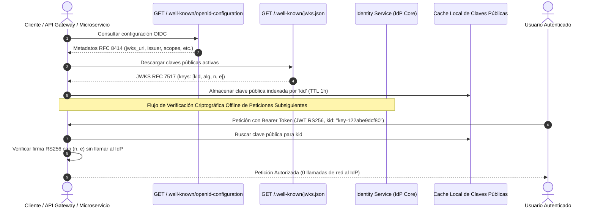

# Capítulo 04: Servidor OIDC & Gestión de Sesiones Distribuidas

[](#)
[](#)
[](#)
[](#)
[](#)

Este capítulo documenta la implementación de `identity-service` como un **Proveedor de Identidad OpenID Connect (IdP / OIDC Authorization Server)** conforme a los estándares de la industria. Provee interoperabilidad completa sin acoplamiento técnico, delegando la emisión y verificación de identidades en primitivas criptográficas asimétricas y flujos de autorización modernos.

---

## 🧭 Historias de Usuario del Épico 04

| Historia | Descripción | Estado |
| :--- | :--- | :---: |
| **US-07** | Servidor OIDC, Gestión Criptográfica de Claves y Endpoints de Descubrimiento JWKS | ✅ En Producción |
| **US-08** | Flujo de Autorización OAuth2 con PKCE y Consentimiento de Usuario | 🔄 Próximo Paso |
| **US-09** | Rotación Deslizante de Refresh Tokens con Cookies Seguras HttpOnly | ⏳ Planificado |

---

## 🔐 US-07: Servidor OIDC, Gestión Criptográfica de Claves y Endpoints JWKS

### 1. Arquitectura Criptográfica & Handshake de Descubrimiento

En arquitecturas distribuidas basadas en microservicios y API Gateways, la verificación de autenticidad de un token JWT jamás debe requerir que cada servicio consulte a la base de datos del IdP ni que comparta secretos simétricos pre-compartidos (*shared secrets* HMAC).

`identity-service` resuelve este desafío implementando el estándar **OpenID Connect Discovery (RFC 8414)** junto con **JSON Web Key Sets (RFC 7517)**:

1. **Firma Asimétrica RS256:** El Identity Provider genera y custodia de forma aislada un par de claves RSA de **2048 bits**. Los tokens (Access Tokens e ID Tokens) son firmados exclusivamente con la clave privada.
2. **Descubrimiento Autónomo (`/.well-known/openid-configuration`):** Cualquier cliente o microservicio obtiene la configuración del IdP (URLs de autorización, token, JWKS, algoritmos soportados y scopes).
3. **Catálogo de Claves Públicas (`/.well-known/jwks.json`):** Expone las claves públicas en formato JWK estándar (`kty: "RSA"`, `alg: "RS256"`, `use: "sig"`, `n`, `e`, `kid`).
4. **Verificación sin Estado (Stateless Non-Repudiation):** Los servicios consumidores descargan la clave pública y verifican localmente la firma criptográfica en microsegundos, sin llamadas de red recurrentes al IdP gracias al cacheo HTTP (`Cache-Control: public, max-age=3600`).



---

### 2. Evidencia Visual del Portal de Descubrimiento

La siguiente captura en alta resolución certifica la respuesta estructurada de metadatos OIDC conforme a RFC 8414:


---

### 3. Recetas Interactivas cURL Paso a Paso

Puedes interactuar directamente con los endpoints criptográficos expuestos en el entorno en vivo:

#### Receta 1: Inspeccionar el Documento de Descubrimiento OIDC (`GET /.well-known/openid-configuration`)

```bash
curl -i http://localhost:4000/.well-known/openid-configuration
```

##### Respuesta Real Obtenida (HTTP 200 OK):
```http
HTTP/1.1 200 OK
Access-Control-Allow-Origin: *
Content-Type: application/json; charset=utf-8
Cache-Control: public, max-age=3600, stale-while-revalidate=86400
X-Content-Type-Options: nosniff
ETag: W/"303-HMCoOKBsEKMrW+LaZUUf1j2cqjY"

{
  "issuer": "http://localhost:4000",
  "authorization_endpoint": "http://localhost:4000/oauth2/authorize",
  "token_endpoint": "http://localhost:4000/api/v1/oauth2/token",
  "jwks_uri": "http://localhost:4000/.well-known/jwks.json",
  "userinfo_endpoint": "http://localhost:4000/api/v1/auth/me",
  "response_types_supported": [
    "code"
  ],
  "subject_types_supported": [
    "public"
  ],
  "id_token_signing_alg_values_supported": [
    "RS256"
  ],
  "scopes_supported": [
    "openid",
    "profile",
    "email",
    "identity:read",
    "identity:write"
  ],
  "token_endpoint_auth_methods_supported": [
    "client_secret_basic",
    "client_secret_post",
    "none"
  ],
  "claims_supported": [
    "sub",
    "iss",
    "aud",
    "exp",
    "iat",
    "email",
    "tenantId"
  ],
  "code_challenge_methods_supported": [
    "S256"
  ],
  "grant_types_supported": [
    "authorization_code",
    "client_credentials",
    "refresh_token"
  ]
}
```

> [!NOTE]
> Observa las cabeceras `Access-Control-Allow-Origin: *` (para permitir a SPAs configurar su cliente OIDC en el navegador) y `Cache-Control: public, max-age=3600` para reducir al mínimo el tráfico hacia el IdP.

---

#### Receta 2: Inspeccionar el Conjunto de Claves Públicas (`GET /.well-known/jwks.json`)

```bash
curl -i http://localhost:4000/.well-known/jwks.json
```

##### Respuesta Real Obtenida (HTTP 200 OK):
```http
HTTP/1.1 200 OK
Access-Control-Allow-Origin: *
Content-Type: application/json; charset=utf-8
Cache-Control: public, max-age=3600, stale-while-revalidate=86400
X-Content-Type-Options: nosniff

{
  "keys": [
    {
      "kty": "RSA",
      "use": "sig",
      "alg": "RS256",
      "kid": "key-122abe9dcf80",
      "n": "vjC64i0pcDvjLxDkvskZm96l_oGQUqLiYE49j-KvTiA0rT1x6CacSVerYEaMyTF3Zg3L308xMbng9Mnrq0m3qDzREemtoCrNkrRisZ-7MNCpqZJ279FVQhA-I1vA6INi8npbjH-kuBxTDRDLXFutQinyBuDfc1KrNmBQWSl_UJasjgMRVIN9oQh5umJh8fVkwAaBdhlb-5n1x9e1Z7SECYLbf-zZ5n332O5p7ZdfQhmupXkqmZ2QXp8VOaTd-nswceOvHaKzDuGkhUxUi3iV0ZTfIwYMgOkCzvOQZStP8oasM2M0Xw_0QkmWtWVi4XyTSl2xEpYNahGeHG9fvQelFQ",
      "e": "AQAB"
    }
  ]
}
```

##### Análisis de Parámetros RFC 7517:
- **`kty` (Key Type):** `"RSA"`, identifica la familia de algoritmos criptográficos.
- **`use` (Key Use):** `"sig"`, certifica que la clave se utiliza exclusivamente para verificación de firmas digitales.
- **`alg` (Algorithm):** `"RS256"`, especifica RSASSA-PKCS1-v1_5 con SHA-256.
- **`kid` (Key ID):** Identificador unívoco de la clave activa. Permite realizar **rotaciones de claves en caliente sin tiempo de inactividad** (*graceful key rollover*), ya que el JWKS puede exponer simultáneamente la clave saliente y la clave entrante.
- **`n` y `e`:** Módulo y exponente público codificados en Base64URL.

---

### 4. Principios de Seguridad y Resiliencia Criptográfica

1. **Aislamiento Estricto de Clave Privada:** El Value Object `JsonWebKeyVO` y el adaptador criptográfico `RsaKeyAdapter` implementan serialización segura. Al inspeccionar o volcar estructuras de datos a logs o APIs, los componentes privados de la clave RSA (`d`, `p`, `q`, `dp`, `dq`, `qi`) son redactados automáticamente como `[REDACTED]`.
2. **Inmunidad contra Confusión de Algoritmos (Algorithm Substitution Attacks):** El servidor rechaza taxativamente tokens con cabecera `alg: "none"` o firmas HMAC manipuladas con la clave pública RSA (vulnerabilidad clásica de librerías JWT mal configuradas).
3. **Rotación Asíncrona sin Pérdida de Sesión:** Cuando se rota la clave criptográfica en producción, el endpoint `/.well-known/jwks.json` mantiene disponible la clave anterior durante su ventana de gracia, permitiendo a los clientes validar tokens emitidos previamente hasta su expiración natural.

---

### 5. Cobertura de Pruebas Automatizadas

La suite de pruebas automatizadas valida la interoperabilidad RFC y el comportamiento del endpoint:

```bash
# Ejecutar suite de integración de Discovery & JWKS
npx jest tests/integration/identity/interfaces/test_oidc_discovery_api.ts
```

```text
PASS tests/integration/identity/interfaces/test_oidc_discovery_api.ts
  Integration API: OIDC Discovery & JWKS Endpoints (US-07 & RFC 8414 / RFC 7517)
    GET /.well-known/openid-configuration
      ✓ should return 200 OK with valid OpenID Provider Metadata and CORS headers (127 ms)
    GET /.well-known/jwks.json
      ✓ should return 200 OK with keys array and enable verifying tokens signed with the server key (45 ms)
      ✓ should respect custom injected AsymmetricKeyProviderPort in server dependencies (55 ms)

Test Suites: 1 passed, 1 total
Tests:       3 passed, 3 total
Snapshots:   0 total
Time:        1.801 s
```

```bash
# Ejecutar especificación ejecutable BDD / Gherkin
npx jest tests/acceptance/step_defs/test_oidc_discovery_steps.ts
```

```text
PASS tests/acceptance/step_defs/test_oidc_discovery_steps.ts
  Feature: Cryptographic Keypair Management, JWKS and OpenID Discovery Endpoints
    Scenario: Retrieve OpenID Connect Discovery metadata
      ✓ should return 200 OK with complete OpenID configuration document conforming to RFC 8414 (57 ms)
    Scenario: Retrieve valid JSON Web Key Set (JWKS)
      ✓ should return 200 OK with RFC 7517 compliant keys array containing RS256 public key parameters (67 ms)

Test Suites: 1 passed, 1 total
Tests:       2 passed, 2 total
Snapshots:   0 total
Time:        1.792 s
```

---

[⬅️ Volver al Hub Principal de Showcase](./README.md)
