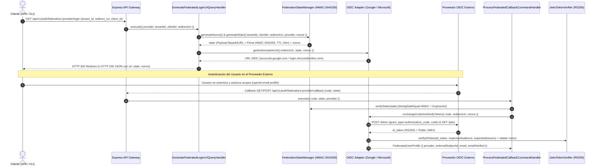
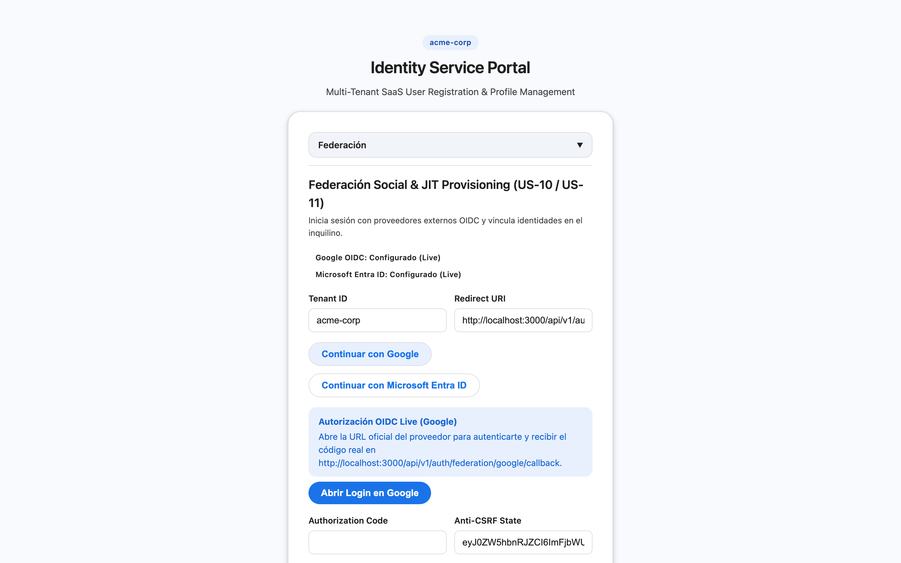
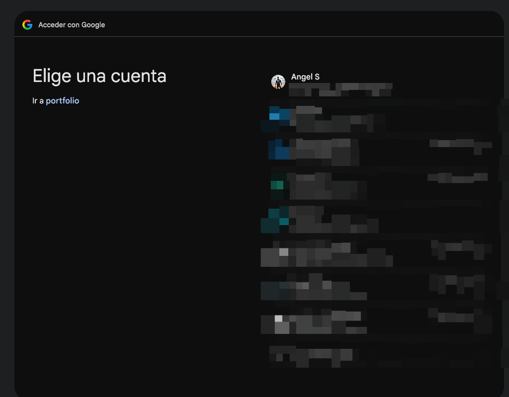
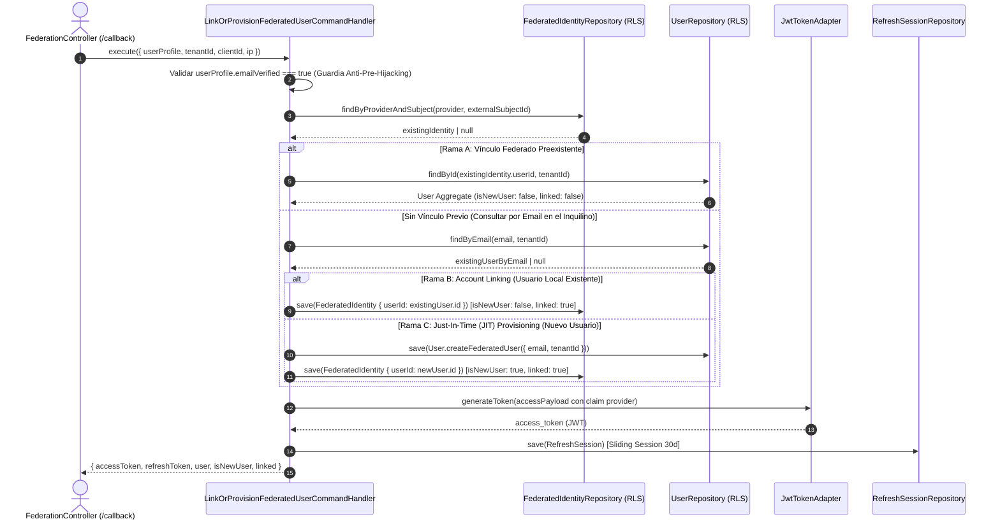
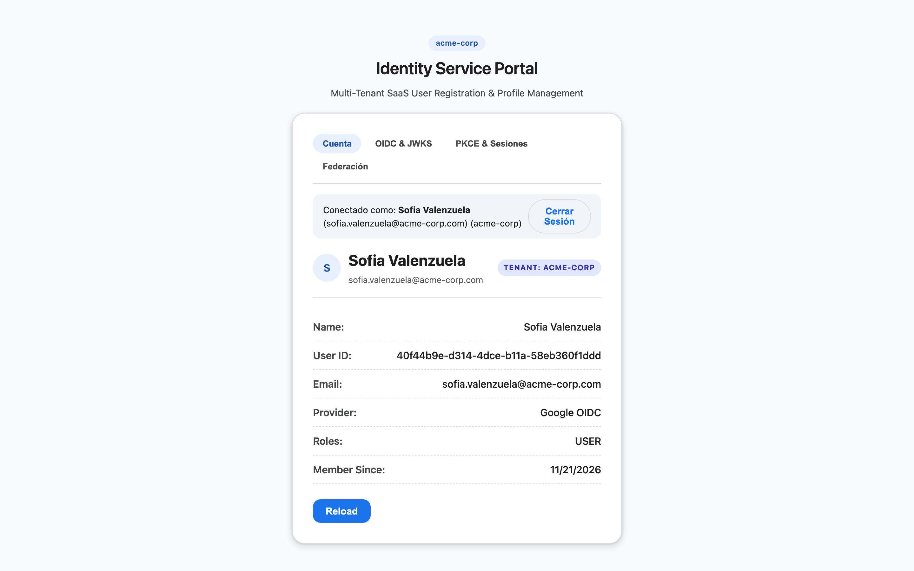
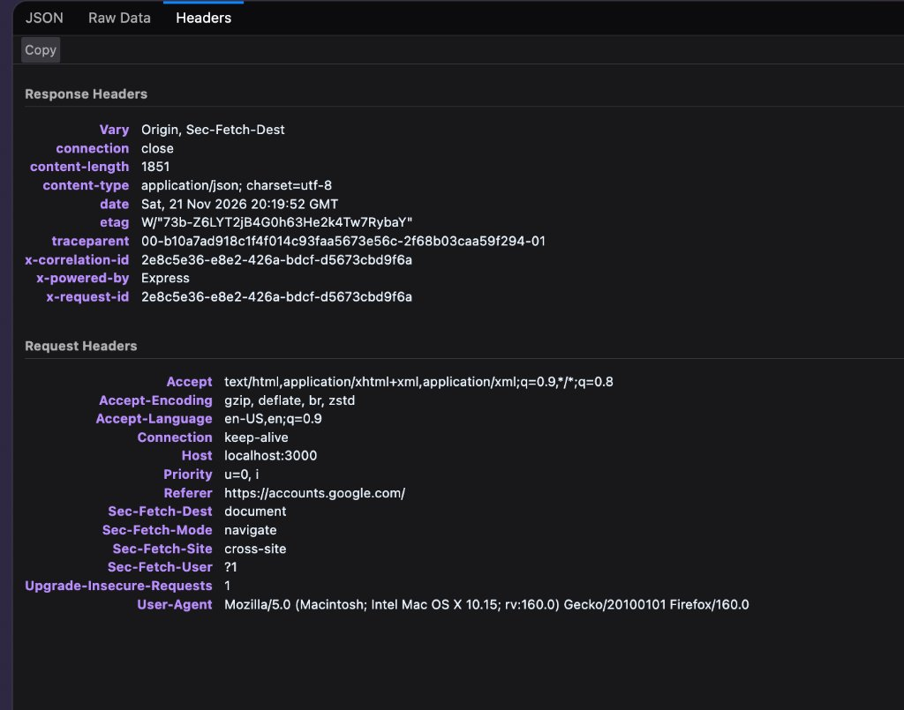

# Capítulo 05: Federación de Identidad OIDC & Aprovisionamiento JIT

[](#)
[](#)
[](#)
[](#)
[](#)

Este capítulo documenta la arquitectura e implementación del **Épico 05: Federación de Identidades y Proveedores Externos**. En entornos corporativos B2B y SaaS modernos, las organizaciones requieren delegar la autenticación primaria en sus propios directorios de identidad (**Google Workspace** y **Microsoft Entra ID / Azure AD**), manteniendo al mismo tiempo el aislamiento multi-inquilino estricto y las sesiones deslizantes nativas de `identity-service`.

---

## 🧭 Historias de Usuario del Épico 05

| Historia | Descripción | Estado |
| :--- | :--- | :---: |
| **US-10** | Conectores OIDC Externos (Google & Microsoft Entra ID) con Validación Criptográfica de Estado y JWKS | ✅ En Producción |
| **US-11** | Vinculación Automática de Cuentas (Account Linking) y Aprovisionamiento Just-In-Time (JIT) Multi-Tenant | ✅ En Producción |

---

## 🌐 US-10: Conectores OIDC Externos (Google & Microsoft Entra ID)

### 1. Arquitectura de Federación Sin Estado, Anti-CSRF HMAC y Verificación JWKS

El diseño sigue el patrón **Ports & Adapters (Arquitectura Hexagonal)** mediante la interfaz de dominio `ExternalIdentityProviderPort`, implementada por `GoogleOidcAdapter` y `MicrosoftEntraAdapter`:

1. **Estado Anti-CSRF Firmado sin Sesiones de Servidor (`FederationStateManager`):** Para evitar almacenar estados efímeros en memoria que fallen en despliegues multi-réplica Kubernetes, el parámetro `state` encapsula `{ tenantId, clientId, redirectUri, provider, nonce, createdAt, expiresAt }` codificado en Base64URL y firmado con **HMAC-SHA256**. Al recibir el callback, la firma se verifica en tiempo constante (`crypto.timingSafeEqual`) y se exige una vigencia máxima de 10 minutos.
2. **Mitigación de Ataques de Repetición (`nonce` OIDC):** Cada solicitud de login inyecta un `nonce` criptográfico de 128 bits (32 caracteres hex) tanto en la URL de autorización como dentro del `state` firmado. Durante el canje, el adaptador exige que el claim `nonce` dentro del `id_token` firmado por Google o Microsoft coincida exactamente con el `nonce` del `state`.
3. **Verificación Remota RS256 Resiliente (`JwksTokenVerifier`):** Los `id_token` devueltos por el proveedor externo son verificados criptográficamente contra el catálogo JWKS público del IdP (`googleapis.com/oauth2/v3/certs` o `login.microsoftonline.com/common/discovery/v2.0/keys`), incorporando caché en memoria, rotación automática ante `kid` desconocido con ventana de enfriamiento (*cooldown*) y reintentos con *exponential backoff*.



#### A. Glosario de Actores y Componentes (Cajas del Diagrama)

| Participante / Caja | Tipo | Rol Arquitectónico y Frontera de Seguridad |
| :--- | :--- | :--- |
| **`SPA` (Cliente SPA / CLI)** | `actor` | Aplicación web o herramienta `./bin/identity` que inicia el flujo de federación para un inquilino específico. |
| **`Gateway` (Express API Gateway)** | `participant` | Pasarela HTTP que expone `/api/v1/auth/federation/:provider/login` y `/callback`. |
| **`LoginHandler` (`GenerateFederatedLoginUrlQueryHandler`)** | `participant` | Caso de uso de consulta que coordina la creación del estado criptográfico y la construcción de la URL del proveedor. |
| **`StateMgr` (`FederationStateManager`)** | `participant` | Gestor criptográfico que firma y verifica tokens `state` con HMAC-SHA256 en tiempo constante y controla su TTL de 10 minutos. |
| **`Adapter` (`GoogleOidcAdapter` / `MicrosoftEntraAdapter`)** | `participant` | Adaptador de infraestructura que implementa `ExternalIdentityProviderPort`, normalizando las diferencias entre Google OIDC y Microsoft Entra ID v2.0 (`oid`/`sub`, `preferred_username`/`upn`). |
| **`IdP` (Proveedor OIDC Externo)** | `participant` | Autoridad de identidad externa (Google o Microsoft) que autentica al usuario y emite el `id_token` firmado con RS256. |
| **`CallbackHandler` (`ProcessFederatedCallbackCommandHandler`)** | `participant` | Caso de uso que valida la integridad del `state`, previene ataques de sustitución de proveedor y orquesta el canje del código. |
| **`Verifier` (`JwksTokenVerifier`)** | `participant` | Motor de verificación RS256 con caché de claves públicas JWKS, rotación bajo demanda y reintentos con retroceso exponencial. |

#### B. Desglose Secuencial del Flujo (Pasos 1 al 16)

1. **Paso 1 (`SPA -> Gateway`):** El cliente solicita iniciar sesión federada invocando `GET /api/v1/auth/federation/:provider/login` con `tenant_id`, `redirect_uri` y opcionalmente `client_id`.
2. **Paso 2 (`Gateway -> LoginHandler`):** El controlador valida los parámetros con Zod y delega en `GenerateFederatedLoginUrlQueryHandler`.
3. **Paso 3 (`LoginHandler -> StateMgr`):** Se solicita la generación de un `nonce` aleatorio de 128 bits y de un token `state` firmado que encapsula el contexto multi-tenant.
4. **Paso 4 (`StateMgr -->> LoginHandler`):** El gestor retorna el `state` (`<payload_base64url>.<hmac_sha256>`) con expiración a 10 minutos y el `nonce`.
5. **Paso 5 (`LoginHandler -> Adapter`):** Se invoca `getAuthorizationUrl` en el adaptador correspondiente (`google` o `microsoft`).
6. **Paso 6 (`Adapter -->> LoginHandler`):** El adaptador construye la URL OIDC completa con `client_id`, `response_type=code`, `scope`, `state` y `nonce`.
7. **Paso 7 (`LoginHandler -->> SPA`):** El servidor redirige con `HTTP 302` hacia el proveedor externo (o devuelve `HTTP 200 OK` en JSON cuando se solicita desde la CLI o con `format=json`).
8. **Paso 8 (`SPA -> IdP`):** El usuario se autentica en la plataforma externa (Google o Microsoft Entra ID).
9. **Paso 9 (`IdP -->> Gateway`):** El proveedor externo redirige de vuelta al endpoint `/api/v1/auth/federation/:provider/callback` entregando el `code` de autorización y el `state`.
10. **Paso 10 (`Gateway -> CallbackHandler`):** El controlador invoca `ProcessFederatedCallbackCommandHandler`.
11. **Paso 11 (`CallbackHandler -> StateMgr`):** Se verifica en tiempo constante la firma HMAC-SHA256 del `state`, su vigencia temporal y la coincidencia exacta del proveedor de la URL con el proveedor firmado en el `state`.
12. **Paso 12 (`CallbackHandler -> Adapter`):** Superada la barrera anti-CSRF, se solicita al adaptador el canje del código y la verificación del token (`exchangeCodeAndVerifyToken`).
13. **Paso 13 (`Adapter -> IdP`):** El adaptador realiza la petición `POST` al endpoint de tokens del proveedor externo y consulta su catálogo JWKS si la clave no está en caché.
14. **Paso 14 (`IdP -->> Adapter`):** El proveedor externo devuelve el `id_token` firmado en RS256 y las claves públicas JWK.
15. **Paso 15 (`Adapter -> Verifier`):** `JwksTokenVerifier` valida la firma RS256 del `id_token`, el emisor (`iss`), la audiencia (`aud`), la expiración (`exp`) y el adaptador comprueba la coincidencia del `nonce` y que `email_verified` sea verdadero.
16. **Paso 16 (`Adapter -->> CallbackHandler`):** Se retorna el perfil normalizado `FederatedUserProfile` listo para su vinculación o aprovisionamiento local.

---

### 2. Ejecución en Vivo & Verificación Interactiva Paso a Paso

#### Escenario A: Generación de URL de Autorización OIDC para Google (`HTTP 200 OK`)

**Comando CLI Oficial (`./bin/identity`):**

```bash
./bin/identity federation login \
  --provider google \
  --tenant acme-corp \
  --client-id portal-web \
  --redirect-uri https://portal.angelpixel.io/callback
```

<details>
<summary><b>Ver Receta Equivalente con cURL</b></summary>

```bash
curl -i "http://localhost:4000/api/v1/auth/federation/google/login?tenant_id=acme-corp&client_id=portal-web&redirect_uri=https://portal.angelpixel.io/callback&format=json"
```
</details>

##### Respuesta Real Obtenida (HTTP 200 OK):
```text
HTTP/1.1 200 OK [146ms]
GET http://localhost:4000/api/v1/auth/federation/google/login?tenant_id=acme-corp&redirect_uri=https%3A%2F%2Fportal.angelpixel.io%2Fcallback&format=json&client_id=portal-web

{
  "url": "https://accounts.google.com/o/oauth2/v2/auth?client_id=mock-google-client-id&redirect_uri=https%3A%2F%2Fportal.angelpixel.io%2Fcallback&response_type=code&scope=openid+email+profile&state=eyJ0ZW5hbnRJZCI6ImFjbWUtY29ycCIsImNsaWVudElkIjoicG9ydGFsLXdlYiIsInJlZGlyZWN0VXJpIjoiaHR0cHM6Ly9wb3J0YWwuYW5nZWxwaXhlbC5pby9jYWxsYmFjayIsInByb3ZpZGVyIjoiZ29vZ2xlIiwibm9uY2UiOiI4OWQzYjliOWI3NWM3OGFhYjM3NzU3ZTQ2OWE5ZmNhZiIsImNyZWF0ZWRBdCI6MTc5NTAxOTM5Nzk5MCwiZXhwaXJlc0F0IjoxNzk1MDE5OTk3OTkwfQ.TxXYiTWlo2ylMdSAbZQitBEPQtTVVzljGrLV4UiUJPA&nonce=89d3b9b9b75c78aab37757e469a9fcaf&access_type=offline&prompt=consent",
  "state": "eyJ0ZW5hbnRJZCI6ImFjbWUtY29ycCIsImNsaWVudElkIjoicG9ydGFsLXdlYiIsInJlZGlyZWN0VXJpIjoiaHR0cHM6Ly9wb3J0YWwuYW5nZWxwaXhlbC5pby9jYWxsYmFjayIsInByb3ZpZGVyIjoiZ29vZ2xlIiwibm9uY2UiOiI4OWQzYjliOWI3NWM3OGFhYjM3NzU3ZTQ2OWE5ZmNhZiIsImNyZWF0ZWRBdCI6MTc5NTAxOTM5Nzk5MCwiZXhwaXJlc0F0IjoxNzk1MDE5OTk3OTkwfQ.TxXYiTWlo2ylMdSAbZQitBEPQtTVVzljGrLV4UiUJPA",
  "nonce": "89d3b9b9b75c78aab37757e469a9fcaf"
}
```

---

#### Escenario B: Generación de URL de Autorización OIDC para Microsoft Entra ID v2.0 (`HTTP 200 OK`)

**Comando CLI Oficial (`./bin/identity`):**

```bash
./bin/identity federation login \
  --provider microsoft \
  --tenant acme-corp \
  --client-id portal-web \
  --redirect-uri https://portal.angelpixel.io/callback
```

<details>
<summary><b>Ver Receta Equivalente con cURL</b></summary>

```bash
curl -i "http://localhost:4000/api/v1/auth/federation/microsoft/login?tenant_id=acme-corp&client_id=portal-web&redirect_uri=https://portal.angelpixel.io/callback&format=json"
```
</details>

##### Respuesta Real Obtenida (HTTP 200 OK):
```text
HTTP/1.1 200 OK [27ms]
GET http://localhost:4000/api/v1/auth/federation/microsoft/login?tenant_id=acme-corp&redirect_uri=https%3A%2F%2Fportal.angelpixel.io%2Fcallback&format=json&client_id=portal-web

{
  "url": "https://login.microsoftonline.com/common/oauth2/v2.0/authorize?client_id=mock-msft-client-id&response_type=code&redirect_uri=https%3A%2F%2Fportal.angelpixel.io%2Fcallback&response_mode=query&scope=openid+email+profile+User.Read&state=eyJ0ZW5hbnRJZCI6ImFjbWUtY29ycCIsImNsaWVudElkIjoicG9ydGFsLXdlYiIsInJlZGlyZWN0VXJpIjoiaHR0cHM6Ly9wb3J0YWwuYW5nZWxwaXhlbC5pby9jYWxsYmFjayIsInByb3ZpZGVyIjoibWljcm9zb2Z0Iiwibm9uY2UiOiJmYjc4ZjMxYzg3NWI3MjYxMzdkM2I3OWYyNDQ1NjZlMSIsImNyZWF0ZWRBdCI6MTc5NTAxOTM5ODEwMCwiZXhwaXJlc0F0IjoxNzk1MDE5OTk4MTAwfQ.Nl3WDjtCSOjuOuaMk33zeV7-1kNL0NFTO8fMyGjuM3A&nonce=fb78f31c875b726137d3b79f244566e1",
  "state": "eyJ0ZW5hbnRJZCI6ImFjbWUtY29ycCIsImNsaWVudElkIjoicG9ydGFsLXdlYiIsInJlZGlyZWN0VXJpIjoiaHR0cHM6Ly9wb3J0YWwuYW5nZWxwaXhlbC5pby9jYWxsYmFjayIsInByb3ZpZGVyIjoibWljcm9zb2Z0Iiwibm9uY2UiOiJmYjc4ZjMxYzg3NWI3MjYxMzdkM2I3OWYyNDQ1NjZlMSIsImNyZWF0ZWRBdCI6MTc5NTAxOTM5ODEwMCwiZXhwaXJlc0F0IjoxNzk1MDE5OTk4MTAwfQ.Nl3WDjtCSOjuOuaMk33zeV7-1kNL0NFTO8fMyGjuM3A",
  "nonce": "fb78f31c875b726137d3b79f244566e1"
}
```

---

#### Escenario C: Seguridad Negativa — Proveedor de Identidad No Soportado (`HTTP 400 Bad Request`)

**Comando CLI Oficial (`./bin/identity`):**

```bash
./bin/identity federation login \
  --provider github \
  --tenant acme-corp \
  --redirect-uri https://portal.angelpixel.io/callback
```

<details>
<summary><b>Ver Receta Equivalente con cURL</b></summary>

```bash
curl -i "http://localhost:4000/api/v1/auth/federation/github/login?tenant_id=acme-corp&redirect_uri=https://portal.angelpixel.io/callback"
```
</details>

##### Respuesta de Seguridad Obtenida (HTTP 400 Bad Request):
```text
HTTP/1.1 400 Bad Request [19ms]
GET http://localhost:4000/api/v1/auth/federation/github/login?tenant_id=acme-corp&redirect_uri=https%3A%2F%2Fportal.angelpixel.io%2Fcallback&format=json

{
  "error": "invalid_request",
  "error_description": "Unsupported identity provider: \"github\". Allowed: google, microsoft"
}
```

---

### 3. Cobertura de Pruebas Automatizadas (US-10)

```bash
npx jest tests/unit/identity/infrastructure/federation/ tests/unit/identity/application/federation/test_federated_handlers.ts tests/integration/identity/interfaces/test_federation_api.ts
```

- **Invariante 1 (`FederationStateManager`):** Rechazo de tokens `state` expirados, malformados o con firma HMAC-SHA256 alterada; redacción de secretos en `toString()` / `util.inspect`.
- **Invariante 2 (`JwksTokenVerifier`):** Cacheo de claves públicas, refresco automático ante rotación de `kid` con *cooldown* y *exponential backoff*.
- **Invariante 3 (Adaptadores Google y Microsoft):** Validación estricta de `nonce`, `aud`, `iss` y normalización de claims (`oid`/`sub`, `preferred_username`/`upn`).

#### 🌐 Demostración Interactiva en la UI (Navegador — `US-10`)

1. **Prerrequisitos:** Backend (`:4000`) y Vite (`:3000`) activos. Abre [`http://localhost:3000/auth`](http://localhost:3000/auth) y selecciona la pestaña **`Federación`**. Al cargar, la UI consulta `GET /api/v1/auth/federation/status` y muestra los 2 badges de estado:
   - **Modo Live (`Configurado (Live)` en verde):** Cuando `GOOGLE_CLIENT_ID` / `MICROSOFT_CLIENT_ID` están configurados en `.env` (consulta la [Guía para obtener credenciales OIDC de Google y Microsoft](../guides/oidc-federation-credentials.md)). La UI ajusta automáticamente el **`Redirect URI`** a `${origin}/api/v1/auth/federation/{provider}/callback` y limpia **`Authorization Code`** para evitar enviar códigos de emulador.
   - **Modo Emulador Dev (`Emulador Dev` en ámbar):** Cuando faltan las credenciales reales en `.env`; muestra el banner informativo local y precarga los códigos simulados (`dev_google_jit_2026` / `dev_microsoft_jit_2026`).
2. **Paso a Paso (Inicio OIDC Externo & `state` Anti-CSRF):**
   - Verifica **Tenant ID** (`acme-corp`) y **Redirect URI**.
   - Pulsa **`Continuar con Google`** (o **`Continuar con Microsoft Entra ID`**).
   - El cliente invoca `GET /api/v1/auth/federation/:provider/login`, autocompleta el campo **`Anti-CSRF State`** firmado con HMAC-SHA256 y muestra la `authorizationUrl` generada con `nonce` y `state`. En **Modo Live**, además habilita el botón **`Abrir Login en Google / Microsoft Entra ID`**, que abre el consentimiento OIDC real en un popup (con fallback automático en la misma pestaña). En Microsoft Entra ID, `MicrosoftEntraAdapter` consulta opcionalmente `GET /v1/me/photo/$value` en Microsoft Graph si el usuario tiene foto configurada.
3. **Trazabilidad E2E:** `tests/e2e/web/auth_portal_oidc_federation.spec.tsx` (Scenario 4).





---

## 🔗 US-11: Vinculación Automática de Cuentas (Account Linking) & Aprovisionamiento JIT

### 1. Arquitectura del Árbol de Resolución de Identidad y Defensa Anti-Pre-Hijacking

Una vez que `ProcessFederatedCallbackCommandHandler` valida la firma RS256 del `id_token` externo y el `state` anti-CSRF, el caso de uso **`LinkOrProvisionFederatedUserCommandHandler`** ejecuta un árbol determinista de tres vías para traducir la identidad externa en una sesión nativa multi-inquilino:

1. **Barrera Anti-Pre-Hijacking (`email_verified === true`):** Nunca se vincula ni aprovisiona una cuenta si el proveedor externo informa `email_verified: false`. Esto bloquea ataques de secuestro previo de cuentas (*Pre-Account Takeover*), donde un atacante registra un correo ajeno sin verificar en un IdP externo.
2. **Rama A — Identidad Federada Preexistente (`isNewUser: false, linked: false`):** Si el par `(provider, externalSubjectId)` ya existe en la tabla `federated_identities`, se verifica que pertenezca al mismo `tenantId` (bloqueando violaciones cross-tenant) y se autentica directamente al usuario vinculado.
3. **Rama B — Vinculación Automática por Correo Verificado / Account Linking (`isNewUser: false, linked: true`):** Si es la primera vez que se presenta ese `(provider, externalSubjectId)`, pero ya existe un usuario local en el mismo inquilino con el mismo correo electrónico verificado, el sistema crea el vínculo `FederatedIdentity` apuntando al `userId` existente sin duplicar el registro de usuario. Un mismo usuario puede vincular simultáneamente Google y Microsoft.
4. **Rama C — Aprovisionamiento Just-In-Time / JIT Provisioning (`isNewUser: true, linked: true`):** Si no existe ni el vínculo federado ni el correo en el inquilino activo, se instancia automáticamente el agregado `User.createFederatedUser({ email, tenantId })` (con marcador `EXTERNAL_FEDERATED_IDENTITY_NO_LOCAL_PASSWORD`), se persiste el vínculo en `federated_identities` bajo protección PostgreSQL RLS y se emite la sesión nativa (`access_token` + `RefreshSession` HttpOnly).



#### A. Glosario de Actores y Componentes (Cajas del Diagrama)

| Participante / Caja | Tipo | Rol Arquitectónico y Frontera de Seguridad |
| :--- | :--- | :--- |
| **`Controller` (`FederationController`)** | `actor` | Controlador REST que recibe el perfil externo verificado desde `ProcessFederatedCallbackCommandHandler` y gestiona la cookie `HttpOnly` de sesión. |
| **`LinkHandler` (`LinkOrProvisionFederatedUserCommandHandler`)** | `participant` | Orquestador de aplicación que ejecuta las reglas de dominio de vinculación de cuentas, aprovisionamiento JIT y aislamiento de inquilinos. |
| **`FedRepo` (`FederatedIdentityRepository`)** | `participant` | Repositorio PostgreSQL de la tabla `federated_identities` con índices únicos `(provider, external_subject_id)` y `(user_id, provider)` bajo política RLS. |
| **`UserRepo` (`UserRepository`)** | `participant` | Repositorio PostgreSQL de la tabla `users` aislado por `tenant_id` mediante Row-Level Security. |
| **`TokenProvider` (`JwtTokenAdapter`)** | `participant` | Motor de firma que emite el `access_token` nativo incluyendo los claims `tenant_id`, `client_id` y `provider`. |
| **`SessionRepo` (`RefreshSessionRepository`)** | `participant` | Almacén de sesiones deslizantes que registra el `RefreshSession` inicial de la familia para permitir rotaciones posteriores (US-09). |

#### B. Desglose Secuencial del Flujo (Pasos 1 al 15)

1. **Paso 1 (`Controller -> LinkHandler`):** Tras validar el callback OIDC, el controlador invoca `LinkOrProvisionFederatedUserCommandHandler` con el `userProfile` verificado y el `tenantId` extraído del `state`.
2. **Paso 2 (`LinkHandler -> LinkHandler`):** Se verifica la invariante crítica `userProfile.emailVerified === true`. Si es falsa, se registra el evento de auditoría `federation_callback_failed` y se aborta el flujo con `HTTP 401 invalid_grant`.
3. **Paso 3 (`LinkHandler -> FedRepo`):** Se consulta `findByProviderAndSubject(provider, externalSubjectId)` para determinar si la identidad externa ya fue vinculada anteriormente.
4. **Paso 4 (`FedRepo -->> LinkHandler`):** El repositorio retorna el agregado `FederatedIdentity` o `null`.
5. **Paso 5 (`LinkHandler -> UserRepo` [Rama A: Vínculo Preexistente]):** Si el vínculo existe, se comprueba que pertenezca al `tenantId` activo (`belongsToTenant`) y se recupera el usuario local mediante `findById`.
6. **Paso 6 (`UserRepo -->> LinkHandler` [Rama A]):** Se obtiene el agregado `User` existente marcando los indicadores `isNewUser = false` y `linked = false`.
7. **Paso 7 (`LinkHandler -> UserRepo` [Ramas B/C: Sin Vínculo Previo]):** Si no existe vínculo previo para ese proveedor, se busca en el inquilino actual si existe un usuario local con el mismo correo verificado (`findByEmail(email, tenantId)`).
8. **Paso 8 (`UserRepo -->> LinkHandler`):** El repositorio devuelve el usuario local coincidente o `null`.
9. **Paso 9 (`LinkHandler -> FedRepo` [Rama B: Account Linking]):** Si el usuario local ya existía en el inquilino, se crea y persiste el nuevo agregado `FederatedIdentity` asociándolo al `userId` existente (`isNewUser = false, linked = true`).
10. **Paso 10 (`LinkHandler -> UserRepo` [Rama C: JIT Provisioning]):** Si el correo no existía en el inquilino, se crea un nuevo usuario sin contraseña local mediante la factoría `User.createFederatedUser({ email, tenantId })` y se guarda en `users`.
11. **Paso 11 (`LinkHandler -> FedRepo` [Rama C: JIT Provisioning]):** Se persiste el vínculo `FederatedIdentity` para el usuario recién aprovisionado (`isNewUser = true, linked = true`).
12. **Paso 12 (`LinkHandler -> TokenProvider`):** Se solicita la emisión del `access_token` nativo con los claims de identidad multi-tenant y el atributo `provider`.
13. **Paso 13 (`TokenProvider -->> LinkHandler`):** El proveedor devuelve el JWT firmado.
14. **Paso 14 (`LinkHandler -> SessionRepo`):** Se crea y almacena una nueva `RefreshSession` activa (TTL 30 días) para habilitar la rotación de tokens (US-09).
15. **Paso 15 (`LinkHandler -->> Controller`):** Se retorna el resultado completo (`accessToken`, `refreshToken`, `user`, `isNewUser`, `linked`) y el controlador inyecta la cookie `HttpOnly; SameSite=Strict`.

---

### 2. Ejecución en Vivo & Verificación Interactiva Paso a Paso

#### Paso 0: Generar Token `state` Criptográfico Activo (`$STATE_GOOGLE`)

```bash
export STATE_GOOGLE=$(./bin/identity federation login \
  --provider google \
  --tenant acme-corp \
  --client-id portal-web \
  --redirect-uri https://portal.angelpixel.io/callback \
  --raw-json | jq -r .state)

echo "STATE_GOOGLE=$STATE_GOOGLE"
```

---

#### Escenario A: Aprovisionamiento Just-In-Time (JIT Provisioning) de Nuevo Usuario (`HTTP 200 OK`)

Al recibir el callback para `valeria.mendoza@acme-corp.com` (quien ingresa por primera vez mediante Google SSO), el sistema crea automáticamente el usuario en `acme-corp`, vincula su `externalSubjectId` y emite una sesión nativa:

**Comando CLI Oficial (`./bin/identity`):**

```bash
./bin/identity federation callback \
  --provider google \
  --code "dev_google_jit_2026" \
  --state "$STATE_GOOGLE"
```

<details>
<summary><b>Ver Receta Equivalente con cURL</b></summary>

```bash
curl -i -X POST http://localhost:4000/api/v1/auth/federation/google/callback \
  -H "Content-Type: application/json" \
  -d "{
    \"code\": \"dev_google_jit_2026\",
    \"state\": \"$STATE_GOOGLE\"
  }"
```
</details>

##### Respuesta Real Obtenida (HTTP 200 OK — `isNewUser: true, linked: true`):
```text
HTTP/1.1 200 OK [194ms]
POST http://localhost:4000/api/v1/auth/federation/google/callback

{
  "status": "success",
  "tokens": {
    "access_token": "eyJhbGciOiJIUzI1NiIsInR5cCI6IkpXVCJ9...",
    "token_type": "Bearer",
    "expires_in": 3600,
    "refresh_token": "02aec16c912e5a36a4faba69ce429dc28599ad635b1c147f2fa69f67cbfcc223"
  },
  "user": {
    "id": "40f44b9e-d314-4dce-b11a-58eb360f1ddd",
    "email": "valeria.mendoza@acme-corp.com",
    "tenantId": "acme-corp"
  },
  "isNewUser": true,
  "linked": true,
  "userProfile": {
    "provider": "google",
    "externalSubjectId": "google-sub-jit-2026",
    "email": "valeria.mendoza@acme-corp.com",
    "emailVerified": true,
    "name": "Valeria Mendoza (Google SSO)"
  },
  "statePayload": {
    "tenantId": "acme-corp",
    "clientId": "portal-web",
    "redirectUri": "https://portal.angelpixel.io/callback",
    "provider": "google"
  }
}
```

---

#### Escenario B: Vinculación Automática a Cuenta Local Preexistente — Account Linking (`HTTP 200 OK`)

Cuando `lead.architect@acme-corp.com` (usuario local registrado previamente en el Capítulo 01) inicia sesión con Google y correo verificado, el sistema vincula la identidad externa a su `userId` existente sin duplicar la cuenta (`isNewUser: false, linked: true`):

**Comando CLI Oficial (`./bin/identity`):**

```bash
./bin/identity federation callback \
  --provider google \
  --code "dev_google_link_2026" \
  --state "$STATE_GOOGLE"
```

<details>
<summary><b>Ver Receta Equivalente con cURL</b></summary>

```bash
curl -i -X POST http://localhost:4000/api/v1/auth/federation/google/callback \
  -H "Content-Type: application/json" \
  -d "{
    \"code\": \"dev_google_link_2026\",
    \"state\": \"$STATE_GOOGLE\"
  }"
```
</details>

##### Respuesta Real Obtenida (HTTP 200 OK — `isNewUser: false, linked: true`):
```text
HTTP/1.1 200 OK [115ms]
POST http://localhost:4000/api/v1/auth/federation/google/callback

{
  "status": "success",
  "tokens": {
    "access_token": "eyJhbGciOiJIUzI1NiIsInR5cCI6IkpXVCJ9...",
    "token_type": "Bearer",
    "expires_in": 3600,
    "refresh_token": "926115c7413cda0021731f024288b69d99a87d5141d15f2188722bc5064195c6"
  },
  "user": {
    "id": "8efe4d17-eb52-47da-b166-bf04a1465639",
    "email": "lead.architect@acme-corp.com",
    "tenantId": "acme-corp"
  },
  "isNewUser": false,
  "linked": true,
  "userProfile": {
    "provider": "google",
    "externalSubjectId": "google-sub-linked-2026",
    "email": "lead.architect@acme-corp.com",
    "emailVerified": true,
    "name": "Sofia Valenzuela (Linked Google)"
  },
  "statePayload": {
    "tenantId": "acme-corp",
    "clientId": "portal-web",
    "redirectUri": "https://portal.angelpixel.io/callback",
    "provider": "google"
  }
}
```

---

#### Escenario C: Seguridad Negativa — Bloqueo Anti-Pre-Hijacking por Correo No Verificado (`HTTP 401 Unauthorized`)

Si el `id_token` externo reporta `email_verified: false`, el servidor bloquea la vinculación y el aprovisionamiento:

**Comando CLI Oficial (`./bin/identity`):**

```bash
./bin/identity federation callback \
  --provider google \
  --code "dev_unverified_2026" \
  --state "$STATE_GOOGLE"
```

<details>
<summary><b>Ver Receta Equivalente con cURL</b></summary>

```bash
curl -i -X POST http://localhost:4000/api/v1/auth/federation/google/callback \
  -H "Content-Type: application/json" \
  -d "{
    \"code\": \"dev_unverified_2026\",
    \"state\": \"$STATE_GOOGLE\"
  }"
```
</details>

##### Respuesta de Seguridad Obtenida (HTTP 401 Unauthorized):
```text
HTTP/1.1 401 Unauthorized [38ms]
POST http://localhost:4000/api/v1/auth/federation/google/callback

{
  "error": "invalid_grant",
  "error_description": "Google account email is not verified"
}
```

---

#### Escenario D: Seguridad Negativa — Rechazo por Firma `state` Anti-CSRF Alterada (`HTTP 400 Bad Request`)

**Comando CLI Oficial (`./bin/identity`):**

```bash
./bin/identity federation callback \
  --provider google \
  --code "dev_google_jit_2026" \
  --state "tampered_payload.forged_hmac_signature"
```

<details>
<summary><b>Ver Receta Equivalente con cURL</b></summary>

```bash
curl -i -X POST http://localhost:4000/api/v1/auth/federation/google/callback \
  -H "Content-Type: application/json" \
  -d '{
    "code": "dev_google_jit_2026",
    "state": "tampered_payload.forged_hmac_signature"
  }'
```
</details>

##### Respuesta de Seguridad Obtenida (HTTP 400 Bad Request):
```text
HTTP/1.1 400 Bad Request [21ms]
POST http://localhost:4000/api/v1/auth/federation/google/callback

{
  "error": "invalid_request",
  "error_description": "Invalid state signature"
}
```

---

### 3. Cobertura de Pruebas Automatizadas (US-11)

```bash
# Suite Unitaria (Agregado FederatedIdentity y Caso de Uso JIT / Account Linking)
npx jest tests/unit/identity/domain/federation/test_federated_identity_aggregate.ts tests/unit/identity/application/federation/test_link_or_provision_handler.ts

# Especificación Ejecutable BDD / Gherkin
npx jest tests/acceptance/step_defs/test_federated_account_linking_steps.ts
```

- **Invariante 1:** Creación Just-In-Time (JIT) sin duplicidad y con emisión de sesión nativa (`AccessToken` + `RefreshSession`).
- **Invariante 2:** Vinculación multi-proveedor (Google + Microsoft Entra ID) hacia una misma identidad local por correo electrónico verificado.
- **Invariante 3:** Rechazo estricto de correos con `email_verified: false` y bloqueo de violaciones cross-tenant con registro de auditoría forense.

#### 🌐 Demostración Interactiva en la UI (Navegador — `US-11`)

1. **Prerrequisitos:** Haber iniciado el flujo en la pestaña **`Federación`** (`US-10`) obteniendo un **`Anti-CSRF State`** válido.
2. **Paso a Paso (Aprovisionamiento JIT, Puente Popup/`postMessage` & `UserProfileCard`):**
   - **En Modo Live:** Pulsa **`Abrir Login en Google / Microsoft Entra ID`** y autentícate en el proveedor externo. Al retornar al backend (`GET /api/v1/auth/federation/:provider/callback` con `Accept: text/html`), el controlador responde con un puente HTML que envía la sesión verificada a la SPA vía `postMessage` (o `sessionStorage` + redirección a `/auth` si se abrió en la misma pestaña), persiste `identity_session` en `localStorage` y muestra tanto la **`federated-identity-card`** como el **`UserProfileCard`** enriquecido en **`Cuenta`** (avatar o inicial, `Name`, `Provider`, `Roles` y `Tenant`) sin almacenar PII extra en PostgreSQL.
   - **En Modo Emulador Dev:** Usa el código simulado precargado (`dev_google_jit_2026` o `dev_microsoft_jit_2026`) y pulsa **`Procesar Callback JIT (google)`** (o `microsoft`): invoca `POST /api/v1/auth/federation/:provider/callback`, vincula o crea la identidad local y persiste `identity_session` en `localStorage`.
3. **Caso Negativo (Anti-CSRF `state` Manipulado):** Modifica manualmente un carácter del campo **`Anti-CSRF State`** y pulsa **`Procesar Callback JIT`** → el servidor rechaza con `400`/`403` y la UI muestra `M3AlertBanner` (`Error de Federación`).
4. **Trazabilidad E2E:** `tests/e2e/web/auth_portal_oidc_federation.spec.tsx` (Scenario 4) y `tests/e2e/web/user_profile_card.spec.tsx`.




##### Evidencia de Callback Real End-to-End (`GET /api/v1/auth/federation/google/callback`):



```json
{
  "status": "success",
  "tokens": {
    "access_token": "eyJhbGciOiJSUzI1NiIsInR5cCI6IkpXVCJ9...",
    "token_type": "Bearer",
    "expires_in": 3600,
    "refresh_token": "b7f9c2a4e8d1035f6a12c4d8e9f0a1b2c3d4e5f6a7b8c9d0e1f2a3b4c5d6e7f8"
  },
  "user": {
    "id": "c4a8e210-9f3b-4c7d-8a1e-5b2d9f0a3c12",
    "email": "sofia.valenzuela@acme-corp.com",
    "tenantId": "acme-corp"
  },
  "isNewUser": false,
  "linked": false,
  "userProfile": {
    "provider": "google",
    "externalSubjectId": "109876543210987654321",
    "email": "sofia.valenzuela@acme-corp.com",
    "emailVerified": true,
    "name": "Sofia Valenzuela",
    "picture": "https://lh3.googleusercontent.com/a/mock-avatar",
    "rawClaims": {
      "iss": "https://accounts.google.com",
      "azp": "000000000000-mockgoogleclientid.apps.googleusercontent.com",
      "aud": "000000000000-mockgoogleclientid.apps.googleusercontent.com",
      "sub": "109876543210987654321",
      "email": "sofia.valenzuela@acme-corp.com",
      "email_verified": true,
      "at_hash": "5kMockAtHashValue9xYz",
      "nonce": "a1b2c3d4e5f6a7b8c9d0e1f2a3b4c5d6",
      "name": "Sofia Valenzuela",
      "picture": "https://lh3.googleusercontent.com/a/mock-avatar",
      "given_name": "Sofia",
      "family_name": "Valenzuela",
      "iat": 1795292392,
      "exp": 1795295992
    }
  },
  "statePayload": {
    "tenantId": "acme-corp",
    "redirectUri": "http://localhost:3000/api/v1/auth/federation/google/callback",
    "provider": "google"
  }
}
```

---

[⬅️ Volver al Hub Principal de Showcase](./README.md)
