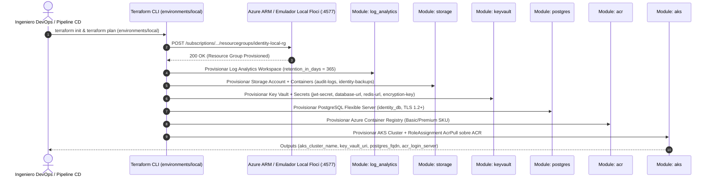
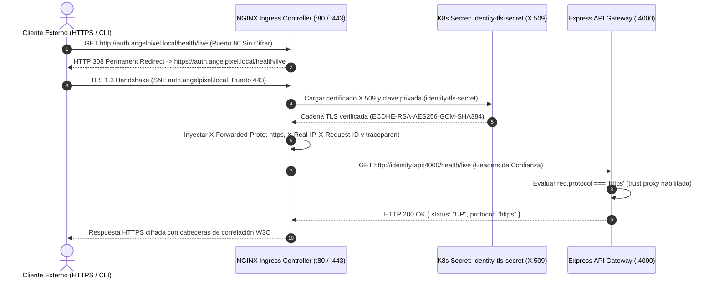

# Capítulo 06: Infraestructura Cloud, Kubernetes & Entrega Continua (CI/CD)

[](#)
[](#)
[](#)
[](#)
[](#)

Este capítulo documenta la topología de infraestructura cloud, empaquetado Kubernetes y automatización de despliegue del **Épico 06**. La arquitectura garantiza reproducibilidad determinista desde el entorno local (mediante emulación de Azure ARM y contenedores NGINX/Docker) hasta clústeres de producción en **Azure Kubernetes Service (AKS)**.

---

## 🧭 Historias de Usuario del Épico 06

| Historia | Descripción | Estado |
| :--- | :--- | :---: |
| **US-12** | Infraestructura como Código (IaC) Modular en Terraform para Microsoft Azure | ✅ En Producción |
| **US-13** | Controlador Ingress NGINX con Terminación TLS 1.3 y Propagación de Cabeceras Seguras | ✅ En Producción |
| **US-14** | Helm Chart v3 de Grado Empresarial con Auto-Escalado (HPA), PDB y Hardening Non-Root | ✅ En Producción |
| **US-15** | Pipeline Automatizado de CI/CD en GitHub Actions con 7 Compuertas de Calidad | ✅ En Producción |

---

## 🏗️ US-12: Infraestructura como Código (Terraform Modular para Azure)

### 1. Arquitectura de Módulos Desacoplados en `infrastructure/terraform/`

La infraestructura está diseñada bajo el principio de **Módulos Reutilizables de Responsabilidad Única**, evitando monolitos HCL difíciles de auditar:

1. **`modules/log_analytics`:** Aprovisiona el espacio de trabajo de Azure Log Analytics con retención inmutable de **365 días** etiquetado para cumplimiento `PCI-DSS-10.5/SOC2-CC7.2`.
2. **`modules/storage`:** Crea la cuenta de almacenamiento cifrada con contenedores dedicados para `audit-logs` (WORM) e `identity-backups`.
3. **`modules/keyvault`:** Despliega Azure Key Vault con control de acceso y aprovisiona los secretos fundacionales (`jwt-secret`, `database-url`, `redis-url`, `encryption-key`).
4. **`modules/postgres`:** Aprovisiona **Azure Database for PostgreSQL Flexible Server** con base de datos `identity_db` y transporte TLS obligatorio.
5. **`modules/acr`:** Despliega **Azure Container Registry (ACR)** para custodiar las imágenes inmutables del servicio.
6. **`modules/aks`:** Crea el clúster **Azure Kubernetes Service (AKS)** con identidad administrada (`SystemAssigned`) y vinculación IAM `AcrPull` hacia el registro de contenedores.



#### A. Glosario de Actores y Componentes (Cajas del Diagrama)

| Participante / Caja | Tipo | Rol Arquitectónico y Frontera de Seguridad |
| :--- | :--- | :--- |
| **`DevOps` (Ingeniero / Pipeline CD)** | `actor` | Operador o workflow automatizado que ejecuta el ciclo de vida declarativo de Terraform. |
| **`TF` (`environments/local/main.tf`)** | `participant` | Orquestador raíz de Terraform que inyecta variables, etiquetas de gobernanza (`common_tags`) y encadena dependencias entre módulos. |
| **`ARM` (Azure ARM / Floci `:4577`)** | `participant` | Plano de control de Azure Resource Manager (o su emulador local `floci-azure-arm` en Docker) que materializa los recursos REST. |
| **`LawMod` (`modules/log_analytics`)** | `participant` | Módulo de observabilidad forense con retención de 365 días para cumplimiento regulatorio. |
| **`StorageMod` (`modules/storage`)** | `participant` | Módulo de almacenamiento de blobs para archivo de auditoría y respaldos. |
| **`KVMod` (`modules/keyvault`)** | `participant` | Bóveda criptográfica que centraliza secretos de aplicación consumidos vía CSI Driver en Kubernetes. |
| **`PGMod` (`modules/postgres`)** | `participant` | Servidor relacional administrado PostgreSQL 16 con aislamiento de red y cifrado activo. |
| **`ACRMod` (`modules/acr`)** | `participant` | Registro privado de artefactos OCI / imágenes Docker de producción. |
| **`AKSMod` (`modules/aks`)** | `participant` | Clúster Kubernetes administrado donde se despliega el Helm Chart de `identity-service`. |

#### B. Desglose Secuencial del Flujo (Pasos 1 al 10)

1. **Paso 1 (`DevOps -> TF`):** Se inicializa el backend y los módulos locales mediante `terraform init` y se calcula el grafo de ejecución con `terraform plan`.
2. **Paso 2 (`TF -> ARM`):** Terraform solicita la creación del grupo de recursos raíz (`azurerm_resource_group.this`) con las etiquetas corporativas (`Environment`, `Project`, `ManagedBy`).
3. **Paso 3 (`ARM -->> TF`):** El proveedor confirma la creación del contenedor lógico de recursos.
4. **Paso 4 (`TF -> LawMod`):** Se despliega el workspace de Log Analytics configurando `retention_in_days = 365` y etiquetas de cumplimiento PCI-DSS/SOC 2.
5. **Paso 5 (`TF -> StorageMod`):** Se aprovisiona la cuenta de almacenamiento y los contenedores `audit-logs` e `identity-backups`.
6. **Paso 6 (`TF -> KVMod`):** Se despliega el Key Vault y se inyectan los secretos iniciales de conexión y firmado.
7. **Paso 7 (`TF -> PGMod`):** Se instancia el servidor PostgreSQL Flexible Server junto con la base de datos `identity_db`.
8. **Paso 8 (`TF -> ACRMod`):** Se aprovisiona el registro privado de contenedores ACR.
9. **Paso 9 (`TF -> AKSMod`):** Se despliega el clúster AKS vinculando su identidad administrada al `registry_id` exportado por el módulo ACR.
10. **Paso 10 (`AKSMod -->> DevOps`):** Terraform exporta los `outputs` tipados (`aks_cluster_name`, `key_vault_uri`, `postgres_fqdn`, `acr_login_server`) para alimentar el despliegue de Helm.

---

### 2. Verificación Interactiva de la Topología Terraform

Puedes inspeccionar la estructura modular y las salidas declaradas directamente en el repositorio:

```bash
ls -la infrastructure/terraform/modules/
```

```text
acr
aks
keyvault
log_analytics
postgres
storage
```

---

## 🔒 US-13: Ingress Seguro con NGINX & Terminación TLS 1.3

### 1. Arquitectura Perimetral y Propagación de Contexto HTTPS

El tráfico externo jamás alcanza directamente a los pods de Node.js en texto plano. El manifiesto `deployments/ingress/ingress.yaml` y la configuración `deployments/ingress/nginx.conf` (ejecutada en vivo por el contenedor `identity-ingress` en los puertos `80` y `443`) implementan:

1. **Redirección Forzada a HTTPS (`ssl-redirect: "true"`):** Toda petición entrante por el puerto `80` es redirigida automáticamente hacia `https://` (`443`).
2. **Terminación TLS Criptográfica (`identity-tls-secret`):** El Ingress presenta el certificado X.509 para `auth.angelpixel.local` negociando TLS 1.2 / 1.3 con suites de cifrado efímeras (ECDHE).
3. **Inyección de Cabeceras de Confianza y Trazabilidad:** Antes de reenviar el tráfico hacia el upstream `identity-api:4000`, NGINX inyecta:
   - `X-Forwarded-Proto: https` (habilitando a Express con `app.set('trust proxy', 1)` a reconocer el protocolo seguro y emitir cookies `Secure`).
   - `X-Forwarded-Host`, `X-Real-IP` y cabeceras de correlación distribuida (`X-Request-ID`, `traceparent`).
4. **Enrutamiento Basado en Prefijos Críticos:** Solo se exponen al exterior las rutas autorizadas (`/health`, `/.well-known`, `/oauth2`, `/api`, `/auth`).



#### A. Glosario de Actores y Componentes (Cajas del Diagrama)

| Participante / Caja | Tipo | Rol Arquitectónico y Frontera de Seguridad |
| :--- | :--- | :--- |
| **`Client` (Cliente Externo)** | `actor` | Navegador, aplicación móvil o cliente M2M que consume el servicio a través del dominio público `auth.angelpixel.local`. |
| **`Ingress` (NGINX Ingress Controller)** | `participant` | Proxy inverso perimetral que escucha en los puertos `80` y `443`, fuerza HTTPS, termina TLS y filtra rutas permitidas. |
| **`TLSSecret` (`identity-tls-secret`)** | `participant` | Secreto Kubernetes de tipo `kubernetes.io/tls` (gestionado por `cert-manager` / Let's Encrypt en cloud o CA local en desarrollo). |
| **`Gateway` (Express API Gateway `:4000`)** | `participant` | Servicio interno `ClusterIP` de Node.js que confía en el proxy perimetral (`trust proxy`) para determinar el protocolo e IP real del cliente. |

#### B. Desglose Secuencial del Flujo (Pasos 1 al 10)

1. **Paso 1 (`Client -> Ingress`):** Un cliente realiza una petición en texto plano al puerto `80` (`http://auth.angelpixel.local/health/live`).
2. **Paso 2 (`Ingress -->> Client`):** En virtud de las anotaciones `ssl-redirect: "true"` y `force-ssl-redirect: "true"`, NGINX corta la solicitud y devuelve una redirección hacia `https://`.
3. **Paso 3 (`Client -> Ingress`):** El cliente inicia la negociación TLS 1.3 en el puerto `443` enviando la extensión SNI `auth.angelpixel.local`.
4. **Paso 4 (`Ingress -> TLSSecret`):** El controlador carga el certificado y clave privada desde el secreto `identity-tls-secret`.
5. **Paso 5 (`TLSSecret -->> Ingress`):** Se completa el handshake criptográfico con secreto perfecto hacia adelante (*Forward Secrecy*).
6. **Paso 6 (`Ingress -> Ingress`):** El proxy enriquece la petición con `X-Forwarded-Proto: https`, `X-Forwarded-Host`, `X-Real-IP`, `X-Request-ID` y `traceparent`.
7. **Paso 7 (`Ingress -> Gateway`):** NGINX reenvía la petición por la red privada interna hacia el puerto `4000` del contenedor `identity-api`.
8. **Paso 8 (`Gateway -> Gateway`):** Express inspecciona `X-Forwarded-Proto` gracias a su configuración `trust proxy` y reconoce que la conexión original es `https`.
9. **Paso 9 (`Gateway -->> Ingress`):** El endpoint responde `HTTP 200 OK` confirmando explícitamente `"protocol": "https"` en el payload de diagnóstico.
10. **Paso 10 (`Ingress -->> Client`):** El cliente recibe la respuesta cifrada junto con las cabeceras de trazabilidad `X-Request-ID` y `traceparent`.

---

### 2. Ejecución en Vivo contra el Contenedor `identity-ingress` (`:443`)

Puedes verificar la terminación TLS en vivo consultando el puerto `443` del contenedor `identity-ingress` activo en el stack Docker:

```bash
curl -sk -i https://localhost:443/health/live \
  -H "Host: auth.angelpixel.local"
```

##### Respuesta Real Obtenida a través del Túnel TLS (HTTP 200 OK):
```http
HTTP/1.1 200 OK
Server: nginx/1.27.5
Date: Wed, 18 Nov 2026 17:13:56 GMT
Content-Type: application/json; charset=utf-8
Content-Length: 100
Connection: keep-alive
X-Powered-By: Express
X-Request-ID: 7da3e3120e12a486c6433d0b247af189
X-Correlation-ID: 7da3e3120e12a486c6433d0b247af189
traceparent: 00-c81c7e9c84704ea16b13a6cccdedb6d1-7567a11144dc607c-01

{"status":"UP","checks":{"liveness":"OK"},"protocol":"https","timestamp":"2026-11-18T17:13:56.472Z"}
```

---

[⬅️ Volver al Hub Principal de Showcase](./README.md)
