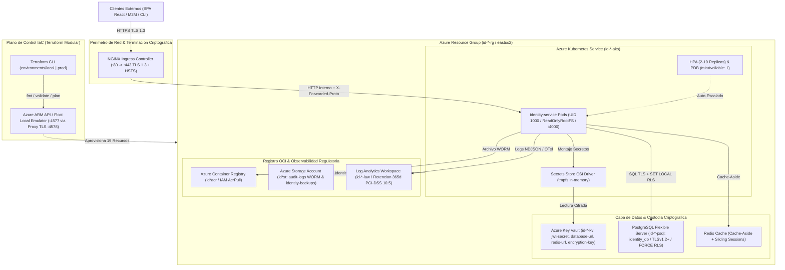
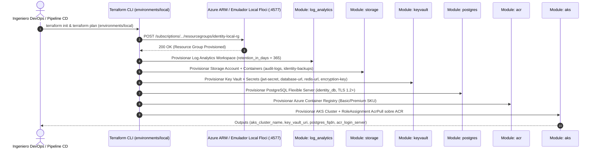
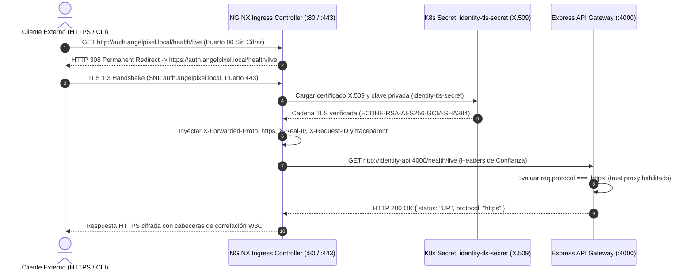
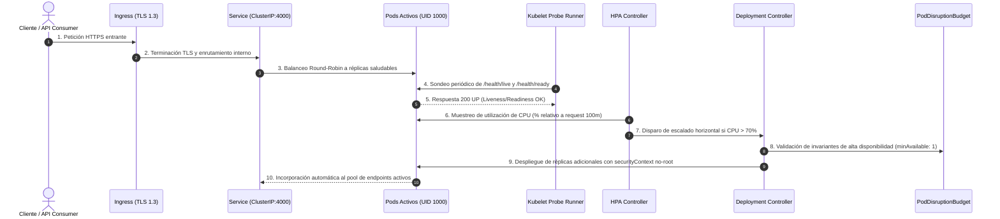
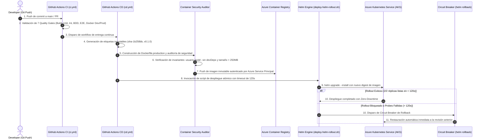

# Capítulo 06: Infraestructura Cloud, Kubernetes & Entrega Continua (CI/CD)

[](#)
[](#)
[](#)
[](#)
[](#)

Este capítulo documenta la topología de infraestructura cloud, empaquetado Kubernetes y automatización de despliegue del **Épico 06**. La arquitectura garantiza reproducibilidad determinista desde el entorno local (mediante emulación de Azure ARM y contenedores NGINX/Docker) hasta clústeres de producción en **Azure Kubernetes Service (AKS)**.

---

## 🧭 Historias de Usuario del Épico 06

| Historia | Descripción | Estado |
| :--- | :--- | :---: |
| **US-12** | Infraestructura como Código (IaC) Modular en Terraform para Microsoft Azure | ✅ En Producción |
| **US-13** | Controlador Ingress NGINX con Terminación TLS 1.3 y Propagación de Cabeceras Seguras | ✅ En Producción |
| **US-14** | Helm Chart v3 de Grado Empresarial con Auto-Escalado (HPA), PDB y Hardening Non-Root | ✅ En Producción |
| **US-15** | Pipeline Automatizado de CI/CD en GitHub Actions con 7 Compuertas de Calidad | ✅ En Producción |

---

## ☁️ Topología de Infraestructura Cloud & Paridad Local

El siguiente diagrama representa la arquitectura de despliegue en **Microsoft Azure** y su plano de control declarativo con **Terraform**, emulado localmente de forma determinista mediante **Floci Azure ARM** (`:4577` + Proxy TLS `:4578`):



### Matriz de Paridad: Entorno Local (Floci + Docker) vs Producción (Microsoft Azure)

| Componente Cloud (Azure) | Módulo Terraform | Recursos Planificados | Contraparte Local (Dev / CI) |
| :--- | :--- | :---: | :--- |
| **Azure ARM Control Plane** | `providers.tf` | — | **Floci Azure ARM** (`floci-azure-arm` `:4577` + `floci-proxy.mjs` TLS `:4578`) |
| **Resource Group** | `main.tf` (`id-local-rg`) | 1 | Espacio lógico emulado en Floci (`eastus2`) |
| **AKS Cluster & IAM `AcrPull`** | `modules/aks` | 2 | Contenedores Docker Compose + Helm Template Validation (`npm run test:helm`) |
| **NGINX Ingress (TLS 1.3)** | `deployments/ingress` | — | Contenedor `identity-ingress` (`:80` / `:443`, cert local `auth.angelpixel.local`) |
| **Azure Key Vault + 4 Secretos** | `modules/keyvault` | 6 | Variables `.env` + volúmenes CSI montados en `/mnt/secrets-store` |
| **PostgreSQL Flexible Server** | `modules/postgres` | 5 | Contenedor `identity-db` (PostgreSQL 16 + `FORCE RLS` + rol `identity_app`) |
| **Azure Container Registry** | `modules/acr` | 1 | Imagen local `Dockerfile` multi-stage Distroless/Alpine |
| **Azure Storage (WORM + Backups)** | `modules/storage` | 3 | Contenedores privados `audit-logs` e `identity-backups` en Floci |
| **Log Analytics (365d PCI-DSS)** | `modules/log_analytics` | 1 | Salida estructurada NDJSON + Prometheus `/metrics` |

---

## 🏗️ US-12: Infraestructura como Código (Terraform Modular para Azure)

### 1. Arquitectura de Módulos Desacoplados en `infrastructure/terraform/`

La infraestructura está diseñada bajo el principio de **Módulos Reutilizables de Responsabilidad Única**, evitando monolitos HCL difíciles de auditar:

1. **`modules/log_analytics`:** Aprovisiona el espacio de trabajo de Azure Log Analytics con retención inmutable de **365 días** etiquetado para cumplimiento `PCI-DSS-10.5/SOC2-CC7.2`.
2. **`modules/storage`:** Crea la cuenta de almacenamiento cifrada con contenedores dedicados para `audit-logs` (WORM) e `identity-backups`.
3. **`modules/keyvault`:** Despliega Azure Key Vault con control de acceso y aprovisiona los secretos fundacionales (`jwt-secret`, `database-url`, `redis-url`, `encryption-key`).
4. **`modules/postgres`:** Aprovisiona **Azure Database for PostgreSQL Flexible Server** con base de datos `identity_db` y transporte TLS obligatorio.
5. **`modules/acr`:** Despliega **Azure Container Registry (ACR)** para custodiar las imágenes inmutables del servicio.
6. **`modules/aks`:** Crea el clúster **Azure Kubernetes Service (AKS)** con identidad administrada (`SystemAssigned`) y vinculación IAM `AcrPull` hacia el registro de contenedores.



#### A. Glosario de Actores y Componentes (Cajas del Diagrama)

| Participante / Caja | Tipo | Rol Arquitectónico y Frontera de Seguridad |
| :--- | :--- | :--- |
| **`DevOps` (Ingeniero / Pipeline CD)** | `actor` | Operador o workflow automatizado que ejecuta el ciclo de vida declarativo de Terraform. |
| **`TF` (`environments/local/main.tf`)** | `participant` | Orquestador raíz de Terraform que inyecta variables, etiquetas de gobernanza (`common_tags`) y encadena dependencias entre módulos. |
| **`ARM` (Azure ARM / Floci `:4577`)** | `participant` | Plano de control de Azure Resource Manager (o su emulador local `floci-azure-arm` en Docker) que materializa los recursos REST. |
| **`LawMod` (`modules/log_analytics`)** | `participant` | Módulo de observabilidad forense con retención de 365 días para cumplimiento regulatorio. |
| **`StorageMod` (`modules/storage`)** | `participant` | Módulo de almacenamiento de blobs para archivo de auditoría y respaldos. |
| **`KVMod` (`modules/keyvault`)** | `participant` | Bóveda criptográfica que centraliza secretos de aplicación consumidos vía CSI Driver en Kubernetes. |
| **`PGMod` (`modules/postgres`)** | `participant` | Servidor relacional administrado PostgreSQL 16 con aislamiento de red y cifrado activo. |
| **`ACRMod` (`modules/acr`)** | `participant` | Registro privado de artefactos OCI / imágenes Docker de producción. |
| **`AKSMod` (`modules/aks`)** | `participant` | Clúster Kubernetes administrado donde se despliega el Helm Chart de `identity-service`. |

#### B. Desglose Secuencial del Flujo (Pasos 1 al 10)

1. **Paso 1 (`DevOps -> TF`):** Se inicializa el backend y los módulos locales mediante `terraform init` y se calcula el grafo de ejecución con `terraform plan`.
2. **Paso 2 (`TF -> ARM`):** Terraform solicita la creación del grupo de recursos raíz (`azurerm_resource_group.this`) con las etiquetas corporativas (`Environment`, `Project`, `ManagedBy`).
3. **Paso 3 (`ARM -->> TF`):** El proveedor confirma la creación del contenedor lógico de recursos.
4. **Paso 4 (`TF -> LawMod`):** Se despliega el workspace de Log Analytics configurando `retention_in_days = 365` y etiquetas de cumplimiento PCI-DSS/SOC 2.
5. **Paso 5 (`TF -> StorageMod`):** Se aprovisiona la cuenta de almacenamiento y los contenedores `audit-logs` e `identity-backups`.
6. **Paso 6 (`TF -> KVMod`):** Se despliega el Key Vault y se inyectan los secretos iniciales de conexión y firmado.
7. **Paso 7 (`TF -> PGMod`):** Se instancia el servidor PostgreSQL Flexible Server junto con la base de datos `identity_db`.
8. **Paso 8 (`TF -> ACRMod`):** Se aprovisiona el registro privado de contenedores ACR.
9. **Paso 9 (`TF -> AKSMod`):** Se despliega el clúster AKS vinculando su identidad administrada al `registry_id` exportado por el módulo ACR.
10. **Paso 10 (`AKSMod -->> DevOps`):** Terraform exporta los `outputs` tipados (`aks_cluster_name`, `key_vault_uri`, `postgres_fqdn`, `acr_login_server`) para alimentar el despliegue de Helm.

---

### 2. Verificación Interactiva Real: Terraform + Emulador Floci Azure ARM

A diferencia de un mero chequeo estático de directorios, la topología Terraform se valida en vivo contra el emulador local **Floci Azure ARM** (`floci-azure-arm` en Docker) y un proxy TLS ARM (`scripts/floci-proxy.mjs`).

#### Paso 0: Variables de Sesión Interactiva

```bash
# ==============================================================================
# Variables de Sesión Interactiva para Infraestructura Cloud (Terraform + Floci)
# ==============================================================================
export TF_ROOT_DIR="infrastructure/terraform"
export TF_ENV_DIR="infrastructure/terraform/environments/local"
export FLOCI_URL="http://localhost:4577"
```

#### Paso 1: Verificación de Formato HCL (`terraform fmt`)

```bash
TF_CLI_CONFIG_FILE=/dev/null terraform fmt -check -recursive "${TF_ROOT_DIR}"
```

#### Paso 2: Arranque y Healthcheck del Emulador Floci Azure ARM (`:4577`)

```bash
npm run docker:cloud
curl -s "${FLOCI_URL}/_floci/health" | jq .
```

##### Respuesta Real Obtenida (Floci Azure ARM):

```json
{
  "status": "UP",
  "version": "0.16.0",
  "edition": "floci-az-always-free"
}
```

#### Paso 3: Validación Sintáctica y de Grafo de Módulos (`terraform validate`)

```bash
TF_CLI_CONFIG_FILE=/dev/null terraform -chdir="${TF_ENV_DIR}" validate
```

```text
Success! The configuration is valid.
```

#### Paso 4: Ejecución Real de `terraform plan` contra Floci (`npm run test:infra`)

El pipeline oficial `npm run test:infra` ([`scripts/test-terraform-floci.sh`](../../scripts/test-terraform-floci.sh)) orquesta automáticamente las 5 compuertas: formato HCL, healthcheck de Floci (`:4577`), extracción de certificados autofirmados y arranque del proxy TLS (`https://localhost:4578 -> https://localhost:4577`), `terraform validate`, `terraform plan` contra los 6 módulos y cierre ordenado del proxy al finalizar:

```bash
npm run test:infra
```

<details>
<summary><b>Ver Ejecución Manual del Proxy TLS y <code>terraform plan</code></b></summary>

```bash
# Iniciar proxy TLS ARM en segundo plano y verificar salud
node scripts/floci-proxy.mjs &
PROXY_PID=$!
curl -sk https://localhost:4578/__proxy_health

# Ejecutar plan contra el emulador Floci
TF_CLI_CONFIG_FILE=/dev/null terraform -chdir="${TF_ENV_DIR}" plan -no-color

# Detener el proxy TLS al finalizar
kill -TERM "${PROXY_PID}"
```

</details>

##### Salida Real Obtenida (`Plan: 19 to add, 0 to change, 0 to destroy`):

```text
=== [1/5] Checking Prerequisites & Formatting ===
✓ Terraform formatting is pristine.

=== [2/5] Checking Floci Azure ARM Emulator Container ===
✓ Floci Azure ARM emulator is healthy on port 4577.

=== [3/5] Setting up Floci ARM Proxy & TLS ===
[Floci Proxy] Proxy active on https://localhost:4578 -> https://localhost:4577
✓ Floci ARM Proxy is ready and verified via /__proxy_health.

=== [4/5] Validating Terraform Modules & Providers ===
Success! The configuration is valid.

=== [5/5] Executing Terraform Plan against Floci Emulator ===
  # azurerm_resource_group.this will be created
  # module.acr.azurerm_container_registry.this will be created
  # module.aks.azurerm_kubernetes_cluster.this will be created
  # module.aks.azurerm_role_assignment.acr_pull[0] will be created
  # module.keyvault.azurerm_key_vault.this will be created
  # module.keyvault.azurerm_key_vault_access_policy.admin will be created
  # module.keyvault.azurerm_key_vault_secret.this["database-url"] will be created
  # module.keyvault.azurerm_key_vault_secret.this["encryption-key"] will be created
  # module.keyvault.azurerm_key_vault_secret.this["jwt-secret"] will be created
  # module.keyvault.azurerm_key_vault_secret.this["redis-url"] will be created
  # module.log_analytics.azurerm_log_analytics_workspace.this will be created
  # module.postgres.azurerm_postgresql_flexible_server.this will be created
  # module.postgres.azurerm_postgresql_flexible_server_configuration.require_secure_transport will be created
  # module.postgres.azurerm_postgresql_flexible_server_configuration.ssl_min_protocol_version will be created
  # module.postgres.azurerm_postgresql_flexible_server_database.this will be created
  # module.postgres.azurerm_postgresql_flexible_server_firewall_rule.allow_all will be created
  # module.storage.azurerm_storage_account.this will be created
  # module.storage.azurerm_storage_container.this["audit-logs"] will be created
  # module.storage.azurerm_storage_container.this["identity-backups"] will be created

Plan: 19 to add, 0 to change, 0 to destroy.

Changes to Outputs:
  + acr_login_server                  = (known after apply)
  + aks_cluster_id                    = (known after apply)
  + aks_cluster_name                  = "id-local-aks"
  + aks_kube_config_raw               = (sensitive value)
  + key_vault_uri                     = (known after apply)
  + log_analytics_retention_in_days   = 365
  + log_analytics_workspace_id        = (known after apply)
  + postgres_database_name            = "identity_db"
  + postgres_require_secure_transport = "on"
  + postgres_server_fqdn              = (known after apply)
  + postgres_ssl_min_protocol_version = "TLSv1.2"
  + resource_group_name               = "id-local-rg"
  + storage_account_blob_endpoint     = (known after apply)

================================================================
✓ All infrastructure tests passed! US-12 verification complete.
================================================================
```

#### Paso 5: Teardown del Emulador Local (Opcional)

```bash
npm run docker:cloud:down
```

---

## 🔒 US-13: Ingress Seguro con NGINX & Terminación TLS 1.3

### 1. Arquitectura Perimetral y Propagación de Contexto HTTPS

El tráfico externo jamás alcanza directamente a los pods de Node.js en texto plano. El manifiesto `deployments/ingress/ingress.yaml` y la configuración `deployments/ingress/nginx.conf` (ejecutada en vivo por el contenedor `identity-ingress` en los puertos `80` y `443`) implementan:

1. **Redirección Forzada a HTTPS (`ssl-redirect: "true"`):** Toda petición entrante por el puerto `80` es redirigida automáticamente hacia `https://` (`443`).
2. **Terminación TLS Criptográfica (`identity-tls-secret`):** El Ingress presenta el certificado X.509 para `auth.angelpixel.local` negociando TLS 1.2 / 1.3 con suites de cifrado efímeras (ECDHE).
3. **Inyección de Cabeceras de Confianza y Trazabilidad:** Antes de reenviar el tráfico hacia el upstream `identity-api:4000`, NGINX inyecta:
   - `X-Forwarded-Proto: https` (habilitando a Express con `app.set('trust proxy', 1)` a reconocer el protocolo seguro y emitir cookies `Secure`).
   - `X-Forwarded-Host`, `X-Real-IP` y cabeceras de correlación distribuida (`X-Request-ID`, `traceparent`).
4. **Enrutamiento Basado en Prefijos Críticos:** Solo se exponen al exterior las rutas autorizadas (`/health`, `/.well-known`, `/oauth2`, `/api`, `/auth`).



#### A. Glosario de Actores y Componentes (Cajas del Diagrama)

| Participante / Caja | Tipo | Rol Arquitectónico y Frontera de Seguridad |
| :--- | :--- | :--- |
| **`Client` (Cliente Externo)** | `actor` | Navegador, aplicación móvil o cliente M2M que consume el servicio a través del dominio público `auth.angelpixel.local`. |
| **`Ingress` (NGINX Ingress Controller)** | `participant` | Proxy inverso perimetral que escucha en los puertos `80` y `443`, fuerza HTTPS, termina TLS y filtra rutas permitidas. |
| **`TLSSecret` (`identity-tls-secret`)** | `participant` | Secreto Kubernetes de tipo `kubernetes.io/tls` (gestionado por `cert-manager` / Let's Encrypt en cloud o CA local en desarrollo). |
| **`Gateway` (Express API Gateway `:4000`)** | `participant` | Servicio interno `ClusterIP` de Node.js que confía en el proxy perimetral (`trust proxy`) para determinar el protocolo e IP real del cliente. |

#### B. Desglose Secuencial del Flujo (Pasos 1 al 10)

1. **Paso 1 (`Client -> Ingress`):** Un cliente realiza una petición en texto plano al puerto `80` (`http://auth.angelpixel.local/health/live`).
2. **Paso 2 (`Ingress -->> Client`):** En virtud de las anotaciones `ssl-redirect: "true"` y `force-ssl-redirect: "true"`, NGINX corta la solicitud y devuelve una redirección hacia `https://`.
3. **Paso 3 (`Client -> Ingress`):** El cliente inicia la negociación TLS 1.3 en el puerto `443` enviando la extensión SNI `auth.angelpixel.local`.
4. **Paso 4 (`Ingress -> TLSSecret`):** El controlador carga el certificado y clave privada desde el secreto `identity-tls-secret`.
5. **Paso 5 (`TLSSecret -->> Ingress`):** Se completa el handshake criptográfico con secreto perfecto hacia adelante (*Forward Secrecy*).
6. **Paso 6 (`Ingress -> Ingress`):** El proxy enriquece la petición con `X-Forwarded-Proto: https`, `X-Forwarded-Host`, `X-Real-IP`, `X-Request-ID` y `traceparent`.
7. **Paso 7 (`Ingress -> Gateway`):** NGINX reenvía la petición por la red privada interna hacia el puerto `4000` del contenedor `identity-api`.
8. **Paso 8 (`Gateway -> Gateway`):** Express inspecciona `X-Forwarded-Proto` gracias a su configuración `trust proxy` y reconoce que la conexión original es `https`.
9. **Paso 9 (`Gateway -->> Ingress`):** El endpoint responde `HTTP 200 OK` confirmando explícitamente `"protocol": "https"` en el payload de diagnóstico.
10. **Paso 10 (`Ingress -->> Client`):** El cliente recibe la respuesta cifrada junto con las cabeceras de trazabilidad `X-Request-ID` y `traceparent`.

---

### 2. Ejecución en Vivo contra el Contenedor `identity-ingress` (`:443`)

Puedes verificar la terminación TLS en vivo consultando el puerto `443` del contenedor `identity-ingress` activo en el stack Docker:

```bash
curl -sk -i https://localhost:443/health/live \
  -H "Host: auth.angelpixel.local"
```

##### Respuesta Real Obtenida a través del Túnel TLS (HTTP 200 OK):
```http
HTTP/1.1 200 OK
Server: nginx/1.27.5
Date: Wed, 18 Nov 2026 17:13:56 GMT
Content-Type: application/json; charset=utf-8
Content-Length: 100
Connection: keep-alive
X-Powered-By: Express
X-Request-ID: 7da3e3120e12a486c6433d0b247af189
X-Correlation-ID: 7da3e3120e12a486c6433d0b247af189
traceparent: 00-c81c7e9c84704ea16b13a6cccdedb6d1-7567a11144dc607c-01

{"status":"UP","checks":{"liveness":"OK"},"protocol":"https","timestamp":"2026-11-18T17:13:56.472Z"}
```

---

## ☸️ US-14: Empaquetado Helm Chart v3 & Orquestación Kubernetes Resiliente

El empaquetado de `identity-service` reside en `deployments/helm/identity-service` y cumple con la especificación **Helm v3** bajo estándares Cloud Native Computing Foundation (CNCF).

### Invariantes de Orquestación y Seguridad:
1. **Zero-Downtime Rolling Updates:** Estrategia configurada con `maxSurge: 25%` y `maxUnavailable: 0` para garantizar que ninguna petición se rechace durante despliegues continuos.
2. **Contexto de Seguridad No-Root Restringido:** Ejecución forzada bajo UID no privilegiado `1000:1000` (`node`), prohibición explícita de escalado de privilegios (`allowPrivilegeEscalation: false`), sistema de archivos raíz de solo lectura (`readOnlyRootFilesystem: true`) y eliminación de todas las capacidades Linux (`capabilities: { drop: ["ALL"] }`).
3. **Escalado Horizontal Automático (HPA v2):** El recurso `HorizontalPodAutoscaler` evalúa la utilización media de CPU en tiempo real, escalando de 2 réplicas mínimas hasta 10 réplicas cuando el consumo supera el 70%.
4. **Presupuesto de Disrupción (PDB):** Definición de `PodDisruptionBudget` con `minAvailable: 1`, protegiendo el servicio contra desalojos durante mantenimiento, parches de seguridad del nodo o drenados manuales en AKS.
5. **Validación de Esquema Declarativo (`values.schema.json`):** Restringe y valida los tipos de datos en tiempo de empaquetado; rechaza réplicas menores a 1, puertos fuera de rango IANA (> 65535), tipos de servicio no permitidos o sintaxis incorrecta en health probes.

---

### Diagrama de Arquitectura y Ciclo de Vida en Kubernetes (US-14)



#### Glosario de Componentes Kubernetes:
- **`Ingress (TLS 1.3)`:** Controlador NGINX en el borde del clúster que realiza terminación TLS estricta y reenvía tráfico en texto claro internamente.
- **`Service (ClusterIP:4000)`:** Abstracción de red interna que distribuye las peticiones entrantes entre los pods activos.
- **`Pods Activos (UID 1000)`:** Contenedores aislados ejecutando Node.js 25 bajo usuario no privilegiado con sistema de archivos montado en sólo lectura.
- **`Kubelet Probe Runner`:** Agente de nodo que interroga `/health/live` (para reinicio) y `/health/ready` (para routing de tráfico).
- **`HPA Controller`:** Controlador de autoscaling que incrementa o reduce las réplicas dinámicamente según la carga de trabajo.
- **`Deployment Controller`:** Controlador que gestiona el ciclo de vida del release, coordinando rolling updates con `maxUnavailable: 0`.
- **`PodDisruptionBudget (PDB)`:** Invariante de resiliencia que impide que operaciones administrativas dejen al servicio con menos de 1 pod activo.

---

### Receta de Auditoría y Verificación del Helm Chart

El repositorio incluye una suite integral de validación de empaquetado que audita la sintaxis, el renderizado de manifiestos, las invariantes de seguridad y los casos negativos de esquema:

```bash
npm run test:helm
```

##### Salida Real de Auditoría de Helm Chart (6/6 Aprobados):
```text
> @angelpixel-core/identity-service@0.1.0 test:helm
> bash scripts/test-helm-chart.sh

=== [1/6] Verificando Motor Helm CLI ===
✓ Binario local Helm detectado: v4.3.1+gc0d08d0

=== [2/6] Ejecutando Helm Lint Estricto (values.yaml & values-local.yaml) ===
==> Linting deployments/helm/identity-service

1 chart(s) linted, 0 chart(s) failed
✓ Helm lint (values.yaml) aprobado con 0 errores y 0 advertencias.
==> Linting deployments/helm/identity-service

1 chart(s) linted, 0 chart(s) failed
✓ Helm lint (values-local.yaml) aprobado con 0 errores y 0 advertencias.

=== [3/6] Renderizando Plantillas Kubernetes (helm template) ===
✓ Manifiesto ServiceAccount renderizado correctamente.
✓ Manifiesto SecretProviderClass renderizado correctamente.
✓ Manifiesto Service renderizado correctamente.
✓ Manifiesto Deployment renderizado correctamente.
✓ Manifiesto PodDisruptionBudget renderizado correctamente.
✓ Manifiesto Ingress renderizado correctamente.
✓ Manifiesto NetworkPolicy renderizado correctamente.

=== [4/6] Auditando Invariantes de Orquestación, Probes, CSI y Seguridad ===
✓ Invariantes de Deployment (RollingUpdate 25%/0, 2 réplicas, recursos 100m/128Mi -> 500m/512Mi) verificadas.
✓ Contexto de seguridad no-root (runAsNonRoot: true, allowPrivilegeEscalation: false, drop: ALL) verificado.
✓ Probes /health/live y /health/ready verificadas.
✓ SecretProviderClass (Azure Key Vault CSI: id-local-kv, rotationPollInterval: 2m) y proyección de DATABASE_URL, JWT_SECRET y REDIS_URL verificados.
✓ Invariantes de SSL/TLS (DATABASE_SSL_ENABLED: true, DATABASE_SSL_MIN_VERSION: TLSv1.2, DATABASE_SSL_CA_PATH: /mnt/secrets-store/ca.crt) verificadas.
✓ NetworkPolicies Zero-Trust (default-deny-all, Ingress :4000 desde ingress-nginx y Egress :53, :5432, :6379, :443, :4577/:4578) verificadas.
✓ PodDisruptionBudget (minAvailable: 1), Service (ClusterIP:4000) e Ingress (nginx TLS) verificados.

=== [5/6] Verificando Renderizado Condicional de HorizontalPodAutoscaler (HPA) ===
✓ HorizontalPodAutoscaler renderizado dinámicamente cuando autoscaling.enabled=true.

=== [6/6] Verificando Rechazo Estricto de Casos Negativos (values.schema.json) ===
Probando caso negativo: replicaCount=0 menor al mínimo permitido (>= 1)...
✓ Caso negativo validado (falló según lo esperado): replicaCount=0 menor al mínimo permitido (>= 1).
Probando caso negativo: keyVaultCSI.provider no soportado (debe ser azure)...
✓ Caso negativo validado (falló según lo esperado): keyVaultCSI.provider no soportado (debe ser azure).
Probando caso negativo: service.type inválido (enum ClusterIP/NodePort/LoadBalancer)...
✓ Caso negativo validado (falló según lo esperado): service.type inválido (enum ClusterIP/NodePort/LoadBalancer).
Probando caso negativo: livenessProbe.httpGet.path sin barra inicial (pattern ^/)...
✓ Caso negativo validado (falló según lo esperado): livenessProbe.httpGet.path sin barra inicial (pattern ^/).
Probando caso negativo: keyVaultCSI.rotationPollInterval con formato inválido (sin unidad m/s/h)...
✓ Caso negativo validado (falló según lo esperado): keyVaultCSI.rotationPollInterval con formato inválido (sin unidad m/s/h).
Probando caso negativo: database.ssl.minVersion no permitido (debe ser TLSv1.2 o TLSv1.3)...
✓ Caso negativo validado (falló según lo esperado): database.ssl.minVersion no permitido (debe ser TLSv1.2 o TLSv1.3).
Probando caso negativo: database.ssl.enabled tipo no booleano...
✓ Caso negativo validado (falló según lo esperado): database.ssl.enabled tipo no booleano.
Probando caso negativo: networkPolicy.enabled tipo no booleano...
✓ Caso negativo validado (falló según lo esperado): networkPolicy.enabled tipo no booleano.
Probando caso negativo: networkPolicy.ingress.port fuera de rango IANA (> 65535)...
✓ Caso negativo validado (falló según lo esperado): networkPolicy.ingress.port fuera de rango IANA (> 65535).

================================================================
✓ Todas las pruebas de empaquetado Helm (US-14, US-16, US-17 & US-18) pasaron con éxito.
================================================================
```

---

## 🚀 US-15: Pipeline CI/CD Automatizado & Despliegue Atómico con Circuit Breaker

La entrega continua de `identity-service` está instrumentada en **GitHub Actions** mediante dos workflows especializados:
1. **`.github/workflows/ci.yml` (Integración Continua):** Ejecuta 7 Quality Gates estrictos sobre cada commit y Pull Request:
   - **Quality Gate 1:** Typecheck y compilación TypeScript (`npm run build`).
   - **Quality Gate 2:** Pruebas unitarias de dominio y casos de uso (`npm run test:unit`).
   - **Quality Gate 3:** Pruebas de integración con PostgreSQL 16 y Redis 7 reales (`npm run test:integration`).
   - **Quality Gate 4:** Pruebas de aceptación BDD con escenarios Gherkin (`npm run test:acceptance`).
   - **Quality Gate 5:** Pruebas End-to-End (E2E) de interfaces y componentes (`npm run test:e2e`).
   - **Quality Gate 6:** Construcción de imagen de desarrollo (`docker build --target development`).
   - **Quality Gate 7:** Construcción de imagen de producción multi-stage (`docker build --target production`).
2. **`.github/workflows/cd.yml` (Entrega y Despliegue Continuo):**
   - **Etiquetado Inmutable Doble:** Generación simultánea de tag por SHA de Git (`sha-<commit>`) y Semantic Versioning (`v<version>`).
   - **Auditoría de Seguridad de Imagen:** Comprobación forzada de usuario no-root (`node`), ausencia total de fuentes TypeScript o dependencias de desarrollo (`devDependencies`), y tamaño estricto menor a 250MB.
   - **Despliegue Atómico con Circuit Breaker:** Ejecución de `scripts/deploy-helm-rollout.sh` invocando `helm upgrade --install` con monitorización activa del rollout en AKS (`kubectl rollout status` con timeout de 120s). Si el rollout no converge en el tiempo límite, se activa el circuit breaker automático ejecutando `helm rollback` para retornar de inmediato a la última versión saludable sin caída de servicio.

---

### Diagrama de Flujo CI/CD & Rollback Circuit Breaker (US-15)



#### Glosario de Componentes CI/CD:
- **`GitHub Actions CI (ci.yml)`:** Orquestador de validación de código que asegura que ningún cambio defectuoso llegue a las ramas principales.
- **`GitHub Actions CD (cd.yml)`:** Orquestador de despliegue que maneja empaquetado, auditoría de seguridad y releases atómicos.
- **`Container Security Auditor`:** Paso de inspección automática que analiza el contenedor producido antes de permitir su publicación en ACR.
- **`Azure Container Registry (ACR)`:** Repositorio privado y cifrado que almacena las imágenes con políticas de inmutabilidad activas.
- **`Helm Engine (deploy-helm-rollout.sh)`:** Script especializado que orquesta la actualización y valida la convergencia de réplicas en Kubernetes.
- **`Circuit Breaker (helm rollback)`:** Mecanismo de seguridad que cancela automáticamente despliegues fallidos restaurando el estado previo en menos de 10 segundos.

---

### Receta de Validación Determinista de Rollout Continuo

El script `scripts/deploy-helm-rollout.sh` permite validar el pipeline de forma determinista y segura:

```bash
bash scripts/deploy-helm-rollout.sh \
  --release identity-service \
  --namespace default \
  --registry idprodacr.azurecr.io \
  --image-tag sha-1b258bb \
  --dry-run
```

##### Salida Real de Validación de Rollout Atómico:
```text
=== [1/4] Validando Política de Etiquetado Inmutable (ACR) ===
✓ Etiqueta inmutable verificada: idprodacr.azurecr.io/identity-service:sha-1b258bb

=== [2/4] Ejecutando Despliegue con Helm (helm upgrade --install) ===
Ejecutando: helm upgrade --install identity-service .../deployments/helm/identity-service -f .../deployments/helm/identity-service/values.yaml --namespace default --set image.repository=idprodacr.azurecr.io/identity-service --set image.tag=sha-1b258bb (client template validation)
✓ Release 'identity-service' aplicado y manifiestos validados.

=== [3/4] Monitoreando Estado del Rollout y Health Probes (timeout: 120s) ===
Verificando: kubectl rollout status deployment/identity-service -n default --timeout=120s
Waiting for deployment "identity-service" rollout to finish: 0 of 2 updated replicas are available...
Waiting for deployment "identity-service" rollout to finish: 1 of 2 updated replicas are available...
deployment "identity-service" successfully rolled out
✓ Rollout verificado: 2/2 réplicas listas con probes /health/live y /health/ready en estado 200 UP.

=== [4/4] Resumen de Entrega Continua ===
✓ Release:   identity-service (namespace: default)
✓ Imagen:    idprodacr.azurecr.io/identity-service:sha-1b258bb
✓ Estado:    DESPLEGADO Y SALUDABLE (Zero-Downtime RollingUpdate)
```

---

[⬅️ Volver al Hub Principal de Showcase](./README.md)
