# Capítulo 06: Infraestructura Cloud, Kubernetes & Entrega Continua (CI/CD)

[](#)
[](#)
[](#)
[](#)
[](#)

Este capítulo documenta la topología de infraestructura cloud, empaquetado Kubernetes y automatización de despliegue del **Épico 06**. La arquitectura garantiza reproducibilidad determinista desde el entorno local (mediante emulación de Azure ARM y contenedores NGINX/Docker) hasta clústeres de producción en **Azure Kubernetes Service (AKS)**.

---

## 🧭 Historias de Usuario del Épico 06

| Historia | Descripción | Estado |
| :--- | :--- | :---: |
| **US-12** | Infraestructura como Código (IaC) Modular en Terraform para Microsoft Azure | ✅ En Producción |
| **US-13** | Controlador Ingress NGINX con Terminación TLS 1.3 y Propagación de Cabeceras Seguras | ✅ En Producción |
| **US-14** | Helm Chart v3 de Grado Empresarial con Auto-Escalado (HPA), PDB y Hardening Non-Root | ✅ En Producción |
| **US-15** | Pipeline Automatizado de CI/CD en GitHub Actions con 7 Compuertas de Calidad | ✅ En Producción |

---

## ☁️ Topología de Infraestructura Cloud & Paridad Local

El siguiente diagrama representa la arquitectura de despliegue en **Microsoft Azure** y su plano de control declarativo con **Terraform**, emulado localmente de forma determinista mediante **Floci Azure ARM** (`:4577` + Proxy TLS `:4578`):

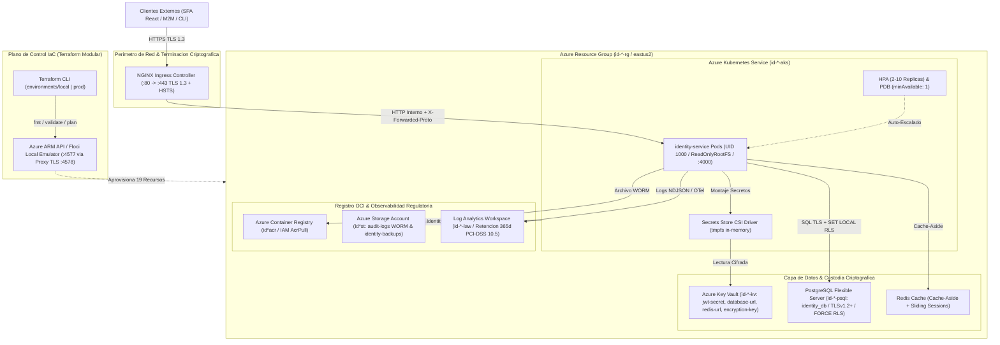

### Matriz de Paridad: Entorno Local (Floci + Docker) vs Producción (Microsoft Azure)

| Componente Cloud (Azure) | Módulo Terraform | Recursos Planificados | Contraparte Local (Dev / CI) |
| :--- | :--- | :---: | :--- |
| **Azure ARM Control Plane** | `providers.tf` | — | **Floci Azure ARM** (`floci-azure-arm` `:4577` + `floci-proxy.mjs` TLS `:4578`) |
| **Resource Group** | `main.tf` (`id-local-rg`) | 1 | Espacio lógico emulado en Floci (`eastus2`) |
| **AKS Cluster & IAM `AcrPull`** | `modules/aks` | 2 | Contenedores Docker Compose + Helm Template Validation (`npm run test:helm`) |
| **NGINX Ingress (TLS 1.3)** | `deployments/ingress` | — | Contenedor `identity-ingress` (`:80` / `:443`, cert local `auth.angelpixel.local`) |
| **Azure Key Vault + 4 Secretos** | `modules/keyvault` | 6 | Variables `.env` + volúmenes CSI montados en `/mnt/secrets-store` |
| **PostgreSQL Flexible Server** | `modules/postgres` | 5 | Contenedor `identity-db` (PostgreSQL 16 + `FORCE RLS` + rol `identity_app`) |
| **Azure Container Registry** | `modules/acr` | 1 | Imagen local `Dockerfile` multi-stage Distroless/Alpine |
| **Azure Storage (WORM + Backups)** | `modules/storage` | 3 | Contenedores privados `audit-logs` e `identity-backups` en Floci |
| **Log Analytics (365d PCI-DSS)** | `modules/log_analytics` | 1 | Salida estructurada NDJSON + Prometheus `/metrics` |

---

## 🏗️ US-12: Infraestructura como Código (Terraform Modular para Azure)

### 1. Arquitectura de Módulos Desacoplados en `infrastructure/terraform/`

La infraestructura está diseñada bajo el principio de **Módulos Reutilizables de Responsabilidad Única**, evitando monolitos HCL difíciles de auditar:

1. **`modules/log_analytics`:** Aprovisiona el espacio de trabajo de Azure Log Analytics con retención inmutable de **365 días** etiquetado para cumplimiento `PCI-DSS-10.5/SOC2-CC7.2`.
2. **`modules/storage`:** Crea la cuenta de almacenamiento cifrada con contenedores dedicados para `audit-logs` (WORM) e `identity-backups`.
3. **`modules/keyvault`:** Despliega Azure Key Vault con control de acceso y aprovisiona los secretos fundacionales (`jwt-secret`, `database-url`, `redis-url`, `encryption-key`).
4. **`modules/postgres`:** Aprovisiona **Azure Database for PostgreSQL Flexible Server** con base de datos `identity_db` y transporte TLS obligatorio.
5. **`modules/acr`:** Despliega **Azure Container Registry (ACR)** para custodiar las imágenes inmutables del servicio.
6. **`modules/aks`:** Crea el clúster **Azure Kubernetes Service (AKS)** con identidad administrada (`SystemAssigned`) y vinculación IAM `AcrPull` hacia el registro de contenedores.

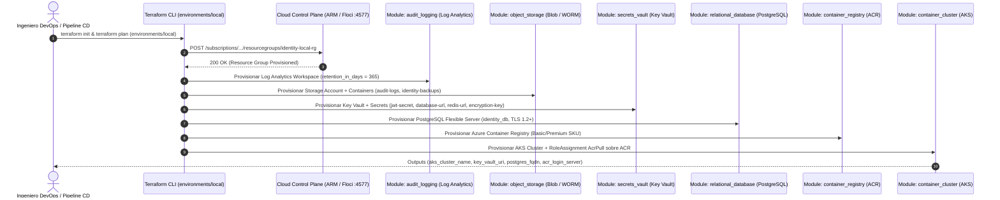

#### A. Glosario de Actores y Componentes (Cajas del Diagrama)

| Participante / Caja | Tipo | Rol Arquitectónico y Frontera de Seguridad |
| :--- | :--- | :--- |
| **`DevOps` (Ingeniero / Pipeline CD)** | `actor` | Operador o workflow automatizado que ejecuta el ciclo de vida declarativo de Terraform. |
| **`TF` (`environments/local/main.tf`)** | `participant` | Orquestador raíz de Terraform que inyecta variables, etiquetas de gobernanza (`common_tags`) y encadena dependencias entre módulos. |
| **`CloudAPI` (Cloud Control Plane — ARM / Floci `:4577`)** | `participant` | Plano de control de infraestructura cloud (Azure Resource Manager o su emulador local `floci-azure-arm` en Docker) que materializa los recursos REST. |
| **`AuditLogMod` (`modules/log_analytics` — Log Analytics)** | `participant` | Módulo de observabilidad forense con retención de 365 días para cumplimiento regulatorio. |
| **`StorageMod` (`modules/storage` — Blob / WORM)** | `participant` | Módulo de almacenamiento de objetos para archivo de auditoría y respaldos. |
| **`VaultMod` (`modules/keyvault` — Key Vault)** | `participant` | Bóveda criptográfica que centraliza secretos de aplicación consumidos vía CSI Driver en Kubernetes. |
| **`DatabaseMod` (`modules/postgres` — PostgreSQL)** | `participant` | Servidor relacional administrado PostgreSQL 16 con aislamiento de red y cifrado activo. |
| **`RegistryMod` (`modules/acr` — ACR)** | `participant` | Registro privado de artefactos OCI / imágenes Docker de producción. |
| **`ClusterMod` (`modules/aks` — AKS)** | `participant` | Clúster Kubernetes administrado donde se despliega el Helm Chart de `identity-service`. |

#### B. Desglose Secuencial del Flujo (Pasos 1 al 10)

1. **Paso 1 (`DevOps -> TF`):** Se inicializa el backend y los módulos locales mediante `terraform init` y se calcula el grafo de ejecución con `terraform plan`.
2. **Paso 2 (`TF -> CloudAPI`):** Terraform solicita la creación del grupo de recursos raíz (`azurerm_resource_group.this`) con las etiquetas corporativas (`Environment`, `Project`, `ManagedBy`).
3. **Paso 3 (`CloudAPI -->> TF`):** El plano de control confirma la creación del contenedor lógico de recursos.
4. **Paso 4 (`TF -> AuditLogMod`):** Se despliega el workspace de Log Analytics configurando `retention_in_days = 365` y etiquetas de cumplimiento PCI-DSS/SOC 2.
5. **Paso 5 (`TF -> StorageMod`):** Se aprovisiona la cuenta de almacenamiento y los contenedores `audit-logs` e `identity-backups`.
6. **Paso 6 (`TF -> VaultMod`):** Se despliega el Key Vault y se inyectan los secretos iniciales de conexión y firmado.
7. **Paso 7 (`TF -> DatabaseMod`):** Se instancia el servidor PostgreSQL Flexible Server junto con la base de datos `identity_db`.
8. **Paso 8 (`TF -> RegistryMod`):** Se aprovisiona el registro privado de contenedores ACR.
9. **Paso 9 (`TF -> ClusterMod`):** Se despliega el clúster AKS vinculando su identidad administrada al `registry_id` exportado por el módulo de registro.
10. **Paso 10 (`ClusterMod -->> DevOps`):** Terraform exporta los `outputs` tipados (`aks_cluster_name`, `key_vault_uri`, `postgres_fqdn`, `acr_login_server`) para alimentar el despliegue de Helm.

---

### 2. Evidencia Visual: Dashboard Local de Floci Azure ARM

Captura en alta resolución del panel web nativo de **Floci Azure ARM** (`http://localhost:4577`), el emulador local que expone paridad determinista para nuestros 6 módulos de Terraform:

- **Estado y Runtime:** Indicador **`Online`**, versión **`v0.16.0`** (`floci-az-always-free` / `AzureCloud`).
- **Conexión y Región:** Endpoint **`http://localhost:4577`** · Región **`eastus`** · Cuenta local **`devstoreaccount1`**.
- **Catálogo de Servicios:** **`33 enabled`** services activos (incluyendo `acr`, `aks`, `keyvault`, `postgres`, `blob`, `arm` y `monitor`).

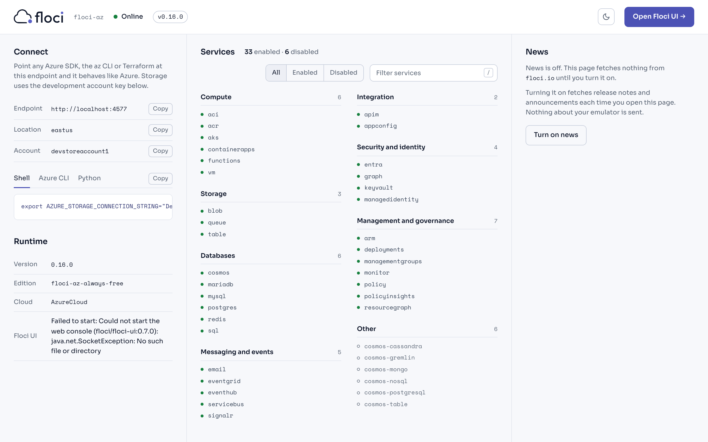

Además, tras montar el socket de Docker en el servicio `floci` ([`compose.yml`](../../compose.yml)), **Floci UI** (`floci/floci-ui:0.7.0` en `http://localhost:4500/console/azure`) expone el explorador visual de servicios en estado inicial limpio (`RESOURCES: 0`, `ACTIVE SERVICES: 12`) previo al aprovisionamiento:

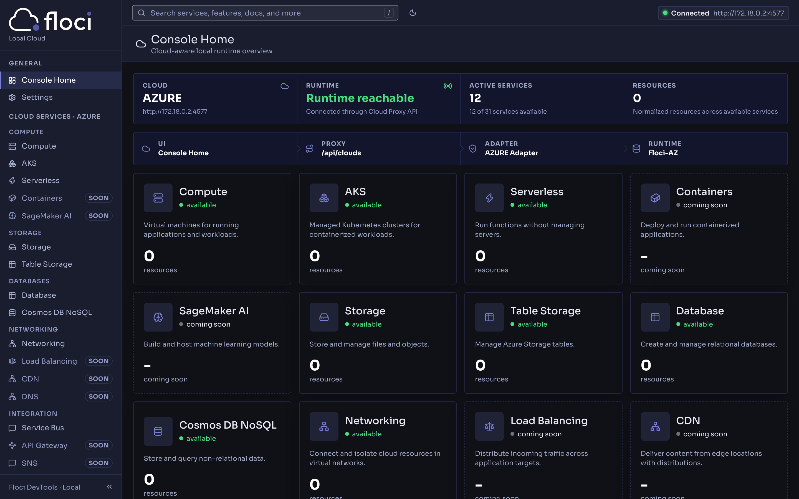

---

### 3. Verificación Interactiva Real: Terraform + Emulador Floci Azure ARM

A diferencia de un mero chequeo estático de directorios, la topología Terraform se valida en vivo contra el emulador local **Floci Azure ARM** (`floci-azure-arm` en Docker) y un proxy TLS ARM (`scripts/floci-proxy.mjs`).

#### Paso 0: Variables de Sesión Interactiva

```bash
# ==============================================================================
# Variables de Sesión Interactiva para Infraestructura Cloud (Terraform + Floci)
# ==============================================================================
export TF_ROOT_DIR="infrastructure/terraform"
export TF_ENV_DIR="infrastructure/terraform/environments/local"
export FLOCI_URL="http://localhost:4577"
```

#### Paso 1: Verificación de Formato HCL (`terraform fmt`)

```bash
TF_CLI_CONFIG_FILE=/dev/null terraform fmt -check -recursive "${TF_ROOT_DIR}"
```

#### Paso 2: Arranque y Healthcheck del Emulador Floci Azure ARM (`:4577`)

```bash
npm run docker:cloud
curl -s "${FLOCI_URL}/_floci/health" | jq .
```

##### Respuesta Real Obtenida (Floci Azure ARM):

```json
{
  "status": "UP",
  "version": "0.16.0",
  "edition": "floci-az-always-free"
}
```

#### Paso 3: Validación Sintáctica y de Grafo de Módulos (`terraform validate`)

```bash
TF_CLI_CONFIG_FILE=/dev/null terraform -chdir="${TF_ENV_DIR}" validate
```

```text
Success! The configuration is valid.
```

#### Paso 4: Ejecución Real de `terraform plan` contra Floci (`npm run test:infra`)

El pipeline oficial `npm run test:infra` ([`scripts/test-terraform-floci.sh`](../../scripts/test-terraform-floci.sh)) orquesta automáticamente las 5 compuertas: formato HCL, healthcheck de Floci (`:4577`), extracción de certificados autofirmados y arranque del proxy TLS (`https://localhost:4578 -> https://localhost:4577`), `terraform validate`, `terraform plan` contra los 6 módulos y cierre ordenado del proxy al finalizar:

```bash
npm run test:infra
```

> [!NOTE]
> **Certificado CA de Floci en macOS (`darwin`):** En macOS, el proveedor `azurerm` (Go) valida TLS contra el llavero del sistema (`Security.framework`) e ignora `SSL_CERT_FILE`. `scripts/test-terraform-floci.sh` verifica automáticamente si el fingerprint SHA-256 de `floci-az-ca.crt` ya está confiado en `~/Library/Keychains/login.keychain-db` y, si es nuevo (primera ejecución o volumen recreado), ejecuta:
> ```bash
> security add-trusted-cert -r trustRoot -k ~/Library/Keychains/login.keychain-db infrastructure/local/floci/.tls/floci-az-ca.crt
> ```

<details>
<summary><b>Ver Ejecución Manual del Proxy TLS y <code>terraform plan</code></b></summary>

```bash
# Iniciar proxy TLS ARM en segundo plano y verificar salud
node scripts/floci-proxy.mjs &
PROXY_PID=$!
curl -sk https://localhost:4578/__proxy_health

# Ejecutar plan contra el emulador Floci
TF_CLI_CONFIG_FILE=/dev/null terraform -chdir="${TF_ENV_DIR}" plan -no-color

# Detener el proxy TLS al finalizar
kill -TERM "${PROXY_PID}"
```

</details>

##### Salida Real Obtenida (`Plan: 19 to add, 0 to change, 0 to destroy`):

```text
=== [1/5] Checking Prerequisites & Formatting ===
✓ Terraform formatting is pristine.

=== [2/5] Checking Floci Azure ARM Emulator Container ===
✓ Floci Azure ARM emulator is healthy on port 4577.

=== [3/5] Setting up Floci ARM Proxy & TLS ===
[Floci Proxy] Proxy active on https://localhost:4578 -> https://localhost:4577
✓ Floci ARM Proxy is ready and verified via /__proxy_health.

=== [4/5] Validating Terraform Modules & Providers ===
Success! The configuration is valid.

=== [5/5] Executing Terraform Plan against Floci Emulator ===
  # azurerm_resource_group.this will be created
  # module.acr.azurerm_container_registry.this will be created
  # module.aks.azurerm_kubernetes_cluster.this will be created
  # module.aks.azurerm_role_assignment.acr_pull[0] will be created
  # module.keyvault.azurerm_key_vault.this will be created
  # module.keyvault.azurerm_key_vault_access_policy.admin will be created
  # module.keyvault.azurerm_key_vault_secret.this["database-url"] will be created
  # module.keyvault.azurerm_key_vault_secret.this["encryption-key"] will be created
  # module.keyvault.azurerm_key_vault_secret.this["jwt-secret"] will be created
  # module.keyvault.azurerm_key_vault_secret.this["redis-url"] will be created
  # module.log_analytics.azurerm_log_analytics_workspace.this will be created
  # module.postgres.azurerm_postgresql_flexible_server.this will be created
  # module.postgres.azurerm_postgresql_flexible_server_configuration.require_secure_transport will be created
  # module.postgres.azurerm_postgresql_flexible_server_configuration.ssl_min_protocol_version will be created
  # module.postgres.azurerm_postgresql_flexible_server_database.this will be created
  # module.postgres.azurerm_postgresql_flexible_server_firewall_rule.allow_all will be created
  # module.storage.azurerm_storage_account.this will be created
  # module.storage.azurerm_storage_container.this["audit-logs"] will be created
  # module.storage.azurerm_storage_container.this["identity-backups"] will be created

Plan: 19 to add, 0 to change, 0 to destroy.

Changes to Outputs:
  + acr_login_server                  = (known after apply)
  + aks_cluster_id                    = (known after apply)
  + aks_cluster_name                  = "id-local-aks"
  + aks_kube_config_raw               = (sensitive value)
  + key_vault_uri                     = (known after apply)
  + log_analytics_retention_in_days   = 365
  + log_analytics_workspace_id        = (known after apply)
  + postgres_database_name            = "identity_db"
  + postgres_require_secure_transport = "on"
  + postgres_server_fqdn              = (known after apply)
  + postgres_ssl_min_protocol_version = "TLSv1.2"
  + resource_group_name               = "id-local-rg"
  + storage_account_blob_endpoint     = (known after apply)

================================================================
✓ All infrastructure tests passed! US-12 verification complete.
================================================================
```

#### Paso 5: Aprovisionamiento Real en Floci (`terraform apply` vía `npm run test:infra:apply`) y Verificación en Floci UI

Para materializar los recursos en el emulador local (más allá del `plan` no destructivo de `npm run test:infra`), [`scripts/test-terraform-floci.sh`](../../scripts/test-terraform-floci.sh) acepta `--apply` reutilizando exactamente la misma configuración TLS (`SSL_CERT_FILE` y proxy `:4578`):

```bash
npm run test:infra:apply
```

Al ejecutarse contra Floci (`v0.17.0`), los recursos raíz soportados por el emulador (`azurerm_resource_group.this`, `module.acr.azurerm_container_registry.this`, `module.aks.azurerm_kubernetes_cluster.this`, `module.keyvault.azurerm_key_vault.this`, `module.log_analytics.azurerm_log_analytics_workspace.this` y `module.postgres.azurerm_postgresql_flexible_server.this`) quedan persistidos en el estado local de Terraform y visibles en **Floci UI** (`http://localhost:4500/console/azure`):

> [!NOTE]
> Algunos subrecursos dependientes de DNS externo (`*.vault.azure.net`) o polling LRO específico de `azurerm` pueden reportar error parcial en el emulador local tras crear los recursos padre; esto no impide inspeccionar los recursos ya aprovisionados en Floci UI.

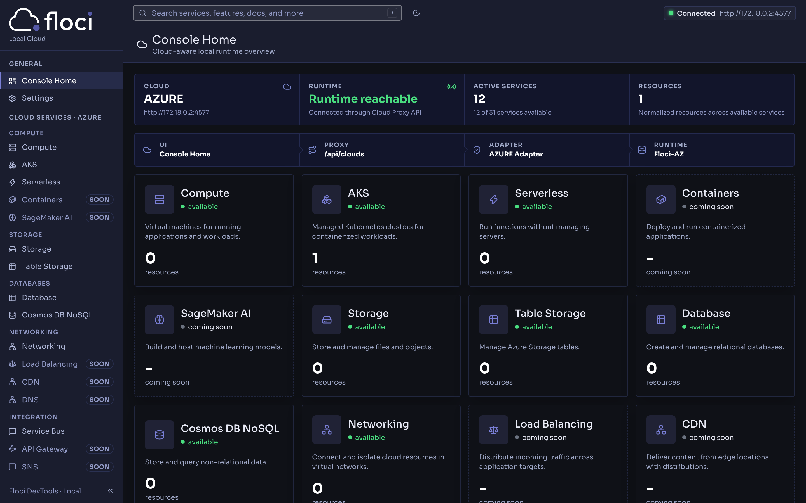

Navegando al explorador de **AKS** (`http://localhost:4500/cloud-explorer/azure/k8s`), se verifica el clúster `id-local-aks` en estado `Succeeded`:

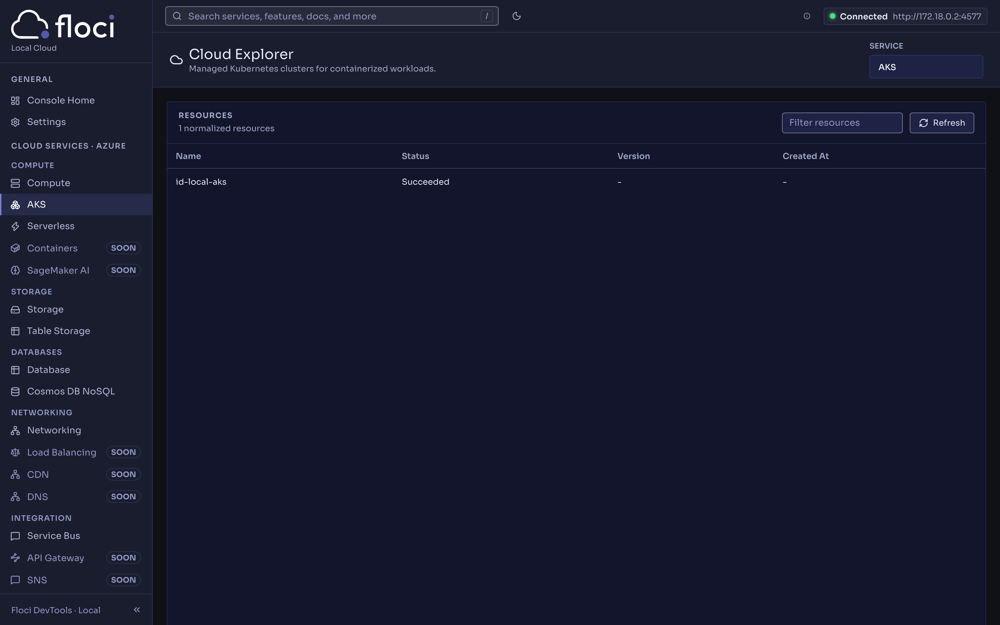

#### Paso 6: Teardown del Emulador Local (Opcional)

```bash
npm run docker:cloud:down
```

#### 🌐 Demostración Interactiva en la UI (Navegador — `US-12`)

1. **Prerrequisitos Root (`ADR-0009`):** Backend (`npm run dev:api` en `:4000`) y Vite (`npm run dev:web` en `:3000`) activos. Registra o autentica un operador en el Root Tenant (`x-tenant-id: system`) vía `POST /api/v1/auth/register` o `./bin/identity users create-root-admin` y guarda su sesión (`tenantId: "system"`, `roles: ["superadmin", "member"]`) en `localStorage.setItem('identity_session', ...)`:

   ```bash
   # 1) Crear operador superadmin en el Root Tenant ('system')
   export ROOT_EMAIL="admin.$(date +%s)@angelpixel.io"
   export ROOT_PASS='SuperAdmin2026!'
   SESSION_JSON=$(./bin/identity users create-root-admin \
     --email "${ROOT_EMAIL}" \
     --password "${ROOT_PASS}" \
     --raw-json | jq -c '{ userId, email: env.ROOT_EMAIL, tenantId: "system", roles: ["superadmin", "member"], token: .accessToken }')
   echo "${SESSION_JSON}"
   ```

   ```js
   // 2) En DevTools Console de http://localhost:3000:
   const session = /* pegá acá el valor de SESSION_JSON */;
   localStorage.removeItem('identity_session');
   localStorage.setItem('identity_session', JSON.stringify(session));
   location.href = '/platform';
   ```

   > [!TIP]
   > **Aislamiento y Vigencia de la Sesión Root (`localStorage` & TTL 1h):**
   > - **Evitar `403 Forbidden (ADR-0009)` al probar otros inquilinos:** Todas las pestañas de `http://localhost:3000` comparten `localStorage.identity_session`. Si iniciás sesión con un usuario comercial (`acme-corp` o federación Google en `/auth`), se sobrescribirá la sesión `system:superadmin`. Usá una **ventana incógnito** o perfil separado para las pruebas de inquilinos comerciales.
   > - **Renovar ante `Error de Postura: Invalid or expired token`:** El JWT emitido por `create-root-admin` tiene un TTL de **1 hora** (`BoundedShell` valida `tenantId`/`roles` en cliente, pero la API rechaza tokens vencidos con `401`). Si expiró, volvé a ejecutar el paso `1)` y actualizá `identity_session` en DevTools.
2. **Caso Negativo (Guardia `403 Forbidden` para Inquilino Comercial):** Si abres [`http://localhost:3000/platform`](http://localhost:3000/platform) con una sesión comercial (e.g., `acme-corp`), `BoundedShell` bloquea el acceso mostrando `M3AlertBanner` (`platform-access-denied`) sin renderizar pestañas administrativas.
3. **Caso Positivo (Postura Read-Only Cloud/IaC):**
   - Abre [`http://localhost:3000/platform`](http://localhost:3000/platform) con sesión `system:superadmin` en la pestaña **`Postura & Gobernanza`**.
   - Pulsa **`Actualizar Postura`** (`GET /api/v1/platform/posture`).
   - Verifica el chip `Cloud IaC: VERIFIED_PARITY` y en **Snapshot de Postura Read-Only** (`M3JsonViewer`) el nodo `infrastructurePosture.cloudIac`:
     ```json
     "cloudIac": {
       "story": "US-12",
       "provider": "Azure / Floci",
       "tlsEndpoint": "https://localhost:4577",
       "status": "VERIFIED_PARITY"
     }
     ```
   - *Nota:* Esta superficie es estrictamente `READ_ONLY_POSTURE`; el aprovisionamiento real se ejecuta vía Terraform/CLI (`npm run test:infra`).
4. **Trazabilidad E2E:** `tests/e2e/web/m3_shell_and_route_guards.spec.tsx` (Scenario 2 & 3) y `tests/e2e/web/platform_console.spec.tsx` (Scenario 1 & 2).

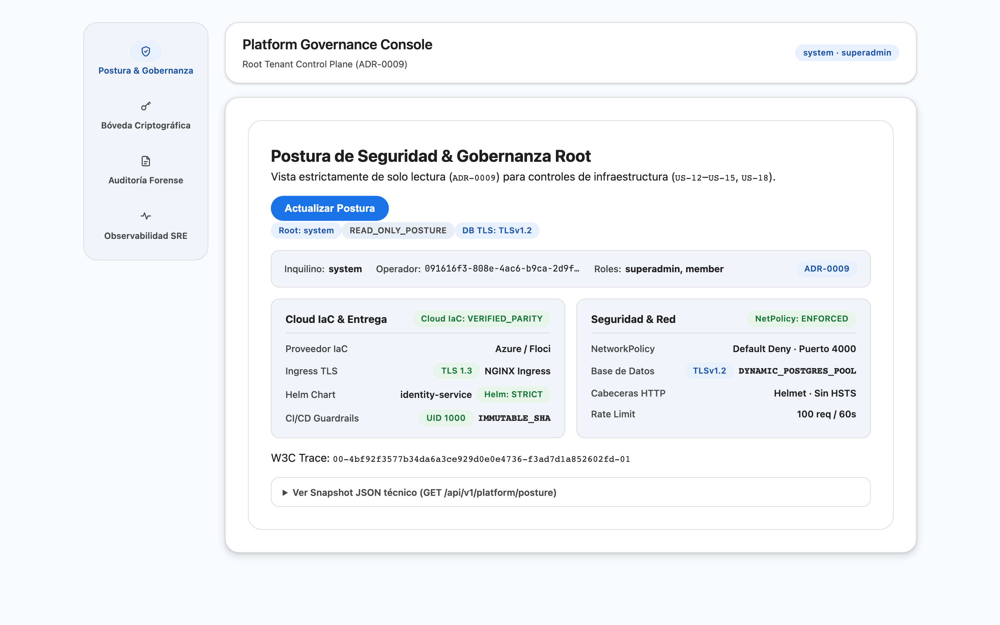

---

## 🔒 US-13: Ingress Seguro con NGINX & Terminación TLS 1.3

### 1. Arquitectura Perimetral y Propagación de Contexto HTTPS

El tráfico externo jamás alcanza directamente a los pods de Node.js en texto plano. El manifiesto `deployments/ingress/ingress.yaml` y la configuración `deployments/ingress/nginx.conf` (ejecutada en vivo por el contenedor `identity-ingress` en los puertos `80` y `443`) implementan:

1. **Redirección Forzada a HTTPS (`ssl-redirect: "true"`):** Toda petición entrante por el puerto `80` es redirigida automáticamente hacia `https://` (`443`).
2. **Terminación TLS Criptográfica (`identity-tls-secret`):** El Ingress presenta el certificado X.509 para `auth.angelpixel.local` negociando TLS 1.2 / 1.3 con suites de cifrado efímeras (ECDHE).
3. **Inyección de Cabeceras de Confianza y Trazabilidad:** Antes de reenviar el tráfico hacia el upstream `identity-api:4000`, NGINX inyecta:
   - `X-Forwarded-Proto: https` (habilitando a Express con `app.set('trust proxy', 1)` a reconocer el protocolo seguro y emitir cookies `Secure`).
   - `X-Forwarded-Host`, `X-Real-IP` y cabeceras de correlación distribuida (`X-Request-ID`, `traceparent`).
4. **Enrutamiento Basado en Prefijos Críticos:** Solo se exponen al exterior las rutas autorizadas (`/health`, `/.well-known`, `/oauth2`, `/api`, `/auth`).

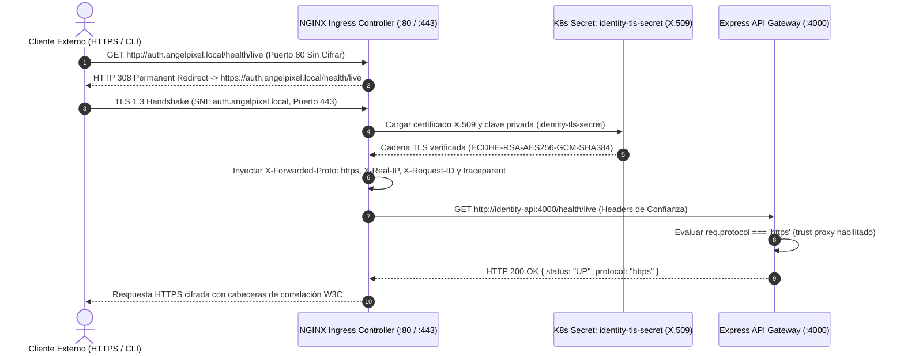

#### A. Glosario de Actores y Componentes (Cajas del Diagrama)

| Participante / Caja | Tipo | Rol Arquitectónico y Frontera de Seguridad |
| :--- | :--- | :--- |
| **`Client` (Cliente Externo)** | `actor` | Navegador, aplicación móvil o cliente M2M que consume el servicio a través del dominio público `auth.angelpixel.local`. |
| **`Ingress` (NGINX Ingress Controller)** | `participant` | Proxy inverso perimetral que escucha en los puertos `80` y `443`, fuerza HTTPS, termina TLS y filtra rutas permitidas. |
| **`TLSSecret` (`identity-tls-secret`)** | `participant` | Secreto Kubernetes de tipo `kubernetes.io/tls` (gestionado por `cert-manager` / Let's Encrypt en cloud o CA local en desarrollo). |
| **`Gateway` (Express API Gateway `:4000`)** | `participant` | Servicio interno `ClusterIP` de Node.js que confía en el proxy perimetral (`trust proxy`) para determinar el protocolo e IP real del cliente. |

#### B. Desglose Secuencial del Flujo (Pasos 1 al 10)

1. **Paso 1 (`Client -> Ingress`):** Un cliente realiza una petición en texto plano al puerto `80` (`http://auth.angelpixel.local/health/live`).
2. **Paso 2 (`Ingress -->> Client`):** En virtud de las anotaciones `ssl-redirect: "true"` y `force-ssl-redirect: "true"`, NGINX corta la solicitud y devuelve una redirección hacia `https://`.
3. **Paso 3 (`Client -> Ingress`):** El cliente inicia la negociación TLS 1.3 en el puerto `443` enviando la extensión SNI `auth.angelpixel.local`.
4. **Paso 4 (`Ingress -> TLSSecret`):** El controlador carga el certificado y clave privada desde el secreto `identity-tls-secret`.
5. **Paso 5 (`TLSSecret -->> Ingress`):** Se completa el handshake criptográfico con secreto perfecto hacia adelante (*Forward Secrecy*).
6. **Paso 6 (`Ingress -> Ingress`):** El proxy enriquece la petición con `X-Forwarded-Proto: https`, `X-Forwarded-Host`, `X-Real-IP`, `X-Request-ID` y `traceparent`.
7. **Paso 7 (`Ingress -> Gateway`):** NGINX reenvía la petición por la red privada interna hacia el puerto `4000` del contenedor `identity-api`.
8. **Paso 8 (`Gateway -> Gateway`):** Express inspecciona `X-Forwarded-Proto` gracias a su configuración `trust proxy` y reconoce que la conexión original es `https`.
9. **Paso 9 (`Gateway -->> Ingress`):** El endpoint responde `HTTP 200 OK` confirmando explícitamente `"protocol": "https"` en el payload de diagnóstico.
10. **Paso 10 (`Ingress -->> Client`):** El cliente recibe la respuesta cifrada junto con las cabeceras de trazabilidad `X-Request-ID` y `traceparent`.

---

### 2. Ejecución en Vivo contra el Contenedor `identity-ingress` (`:80` / `:443`)

#### Paso 0: Variables de Sesión Interactiva

```bash
# ==============================================================================
# Variables de Sesión Interactiva para NGINX Ingress & Terminación TLS 1.3
# ==============================================================================
export INGRESS_HOST="auth.angelpixel.local"
export INGRESS_HTTP_URL="http://localhost:80"
export INGRESS_HTTPS_URL="https://localhost:443"
export INGRESS_CA_CERT="deployments/tls/certs/auth-ca.crt"
```

#### Paso 1: Arranque del Perfil Ingress & Certificados Locales

```bash
# Si aún no existen los certificados locales en deployments/tls/certs:
npm run cert:generate

# Levantar el contenedor identity-ingress
npm run docker:ingress
```

#### Paso 2: Verificación de Redirección Forzada HTTP (`:80`) → HTTPS (`308 Permanent Redirect`)

```bash
curl -sI "${INGRESS_HTTP_URL}/health/live" \
  -H "Host: ${INGRESS_HOST}"
```

```http
HTTP/1.1 308 Permanent Redirect
Server: nginx/1.27.5
Location: https://auth.angelpixel.local/health/live
```

#### Paso 3: Terminación TLS 1.3 en `:443` y Propagación de `X-Forwarded-Proto` (`./bin/identity`)

Usando el binario unificado `./bin/identity ops health` con `--cacert` y `--resolve`, verificamos el endpoint `/health/live` a través del túnel TLS del Ingress sin necesidad de editar `/etc/hosts`:

```bash
./bin/identity ops health --probe live \
  --url "https://${INGRESS_HOST}" \
  --cacert "${INGRESS_CA_CERT}" \
  --resolve "${INGRESS_HOST}:443:127.0.0.1"
```

##### Respuesta Real Obtenida a través del Túnel TLS (HTTP 200 OK):
```text
HTTP/1.1 200 OK [814ms]
GET https://auth.angelpixel.local/health/live
Trace: traceparent=00-0853cc6f2695e64bebc96b787d0dcfde-8bd2b6d6a9f3080a-01 | X-Request-ID=4b4145a121054e5a7b7f97a0165bbf40

{
  "status": "UP",
  "checks": {
    "liveness": "OK"
  },
  "protocol": "https",
  "timestamp": "2026-11-22T22:41:51.165Z"
}
```

<details>
<summary><b>Ver Receta Equivalente con cURL (Cabeceras HTTP Crudas)</b></summary>

```bash
curl -s -i --cacert "${INGRESS_CA_CERT}" \
  --resolve "${INGRESS_HOST}:443:127.0.0.1" \
  "https://${INGRESS_HOST}/health/live"
```

</details>

#### Paso 4: Suite Automatizada Completa (`npm run test:ingress`)

```bash
npm run test:ingress
```

##### Salida Real de Verificación de Ingress TLS (6/6 Aprobados):
```text
=== [1/6] Comprobando Certificados TLS y Herramientas ===
✓ Certificados TLS disponibles en deployments/tls/certs

=== [2/6] Verificando / Iniciando Stack de Ingress Local ===
✓ Identity Ingress Controller activo y escuchando en puertos 80 / 443.

=== [3/6] Test Vector 1: Redirección Forzada HTTP -> HTTPS (308) ===
Código de estado HTTP recibido: 308
Cabecera Location: Location: https://auth.angelpixel.local/health/live
✓ Redirección 308 Permanent Redirect verificada correctamente.

=== [4/6] Test Vector 2: Terminación TLS y Liveness Probe (/health/live) ===
Respuesta de /health/live: {"status":"UP","checks":{"liveness":"OK"},"protocol":"https","timestamp":"2026-11-20T01:56:35.715Z"}
✓ Terminación TLS y Liveness Probe validadas con éxito sobre HTTPS.

=== [5/6] Test Vector 3: Readiness Probe (/health/ready) ===
Respuesta de /health/ready: {"status":"UP","checks":{"database":"OK","cache":"OK"},"timestamp":"2026-11-20T01:56:35.749Z"}
✓ Readiness Probe validada con éxito.

=== [6/6] Test Vector 4: OIDC Discovery & Propagación X-Request-ID ===
✓ Cabecera de correlación X-Request-ID (custom-e2e-trace-id-1795139795) propagada correctamente por el Ingress.
✓ Endpoint OIDC Discovery accesible y verificado a través de la capa de borde Ingress.

================================================================
✓ Todas las pruebas de Ingress TLS y enrutamiento pasaron con éxito.
================================================================
```

#### Paso 5: Teardown del Perfil Ingress (Opcional)

```bash
npm run docker:ingress:down
```

#### 🌐 Demostración Interactiva en la UI (Navegador — `US-13`)

1. **Prerrequisitos:** Sesión `system:superadmin` activa y vigente (ver pasos y nota de TTL/aislamiento en `US-12`) en [`http://localhost:3000/platform`](http://localhost:3000/platform) → pestaña **`Postura & Gobernanza`**.
2. **Inspección Read-Only (`GET /api/v1/platform/posture`):**
   - Verifica el chip **`Ingress: TLS 1.3`** y el nodo `infrastructurePosture.ingressTls` en `M3JsonViewer`:
     ```json
     "ingressTls": {
       "story": "US-13",
       "protocol": "TLS 1.3",
       "proxyMode": "NGINX Ingress",
       "status": "ACTIVE"
     }
     ```
   - Comprueba en **DevTools → Network** la cabecera `traceparent` W3C emitida por la consola.
   - *Nota:* La terminación TLS y cabeceras del proxy se validan en vivo mediante `npm run test:ingress`; la UI no expone toggles mutables para desactivar TLS.
3. **Trazabilidad E2E:** `tests/e2e/web/platform_console.spec.tsx` (Scenario 2).

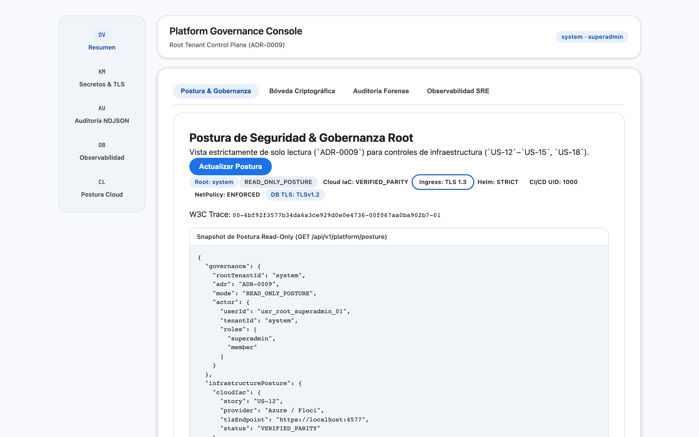

---

## ☸️ US-14: Empaquetado Helm Chart v3 & Orquestación Kubernetes Resiliente

El empaquetado de `identity-service` reside en `deployments/helm/identity-service` y cumple con la especificación **Helm v3** bajo estándares Cloud Native Computing Foundation (CNCF).

### Invariantes de Orquestación y Seguridad:
1. **Zero-Downtime Rolling Updates:** Estrategia configurada con `maxSurge: 25%` y `maxUnavailable: 0` para garantizar que ninguna petición se rechace durante despliegues continuos.
2. **Contexto de Seguridad No-Root Restringido:** Ejecución forzada bajo UID no privilegiado `1000:1000` (`node`), prohibición explícita de escalado de privilegios (`allowPrivilegeEscalation: false`), sistema de archivos raíz de solo lectura (`readOnlyRootFilesystem: true`) y eliminación de todas las capacidades Linux (`capabilities: { drop: ["ALL"] }`).
3. **Escalado Horizontal Automático (HPA v2):** El recurso `HorizontalPodAutoscaler` evalúa la utilización media de CPU en tiempo real, escalando de 2 réplicas mínimas hasta 10 réplicas cuando el consumo supera el 70%.
4. **Presupuesto de Disrupción (PDB):** Definición de `PodDisruptionBudget` con `minAvailable: 1`, protegiendo el servicio contra desalojos durante mantenimiento, parches de seguridad del nodo o drenados manuales en AKS.
5. **Validación de Esquema Declarativo (`values.schema.json`):** Restringe y valida los tipos de datos en tiempo de empaquetado; rechaza réplicas menores a 1, puertos fuera de rango IANA (> 65535), tipos de servicio no permitidos o sintaxis incorrecta en health probes.

---

### Diagrama de Arquitectura y Ciclo de Vida en Kubernetes (US-14)

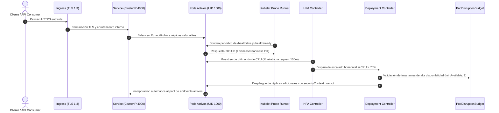

#### A. Glosario de Actores y Componentes (Cajas del Diagrama)

| Participante / Caja | Tipo | Rol Arquitectónico y Frontera de Seguridad |
| :--- | :--- | :--- |
| **`Client` (Cliente / API Consumer)** | `actor` | Navegador SPA, aplicación móvil o cliente M2M que consume el servicio a través del borde HTTPS del clúster. |
| **`Ing` (Ingress TLS 1.3)** | `participant` | Controlador NGINX perimetral que ejecuta la terminación TLS 1.3 y enruta las rutas autorizadas hacia el servicio interno. |
| **`Svc` (`Service ClusterIP:4000`)** | `participant` | Abstracción de red interna de Kubernetes que balancea el tráfico hacia los endpoints saludables sin exponer los pods directamente. |
| **`Pods` (`Pods Activos UID 1000`)** | `participant` | Contenedores endurecidos de Node.js 25 ejecutados bajo usuario no privilegiado (`runAsNonRoot: true`, `readOnlyRootFilesystem: true`, `drop: ALL`). |
| **`Kubelet` (Kubelet Probe Runner)** | `participant` | Agente de nodo que ejecuta las sondas periódicas `/health/live` (reinicio automático) y `/health/ready` (admisión de tráfico). |
| **`HPA` (HPA Controller)** | `participant` | Controlador `autoscaling/v2` que evalúa la utilización media de CPU y escala dinámicamente entre 2 y 10 réplicas. |
| **`Deploy` (Deployment Controller)** | `participant` | Controlador que gestiona el ciclo de vida de las réplicas aplicando `RollingUpdate` sin caídas (`maxSurge: 25%`, `maxUnavailable: 0`). |
| **`PDB` (`PodDisruptionBudget`)** | `participant` | Invariante de disponibilidad (`minAvailable: 1`) que impide desalojos voluntarios simultáneos durante mantenimiento o drenado de nodos. |

#### B. Desglose Secuencial del Flujo (Pasos 1 al 10)

1. **Paso 1 (`Client -> Ing`):** Un cliente externo envía una solicitud HTTPS al dominio público expuesto por el controlador de Ingress.
2. **Paso 2 (`Ing -> Svc`):** NGINX realiza la terminación TLS 1.3, inyecta cabeceras de confianza y reenvía la petición hacia el `Service ClusterIP` en el puerto `:4000`.
3. **Paso 3 (`Svc -> Pods`):** El `Service` distribuye la solicitud en modo Round-Robin únicamente hacia los pods que se encuentran marcados como `Ready`.
4. **Paso 4 (`Kubelet -> Pods`):** De forma continua, el Kubelet del nodo sondea los endpoints internos `/health/live` y `/health/ready` de cada réplica.
5. **Paso 5 (`Pods -->> Kubelet`):** Las réplicas saludables responden `HTTP 200 UP`, confirmando conectividad con PostgreSQL y Redis para permanecer en el pool de tráfico.
6. **Paso 6 (`HPA -> Pods`):** El controlador HPA recolecta métricas de utilización de CPU respecto al `request` base de `100m`.
7. **Paso 7 (`HPA -> Deploy`):** Cuando el consumo promedio supera el umbral configurado del `70%`, el HPA instruye al `Deployment` incrementar el número deseado de réplicas (hasta un máximo de 10).
8. **Paso 8 (`Deploy -> PDB`):** Antes de mutar o drenar pods durante actualizaciones o rebalances, el plano de control verifica el presupuesto `PodDisruptionBudget` (`minAvailable: 1`).
9. **Paso 9 (`Deploy -> Pods`):** El `Deployment` programa nuevas réplicas heredando obligatoriamente el `securityContext` restringido (`UID 1000`, `allowPrivilegeEscalation: false`, `readOnlyRootFilesystem: true`).
10. **Paso 10 (`Pods -->> Svc`):** Una vez superada la sonda `/health/ready`, cada nueva réplica se registra automáticamente en los endpoints activos del `Service` absorbiendo carga sin interrupciones.

---

### Receta de Auditoría y Verificación del Helm Chart

El repositorio incluye una suite integral de validación de empaquetado que audita la sintaxis, el renderizado de manifiestos, las invariantes de seguridad y los casos negativos de esquema:

```bash
export HELM_CHART_DIR="deployments/helm/identity-service"

npm run test:helm
```

<details>
<summary><b>Ver Comandos Manuales Equivalentes de Helm CLI</b></summary>

```bash
# Lint estricto con valores por defecto y valores locales
helm lint "${HELM_CHART_DIR}" --strict
helm lint "${HELM_CHART_DIR}" -f "${HELM_CHART_DIR}/values-local.yaml" --strict

# Renderizar manifiestos Kubernetes con HPA habilitado e inspeccionar recursos generados
helm template identity-service "${HELM_CHART_DIR}" \
  -f "${HELM_CHART_DIR}/values-local.yaml" \
  --set autoscaling.enabled=true | grep -E "^kind:"
```

</details>

##### Salida Real de Auditoría de Helm Chart (6/6 Aprobados):
```text
> @angelpixel-core/identity-service@0.1.0 test:helm
> bash scripts/test-helm-chart.sh

=== [1/6] Verificando Motor Helm CLI ===
✓ Binario local Helm detectado: v4.3.1+gc0d08d0

=== [2/6] Ejecutando Helm Lint Estricto (values.yaml & values-local.yaml) ===
==> Linting deployments/helm/identity-service

1 chart(s) linted, 0 chart(s) failed
✓ Helm lint (values.yaml) aprobado con 0 errores y 0 advertencias.
==> Linting deployments/helm/identity-service

1 chart(s) linted, 0 chart(s) failed
✓ Helm lint (values-local.yaml) aprobado con 0 errores y 0 advertencias.

=== [3/6] Renderizando Plantillas Kubernetes (helm template) ===
✓ Manifiesto ServiceAccount renderizado correctamente.
✓ Manifiesto SecretProviderClass renderizado correctamente.
✓ Manifiesto Service renderizado correctamente.
✓ Manifiesto Deployment renderizado correctamente.
✓ Manifiesto PodDisruptionBudget renderizado correctamente.
✓ Manifiesto Ingress renderizado correctamente.
✓ Manifiesto NetworkPolicy renderizado correctamente.

=== [4/6] Auditando Invariantes de Orquestación, Probes, CSI y Seguridad ===
✓ Invariantes de Deployment (RollingUpdate 25%/0, 2 réplicas, recursos 100m/128Mi -> 500m/512Mi) verificadas.
✓ Contexto de seguridad no-root (runAsNonRoot: true, allowPrivilegeEscalation: false, drop: ALL) verificado.
✓ Probes /health/live y /health/ready verificadas.
✓ SecretProviderClass (Azure Key Vault CSI: id-local-kv, rotationPollInterval: 2m) y proyección de DATABASE_URL, JWT_SECRET y REDIS_URL verificados.
✓ Invariantes de SSL/TLS (DATABASE_SSL_ENABLED: true, DATABASE_SSL_MIN_VERSION: TLSv1.2, DATABASE_SSL_CA_PATH: /mnt/secrets-store/ca.crt) verificadas.
✓ NetworkPolicies Zero-Trust (default-deny-all, Ingress :4000 desde ingress-nginx y Egress :53, :5432, :6379, :443, :4577/:4578) verificadas.
✓ PodDisruptionBudget (minAvailable: 1), Service (ClusterIP:4000) e Ingress (nginx TLS) verificados.

=== [5/6] Verificando Renderizado Condicional de HorizontalPodAutoscaler (HPA) ===
✓ HorizontalPodAutoscaler renderizado dinámicamente cuando autoscaling.enabled=true.

=== [6/6] Verificando Rechazo Estricto de Casos Negativos (values.schema.json) ===
Probando caso negativo: replicaCount=0 menor al mínimo permitido (>= 1)...
✓ Caso negativo validado (falló según lo esperado): replicaCount=0 menor al mínimo permitido (>= 1).
Probando caso negativo: keyVaultCSI.provider no soportado (debe ser azure)...
✓ Caso negativo validado (falló según lo esperado): keyVaultCSI.provider no soportado (debe ser azure).
Probando caso negativo: service.type inválido (enum ClusterIP/NodePort/LoadBalancer)...
✓ Caso negativo validado (falló según lo esperado): service.type inválido (enum ClusterIP/NodePort/LoadBalancer).
Probando caso negativo: livenessProbe.httpGet.path sin barra inicial (pattern ^/)...
✓ Caso negativo validado (falló según lo esperado): livenessProbe.httpGet.path sin barra inicial (pattern ^/).
Probando caso negativo: keyVaultCSI.rotationPollInterval con formato inválido (sin unidad m/s/h)...
✓ Caso negativo validado (falló según lo esperado): keyVaultCSI.rotationPollInterval con formato inválido (sin unidad m/s/h).
Probando caso negativo: database.ssl.minVersion no permitido (debe ser TLSv1.2 o TLSv1.3)...
✓ Caso negativo validado (falló según lo esperado): database.ssl.minVersion no permitido (debe ser TLSv1.2 o TLSv1.3).
Probando caso negativo: database.ssl.enabled tipo no booleano...
✓ Caso negativo validado (falló según lo esperado): database.ssl.enabled tipo no booleano.
Probando caso negativo: networkPolicy.enabled tipo no booleano...
✓ Caso negativo validado (falló según lo esperado): networkPolicy.enabled tipo no booleano.
Probando caso negativo: networkPolicy.ingress.port fuera de rango IANA (> 65535)...
✓ Caso negativo validado (falló según lo esperado): networkPolicy.ingress.port fuera de rango IANA (> 65535).

================================================================
✓ Todas las pruebas de empaquetado Helm (US-14, US-16, US-17 & US-18) pasaron con éxito.
================================================================
```

#### 🌐 Demostración Interactiva en la UI (Navegador — `US-14`)

1. **Prerrequisitos:** Sesión `system:superadmin` activa y vigente (ver pasos y nota de TTL/aislamiento en `US-12`) en [`http://localhost:3000/platform`](http://localhost:3000/platform) → pestaña **`Postura & Gobernanza`**.
2. **Inspección Read-Only (`GET /api/v1/platform/posture`):**
   - Verifica el chip **`Helm: STRICT`** y el nodo `infrastructurePosture.helmChart` en **Snapshot de Postura Read-Only**:
     ```json
     "helmChart": {
       "story": "US-14",
       "release": "identity-service",
       "schemaValidation": "STRICT",
       "networkPolicyZeroTrust": true
     }
     ```
   - *Nota:* La validación de `values.schema.json` y el despliegue del chart se realizan exclusivamente por CLI/CI (`npm run test:helm`).
3. **Trazabilidad E2E:** `tests/e2e/web/platform_console.spec.tsx` (Scenario 2).


---

## 🚀 US-15: Pipeline CI/CD Automatizado & Despliegue Atómico con Circuit Breaker

La entrega continua de `identity-service` está instrumentada en **GitHub Actions** mediante dos workflows especializados:
1. **`.github/workflows/ci.yml` (Integración Continua):** Ejecuta 7 Quality Gates estrictos sobre cada commit y Pull Request:
   - **Quality Gate 1:** Typecheck y compilación TypeScript (`npm run build`).
   - **Quality Gate 2:** Pruebas unitarias de dominio y casos de uso (`npm run test:unit`).
   - **Quality Gate 3:** Pruebas de integración con PostgreSQL 16 y Redis 7 reales (`npm run test:integration`).
   - **Quality Gate 4:** Pruebas de aceptación BDD con escenarios Gherkin (`npm run test:acceptance`).
   - **Quality Gate 5:** Pruebas End-to-End (E2E) de interfaces y componentes (`npm run test:e2e`).
   - **Quality Gate 6:** Construcción de imagen de desarrollo (`docker build --target development`).
   - **Quality Gate 7:** Construcción de imagen de producción multi-stage (`docker build --target production`).
2. **`.github/workflows/cd.yml` (Entrega y Despliegue Continuo):**
   - **Etiquetado Inmutable Doble:** Generación simultánea de tag por SHA de Git (`sha-<commit>`) y Semantic Versioning (`v<version>`).
   - **Auditoría de Seguridad de Imagen:** Comprobación forzada de usuario no-root (`node`), ausencia total de fuentes TypeScript o dependencias de desarrollo (`devDependencies`), y tamaño estricto menor a 250MB.
   - **Despliegue Atómico con Circuit Breaker:** Ejecución de `scripts/deploy-helm-rollout.sh` invocando `helm upgrade --install` con monitorización activa del rollout en AKS (`kubectl rollout status` con timeout de 120s). Si el rollout no converge en el tiempo límite, se activa el circuit breaker automático ejecutando `helm rollback` para retornar de inmediato a la última versión saludable sin caída de servicio.

---

### Diagrama de Flujo CI/CD & Rollback Circuit Breaker (US-15)

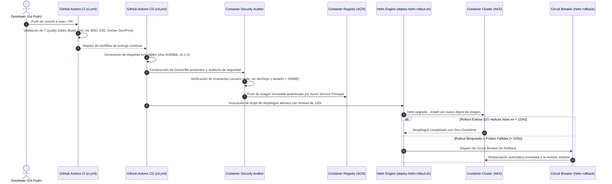

#### A. Glosario de Actores y Componentes (Cajas del Diagrama)

| Participante / Caja | Tipo | Rol Arquitectónico y Frontera de Seguridad |
| :--- | :--- | :--- |
| **`Dev` (Developer — Git Push)** | `actor` | Desarrollador o maintainer que integra cambios mediante Pull Request o push protegido sobre la rama `main`. |
| **`CI` (`GitHub Actions CI — ci.yml`)** | `participant` | Orquestador de integración continua que ejecuta las 7 compuertas de calidad obligatorias antes de habilitar cualquier entrega. |
| **`CD` (`GitHub Actions CD — cd.yml`)** | `participant` | Orquestador de entrega continua encargado del etiquetado inmutable doble (`sha-<commit>` y `v<version>`) y del disparo controlado del despliegue. |
| **`Sec` (Container Security Auditor)** | `participant` | Etapa de auditoría automatizada que verifica usuario no-root (`node` UID 1000), ausencia de `.ts` / `devDependencies` y límite estricto de tamaño `< 250MB`. |
| **`Registry` (Container Registry — ACR)** | `participant` | Registro privado de artefactos OCI que almacena las imágenes firmadas e inmutables (rechazando etiquetas mutables como `:latest`). |
| **`Helm` (`deploy-helm-rollout.sh`)** | `participant` | Script de despliegue atómico que ejecuta `helm upgrade --install` y supervisa activamente la convergencia del rollout con timeout de 120s. |
| **`Cluster` (Container Cluster — AKS)** | `participant` | Clúster Kubernetes de producción que aplica el `RollingUpdate` y valida las sondas `/health/live` y `/health/ready` de cada nueva réplica. |
| **`Rollback` (`helm rollback`)** | `participant` | Mecanismo Circuit Breaker que revierte automáticamente a la última revisión saludable ante un fallo de probes o timeout, evitando degradación del servicio. |

#### B. Desglose Secuencial del Flujo (Pasos 1 al 12)

1. **Paso 1 (`Dev -> CI`):** El desarrollador publica un commit o abre un Pull Request hacia `main`, disparando el workflow de integración continua.
2. **Paso 2 (`CI -> CI`):** GitHub Actions ejecuta en cadena los 7 Quality Gates (`build`, `test:unit`, `test:integration`, `test:acceptance`, `test:e2e`, `docker build` dev y prod).
3. **Paso 3 (`CI -->> CD`):** Superadas todas las compuertas en verde, el pipeline habilita la ejecución del workflow de entrega continua (`cd.yml`).
4. **Paso 4 (`CD -> CD`):** El pipeline calcula etiquetas inmutables simultáneas a partir del hash del commit (`sha-<commit>`) y la versión semántica (`v<version>`).
5. **Paso 5 (`CD -> Sec`):** Se construye la imagen multi-stage productiva (`Dockerfile.production`) y se entrega al auditor de seguridad de contenedores.
6. **Paso 6 (`Sec -> Sec`):** El auditor comprueba de forma determinista que la imagen corre bajo usuario `node` (UID 1000), no contiene fuentes TypeScript ni `devDependencies` y pesa menos de `250MB`.
7. **Paso 7 (`Sec -> Registry`):** Validados los invariantes, la imagen inmutable se publica en el Container Registry (ACR) autenticándose mediante Azure Service Principal.
8. **Paso 8 (`CD -> Helm`):** El workflow invoca `scripts/deploy-helm-rollout.sh` con el digest/tag inmutable y un presupuesto máximo de convergencia de `120s`.
9. **Paso 9 (`Helm -> Cluster`):** Helm aplica `helm upgrade --install` sobre el Container Cluster (AKS), iniciando el reemplazo progresivo de réplicas (`maxUnavailable: 0`).
10. **Paso 10 — Rama `alt` Rollout Exitoso (`Cluster -->> Helm`):** Si las `2/2` réplicas alcanzan estado `200 UP` en `/health/live` y `/health/ready` dentro de los `120s`, el despliegue se certifica completo con Zero-Downtime.
11. **Paso 11 — Rama `else` Rollout Fallido (`Helm -> Rollback`):** Si alguna sonda responde `503 DOWN` o el rollout excede el timeout de `120s`, el script dispara automáticamente el Circuit Breaker.
12. **Paso 12 — Rama `else` Rollout Fallido (`Rollback -> Cluster`):** Se ejecuta `helm rollback` para restaurar de inmediato la revisión estable anterior y se detiene el pipeline con código de error (`exit code 1`).

---

### Receta de Auditoría Integral CI/CD & Rollout Continuo

#### 1. Suite Automatizada Completa (`npm run test:cicd`)

El repositorio incluye una verificación de 5 etapas ([`scripts/test-cicd-pipeline.sh`](../../scripts/test-cicd-pipeline.sh)) que construye `Dockerfile.production`, audita seguridad de contenedor (`node` UID 1000, 0 `.ts`, 0 `devDependencies`, tamaño `< 250MB`), valida los workflows `.github/workflows/cd.yml` y `.circleci/config.yml`, verifica el rechazo de etiquetas mutables `:latest`, simula el rollout atómico Helm y dispara el Circuit Breaker ante un fallo `503 DOWN`:

```bash
npm run test:cicd
```

##### Salida Real de Auditoría CI/CD (5/5 Aprobados):
```text
=== [1/5] Escenario BDD 1: Build Multi-Etapa Productivo (Dockerfile.production) ===
✓ Usuario no-root verificado dentro de la imagen: node (UID 1000)
✓ Aislamiento de artefactos verificado: 0 archivos .ts y 0 devDependencies en el runner.
✓ Tamaño de imagen optimizado: 172MB (< 250MB límite máximo).

=== [2/5] Escenario BDD 2: Validación Estructural de Pipelines (.github/workflows/cd.yml & .circleci/config.yml) ===
✓ Workflow GitHub Actions (.github/workflows/cd.yml) validado sintáctica y estructuralmente.
✓ Pipeline CircleCI 2.1 (.circleci/config.yml) con Orbs y gate de aprobación validado.

=== [3/5] Verificando Rechazo de Etiqueta Mutable ':latest' ===
✓ Política de inmutabilidad verificada: tag ':latest' bloqueado correctamente.

=== [4/5] Verificando Rollout Exitoso con Etiqueta Inmutable (sha-a4e751b) ===
✓ Rollout verificado: 2/2 réplicas listas con probes /health/live y /health/ready en estado 200 UP.

=== [5/5] Escenario BDD 3: Verificando Rollback Automático ante Fallo de Health Probes (503 DOWN) ===
✓ Circuit Breaker verificado: Fallo en /health/ready disparó 'helm rollback identity-service 0' y detuvo el pipeline (exit code 1).

================================================================
✓ Todas las pruebas de automatización CI/CD (US-15) pasaron con éxito.
================================================================
```

#### 2. Validación Determinista Individual de Rollout (`deploy-helm-rollout.sh`)

```bash
export RELEASE_NAME="identity-service"
export K8S_NAMESPACE="default"
export ACR_REGISTRY="idprodacr.azurecr.io"
export IMAGE_TAG="sha-$(git rev-parse --short=7 HEAD)"

bash scripts/deploy-helm-rollout.sh \
  --release "${RELEASE_NAME}" \
  --namespace "${K8S_NAMESPACE}" \
  --registry "${ACR_REGISTRY}" \
  --image-tag "${IMAGE_TAG}" \
  --dry-run
```

##### Salida Real de Validación de Rollout Atómico:
```text
=== [1/4] Validando Política de Etiquetado Inmutable (ACR) ===
✓ Etiqueta inmutable verificada: idprodacr.azurecr.io/identity-service:sha-1b258bb

=== [2/4] Ejecutando Despliegue con Helm (helm upgrade --install) ===
Ejecutando: helm upgrade --install identity-service .../deployments/helm/identity-service -f .../deployments/helm/identity-service/values.yaml --namespace default --set image.repository=idprodacr.azurecr.io/identity-service --set image.tag=sha-1b258bb (client template validation)
✓ Release 'identity-service' aplicado y manifiestos validados.

=== [3/4] Monitoreando Estado del Rollout y Health Probes (timeout: 120s) ===
Verificando: kubectl rollout status deployment/identity-service -n default --timeout=120s
Waiting for deployment "identity-service" rollout to finish: 0 of 2 updated replicas are available...
Waiting for deployment "identity-service" rollout to finish: 1 of 2 updated replicas are available...
deployment "identity-service" successfully rolled out
✓ Rollout verificado: 2/2 réplicas listas con probes /health/live y /health/ready en estado 200 UP.

=== [4/4] Resumen de Entrega Continua ===
✓ Release:   identity-service (namespace: default)
✓ Imagen:    idprodacr.azurecr.io/identity-service:sha-1b258bb
✓ Estado:    DESPLEGADO Y SALUDABLE (Zero-Downtime RollingUpdate)
```

#### 🌐 Demostración Interactiva en la UI (Navegador — `US-15`)

1. **Prerrequisitos:** Sesión `system:superadmin` activa y vigente (ver pasos y nota de TTL/aislamiento en `US-12`) en [`http://localhost:3000/platform`](http://localhost:3000/platform) → pestaña **`Postura & Gobernanza`**.
2. **Inspección Read-Only (`GET /api/v1/platform/posture`):**
   - Verifica el chip **`CI/CD UID: 1000`** y el nodo `infrastructurePosture.cicdGuardrails` (`nonRootUid: 1000`, `imageTagPolicy: "IMMUTABLE_SHA"`, `rollbackCircuitBreaker: true`).
   - Comprueba la etiqueta `W3C Trace` debajo de los chips y pulsa **`Actualizar Postura`** para verificar la recarga sin secretos en claro.
   - *Nota:* La construcción de la imagen Docker y el rollback automático se ejecutan en el pipeline (`npm run test:cicd`).
3. **Trazabilidad E2E:** `tests/e2e/web/platform_console.spec.tsx` (Scenario 2).

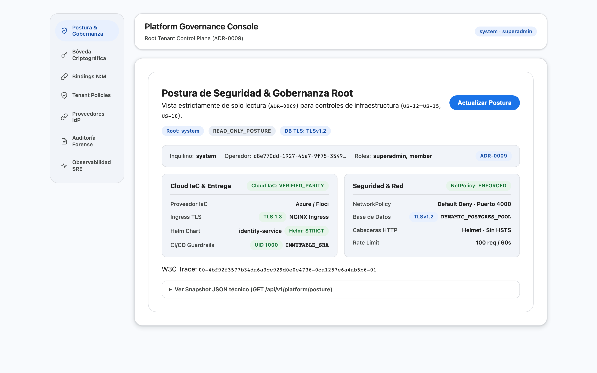

---

[⬅️ Volver al Hub Principal de Showcase](./README.md)
