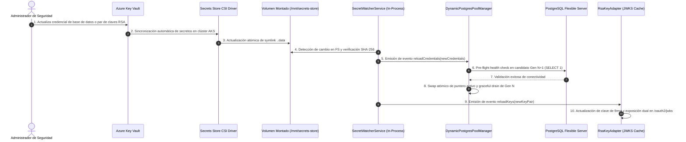

# 🛡️ Capítulo 07: Cumplimiento Regulatorio FinTech, Hardening & Resiliencia

Este capítulo documenta las capacidades avanzadas de seguridad en profundidad (*Defense-in-Depth*), resiliencia operativa y cumplimiento regulatorio estricto integradas en `identity-service`, alineadas con los estándares internacionales más rigurosos para la industria financiera y tecnológica:

- **PCI-DSS v4.0:** Requisitos 3 (Protección de datos del titular), 4 (Cifrado de transmisiones), 8 (Gestión de acceso e identidades) y 10 (Registro de auditoría y monitoreo).
- **SOC 2 Type II:** Criterios de Servicios de Confianza (Trust Services Criteria) para Seguridad (CC6.1 a CC6.8) y Disponibilidad (A1.1 a A1.3).
- **ISO/IEC 27001:2022:** Controles A.10 (Criptografía), A.12 (Seguridad operativa) y A.13 (Seguridad de las comunicaciones y redes).
- **NIST SP 800-53 Rev. 5:** Familias de control SC (Protección de sistemas y comunicaciones) y AU (Auditoría y rendición de cuentas).

---

## 📑 Resumen de Historias de Usuario (Epic 07)

| Historia de Usuario | Título & Alcance Técnico | Principales Componentes Involucrados | Normativa / Estándar |
| :--- | :--- | :--- | :--- |
| **US-16** | **Rotación de Secretos en Caliente sin Downtime** | `SecretWatcherService`, `DynamicPostgresPoolManager`, `RsaKeyAdapter` | PCI-DSS Req 3.6/3.7, SOC 2 CC6.1 |
| **US-17** | **Cifrado E2E en Tránsito & Anti-Downgrade SSL** | TLS 1.3/1.2 Mandatorio, `rejectUnauthorized: true`, Anti-Downgrade Guard | PCI-DSS Req 4.1, ISO 27001 A.10.1 |
| **US-18** | **Microsegmentación Zero-Trust con NetworkPolicies** | Calico/K8s CNI, Default Deny All, Egress Lockdown | ISO 27001 A.13.1, SOC 2 CC6.6 |
| **US-19** | **Auditoría Estructurada Inmutable WORM** | `AuditEventBuilder`, 12-Factor stdout NDJSON, Azure Log Analytics | PCI-DSS Req 10.2/10.3, SOC 2 CC6.8 |

---

## 🔑 US-16: Azure Key Vault CSI Driver Secret Rotation & In-Process Dynamic Reload

En infraestructuras financieras críticas, reiniciar los contenedores cada vez que se rota una credencial de base de datos o una clave criptográfica provoca micro-interrupciones, degradación de latencia y riesgo de saturación en el clúster. 

`identity-service` resuelve este reto implementando una **arquitectura de recarga dinámica en caliente dentro del propio proceso (In-Process Dynamic Reload)**, sincronizada automáticamente con el **Azure Key Vault Secrets Store CSI Driver** de Kubernetes.

### 🏛️ Pilares Arquitectónicos de US-16

#### 1. Observador de Secretos en Proceso (`SecretWatcherService`)
- **Monitoreo de Enlaces Simbólicos de Kubernetes:** Kubernetes actualiza los volúmenes montados por el CSI Driver de manera atómica, modificando el enlace simbólico `..data` para apuntar a un nuevo directorio con marca de tiempo (ej. `..2026_11_...`). `SecretWatcherService` supervisa `/mnt/secrets-store/` mediante `fs.watch`, reconociendo estos swaps atómicos de directorios en una sola pasada.
- **Debounce y Hashing Criptográfico SHA-256:** Para prevenir recargas espurias por eventos redundantes del sistema operativo, el servicio mantiene un mapa de hashes SHA-256 de los contenidos reales de los archivos. Si el contenido decodificado es idéntico al actual, la notificación es descartada silenciosamente.

#### 2. Gestor Dinámico de Conexiones PostgreSQL (`DynamicPostgresPoolManager`)
- **Arquitectura de Pools Generacionales ($N \to N+1$):** El gestor administra un pool activo (Generación $N$) y una lista de pools en retiro (*retiring pools*).
- **Pre-flight Healthcheck Mandatorio:** Cuando se detecta un cambio en `database-url`, el gestor crea un pool candidato (Generación $N+1$) y ejecuta una consulta de prueba estricta (`SELECT 1`).
- **Fail-Safe Inmutable:** Si el candidato falla (credenciales incorrectas, host inalcanzable o rechazo de autenticación), el swap es cancelado de inmediato, el pool activo $N$ se mantiene en producción sin alteraciones y las sondas `/health/ready` y `/health/live` continúan en estado saludable.
- **Intercambio Atómico de Puntero:** Si la comprobación es satisfactoria, el puntero del pool activo se actualiza atómicamente a la Generación $N+1$.
- **Graceful Draining sin Caída de Peticiones:** Las transacciones y queries que ya estaban en curso en la Generación $N$ finalizan sin ser interrumpidas; una vez agotadas las conexiones activas, el pool antiguo es cerrado limpiamente (`pool.end()`).

#### 3. Rotación Asimétrica de Claves de Firma JWT (`RsaKeyAdapter`)
- **Hot Key Rollover Asimétrico:** Cuando se rotan las claves RSA (`jwt-private.pem` y `jwt-public.pem`), el adaptador carga el nuevo par y actualiza su identificador de clave (`kid`).
- **Ventana de Gracia y JWKS Multi-Clave (RFC 7517):** Para evitar que tokens válidos en tránsito sean rechazados por otros microservicios, el endpoint público `/oauth2/jwks` publica simultáneamente la clave pública activa y la clave anterior durante el período de gracia configurado. Las nuevas firmas se generan con la clave nueva, mientras que la validación de tokens en vuelo se realiza contra la clave correspondiente mediante el encabezado `kid` del JWT.

---

### 🔄 Diagrama de Secuencia: Rotación de Secretos con Cero Tiempo de Inactividad (US-16)



#### Glosario de Componentes US-16:
- **`Administrador de Seguridad`:** Ingeniero de operaciones o pipeline automatizado de rotación programada (ej. cada 90 días conforme a PCI-DSS Req 3.6).
- **`Azure Key Vault (AKV)`:** Almacén centralizado de secretos corporativos protegido por HSM dedicados y políticas de acceso RBAC.
- **`Secrets Store CSI Driver`:** Agente de Kubernetes que sondea periódicamente Azure Key Vault y monta los secretos como archivos en el pod.
- **`Volumen Montado (/mnt/secrets-store)`:** Sistema de archivos en memoria (`tmpfs`) donde residen los secretos, gestionado con enlaces simbólicos atómicos.
- **`SecretWatcherService (In-Process)`:** Módulo Node.js que supervisa los archivos sin dependencias de reinicio de procesos y filtra eventos duplicados.
- **`DynamicPostgresPoolManager`:** Adaptador de persistencia que desacopla la conexión física a base de datos de las operaciones de negocio, garantizando continuidad transaccional.
- **`PostgreSQL Flexible Server`:** Motor de base de datos relacional gestionado en Azure con autenticación forzada y TLS estricto.
- **`RsaKeyAdapter (JWKS Cache)`:** Proveedor criptográfico que administra el ciclo de vida de los pares de claves asimétricas RSA-2048 y emite el conjunto de claves públicas bajo RFC 7517.

---

### 🧪 Verificación Automatizada: Suite de Pruebas de Integración E2E (US-16)

La resiliencia de la recarga dinámica y la ausencia total de caídas en peticiones se certifican mediante la suite de integración E2E dedicada:

```bash
npx jest tests/integration/identity/security/test_zero_downtime_secret_rotation.ts
```

##### Salida Real de Verificación Automatizada (4/4 Escenarios Aprobados):
```text
PASS tests/integration/identity/security/test_zero_downtime_secret_rotation.ts
  Integration E2E: Zero-Downtime Secret Rotation & CSI Driver Synchronization (US-16)
    Scenario 1: In-Flight Database Credential Swap (Zero-Downtime)
      ✓ should dynamically swap database pools without dropping queries when database-url rotates (159 ms)
      ✓ should fail-safe: preserve active pool and keep /health/ready UP when candidate credentials fail pre-swap check (133 ms)
    Scenario 2: Hot Asymmetric Key Rollover via CSI Volume Mount
      ✓ should seamlessly verify tokens in flight during key rollover and expose both keys in JWKS (171 ms)
    Scenario 3: Kubernetes Symlink Swap Synchronization (..data)
      ✓ should detect atomic symlink directory swap and update all mounted secrets in a single pass (113 ms)

Test Suites: 1 passed, 1 total
Tests:       4 passed, 4 total
Snapshots:   0 total
Time:        3.142 s
Ran all test suites matching tests/integration/identity/security/test_zero_downtime_secret_rotation.ts.
```

---

[⬅️ Volver al Hub Principal de Showcase](./README.md)
