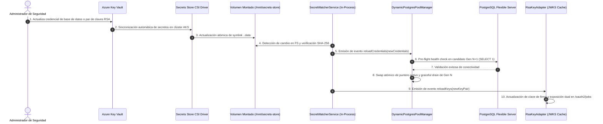
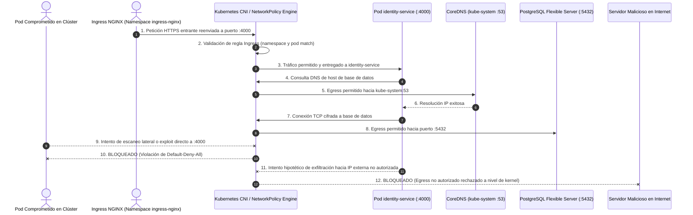

# 🛡️ Capítulo 07: Cumplimiento Regulatorio FinTech, Hardening & Resiliencia

Este capítulo documenta las capacidades avanzadas de seguridad en profundidad (*Defense-in-Depth*), resiliencia operativa y cumplimiento regulatorio estricto integradas en `identity-service`, alineadas con los estándares internacionales más rigurosos para la industria financiera y tecnológica:

- **PCI-DSS v4.0:** Requisitos 3 (Protección de datos del titular), 4 (Cifrado de transmisiones), 8 (Gestión de acceso e identidades) y 10 (Registro de auditoría y monitoreo).
- **SOC 2 Type II:** Criterios de Servicios de Confianza (Trust Services Criteria) para Seguridad (CC6.1 a CC6.8) y Disponibilidad (A1.1 a A1.3).
- **ISO/IEC 27001:2022:** Controles A.10 (Criptografía), A.12 (Seguridad operativa) y A.13 (Seguridad de las comunicaciones y redes).
- **NIST SP 800-53 Rev. 5:** Familias de control SC (Protección de sistemas y comunicaciones) y AU (Auditoría y rendición de cuentas).

---

## 📑 Resumen de Historias de Usuario (Epic 07)

| Historia de Usuario | Título & Alcance Técnico | Principales Componentes Involucrados | Normativa / Estándar |
| :--- | :--- | :--- | :--- |
| **US-16** | **Rotación de Secretos en Caliente sin Downtime** | `SecretWatcherService`, `DynamicPostgresPoolManager`, `RsaKeyAdapter` | PCI-DSS Req 3.6/3.7, SOC 2 CC6.1 |
| **US-17** | **Cifrado E2E en Tránsito & Anti-Downgrade SSL** | TLS 1.3/1.2 Mandatorio, `rejectUnauthorized: true`, Anti-Downgrade Guard | PCI-DSS Req 4.1, ISO 27001 A.10.1 |
| **US-18** | **Microsegmentación Zero-Trust con NetworkPolicies** | Calico/K8s CNI, Default Deny All, Egress Lockdown | ISO 27001 A.13.1, SOC 2 CC6.6 |
| **US-19** | **Auditoría Estructurada Inmutable WORM** | `AuditEventBuilder`, 12-Factor stdout NDJSON, Azure Log Analytics | PCI-DSS Req 10.2/10.3, SOC 2 CC6.8 |

---

## 🔑 US-16: Azure Key Vault CSI Driver Secret Rotation & In-Process Dynamic Reload

En infraestructuras financieras críticas, reiniciar los contenedores cada vez que se rota una credencial de base de datos o una clave criptográfica provoca micro-interrupciones, degradación de latencia y riesgo de saturación en el clúster. 

`identity-service` resuelve este reto implementando una **arquitectura de recarga dinámica en caliente dentro del propio proceso (In-Process Dynamic Reload)**, sincronizada automáticamente con el **Azure Key Vault Secrets Store CSI Driver** de Kubernetes.

### 🏛️ Pilares Arquitectónicos de US-16

#### 1. Observador de Secretos en Proceso (`SecretWatcherService`)
- **Monitoreo de Enlaces Simbólicos de Kubernetes:** Kubernetes actualiza los volúmenes montados por el CSI Driver de manera atómica, modificando el enlace simbólico `..data` para apuntar a un nuevo directorio con marca de tiempo (ej. `..2026_11_...`). `SecretWatcherService` supervisa `/mnt/secrets-store/` mediante `fs.watch`, reconociendo estos swaps atómicos de directorios en una sola pasada.
- **Debounce y Hashing Criptográfico SHA-256:** Para prevenir recargas espurias por eventos redundantes del sistema operativo, el servicio mantiene un mapa de hashes SHA-256 de los contenidos reales de los archivos. Si el contenido decodificado es idéntico al actual, la notificación es descartada silenciosamente.

#### 2. Gestor Dinámico de Conexiones PostgreSQL (`DynamicPostgresPoolManager`)
- **Arquitectura de Pools Generacionales ($N \to N+1$):** El gestor administra un pool activo (Generación $N$) y una lista de pools en retiro (*retiring pools*).
- **Pre-flight Healthcheck Mandatorio:** Cuando se detecta un cambio en `database-url`, el gestor crea un pool candidato (Generación $N+1$) y ejecuta una consulta de prueba estricta (`SELECT 1`).
- **Fail-Safe Inmutable:** Si el candidato falla (credenciales incorrectas, host inalcanzable o rechazo de autenticación), el swap es cancelado de inmediato, el pool activo $N$ se mantiene en producción sin alteraciones y las sondas `/health/ready` y `/health/live` continúan en estado saludable.
- **Intercambio Atómico de Puntero:** Si la comprobación es satisfactoria, el puntero del pool activo se actualiza atómicamente a la Generación $N+1$.
- **Graceful Draining sin Caída de Peticiones:** Las transacciones y queries que ya estaban en curso en la Generación $N$ finalizan sin ser interrumpidas; una vez agotadas las conexiones activas, el pool antiguo es cerrado limpiamente (`pool.end()`).

#### 3. Rotación Asimétrica de Claves de Firma JWT (`RsaKeyAdapter`)
- **Hot Key Rollover Asimétrico:** Cuando se rotan las claves RSA (`jwt-private.pem` y `jwt-public.pem`), el adaptador carga el nuevo par y actualiza su identificador de clave (`kid`).
- **Ventana de Gracia y JWKS Multi-Clave (RFC 7517):** Para evitar que tokens válidos en tránsito sean rechazados por otros microservicios, el endpoint público `/oauth2/jwks` publica simultáneamente la clave pública activa y la clave anterior durante el período de gracia configurado. Las nuevas firmas se generan con la clave nueva, mientras que la validación de tokens en vuelo se realiza contra la clave correspondiente mediante el encabezado `kid` del JWT.

---

### 🔄 Diagrama de Secuencia: Rotación de Secretos con Cero Tiempo de Inactividad (US-16)



#### Glosario de Componentes US-16:
- **`Administrador de Seguridad`:** Ingeniero de operaciones o pipeline automatizado de rotación programada (ej. cada 90 días conforme a PCI-DSS Req 3.6).
- **`Azure Key Vault (AKV)`:** Almacén centralizado de secretos corporativos protegido por HSM dedicados y políticas de acceso RBAC.
- **`Secrets Store CSI Driver`:** Agente de Kubernetes que sondea periódicamente Azure Key Vault y monta los secretos como archivos en el pod.
- **`Volumen Montado (/mnt/secrets-store)`:** Sistema de archivos en memoria (`tmpfs`) donde residen los secretos, gestionado con enlaces simbólicos atómicos.
- **`SecretWatcherService (In-Process)`:** Módulo Node.js que supervisa los archivos sin dependencias de reinicio de procesos y filtra eventos duplicados.
- **`DynamicPostgresPoolManager`:** Adaptador de persistencia que desacopla la conexión física a base de datos de las operaciones de negocio, garantizando continuidad transaccional.
- **`PostgreSQL Flexible Server`:** Motor de base de datos relacional gestionado en Azure con autenticación forzada y TLS estricto.
- **`RsaKeyAdapter (JWKS Cache)`:** Proveedor criptográfico que administra el ciclo de vida de los pares de claves asimétricas RSA-2048 y emite el conjunto de claves públicas bajo RFC 7517.

---

### 🧪 Verificación Automatizada: Suite de Pruebas de Integración E2E (US-16)

La resiliencia de la recarga dinámica y la ausencia total de caídas en peticiones se certifican mediante la suite de integración E2E dedicada:

```bash
npx jest tests/integration/identity/security/test_zero_downtime_secret_rotation.ts
```

##### Salida Real de Verificación Automatizada (4/4 Escenarios Aprobados):
```text
PASS tests/integration/identity/security/test_zero_downtime_secret_rotation.ts
  Integration E2E: Zero-Downtime Secret Rotation & CSI Driver Synchronization (US-16)
    Scenario 1: In-Flight Database Credential Swap (Zero-Downtime)
      ✓ should dynamically swap database pools without dropping queries when database-url rotates (159 ms)
      ✓ should fail-safe: preserve active pool and keep /health/ready UP when candidate credentials fail pre-swap check (133 ms)
    Scenario 2: Hot Asymmetric Key Rollover via CSI Volume Mount
      ✓ should seamlessly verify tokens in flight during key rollover and expose both keys in JWKS (171 ms)
    Scenario 3: Kubernetes Symlink Swap Synchronization (..data)
      ✓ should detect atomic symlink directory swap and update all mounted secrets in a single pass (113 ms)

Test Suites: 1 passed, 1 total
Tests:       4 passed, 4 total
Snapshots:   0 total
Time:        3.142 s
Ran all test suites matching tests/integration/identity/security/test_zero_downtime_secret_rotation.ts.
```

---

## 🔒 US-17: Database Encryption In-Flight (TLS 1.3/1.2) & Anti-Downgrade Defense

En la industria de tecnología financiera (FinTech), el cifrado en tránsito no es opcional ni puede depender de configuraciones permisivas. El estándar **PCI-DSS v4.0 (Req 4.1)** y **SOC 2 (CC6.7)** prohíben explícitamente el uso de suites criptográficas obsoletas (SSLv3, TLS 1.0, TLS 1.1) y exigen autenticación mutua o verificación estricta de la cadena de confianza de la Autoridad Certificadora (CA).

`identity-service` implementa un blindaje integral para las conexiones hacia **Azure Database for PostgreSQL Flexible Server** y **Redis**, combinando verificación estricta de certificados, carga dinámica de certificados CA desde volúmenes CSI y una defensa activa contra ataques de degradación (*Anti-Downgrade SSL Guard*).

### 🏛️ Pilares Arquitectónicos de US-17

#### 1. Forzado Mandatorio de TLS 1.2+ y Carga Dinámica de CA
- **Cifrado E2E Obligatorio:** Toda conexión cliente administrada por `DynamicPostgresPoolManager` se inicializa con TLS 1.2 como versión mínima permitida (`DATABASE_SSL_MIN_VERSION: TLSv1.2` o `TLSv1.3`), rechazando cualquier intento de negociación bajo protocolos obsoletos.
- **Resolución de CA Root desde Volumen CSI (`DATABASE_SSL_CA_PATH`):** El certificado público de la CA de Azure (`ca.crt`) no se almacena en el código ni en la imagen del contenedor; se monta dinámicamente en `/mnt/secrets-store/ca.crt` mediante el CSI Driver. El servicio resuelve este archivo en tiempo de ejecución para validar criptográficamente la identidad del servidor de base de datos.

#### 2. Rechazo Determinista de MitM (`rejectUnauthorized: true`)
- **Bloqueo Incondicional de Certificados Inválidos:** Se prohíbe el uso de banderas permisivas como `rejectUnauthorized: false` o modos `sslmode=no-verify`. Si el servidor remoto presenta un certificado autofirmado desconocido, expirado o con nombres de dominio (SAN) no coincidentes, el handshake falla inmediatamente.
- **Aislamiento Seguro en Probes de Diagnóstico:** Ante un fallo de validación de certificados, el gestor de base de datos reporta el error a las sondas de salud. La sonda `/health/ready` responde de inmediato con `HTTP 503 Service Unavailable`, evitando que Kubernetes envíe tráfico de usuarios hacia un pod con conectividad degradada, mientras que `/health/live` se mantiene en `HTTP 200 OK` para prevenir reinicios destructivos en bucle (*crashloops*).

#### 3. Defensa Activa en Caliente (*Runtime Anti-Downgrade SSL Guard*)
- **Interceptación de Parámetros Maliciosos durante Rotaciones:** Si durante una rotación automática o manual de secretos CSI el archivo de configuración es alterado para incluir parámetros inseguros (ej. `sslmode=disable`, `ssl=false` o certificados alterados), el mecanismo *Anti-Downgrade SSL Guard* intercepta la operación en memoria.
- **Fail-Safe & Emisión de Alerta de Seguridad:** La recarga del nuevo pool es rechazada de inmediato, el pool seguro activo previo permanece intacto atendiendo transacciones cifradas y el sistema emite un evento de auditoría de seguridad clasificado como `SECURITY_VIOLATION` hacia las bitácoras estructuradas.

---

### 🔄 Diagrama de Secuencia: Validación TLS & Protección Anti-Downgrade (US-17)

```mermaid
sequenceDiagram
    autonumber
    actor Client as Cliente / Transacción API
    participant App as Aplicación (Server HTTP)
    participant PoolMgr as DynamicPostgresPoolManager
    participant SSLGuard as Anti-Downgrade SSL Guard
    participant PG as PostgreSQL Flexible Server (TLS 1.2+)
    participant Audit as Logger de Auditoría NDJSON

    Client->>App: 1. Petición que requiere persistencia segura
    App->>PoolMgr: 2. Solicitud de conexión cliente del pool
    PoolMgr->>SSLGuard: 3. Validación de opciones SSL (rejectUnauthorized: true, TLS >= 1.2)
    alt Handshake Seguro con CA Válido
        SSLGuard->>PG: 4. Establecimiento de túnel TLS con verificación de CA (/mnt/secrets-store/ca.crt)
        PG-->>PoolMgr: 5. Handshake completado exitosamente (Cifrado Activo)
        PoolMgr-->>App: 6. Conexión entregada; ejecución de transacción cifrada
        App-->>Client: 7. Respuesta exitosa 200 OK con datos protegidos
    else Intento de Rotación Insegura (sslmode=disable / MitM)
        SSLGuard->>SSLGuard: 4. Detección de degradación criptográfica o certificado no confiable
        SSLGuard->>Audit: 5. Emisión de alerta de seguridad crítica (SECURITY_VIOLATION)
        SSLGuard-->>PoolMgr: 6. Rechazo de inicialización y preservación del pool seguro anterior
        PoolMgr-->>App: 7. Sonda /health/ready reporta 503 DOWN para proteger el tráfico
    end
```

#### Glosario de Componentes US-17:
- **`Cliente / Transacción API`:** Usuario o aplicación externa ejecutando una operación autenticada (ej. registro, login o emisión de tokens).
- **`Aplicación (Server HTTP)`:** Instancia de `identity-service` que atiende peticiones en el puerto `:4000`.
- **`DynamicPostgresPoolManager`:** Administrador generacional de pools de conexión PostgreSQL con soporte estricto de SSL.
- **`Anti-Downgrade SSL Guard`:** Componente de defensa perimetral en memoria que valida las opciones criptográficas antes de cualquier operación de red.
- **`PostgreSQL Flexible Server (TLS 1.2+)`:** Instancia de base de datos en Azure configurada con `ssl_enforcement_enabled = true` y `ssl_minimal_tls_version_enforced = TLSv1.2`.
- **`Logger de Auditoría NDJSON`:** Módulo emisor de eventos de seguridad que envía trazas enriquecidas con severidad `CRITICAL` hacia stdout.

---

### 🧪 Verificación Automatizada: Suite de Pruebas de Cifrado y Hardening (US-17)

La efectividad de la protección TLS y la defensa anti-downgrade se validan mediante la siguiente suite de integración:

```bash
npx jest tests/integration/identity/security/test_database_tls_hardening.ts
```

##### Salida Real de Verificación Automatizada (6/6 Escenarios Aprobados):
```text
PASS tests/integration/identity/security/test_database_tls_hardening.ts
  Integration E2E: Database Encryption In-Flight TLS & Hardening (US-17)
    Scenario 1: Full In-Flight TLS 1.2+ Enforcement with CA Certificate Validation
      ✓ should initialize dynamic pool with strict TLS 1.2+ and valid CA, serving /health probes with 200 OK (51 ms)
      ✓ should resolve SSL configuration from environment variables (DATABASE_SSL_*) on bootstrap (22 ms)
    Scenario 2: Runtime Anti-Downgrade Defense during CSI Secret Rotation
      ✓ should block downgrade attack when CSI secret rotates to sslmode=no-verify and emit security audit event (165 ms)
    Scenario 3: Deterministic Rejection of Untrusted / MitM Certificates
      ✓ should reject untrusted server certificates, returning 503 on readiness and 200 on liveness (84 ms)
    Scenario 4: CA Certificate Resolution from Mounted CSI Volume File (DATABASE_SSL_CA_PATH)
      ✓ should read CA certificate file from DATABASE_SSL_CA_PATH and bind it to pool configuration (47 ms)
      ✓ should bootstrap server directly with DATABASE_SSL_CA_PATH environment variable (39 ms)

Test Suites: 1 passed, 1 total
Tests:       6 passed, 6 total
Snapshots:   0 total
Time:        2.136 s
Ran all test suites matching tests/integration/identity/security/test_database_tls_hardening.ts.
```

---

## 🌐 US-18: Kubernetes Zero-Trust NetworkPolicies & Micro-Segmentation

En entornos de servicios financieros y banca digital, asumir que el perímetro interno del clúster es seguro constituye una vulnerabilidad crítica. Si un contenedor auxiliar o de otra aplicación fuese comprometido, la ausencia de segmentación permitiría a un atacante realizar escaneos laterales, interceptar tráfico o exfiltrar datos.

Para neutralizar este vector, `identity-service` implementa una arquitectura **Zero-Trust nativa en Kubernetes** mediante `NetworkPolicies` orquestadas por el motor CNI (Calico / Azure CNI), certificada bajo los estándares **ISO/IEC 27001:2022 (Control A.13.1 - Seguridad de Redes)** y **SOC 2 Type II (Criterio CC6.6 - Microsegmentación de Límites Lógicos)**.

### 🏛️ Pilares Arquitectónicos de US-18

#### 1. Política Incondicional `default-deny-all`
- **Aislamiento Total por Defecto:** En `deployments/helm/identity-service/templates/networkpolicy.yaml`, el manifiesto `identity-service-default-deny-all` aplica un selector vacío (`podSelector: {}`) afectando a todo el namespace con `policyTypes: [Ingress, Egress]`.
- **Cero Suposición de Confianza:** Cualquier intento de comunicación que no esté explícitamente listado en una regla posterior es descartado silenciosamente por el kernel a nivel de eBPF / iptables.

#### 2. Whitelist Estricta de Tráfico Entrante (Ingress)
- **Acceso Exclusivo desde el Controlador de Ingress:** El tráfico entrante se autoriza únicamente hacia el puerto `:4000` (puerto de servicio HTTP) y se filtra doblemente:
  1. `namespaceSelector`: Debe originarse en el namespace del controlador (`ingress-nginx`).
  2. `podSelector`: Debe provenir de pods con la etiqueta del controlador oficial (`app.kubernetes.io/name: ingress-nginx`).
- **Inmunidad ante Movimiento Lateral:** Ningún otro microservicio dentro del clúster (incluso dentro del mismo namespace) puede alcanzar directamente el puerto HTTP de `identity-service`.

#### 3. Lockdown Estricto de Tráfico Saliente (Egress)
- **Microsegmentación por Puerto y Destino:** La política de salida restringe estrictamente los destinos autorizados a los requerimientos esenciales del servicio:
  - **Resolución de Nombres DNS:** Tráfico UDP y TCP en puerto `:53` restringido exclusivamente al namespace `kube-system` con destino a los pods de `CoreDNS` (`kube-dns`).
  - **Base de Datos PostgreSQL:** Tráfico TCP en puerto `:5432` hacia la instancia administrada de Azure Database for PostgreSQL Flexible Server.
  - **Caché Distribuida Redis:** Tráfico TCP en puerto `:6379` hacia Azure Cache for Redis.
  - **Salida HTTPS Cifrada:** Tráfico TCP en puerto `:443` hacia Azure Key Vault y los endpoints de federación OAuth2/OIDC externos (Google Identity y Microsoft Entra ID).
  - **Servicio de Metadatos Azure IMDS / CSI:** Tráfico TCP en puertos `:4577` y `:4578` para la sincronización de credenciales del Secrets Store CSI Driver.
  - **Bloqueo de Exfiltración:** Todo intento de conexión hacia puertos no estándar, rangos de IP arbitrarios o internet abierto no catalogado es bloqueado de inmediato.

---

### 🔄 Diagrama de Secuencia: Filtrado Perimetral Zero-Trust (US-18)



#### Glosario de Componentes US-18:
- **`Ingress NGINX (ingress-nginx)`:** Único punto de entrada autorizado al clúster, responsable de la terminación TLS y reenrutamiento seguro.
- **`Kubernetes CNI / NetworkPolicy Engine`:** Motor de red subyacente (ej. Calico o Azure CNI) que hace cumplir las reglas de filtrado perimetral en cada nodo de cómputo.
- **`Pod identity-service (:4000)`:** Instancia de la aplicación protegida en su espacio de red local.
- **`CoreDNS (kube-system :53)`:** Servicio de resolución de nombres autorizado dentro del clúster.
- **`PostgreSQL Flexible Server (:5432)`:** Base de datos relacional autorizada para persistencia.
- **`Pod Comprometido en Clúster`:** Simulación de una amenaza interna que intenta realizar escaneo lateral o ataques directos a otros contenedores.
- **`Servidor Malicioso en Internet`:** Destino externo no autorizado utilizado para evaluar la prevención de fuga de datos (*data exfiltration*).

---

### 🧪 Verificación Automatizada: Auditoría de NetworkPolicies en Helm

La sintaxis, el renderizado de plantillas y las restricciones estrictas del esquema JSON para NetworkPolicies se auditan mediante la suite de empaquetado:

```bash
npm run test:helm
```

##### Salida Real de Verificación de NetworkPolicies (Auditoría Aprobada):
```text
=== [3/6] Renderizando Plantillas Kubernetes (helm template) ===
...
✓ Manifiesto NetworkPolicy renderizado correctamente.

=== [4/6] Auditando Invariantes de Orquestación, Probes, CSI y Seguridad ===
...
✓ NetworkPolicies Zero-Trust (default-deny-all, Ingress :4000 desde ingress-nginx y Egress :53, :5432, :6379, :443, :4577/:4578) verificadas.

=== [6/6] Verificando Rechazo Estricto de Casos Negativos (values.schema.json) ===
...
Probando caso negativo: networkPolicy.enabled tipo no booleano...
✓ Caso negativo validado (falló según lo esperado): networkPolicy.enabled tipo no booleano.
Probando caso negativo: networkPolicy.ingress.port fuera de rango IANA (> 65535)...
✓ Caso negativo validado (falló según lo esperado): networkPolicy.ingress.port fuera de rango IANA (> 65535).
```

---

[⬅️ Volver al Hub Principal de Showcase](./README.md)
