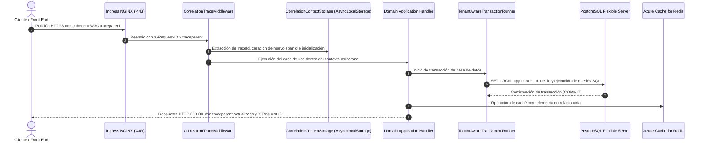
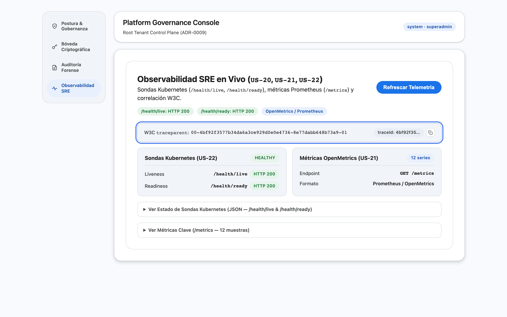
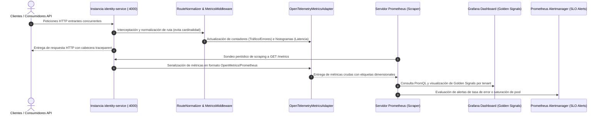
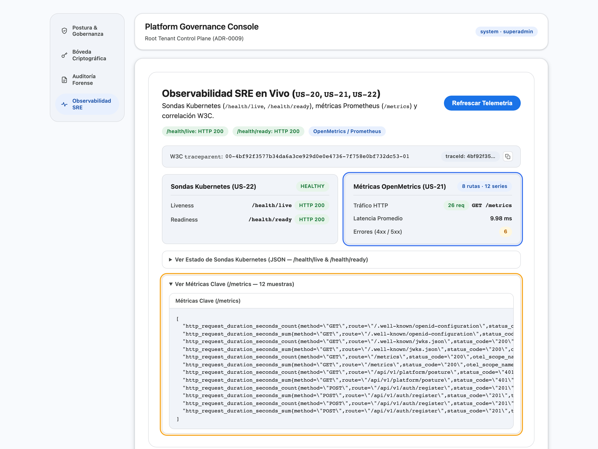
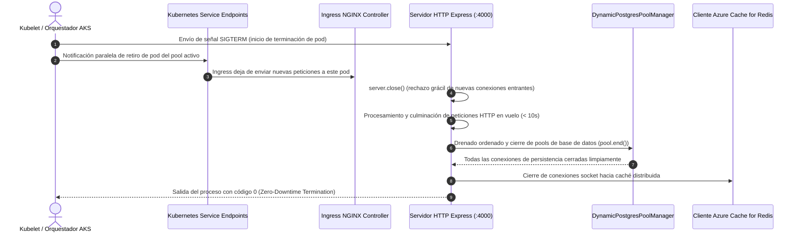
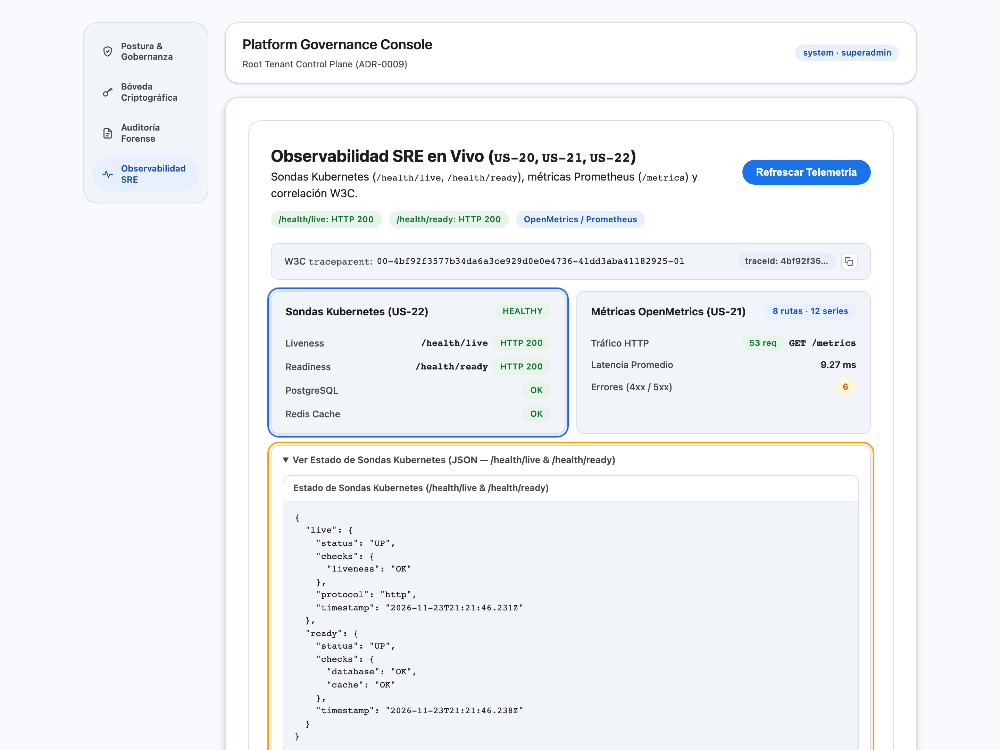
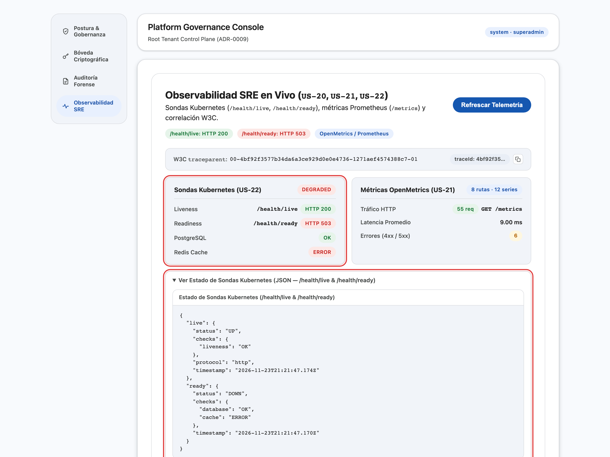

# 🔭 Capítulo 08: Observabilidad Distribuida, Métricas & Confiabilidad en Producción

Este capítulo documenta las capacidades avanzadas de observabilidad, telemetría y confiabilidad en producción integradas en `identity-service`, diseñadas bajo las directrices de la disciplina de **Site Reliability Engineering (SRE)** y los estándares abiertos de la **Cloud Native Computing Foundation (CNCF)**:

- **OpenTelemetry (OTel):** Instrumentación estándar para trazabilidad distribuida e interoperabilidad entre proveedores de observabilidad (Jaeger, Zipkin, Azure Application Insights).
- **W3C Trace Context:** Especificación internacional que define las cabeceras `traceparent` y `tracestate` para la correlación transparente de peticiones a través de redes distribuidas.
- **Las 4 Señales de Oro (Golden Signals):** Monitoreo continuo de Latencia, Tráfico, Errores y Saturación (Google SRE Book).
- **Kubernetes Resilience Probes & Graceful Shutdown:** Sondas de salud desacopladas (`/health/live`, `/health/ready`, `/health`) y drenado ordenado de conexiones ante señales `SIGTERM` / `SIGINT`.

---

## 📑 Resumen de Historias de Usuario (Epic 08)

| Historia de Usuario | Título & Alcance Técnico | Principales Componentes Involucrados | Estándar / Paradigma |
| :--- | :--- | :--- | :--- |
| **US-20** | **Trazabilidad Distribuida & Propagación W3C** | `CorrelationContextStorage`, `AsyncLocalStorage`, PostgreSQL Session Tracing | W3C Trace Context, OpenTelemetry |
| **US-21** | **Métricas Prometheus & Señales de Oro** | `OpenTelemetryMetricsAdapter`, Endpoint `/metrics`, Grafana Dashboards | OpenMetrics, Prometheus Golden Signals |
| **US-22** | **Sondas de Salud & Graceful Shutdown** | Sondas `/health/*`, Drenado de Pools, Manejadores `SIGTERM`/`SIGINT` | Kubernetes Probes, Resiliencia Cloud-Native |

---

## 🔗 US-20: OpenTelemetry Distributed Tracing & W3C Trace Context Propagation

En arquitecturas de microservicios modernas y distribuidas, diagnosticar cuellos de botella de rendimiento o rastrear la causa raíz de un fallo transaccional resulta imposible sin una correlación unívoca de extremo a extremo.

`identity-service` implementa trazabilidad distribuida basada en la recomendación oficial del **W3C Trace Context**, enriquecida con almacenamiento de contexto asíncrono no invasivo (`AsyncLocalStorage`) y propagación profunda hacia las sesiones de base de datos relacionales en **PostgreSQL** y la capa de almacenamiento en **Redis**.

### 🏛️ Pilares Arquitectónicos de US-20

#### 1. Especificación W3C Trace Context (`traceparent`)
- **Estructura Canónica de Cabecera:** Cada petición entrante es evaluada contra el estándar W3C:
  $$\text{traceparent: } \texttt{00-\{traceId\}-\{parentSpanId\}-\{traceFlags\}}$$
  - `version` (`00`): Versión actual de la especificación W3C.
  - `traceId` (32 caracteres hexadecimales / 16 bytes): Identificador global único e inmutable de la transacción distribuida. Si el cliente o API Gateway ya lo suministra, se preserva íntegramente. Si la petición no lo incluye, el servicio genera un nuevo UUID/Trace ID criptográfico.
  - `parentSpanId` (16 caracteres hexadecimales / 8 bytes): Identificador del tramo emisor. El servidor genera un nuevo `spanId` para su propio tramo de ejecución.
  - `traceFlags` (`01`): Bandera que indica que la traza fue seleccionada para muestreo y grabación (*sampled*).
- **Reflejo en Respuestas HTTP:** Las cabeceras `traceparent`, `X-Request-ID` y `X-Correlation-ID` se devuelven en todas las respuestas HTTP para permitir a los clientes correlacionar sus propios registros de red.

#### 2. Almacenamiento Contextual Asíncrono (`AsyncLocalStorage`)
- **Aislamiento sin Contaminación de Firmas:** El módulo `CorrelationContextStorage` envuelve cada ciclo de vida de petición dentro del contexto asíncrono nativo de Node.js (`AsyncLocalStorage`).
- **Desacoplamiento Total:** Los casos de uso de dominio, servicios de aplicación y adaptadores de infraestructura acceden a las variables de traza (`traceId`, `spanId`, `correlationId`, `tenantId`) mediante llamadas estáticas limpias (`CorrelationContextStorage.current()`), evitando la necesidad de propagar objetos de contexto como argumentos en cada firma de método.

#### 3. Propagación Profunda hacia PostgreSQL y Redis
- **Variables Locales de Sesión SQL:** Dentro de cada transacción administrada por `TenantAwareTransactionRunner`, el servicio ejecuta de forma transparente:
  ```sql
  SET LOCAL app.current_tenant_id = 'acme-corp';
  SET LOCAL app.current_trace_id = '4bf92f3577b34da6a3ce929d0e0e4736';
  SET LOCAL app.current_span_id = '9913b70a48677269';
  ```
  Esto permite que las bitácoras internas de PostgreSQL (`pg_stat_activity`, logs de consultas lentas y extensiones de auditoría pgaudit) queden correlacionadas automáticamente con la traza de OpenTelemetry.
- **Correlación en Redis:** Toda clave efímera de caché o sesión de refresh token incluye metadatos de traza para auditoría de invalidaciones.

---

### 🔄 Diagrama de Secuencia: Viaje de una Petición con Trazabilidad W3C (US-20)



#### A. Glosario de Actores y Componentes (Cajas del Diagrama)

| Participante / Caja | Tipo | Rol Arquitectónico y Frontera de Seguridad |
| :--- | :--- | :--- |
| **`Client` (Cliente / Front-End)** | `actor` | Navegador SPA, aplicación móvil, microservicio o CLI (`./bin/identity`) que inicia la petición y opcionalmente envía `traceparent`, `X-Request-ID` y `X-Correlation-ID`. |
| **`Ingress` (Ingress NGINX `:443`)** | `participant` | Proxy inverso perimetral que termina TLS 1.3 y propaga íntegras las cabeceras de trazabilidad W3C hacia el servicio interno. |
| **`TraceMW` (`CorrelationTraceMiddleware`)** | `participant` | Middleware HTTP de Express (`trace_context_middleware.ts`) que valida `traceparent` W3C, genera un nuevo `spanId` hijo (o una traza raíz nueva) y decora las cabeceras de respuesta. |
| **`Storage` (`CorrelationContextStorage`)** | `participant` | Envoltorio sobre `AsyncLocalStorage` de Node.js que mantiene aislado el `TraceContext` (`traceId`, `spanId`, `requestId`, `correlationId`) a lo largo de toda la cadena de promesas. |
| **`Handler` (Domain Application Handler)** | `participant` | Caso de uso de aplicación que accede de forma transparente a `CorrelationContextStorage.current()` sin contaminar las firmas de dominio. |
| **`DBRunner` (`TenantAwareTransactionRunner`)** | `participant` | Coordinador transaccional que inyecta `app.current_tenant_id`, `app.current_trace_id` y `app.current_span_id` en la sesión SQL mediante `SET LOCAL`. |
| **`PG` (PostgreSQL Flexible Server)** | `participant` | Motor relacional donde las consultas y auditorías (`pg_stat_activity`, `pgaudit`) heredan el `trace_id` activo de la transacción. |
| **`Redis` (Azure Cache for Redis)** | `participant` | Capa de caché y sesiones de refresco cuyas operaciones quedan correlacionadas con el mismo contexto de traza. |

#### B. Desglose Secuencial del Flujo (Pasos 1 al 9)

1. **Paso 1 (`Client -> Ingress`):** El cliente envía una solicitud HTTPS incluyendo (opcionalmente) una cabecera W3C `traceparent` (`00-<traceId>-<parentSpanId>-01`).
2. **Paso 2 (`Ingress -> TraceMW`):** NGINX reenvía la petición hacia el contenedor `identity-service` preservando `traceparent`, `X-Request-ID` y `X-Correlation-ID`.
3. **Paso 3 (`TraceMW -> Storage`):** `traceContextMiddleware` valida el formato W3C, preserva el `traceId` entrante (o genera uno de 16 bytes si no existe), crea un nuevo `spanId` hijo de 8 bytes y abre el alcance aislado en `AsyncLocalStorage`.
4. **Paso 4 (`TraceMW -> Handler`):** El flujo continúa hacia el controlador y caso de uso correspondiente dentro de `CorrelationContextStorage.run(...)`.
5. **Paso 5 (`Handler -> DBRunner`):** El caso de uso solicita una transacción multi-tenant a `TenantAwareTransactionRunner`.
6. **Paso 6 (`DBRunner -> PG`):** Al abrir `BEGIN`, el runner ejecuta `SET LOCAL app.current_tenant_id`, `SET LOCAL app.current_trace_id` y `SET LOCAL app.current_span_id` antes de lanzar las queries SQL.
7. **Paso 7 (`PG -->> DBRunner`):** PostgreSQL confirma la transacción (`COMMIT`) descartando automáticamente las variables `SET LOCAL` al finalizar.
8. **Paso 8 (`Handler -> Redis`):** Las lecturas/escrituras en caché y sesiones quedan correlacionadas con el mismo `traceId` para observabilidad de latencia e invalidaciones.
9. **Paso 9 (`Handler -->> Client`):** Express entrega la respuesta HTTP `200 OK` reflejando `traceparent` (con el nuevo `spanId`), `X-Request-ID` y `X-Correlation-ID` en las cabeceras.

---

### 🚀 Ejecución en Vivo & Verificación Interactiva Paso a Paso (`./bin/identity`)

#### Paso 0: Variables de Sesión para Trazabilidad W3C

```bash
# ==============================================================================
# Variables de Sesión Interactiva para Trazabilidad Distribuida W3C (US-20)
# ==============================================================================
export BASE_URL="http://localhost:4000"
export TRACE_ID="4bf92f3577b34da6a3ce929d0e0e4736"
export PARENT_SPAN_ID="00f067aa0ba902b7"
export INCOMING_TRACEPARENT="00-${TRACE_ID}-${PARENT_SPAN_ID}-01"
export CUSTOM_REQ_ID="req-us20-trace-2026"
export CUSTOM_CORR_ID="corr-us20-trace-2026"
```

---

#### Paso 1: Generación Automática de Traza Raíz W3C (Sin Cabecera Entrante)

Cuando un cliente no envía `traceparent`, el middleware genera automáticamente un `traceId` raíz de 32 hexadecimales, un `spanId` de 16 hexadecimales y un `X-Request-ID` UUIDv4. `./bin/identity` imprime la línea `Trace:` en cada respuesta humana:

**Comando CLI Oficial (`./bin/identity`):**

```bash
./bin/identity oidc discovery
```

<details>
<summary><b>Ver Receta Equivalente con cURL</b></summary>

```bash
curl -i -s "${BASE_URL}/.well-known/openid-configuration"
```

</details>

##### Salida Real Obtenida (Traza Raíz Generada Automáticamente):

```text
HTTP/1.1 200 OK [26ms]
GET http://localhost:4000/.well-known/openid-configuration
Trace: traceparent=00-2022e5fa0351da142eb69b0a7523221e-3bb3e1194182cd9e-01 | X-Request-ID=4ae295af-6fe0-4886-8f8c-be4526c8bd37

{
  "issuer": "http://localhost:4000",
  "authorization_endpoint": "http://localhost:4000/oauth2/authorize",
  "token_endpoint": "http://localhost:4000/api/v1/oauth2/token",
  "jwks_uri": "http://localhost:4000/.well-known/jwks.json",
  "userinfo_endpoint": "http://localhost:4000/api/v1/auth/me",
  "response_types_supported": ["code"],
  "subject_types_supported": ["public"],
  "id_token_signing_alg_values_supported": ["RS256"]
}
```

---

#### Paso 2: Propagación de `traceparent` W3C (Preservación de `${TRACE_ID}` & Rotación de `spanId`)

Inyectamos la cabecera W3C entrante (`${INCOMING_TRACEPARENT}`) junto con `--request-id` y `--correlation-id`. Observa cómo el servidor preserva **100% idéntico** el `${TRACE_ID}` (`4bf92f3577b34da6a3ce929d0e0e4736`) y genera un nuevo `spanId` hijo (`d91d81ccca879309`):

**Comando CLI Oficial (`./bin/identity`):**

```bash
./bin/identity oidc discovery \
  --traceparent "${INCOMING_TRACEPARENT}" \
  --request-id "${CUSTOM_REQ_ID}" \
  --correlation-id "${CUSTOM_CORR_ID}"
```

<details>
<summary><b>Ver Receta Equivalente con cURL (sobre <code>/health/live</code>)</b></summary>

```bash
curl -i -s "${BASE_URL}/health/live" \
  -H "traceparent: ${INCOMING_TRACEPARENT}" \
  -H "X-Request-ID: ${CUSTOM_REQ_ID}" \
  -H "X-Correlation-ID: ${CUSTOM_CORR_ID}"
```

</details>

##### Salida Real Obtenida (Propagación W3C Verificada):

```text
HTTP/1.1 200 OK [25ms]
GET http://localhost:4000/.well-known/openid-configuration
Trace: traceparent=00-4bf92f3577b34da6a3ce929d0e0e4736-d91d81ccca879309-01 | X-Request-ID=req-us20-trace-2026 | X-Correlation-ID=corr-us20-trace-2026
```

| Campo W3C / Correlación | Valor Enviado (Cliente) | Valor Devuelto (Servidor) | Invariante Verificado |
| :--- | :--- | :--- | :--- |
| **`traceId`** | `4bf92f3577b34da6a3ce929d0e0e4736` | `4bf92f3577b34da6a3ce929d0e0e4736` | Preservado 100% idéntico |
| **`spanId`** | `00f067aa0ba902b7` (parent) | `d91d81ccca879309` (child) | Rotado a nuevo tramo hijo |
| **`X-Request-ID`** | `req-us20-trace-2026` | `req-us20-trace-2026` | Propagado sin alteración |
| **`X-Correlation-ID`** | `corr-us20-trace-2026` | `corr-us20-trace-2026` | Propagado sin alteración |

---

#### 🌐 Demostración Interactiva en la UI (Navegador — `US-20`)

1. **Prerrequisitos Root (`ADR-0009`):** Backend (`npm run dev:api` en `:4000`) y Vite (`npm run dev:web` en `:3000`) activos con sesión `system:superadmin` vigente en [`http://localhost:3000/platform`](http://localhost:3000/platform). Si expiró el JWT de 1 hora (`Invalid or expired token`), regenerá `SESSION_JSON` en `localStorage` siguiendo el paso `1)` de **Demostración Interactiva (`US-16`)** en [`07-fintech-compliance.md`](./07-fintech-compliance.md).
2. **Paso a Paso (Propagación W3C `traceparent` y Correlación End-to-End):**
   - Abre [`http://localhost:3000/platform`](http://localhost:3000/platform) y selecciona **`Observabilidad SRE`** en la barra lateral izquierda.
   - Pulsa **`Refrescar Telemetría`**.
   - Verifica la barra **`W3C traceparent: 00-4bf92f3577b34da6a3ce929d0e0e4736-...`** y en **DevTools → Network** (filtra por **`XHR`**, haz click en `GET /health/live` y abre la pestaña **`Headers`** → *Request Headers* / *Response Headers*) las cabeceras `traceparent` y `X-Request-ID` inyectadas automáticamente por `apiRequest`.
   - Pulsa el botón de **copiar `traceId`** (`4bf92f35...`) en el extremo derecho de la barra y pégalo en el filtro **`Trace ID`** de **`Auditoría Forense`** (`US-19`) para comprobar la correlación end-to-end.

   

3. **Trazabilidad E2E:** `tests/e2e/web/m3_shell_and_route_guards.spec.tsx` (Scenario 4) y `tests/e2e/web/platform_console.spec.tsx` (Scenario 5).

---

### 🧪 Verificación Automatizada: Propagación de Traza en PostgreSQL (US-20)

La propagación de variables de sesión en base de datos bajo `CorrelationContextStorage` se certifica mediante su suite de integración:

```bash
npx jest tests/integration/identity/tracing/test_database_trace_propagation.ts
```

##### Salida Real de Verificación Automatizada (3/3 Tests Aprobados):
```text
PASS tests/integration/identity/tracing/test_database_trace_propagation.ts
  Integration: Database Trace Context Propagation (US-20)
    Propagación Completa bajo CorrelationContextStorage
      ✓ debe registrar secuencialmente las variables locales de sesión en PostgreSQL (3 ms)
    Aislamiento Defensivo fuera de CorrelationContextStorage
      ✓ debe ejecutar la transacción solo con app.current_tenant_id cuando no hay traza activa
    Manejo de Errores y Rollback
      ✓ debe ejecutar ROLLBACK y liberar la conexión con flag de error ante excepciones en la transacción (7 ms)

Test Suites: 1 passed, 1 total
Tests:       3 passed, 3 total
Snapshots:   0 total
Time:        1.725 s
Ran all test suites matching tests/integration/identity/tracing/test_database_trace_propagation.ts.
```

---

## 📊 US-21: Métricas Prometheus / OpenMetrics Multi-Tenant & Golden Signals

El monitoreo efectivo de un servicio de autenticación y autorización de misión crítica no puede limitarse a consultar si el proceso está activo. La metodología de **Site Reliability Engineering (SRE)** de Google establece que todo sistema distribuido debe gobernarse mediante las **4 Señales de Oro (Golden Signals)**: Latencia, Tráfico, Errores y Saturación.

`identity-service` implementa un motor de telemetría de alto rendimiento basado en **OpenTelemetry Metrics SDK** y el estándar **OpenMetrics / Prometheus**, con agregación dimensional por espacio de tenencia (`tenant_id`), normalización de rutas contra alta cardinalidad y exposición sin bloqueo en el endpoint estándar `/metrics`.

### 🏛️ Pilares Arquitectónicos de US-21

#### 1. Las 4 Señales de Oro (SRE Golden Signals)
- **Latencia:**
  - Histograma `http_request_duration_seconds` con cubos (*buckets*) exponenciales rigurosamente calibrados (`0.005s`, `0.01s`, `0.025s`, `0.05s`, `0.1s`, `0.25s`, `0.5s`, `1s`, `2.5s`, `5s`, `10s`), permitiendo calcular percentiles precisos ($p_{50}$, $p_{95}$, $p_{99}$) y verificar Acuerdos de Nivel de Servicio (SLA/SLO).
  - Histograma interno `db_query_duration_seconds` para aislar el tiempo de procesamiento en base de datos del tiempo de red HTTP.
- **Tráfico:**
  - Contador monotónico `http_requests_total` que cuantifica la tasa de peticiones entrantes, etiquetado dimensionalmente por método HTTP (`GET`, `POST`, `PATCH`), ruta normalizada (`route`), código de estado (`status_code`) y tenencia (`tenant_id`).
- **Errores:**
  - Contador `http_errors_total` que agrega fallos clasificados (códigos 4xx para errores de cliente y 5xx para fallos internos).
  - Contador `auth_attempts_total{result="failure"}` que detecta picos de intentos de autenticación fallidos o ataques de fuerza bruta.
- **Saturación:**
  - Medidor de runtime `target_info` y métricas de memoria heap y event loop de Node.js.
  - Indicadores de saturación del pool de conexiones PostgreSQL (`db_pool_active_connections`, `db_pool_idle_connections`, `db_pool_waiting_queries`), permitiendo disparar alertas antes de que se agote la capacidad de la base de datos.

#### 2. Prevención Activa de Explosión de Cardinalidad de Rutas
- **El Peligro de la Alta Cardinalidad:** Si una API registra rutas con parámetros variables directamente (ej. `/api/v1/users/usr_1a2b3c`), cada identificador genera una nueva serie temporal en la base de datos de Prometheus, provocando agotamiento de memoria (*OOM crash*) en el servidor de monitoreo.
- **`RouteNormalizer` en Middleware:** `identity-service` intercepta las rutas antes de registrar las métricas, normalizando dinámicamente los parámetros de ruta hacia plantillas canónicas (ej. `/api/v1/users/:userId`, `/api/v1/auth/federation/:provider/login`).

---

### 🔄 Diagrama de Secuencia: Pipeline de Scraping de Métricas & Dashboard (US-21)



#### A. Glosario de Actores y Componentes (Cajas del Diagrama)

| Participante / Caja | Tipo | Rol Arquitectónico y Frontera de Seguridad |
| :--- | :--- | :--- |
| **`User` (Clientes / Consumidores API)** | `actor` | Navegadores SPA, clientes M2M, operadores CLI o pruebas de carga que generan tráfico HTTP hacia el servicio. |
| **`App` (`identity-service :4000`)** | `participant` | Instancia de Express que procesa las peticiones de negocio y expone el endpoint de scraping `GET /metrics` sin bloquear el event loop. |
| **`Normalizer` (`RouteNormalizer` & `MetricsMiddleware`)** | `participant` | Middleware que intercepta `res.on('finish')`, mide latencia con alta precisión y colapsa parámetros dinámicos (`/api/v1/users/:userId`) evitando explosión de cardinalidad. |
| **`MetricsAdapter` (`OpenTelemetryMetricsAdapter`)** | `participant` | Adaptador de telemetría basado en OpenTelemetry Metrics SDK (`3.1.1`) que mantiene contadores, histogramas exponenciales y medidores de saturación en formato OpenMetrics. |
| **`Prom` (Servidor Prometheus — Scraper)** | `participant` | Motor de series temporales que realiza scraping HTTP pull periódico (`GET /metrics` cada 15s) sobre los pods activos. |
| **`Grafana` (Grafana Dashboard)** | `participant` | Panel ejecutivo y SRE que consulta PromQL para visualizar las 4 Señales de Oro (Latencia, Tráfico, Errores y Saturación) por ruta y `tenant_id`. |
| **`Alert` (Prometheus Alertmanager)** | `participant` | Evaluador de reglas SLO que dispara alertas al equipo de guardia cuando $p_{99} > 250\text{ms}$, la tasa 5xx supera el $1\%$ o el pool PostgreSQL entra en saturación. |

#### B. Desglose Secuencial del Flujo (Pasos 1 al 9)

1. **Paso 1 (`User -> App`):** Clientes concurrentes envían peticiones HTTP hacia los endpoints públicos y autenticados de `identity-service`.
2. **Paso 2 (`App -> Normalizer`):** `MetricsMiddleware` intercepta la finalización de cada respuesta y aplica `RouteNormalizer` para reemplazar UUIDs y parámetros dinámicos por plantillas canónicas.
3. **Paso 3 (`Normalizer -> MetricsAdapter`):** Se incrementan `http_requests_total` (y `http_errors_total` ante 4xx/5xx) y se registra la duración exacta en los cubos del histograma `http_request_duration_seconds`.
4. **Paso 4 (`App -->> User`):** El servicio devuelve la respuesta HTTP al cliente con su cabecera `traceparent` correlacionada y sin añadir latencia de red por telemetría.
5. **Paso 5 (`Prom -> App`):** El scraper de Prometheus (o `./bin/identity ops metrics`) consulta `GET /metrics`.
6. **Paso 6 (`App -> MetricsAdapter`):** El servidor solicita al adaptador OpenTelemetry la serialización del estado actual de todos los instrumentos.
7. **Paso 7 (`MetricsAdapter -->> Prom`):** Se devuelve el payload en texto plano OpenMetrics/Prometheus (`# HELP`, `# TYPE`, `# UNIT` y series etiquetadas).
8. **Paso 8 (`Prom -> Grafana`):** Grafana ejecuta consultas PromQL sobre las series almacenadas para calcular tasas de tráfico y percentiles ($p_{50}$, $p_{95}$, $p_{99}$).
9. **Paso 9 (`Prom -> Alert`):** Alertmanager evalúa umbrales de SLA/SLO y notifica incidentes ante degradación de latencia, picos de error o agotamiento del pool.

---

### 🚀 Ejecución en Vivo & Verificación Interactiva Paso a Paso (`./bin/identity ops metrics`)

#### Paso 0: Variables de Sesión para Métricas Prometheus

```bash
# ==============================================================================
# Variables de Sesión Interactiva para Métricas Prometheus & Golden Signals (US-21)
# ==============================================================================
export BASE_URL="http://localhost:4000"
export METRIC_TRAFFIC="http_requests_total"
export METRIC_LATENCY="http_request_duration_seconds"
export METRIC_TARGET="target_info"
```

---

#### Paso 1: Señal de Tráfico — Generación de Peticiones & Inspección de `http_requests_total`

Generamos tráfico real sobre los endpoints OIDC y consultamos inmediatamente el contador de tráfico filtrado por `${METRIC_TRAFFIC}`:

**Comando CLI Oficial (`./bin/identity`):**

```bash
./bin/identity oidc discovery --raw-json >/dev/null
./bin/identity oidc jwks --raw-json >/dev/null

./bin/identity ops metrics --filter "${METRIC_TRAFFIC}"
```

<details>
<summary><b>Ver Receta Equivalente con cURL</b></summary>

```bash
curl -s "${BASE_URL}/.well-known/openid-configuration" >/dev/null
curl -s "${BASE_URL}/.well-known/jwks.json" >/dev/null

curl -s "${BASE_URL}/metrics" | grep "${METRIC_TRAFFIC}"
```

</details>

##### Salida Real Obtenida (Contador de Tráfico OpenMetrics):

```text
Métricas Prometheus (5 líneas encontradas):
# HELP http_requests_total Total number of inbound HTTP requests processed
# TYPE http_requests_total counter
http_requests_total{method="GET",route="/health/live",status_code="200",otel_scope_name="@angelpixel-core/identity-service"} 1
http_requests_total{method="GET",route="/.well-known/openid-configuration",status_code="200",otel_scope_name="@angelpixel-core/identity-service"} 1
http_requests_total{method="GET",route="/.well-known/jwks.json",status_code="200",otel_scope_name="@angelpixel-core/identity-service"} 1
```

---

#### Paso 2: Señales de Latencia & Saturación — Histograma Exponencial & Metadatos JSON

Inspeccionamos el histograma calibrado (`0.005s` a `10s` + `+Inf`) para cálculo de percentiles ($p_{50}/p_{95}/p_{99}$) y exportamos los metadatos del SDK OpenTelemetry en JSON:

**Comando CLI Oficial (`./bin/identity`):**

```bash
# 1. Histograma de latencia con cubos exponenciales
./bin/identity ops metrics --filter "${METRIC_LATENCY}" | head -n 20

# 2. Metadatos de runtime en formato JSON estructurado
./bin/identity ops metrics --filter "${METRIC_TARGET}" --format json --raw-json | jq .
```

<details>
<summary><b>Ver Receta Equivalente con cURL (Scraping Directo Prometheus)</b></summary>

```bash
curl -s "${BASE_URL}/metrics" | head -n 25
```

</details>

##### Salidas Reales Obtenidas:

```text
Métricas Prometheus (59 líneas encontradas):
# HELP http_request_duration_seconds Duration of inbound HTTP requests in seconds
# UNIT http_request_duration_seconds s
# TYPE http_request_duration_seconds histogram
http_request_duration_seconds_count{method="GET",route="/health/live",status_code="200",otel_scope_name="@angelpixel-core/identity-service"} 1
http_request_duration_seconds_sum{method="GET",route="/health/live",status_code="200",otel_scope_name="@angelpixel-core/identity-service"} 0.0029295
http_request_duration_seconds_bucket{method="GET",route="/health/live",status_code="200",otel_scope_name="@angelpixel-core/identity-service",le="0.005"} 1
http_request_duration_seconds_bucket{method="GET",route="/health/live",status_code="200",otel_scope_name="@angelpixel-core/identity-service",le="0.01"} 1
http_request_duration_seconds_bucket{method="GET",route="/health/live",status_code="200",otel_scope_name="@angelpixel-core/identity-service",le="0.025"} 1
http_request_duration_seconds_bucket{method="GET",route="/health/live",status_code="200",otel_scope_name="@angelpixel-core/identity-service",le="0.05"} 1
http_request_duration_seconds_bucket{method="GET",route="/health/live",status_code="200",otel_scope_name="@angelpixel-core/identity-service",le="0.1"} 1
http_request_duration_seconds_bucket{method="GET",route="/health/live",status_code="200",otel_scope_name="@angelpixel-core/identity-service",le="0.25"} 1
http_request_duration_seconds_bucket{method="GET",route="/health/live",status_code="200",otel_scope_name="@angelpixel-core/identity-service",le="0.5"} 1
http_request_duration_seconds_bucket{method="GET",route="/health/live",status_code="200",otel_scope_name="@angelpixel-core/identity-service",le="1"} 1
http_request_duration_seconds_bucket{method="GET",route="/health/live",status_code="200",otel_scope_name="@angelpixel-core/identity-service",le="2.5"} 1
http_request_duration_seconds_bucket{method="GET",route="/health/live",status_code="200",otel_scope_name="@angelpixel-core/identity-service",le="5"} 1
http_request_duration_seconds_bucket{method="GET",route="/health/live",status_code="200",otel_scope_name="@angelpixel-core/identity-service",le="10"} 1
http_request_duration_seconds_bucket{method="GET",route="/health/live",status_code="200",otel_scope_name="@angelpixel-core/identity-service",le="+Inf"} 1
http_request_duration_seconds_count{method="GET",route="/.well-known/openid-configuration",status_code="200",otel_scope_name="@angelpixel-core/identity-service"} 1
http_request_duration_seconds_sum{method="GET",route="/.well-known/openid-configuration",status_code="200",otel_scope_name="@angelpixel-core/identity-service"} 0.000558417
```

```json
{
  "target_info{service_name=\"unknown_service:/usr/local/bin/node\",telemetry_sdk_language=\"nodejs\",telemetry_sdk_name=\"opentelemetry\",telemetry_sdk_version=\"3.1.1\"}": 1
}
```

---

#### 🌐 Demostración Interactiva en la UI (Navegador — `US-21`)

1. **Prerrequisitos Root (`ADR-0009`):** Backend (`npm run dev:api` en `:4000`) y Vite (`npm run dev:web` en `:3000`) activos con sesión `system:superadmin` vigente en [`http://localhost:3000/platform`](http://localhost:3000/platform). Si expiró el JWT de 1 hora (`Invalid or expired token`), regenerá `SESSION_JSON` en `localStorage` siguiendo el paso `1)` de **Demostración Interactiva (`US-16`)** en [`07-fintech-compliance.md`](./07-fintech-compliance.md).
2. **Paso a Paso (Métricas Prometheus / OpenMetrics en Vivo):**
   - Abre [`http://localhost:3000/platform`](http://localhost:3000/platform) y selecciona **`Observabilidad SRE`** en la barra lateral izquierda.
   - Pulsa **`Refrescar Telemetría`** → el cliente invoca `GET /metrics` (`text/plain; version=0.0.4`).
   - Verifica el chip **`OpenMetrics / Prometheus`**, la tarjeta **Métricas OpenMetrics (`US-21`)** con las Señales de Oro en vivo (**Tráfico HTTP**, **Latencia Promedio**, **Errores 4xx/5xx** y conteo de rutas normalizadas) y despliega **Ver Métricas Clave (`/metrics`)** para inspeccionar `http_request_duration_seconds_count` sin explosión de cardinalidad por IDs dinámicos.

   

3. **Verificación Técnica & Trazabilidad E2E:** Comprueba `traceparent` W3C en **DevTools → Network** (filtro **`XHR`** → `GET /metrics` → pestaña **`Headers`**); `tests/e2e/web/platform_console.spec.tsx` (Scenario 5).

---

### 🧪 Verificación Automatizada: Endpoint de Métricas y Normalización (US-21)

La integridad de las métricas y la prevención de cardinalidad se verifican mediante la siguiente suite de pruebas:

```bash
npx jest tests/integration/interfaces/http/test_metrics_endpoint.ts
```

##### Salida Real de Verificación Automatizada (5/5 Tests Aprobados):
```text
PASS tests/integration/interfaces/http/test_metrics_endpoint.ts
  Integration API: Structured Metrics & Prometheus Endpoint (US-21)
    Default In-Memory Metrics in Express Server
      ✓ should expose GET /metrics with status 200 and standard Prometheus exposition Content-Type (78 ms)
      ✓ should record inbound request traffic and latency after processing HTTP endpoints (38 ms)
      ✓ should record HTTP errors in http_errors_total when request fails with 4xx or 5xx (56 ms)
      ✓ should normalize parameterized and unmapped dynamic routes to prevent cardinality explosion (40 ms)
    Full OpenTelemetry SDK Integration in Express Server
      ✓ should export OpenTelemetry formatted metrics including runtime saturation and explicit histogram buckets (58 ms)

Test Suites: 1 passed, 1 total
Tests:       5 passed, 5 total
Snapshots:   0 total
Time:        1.942 s
Ran all test suites matching tests/integration/interfaces/http/test_metrics_endpoint.ts.
```

---

## 🩺 US-22: Sondas de Resiliencia Kubernetes & Zero-Downtime Graceful Shutdown

En plataformas de orquestación de contenedores como **Kubernetes (AKS)**, los pods son efímeros por diseño: se escalan dinámicamente, se reubican por mantenimiento de nodos o se reemplazan durante despliegues continuos (*Rolling Updates*). Si un servicio no distingue entre estar "vivo" y estar "listo", o si se aborta abruptamente ante una señal de apagado, los clientes sufrirán errores transitorios `HTTP 502 Bad Gateway` y `HTTP 504 Gateway Timeout`.

`identity-service` resuelve este desafío implementando una arquitectura de **sondas de salud rigurosamente desacopladas** y un **protocolo de apagado grácil (Graceful Shutdown)** de cuatro fases con drenado coordinado de conexiones en vuelo.

### 🏛️ Pilares Arquitectónicos de US-22

#### 1. Arquitectura de Sondas Desacopladas de Kubernetes
- **Sonda de Liveness (`/health/live` / `/health/liveness`):**
  - Evalúa exclusivamente que el bucle de eventos (*event loop*) de Node.js esté respondiendo activamente a peticiones de I/O.
  - **Invariante de Resiliencia:** Si la base de datos o la caché se desconectan temporalmente, la sonda de liveness **continúa respondiendo `HTTP 200 UP`**. Esto evita que Kubelet reinicie inútilmente el contenedor en bucle (*crashloop*), lo cual solo agravaría la saturación del clúster mientras la infraestructura externa se recupera.
- **Sonda de Readiness (`/health/ready` / `/health/readiness`):**
  - Evalúa la capacidad real del pod para ejecutar transacciones de autenticación y autorización:
    - **PostgreSQL Flexible Server (`PostgresProbe`):** Ejecuta una consulta activa `SELECT 1`. Si la base de datos no responde, retorna de inmediato `HTTP 503 DOWN`, provocando que el balanceador de carga de Kubernetes retire el pod de los endpoints activos.
    - **Azure Key Vault (`KeyVaultProbe`):** Valida que existan claves criptográficas cargadas en memoria para firmar y validar tokens JWT. Si no hay claves, responde `HTTP 503 DOWN`.
    - **Azure Cache for Redis (`CacheProbe`):** Evalúa la conectividad a la caché distribuida. **Degradación Controlada:** Si Redis falla pero PostgreSQL está saludable, la sonda responde `HTTP 200 DEGRADED`, permitiendo que el servicio continúe atendiendo a los usuarios consultando directamente a la base de datos en lugar de aislar el pod.
- **Sonda Agregada de Diagnóstico (`/health`):**
  - Consolida el reporte completo del sistema con marcas de tiempo ISO-8601 y latencias individuales por dependencia, ideal para dashboards ejecutivos y monitores sintéticos externos.

#### 2. Protocolo de Apagado Grácil (*Zero-Downtime Graceful Shutdown*)
- **Interceptación de Señales del Sistema Operativo (`SIGTERM` y `SIGINT`):**
  - Cuando Kubernetes decide terminar un pod (ej. por escalado hacia abajo o actualización de versión), Kubelet envía la señal `SIGTERM`.
  - **Fase 1 (Deregistración en Endpoints):** En paralelo al `SIGTERM`, Kubernetes remueve el pod de la lista de endpoints activos del `Service`. La sonda `/health/ready` comienza a reportar `DOWN` para rechazar tráfico residual de proxies.
  - **Fase 2 (Cierre de Listener HTTP):** El servidor Express invoca `server.close()`, dejando de aceptar nuevas conexiones entrantes pero manteniendo abiertos los sockets de las peticiones que ya habían iniciado.
  - **Fase 3 (Drenado de Peticiones en Vuelo):** Se concede un período de gracia de hasta 10 segundos para que todas las peticiones activas completen sus respuestas hacia los clientes.
  - **Fase 4 (Drenado de Pools de Persistencia):** Una vez que no restan operaciones activas en la aplicación, se vacían los pools de PostgreSQL invocando `pool.end()` y se cierran las conexiones de Redis de forma coordinada.
  - **Fase 5 (Salida Limpia):** El proceso termina con código `0`, garantizando que ninguna transacción bancaria o de autenticación quede en estado indeterminado.

---

### 🔄 Diagrama de Secuencia: Ciclo de Vida de Terminación Grácil (US-22)



#### A. Glosario de Actores y Componentes (Cajas del Diagrama)

| Participante / Caja | Tipo | Rol Arquitectónico y Frontera de Seguridad |
| :--- | :--- | :--- |
| **`Kubelet` (Kubelet / Orquestador AKS)** | `actor` | Agente del nodo Kubernetes que coordina el apagado controlado del contenedor respetando `terminationGracePeriodSeconds: 30`. |
| **`Endpoints` (Kubernetes Service Endpoints)** | `participant` | Controlador de red que retira la IP del pod en terminación y propaga el cambio en milisegundos hacia kube-proxy y los balanceadores. |
| **`Ingress` (Ingress NGINX Controller)** | `participant` | Proxy inverso perimetral que actualiza sus upstreams dejando de enrutar nuevas conexiones hacia el pod saliente. |
| **`App` (Servidor HTTP Express `:4000`)** | `participant` | Proceso Node.js que intercepta `SIGTERM` / `SIGINT`, cierra el listener HTTP (`server.close()`) y espera a que finalicen las transacciones en vuelo. |
| **`DBPool` (`DynamicPostgresPoolManager`)** | `participant` | Gestor de conexiones PostgreSQL que drena todas las consultas SQL activas antes de invocar `pool.end()`, evitando transacciones huérfanas. |
| **`Redis` (Cliente Azure Cache for Redis)** | `participant` | Cliente de caché distribuida que libera sus sockets abiertos de forma ordenada antes del cierre definitivo del proceso. |

#### B. Desglose Secuencial del Flujo (Pasos 1 al 9)

1. **Paso 1 (`Kubelet -> App`):** Al iniciar un Rolling Update, drenado de nodo o scale-down, Kubelet envía la señal `SIGTERM` al proceso de `identity-service`.
2. **Paso 2 (`Kubelet -> Endpoints`):** En paralelo, el plano de control remueve la IP del pod de la lista de `Service Endpoints` activos.
3. **Paso 3 (`Endpoints -> Ingress`):** NGINX Ingress actualiza su tabla de upstreams y deja de despachar tráfico nuevo hacia el pod en terminación.
4. **Paso 4 (`App -> App`):** El manejador `gracefulShutdown` invoca `server.close()`, dejando de aceptar nuevas conexiones TCP mientras mantiene vivos los sockets activos.
5. **Paso 5 (`App -> App`):** Todas las peticiones HTTP en vuelo completan su ejecución y responden al cliente dentro del margen de gracia (`< 10s`), evitando errores `502/504`.
6. **Paso 6 (`App -> DBPool`):** Una vez agotadas las peticiones entrantes, el servidor ordena el drenado y cierre de los pools activos y en retiro (`pool.end()`).
7. **Paso 7 (`DBPool -->> App`):** `DynamicPostgresPoolManager` confirma que todas las conexiones a PostgreSQL fueron liberadas limpiamente.
8. **Paso 8 (`App -> Redis`):** Se cierran de forma ordenada los descriptores de socket hacia Redis y el exportador de métricas OpenTelemetry.
9. **Paso 9 (`App -->> Kubelet`):** El proceso finaliza explícitamente con `exit code 0`, certificando una terminación Zero-Downtime limpia.

---

### 🚀 Ejecución en Vivo & Verificación Interactiva Paso a Paso (`./bin/identity ops health`)

#### Paso 0: Variable de Sesión para Sondas de Salud

```bash
# ==============================================================================
# Variable de Sesión Interactiva para Sondas Kubernetes (US-22)
# ==============================================================================
export BASE_URL="http://localhost:4000"
```

---

#### Paso 1: Sonda de Liveness (`/health/live`)

Verifica que el event loop de Node.js responde activamente (permanece `200 UP` incluso ante degradaciones de dependencias externas, evitando *crashloops*):

**Comando CLI Oficial (`./bin/identity`):**

```bash
./bin/identity ops health --probe live
```

<details>
<summary><b>Ver Receta Equivalente con cURL</b></summary>

```bash
curl -i -s "${BASE_URL}/health/live"
```

</details>

##### Salida Real Obtenida (HTTP 200 OK):

```text
HTTP/1.1 200 OK [35ms]
GET http://localhost:4000/health/live
Trace: traceparent=00-97d099ba3e33ef948a070bd4495614e6-7e0362749c272174-01 | X-Request-ID=760e706a-cc36-4866-b998-fd2fcb61641c

{
  "status": "UP",
  "checks": {
    "liveness": "OK"
  },
  "protocol": "http",
  "timestamp": "2026-11-20T20:05:31.571Z"
}
```

---

#### Paso 2: Sonda de Readiness con Diagnóstico de Dependencias (`/health/ready`)

Evalúa PostgreSQL (`SELECT 1`), Azure Key Vault (claves activas) y Redis (`200 UP` si todo está sano, `200 DEGRADED` si solo falla caché, `503 DOWN` si falla DB o Key Vault):

**Comando CLI Oficial (`./bin/identity`):**

```bash
./bin/identity ops health --probe ready
```

<details>
<summary><b>Ver Receta Equivalente con cURL</b></summary>

```bash
curl -i -s "${BASE_URL}/health/ready"
```

</details>

##### Salida Real Obtenida (HTTP 200 OK):

```text
HTTP/1.1 200 OK [26ms]
GET http://localhost:4000/health/ready
Trace: traceparent=00-1c338477a073754a594fb25fb835f977-c609d05eebfa84cf-01 | X-Request-ID=54949f14-b8d5-4808-a030-090d0590d779

{
  "status": "UP",
  "checks": {
    "database": "OK",
    "cache": "OK"
  },
  "timestamp": "2026-11-20T20:05:31.663Z"
}
```

---

#### Paso 3: Reporte Consolidado de Diagnóstico (`/health`)

Exporta el estado agregado en JSON puro apto para monitores sintéticos y piping con `jq`:

**Comando CLI Oficial (`./bin/identity`):**

```bash
./bin/identity ops health --probe all --raw-json | jq .
```

<details>
<summary><b>Ver Receta Equivalente con cURL</b></summary>

```bash
curl -s "${BASE_URL}/health" | jq .
```

</details>

##### Salida Real Obtenida (JSON Consolidado):

```json
{
  "status": "UP",
  "checks": {
    "liveness": "OK",
    "database": "OK",
    "cache": "OK"
  },
  "timestamp": "2026-11-20T20:05:31.751Z"
}
```

---

#### 🌐 Demostración Interactiva en la UI (Navegador — `US-22`)

1. **Prerrequisitos Root (`ADR-0009`):** Backend (`npm run dev:api` en `:4000`) y Vite (`npm run dev:web` en `:3000`) activos con sesión `system:superadmin` vigente en [`http://localhost:3000/platform`](http://localhost:3000/platform). Si expiró el JWT de 1 hora (`Invalid or expired token`), regenerá `SESSION_JSON` en `localStorage` siguiendo el paso `1)` de **Demostración Interactiva (`US-16`)** en [`07-fintech-compliance.md`](./07-fintech-compliance.md).
2. **Caso Positivo (Sondas Kubernetes `liveness` & `readiness`):**
   - Abre [`http://localhost:3000/platform`](http://localhost:3000/platform) y selecciona **`Observabilidad SRE`** en la barra lateral izquierda.
   - Pulsa **`Refrescar Telemetría`** → consulta simultáneamente `GET /health/live` y `GET /health/ready`.
   - Verifica los chips **`/health/live: HTTP 200`** y **`/health/ready: HTTP 200`**, el desglose en la tarjeta **Sondas Kubernetes (`US-22`)** (**`HEALTHY`**, **`PostgreSQL: OK`**, **`Redis Cache: OK`**) y opcionalmente el acordeón **Ver Estado de Sondas Kubernetes (`JSON — /health/live & /health/ready`)**.

   

3. **Caso Negativo (Degradación de Readiness `503`):**
   - Si una dependencia crítica (PostgreSQL o Redis) se detiene y pulsas **`Refrescar Telemetría`**, `/health/ready` cambia a rojo **`HTTP 503`** (`DEGRADED`, mostrando la dependencia afectada en `ERROR`) mientras `/health/live` permanece en **`HTTP 200`**.

   

4. **Verificación Técnica & Trazabilidad E2E:** Comprueba `traceparent` W3C en **DevTools → Network** (filtro **`XHR`** → `GET /health/ready` → pestaña **`Headers`**); `tests/e2e/web/platform_console.spec.tsx` (Scenario 5).

---

### 🧪 Verificación Automatizada: Sondas de Salud & Readiness (US-22)

La suite de integración valida de forma exhaustiva los 10 escenarios de liveness, readiness, degradación controlada y reporte consolidado:

```bash
npx jest tests/integration/interfaces/http/test_health_readiness_endpoints.ts
```

##### Salida Real de Verificación Automatizada (10/10 Tests Aprobados):
```text
PASS tests/integration/interfaces/http/test_health_readiness_endpoints.ts
  Integration API: Infrastructure Health & Readiness Endpoints (US-22)
    Liveness Probe (/health/live & /health/liveness)
      ✓ should return HTTP 200 with status UP on /health/live (52 ms)
      ✓ should return HTTP 200 with status UP on canonical /health/liveness (57 ms)
      ✓ should maintain liveness HTTP 200 UP even when a critical dependency is down (70 ms)
    Readiness Probe (/health/ready & /health/readiness)
      ✓ should return HTTP 200 with status UP when all dependencies are healthy (74 ms)
      ✓ should return HTTP 200 on canonical alias /health/readiness (89 ms)
      ✓ should return HTTP 503 with status DOWN when PostgreSQL database fails (60 ms)
      ✓ should return HTTP 503 with status DOWN when KeyVault has no active keys (120 ms)
      ✓ should return HTTP 200 with status DEGRADED when non-critical cache fails (55 ms)
    Aggregated Health Endpoint (/health)
      ✓ should return HTTP 200 with consolidated report when dependencies are healthy (28 ms)
      ✓ should return HTTP 503 when overall status is DOWN (28 ms)

Test Suites: 1 passed, 1 total
Tests:       10 passed, 10 total
Snapshots:   0 total
Time:        1.982 s
Ran all test suites matching tests/integration/interfaces/http/test_health_readiness_endpoints.ts.
```

---

[⬅️ Volver al Hub Principal de Showcase](./README.md)
