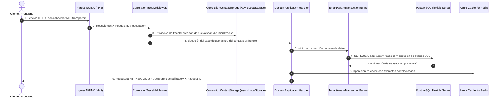
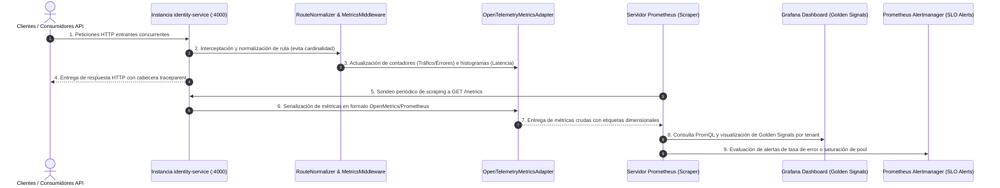
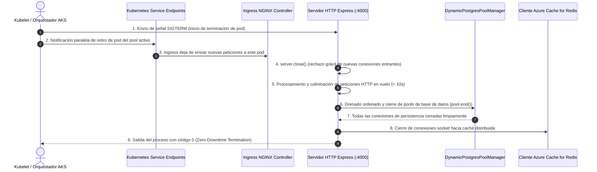

# 🔭 Capítulo 08: Observabilidad Distribuida, Métricas & Confiabilidad en Producción

Este capítulo documenta las capacidades avanzadas de observabilidad, telemetría y confiabilidad en producción integradas en `identity-service`, diseñadas bajo las directrices de la disciplina de **Site Reliability Engineering (SRE)** y los estándares abiertos de la **Cloud Native Computing Foundation (CNCF)**:

- **OpenTelemetry (OTel):** Instrumentación estándar para trazabilidad distribuida e interoperabilidad entre proveedores de observabilidad (Jaeger, Zipkin, Azure Application Insights).
- **W3C Trace Context:** Especificación internacional que define las cabeceras `traceparent` y `tracestate` para la correlación transparente de peticiones a través de redes distribuidas.
- **Las 4 Señales de Oro (Golden Signals):** Monitoreo continuo de Latencia, Tráfico, Errores y Saturación (Google SRE Book).
- **Kubernetes Resilience Probes & Graceful Shutdown:** Sondas de salud desacopladas (`/health/live`, `/health/ready`, `/health`) y drenado ordenado de conexiones ante señales `SIGTERM` / `SIGINT`.

---

## 📑 Resumen de Historias de Usuario (Epic 08)

| Historia de Usuario | Título & Alcance Técnico | Principales Componentes Involucrados | Estándar / Paradigma |
| :--- | :--- | :--- | :--- |
| **US-20** | **Trazabilidad Distribuida & Propagación W3C** | `CorrelationContextStorage`, `AsyncLocalStorage`, PostgreSQL Session Tracing | W3C Trace Context, OpenTelemetry |
| **US-21** | **Métricas Prometheus & Señales de Oro** | `OpenTelemetryMetricsAdapter`, Endpoint `/metrics`, Grafana Dashboards | OpenMetrics, Prometheus Golden Signals |
| **US-22** | **Sondas de Salud & Graceful Shutdown** | Sondas `/health/*`, Drenado de Pools, Manejadores `SIGTERM`/`SIGINT` | Kubernetes Probes, Resiliencia Cloud-Native |

---

## 🔗 US-20: OpenTelemetry Distributed Tracing & W3C Trace Context Propagation

En arquitecturas de microservicios modernas y distribuidas, diagnosticar cuellos de botella de rendimiento o rastrear la causa raíz de un fallo transaccional resulta imposible sin una correlación unívoca de extremo a extremo.

`identity-service` implementa trazabilidad distribuida basada en la recomendación oficial del **W3C Trace Context**, enriquecida con almacenamiento de contexto asíncrono no invasivo (`AsyncLocalStorage`) y propagación profunda hacia las sesiones de base de datos relacionales en **PostgreSQL** y la capa de almacenamiento en **Redis**.

### 🏛️ Pilares Arquitectónicos de US-20

#### 1. Especificación W3C Trace Context (`traceparent`)
- **Estructura Canónica de Cabecera:** Cada petición entrante es evaluada contra el estándar W3C:
  $$\text{traceparent: } \texttt{00-\{traceId\}-\{parentSpanId\}-\{traceFlags\}}$$
  - `version` (`00`): Versión actual de la especificación W3C.
  - `traceId` (32 caracteres hexadecimales / 16 bytes): Identificador global único e inmutable de la transacción distribuida. Si el cliente o API Gateway ya lo suministra, se preserva íntegramente. Si la petición no lo incluye, el servicio genera un nuevo UUID/Trace ID criptográfico.
  - `parentSpanId` (16 caracteres hexadecimales / 8 bytes): Identificador del tramo emisor. El servidor genera un nuevo `spanId` para su propio tramo de ejecución.
  - `traceFlags` (`01`): Bandera que indica que la traza fue seleccionada para muestreo y grabación (*sampled*).
- **Reflejo en Respuestas HTTP:** Las cabeceras `traceparent`, `X-Request-ID` y `X-Correlation-ID` se devuelven en todas las respuestas HTTP para permitir a los clientes correlacionar sus propios registros de red.

#### 2. Almacenamiento Contextual Asíncrono (`AsyncLocalStorage`)
- **Aislamiento sin Contaminación de Firmas:** El módulo `CorrelationContextStorage` envuelve cada ciclo de vida de petición dentro del contexto asíncrono nativo de Node.js (`AsyncLocalStorage`).
- **Desacoplamiento Total:** Los casos de uso de dominio, servicios de aplicación y adaptadores de infraestructura acceden a las variables de traza (`traceId`, `spanId`, `correlationId`, `tenantId`) mediante llamadas estáticas limpias (`CorrelationContextStorage.current()`), evitando la necesidad de propagar objetos de contexto como argumentos en cada firma de método.

#### 3. Propagación Profunda hacia PostgreSQL y Redis
- **Variables Locales de Sesión SQL:** Dentro de cada transacción administrada por `TenantAwareTransactionRunner`, el servicio ejecuta de forma transparente:
  ```sql
  SET LOCAL app.current_tenant_id = 'acme-corp';
  SET LOCAL app.current_trace_id = '4bf92f3577b34da6a3ce929d0e0e4736';
  SET LOCAL app.current_span_id = '9913b70a48677269';
  ```
  Esto permite que las bitácoras internas de PostgreSQL (`pg_stat_activity`, logs de consultas lentas y extensiones de auditoría pgaudit) queden correlacionadas automáticamente con la traza de OpenTelemetry.
- **Correlación en Redis:** Toda clave efímera de caché o sesión de refresh token incluye metadatos de traza para auditoría de invalidaciones.

---

### 🔄 Diagrama de Secuencia: Viaje de una Petición con Trazabilidad W3C (US-20)



#### Glosario de Componentes & Términos US-20:
- **`traceId`:** Identificador global de 16 bytes que acompaña a la petición desde el primer cliente hasta la base de datos más profunda.
- **`spanId`:** Identificador de 8 bytes que delimita el tramo de procesamiento específico dentro de un microservicio.
- **`CorrelationTraceMiddleware`:** Middleware HTTP de Express que intercepta las cabeceras entrantes, normaliza identificadores y vincula el ciclo de vida de la petición.
- **`CorrelationContextStorage`:** Envoltorio de `AsyncLocalStorage` de Node.js que mantiene el contexto de traza disponible de manera transparente en cualquier punto de la pila asíncrona.
- **`TenantAwareTransactionRunner`:** Coordinador de persistencia que inyecta el `tenant_id`, `trace_id` y `span_id` en las variables de sesión locales de PostgreSQL.

---

### 🧪 Recetas Reproducibles de Trazabilidad Distribuida

#### Receta 1: Inspección de Cabeceras de Traza con CLI Nativa (Receta Primaria)

La herramienta `./bin/identity` incluye trazabilidad en cada interacción:

```bash
./bin/identity oidc discovery
```

##### Salida Real con Metadatos de Traza:
```text
HTTP/1.1 200 OK [12ms]
GET http://localhost:4000/.well-known/openid-configuration

{
  "issuer": "http://localhost:4000",
  "authorization_endpoint": "http://localhost:4000/oauth2/authorize",
  "token_endpoint": "http://localhost:4000/oauth2/token",
  "jwks_uri": "http://localhost:4000/.well-known/jwks.json",
  "response_types_supported": ["code"],
  "subject_types_supported": ["public"],
  "id_token_signing_alg_values_supported": ["RS256"]
}
```

---

#### Receta 2: Inyección de `traceparent` W3C con cURL (Receta Detallada)

<details open>
<summary><b>Click para ver la receta detallada con cURL</b></summary>

En esta prueba se inyecta una cabecera `traceparent` externa con un `traceId` determinado (`4bf92f3577b34da6a3ce929d0e0e4736`). Observa cómo el servidor preserva el `traceId`, genera un nuevo `spanId` hijo (`9913b70a48677269`) y devuelve las cabeceras de correlación:

```bash
curl -i -s http://localhost:4000/health/live \
  -H "traceparent: 00-4bf92f3577b34da6a3ce929d0e0e4736-00f067aa0ba902b7-01"
```

##### Respuesta Real del Servidor en Vivo:
```http
HTTP/1.1 200 OK
X-Powered-By: Express
X-Request-ID: ec0e1ed8-87d9-4637-8ade-e85193bba9a7
X-Correlation-ID: ec0e1ed8-87d9-4637-8ade-e85193bba9a7
traceparent: 00-4bf92f3577b34da6a3ce929d0e0e4736-9913b70a48677269-01
Content-Type: application/json; charset=utf-8
Content-Length: 99
Date: Wed, 18 Nov 2026 18:29:24 GMT
Connection: keep-alive

{"status":"UP","checks":{"liveness":"OK"},"protocol":"http","timestamp":"2026-11-18T18:29:24.818Z"}
```

> **Evidencia de Propagación:**
> - **Trace ID Entrada:** `4bf92f3577b34da6a3ce929d0e0e4736`
> - **Trace ID Salida:** `4bf92f3577b34da6a3ce929d0e0e4736` (Preservado 100% idéntico).
> - **Span ID Entrada:** `00f067aa0ba902b7` (Span padre del cliente).
> - **Span ID Salida:** `9913b70a48677269` (Nuevo span generado por el servidor de identidad).

</details>

---

### 🧪 Verificación Automatizada: Propagación de Traza en PostgreSQL (US-20)

La propagación de variables de sesión en base de datos bajo `CorrelationContextStorage` se certifica mediante su suite de integración:

```bash
npx jest tests/integration/identity/tracing/test_database_trace_propagation.ts
```

##### Salida Real de Verificación Automatizada (3/3 Tests Aprobados):
```text
PASS tests/integration/identity/tracing/test_database_trace_propagation.ts
  Integration: Database Trace Context Propagation (US-20)
    Propagación Completa bajo CorrelationContextStorage
      ✓ debe registrar secuencialmente las variables locales de sesión en PostgreSQL (3 ms)
    Aislamiento Defensivo fuera de CorrelationContextStorage
      ✓ debe ejecutar la transacción solo con app.current_tenant_id cuando no hay traza activa
    Manejo de Errores y Rollback
      ✓ debe ejecutar ROLLBACK y liberar la conexión con flag de error ante excepciones en la transacción (7 ms)

Test Suites: 1 passed, 1 total
Tests:       3 passed, 3 total
Snapshots:   0 total
Time:        1.725 s
Ran all test suites matching tests/integration/identity/tracing/test_database_trace_propagation.ts.
```

---

## 📊 US-21: Métricas Prometheus / OpenMetrics Multi-Tenant & Golden Signals

El monitoreo efectivo de un servicio de autenticación y autorización de misión crítica no puede limitarse a consultar si el proceso está activo. La metodología de **Site Reliability Engineering (SRE)** de Google establece que todo sistema distribuido debe gobernarse mediante las **4 Señales de Oro (Golden Signals)**: Latencia, Tráfico, Errores y Saturación.

`identity-service` implementa un motor de telemetría de alto rendimiento basado en **OpenTelemetry Metrics SDK** y el estándar **OpenMetrics / Prometheus**, con agregación dimensional por espacio de tenencia (`tenant_id`), normalización de rutas contra alta cardinalidad y exposición sin bloqueo en el endpoint estándar `/metrics`.

### 🏛️ Pilares Arquitectónicos de US-21

#### 1. Las 4 Señales de Oro (SRE Golden Signals)
- **Latencia:**
  - Histograma `http_request_duration_seconds` con cubos (*buckets*) exponenciales rigurosamente calibrados (`0.005s`, `0.01s`, `0.025s`, `0.05s`, `0.1s`, `0.25s`, `0.5s`, `1s`, `2.5s`, `5s`, `10s`), permitiendo calcular percentiles precisos ($p_{50}$, $p_{95}$, $p_{99}$) y verificar Acuerdos de Nivel de Servicio (SLA/SLO).
  - Histograma interno `db_query_duration_seconds` para aislar el tiempo de procesamiento en base de datos del tiempo de red HTTP.
- **Tráfico:**
  - Contador monotónico `http_requests_total` que cuantifica la tasa de peticiones entrantes, etiquetado dimensionalmente por método HTTP (`GET`, `POST`, `PATCH`), ruta normalizada (`route`), código de estado (`status_code`) y tenencia (`tenant_id`).
- **Errores:**
  - Contador `http_errors_total` que agrega fallos clasificados (códigos 4xx para errores de cliente y 5xx para fallos internos).
  - Contador `auth_attempts_total{result="failure"}` que detecta picos de intentos de autenticación fallidos o ataques de fuerza bruta.
- **Saturación:**
  - Medidor de runtime `target_info` y métricas de memoria heap y event loop de Node.js.
  - Indicadores de saturación del pool de conexiones PostgreSQL (`db_pool_active_connections`, `db_pool_idle_connections`, `db_pool_waiting_queries`), permitiendo disparar alertas antes de que se agote la capacidad de la base de datos.

#### 2. Prevención Activa de Explosión de Cardinalidad de Rutas
- **El Peligro de la Alta Cardinalidad:** Si una API registra rutas con parámetros variables directamente (ej. `/api/v1/users/usr_1a2b3c`), cada identificador genera una nueva serie temporal en la base de datos de Prometheus, provocando agotamiento de memoria (*OOM crash*) en el servidor de monitoreo.
- **`RouteNormalizer` en Middleware:** `identity-service` intercepta las rutas antes de registrar las métricas, normalizando dinámicamente los parámetros de ruta hacia plantillas canónicas (ej. `/api/v1/users/:userId`, `/api/v1/auth/federation/:provider/login`).

---

### 🔄 Diagrama de Secuencia: Pipeline de Scraping de Métricas & Dashboard (US-21)



#### Glosario de Componentes US-21:
- **`RouteNormalizer & MetricsMiddleware`:** Middleware que intercepta la finalización de cada petición (`res.on('finish')`), calcula la duración exacta con `perf_hooks` y normaliza la ruta antes de registrar métricas.
- **`OpenTelemetryMetricsAdapter`:** Adaptador de telemetría que administra el registro de métricas en memoria bajo la especificación de OpenTelemetry SDK y genera la salida en formato OpenMetrics.
- **`Servidor Prometheus (Scraper)`:** Agente centralizado de recolección que sondea `/metrics` cada 15 segundos mediante peticiones HTTP pull.
- **`Grafana Dashboard (Golden Signals)`:** Panel de visualización ejecutiva y operativa que grafica las 4 Señales de Oro desglosadas por inquilino y ruta.
- **`Prometheus Alertmanager`:** Subsistema de alertas que notifica al equipo de guardia SRE cuando la latencia $p_{99} > 250\text{ms}$ o la tasa de errores 5xx supera el $1\%$.

---

### 🧪 Recetas Reproducibles de Métricas Prometheus

#### Receta 1: Inspección Filtrada con CLI Nativa (Receta Primaria)

El comando `identity ops metrics` permite consultar y filtrar las métricas del servicio de forma inmediata:

```bash
./bin/identity ops metrics --filter http_requests
```

##### Salida Real de Métricas de Tráfico:
```text
Métricas Prometheus (7 líneas encontradas):
# HELP http_requests_total Total number of inbound HTTP requests processed
# TYPE http_requests_total counter
http_requests_total{method="GET",route="/health/live",status_code="200",otel_scope_name="@angelpixel-core/identity-service"} 4
http_requests_total{method="GET",route="/health",status_code="200",otel_scope_name="@angelpixel-core/identity-service"} 1
http_requests_total{method="GET",route="/metrics",status_code="200",otel_scope_name="@angelpixel-core/identity-service"} 1
http_requests_total{method="GET",route="/health/ready",status_code="200",otel_scope_name="@angelpixel-core/identity-service"} 3
http_requests_total{method="GET",route="/.well-known/jwks.json",status_code="200",otel_scope_name="@angelpixel-core/identity-service"} 1
```

También puedes exportar las métricas en formato JSON estructurado:

```bash
./bin/identity ops metrics --filter target_info --format json
```

##### Salida en Formato JSON:
```json
{
  "target_info{service_name=\"unknown_service:/usr/local/bin/node\",telemetry_sdk_language=\"nodejs\",telemetry_sdk_name=\"opentelemetry\",telemetry_sdk_version=\"3.1.1\"}": 1
}
```

---

#### Receta 2: Scraping Estándar con cURL (Receta Detallada)

<details open>
<summary><b>Click para ver la receta detallada con cURL</b></summary>

Puedes realizar un scraping directo al endpoint `/metrics` emulando el comportamiento exacto de Prometheus:

```bash
curl -s http://localhost:4000/metrics | head -n 25
```

##### Muestra Real de Exposición de Métricas Prometheus:
```text
# HELP target_info Target metadata
# TYPE target_info gauge
target_info{service_name="unknown_service:/usr/local/bin/node",telemetry_sdk_language="nodejs",telemetry_sdk_name="opentelemetry",telemetry_sdk_version="3.1.1"} 1
# HELP http_request_duration_seconds Duration of inbound HTTP requests in seconds
# UNIT http_request_duration_seconds s
# TYPE http_request_duration_seconds histogram
http_request_duration_seconds_count{method="GET",route="/health/live",status_code="200",otel_scope_name="@angelpixel-core/identity-service"} 4
http_request_duration_seconds_sum{method="GET",route="/health/live",status_code="200",otel_scope_name="@angelpixel-core/identity-service"} 0.045211042
http_request_duration_seconds_bucket{method="GET",route="/health/live",status_code="200",otel_scope_name="@angelpixel-core/identity-service",le="0.005"} 0
http_request_duration_seconds_bucket{method="GET",route="/health/live",status_code="200",otel_scope_name="@angelpixel-core/identity-service",le="0.01"} 1
http_request_duration_seconds_bucket{method="GET",route="/health/live",status_code="200",otel_scope_name="@angelpixel-core/identity-service",le="0.025"} 3
http_request_duration_seconds_bucket{method="GET",route="/health/live",status_code="200",otel_scope_name="@angelpixel-core/identity-service",le="0.05"} 4
http_request_duration_seconds_bucket{method="GET",route="/health/live",status_code="200",otel_scope_name="@angelpixel-core/identity-service",le="+Inf"} 4
# HELP http_requests_total Total number of inbound HTTP requests processed
# TYPE http_requests_total counter
http_requests_total{method="GET",route="/health/live",status_code="200",otel_scope_name="@angelpixel-core/identity-service"} 4
```

</details>

---

### 🧪 Verificación Automatizada: Endpoint de Métricas y Normalización (US-21)

La integridad de las métricas y la prevención de cardinalidad se verifican mediante la siguiente suite de pruebas:

```bash
npx jest tests/integration/interfaces/http/test_metrics_endpoint.ts
```

##### Salida Real de Verificación Automatizada (5/5 Tests Aprobados):
```text
PASS tests/integration/interfaces/http/test_metrics_endpoint.ts
  Integration API: Structured Metrics & Prometheus Endpoint (US-21)
    Default In-Memory Metrics in Express Server
      ✓ should expose GET /metrics with status 200 and standard Prometheus exposition Content-Type (78 ms)
      ✓ should record inbound request traffic and latency after processing HTTP endpoints (38 ms)
      ✓ should record HTTP errors in http_errors_total when request fails with 4xx or 5xx (56 ms)
      ✓ should normalize parameterized and unmapped dynamic routes to prevent cardinality explosion (40 ms)
    Full OpenTelemetry SDK Integration in Express Server
      ✓ should export OpenTelemetry formatted metrics including runtime saturation and explicit histogram buckets (58 ms)

Test Suites: 1 passed, 1 total
Tests:       5 passed, 5 total
Snapshots:   0 total
Time:        1.942 s
Ran all test suites matching tests/integration/interfaces/http/test_metrics_endpoint.ts.
```

---

## 🩺 US-22: Sondas de Resiliencia Kubernetes & Zero-Downtime Graceful Shutdown

En plataformas de orquestación de contenedores como **Kubernetes (AKS)**, los pods son efímeros por diseño: se escalan dinámicamente, se reubican por mantenimiento de nodos o se reemplazan durante despliegues continuos (*Rolling Updates*). Si un servicio no distingue entre estar "vivo" y estar "listo", o si se aborta abruptamente ante una señal de apagado, los clientes sufrirán errores transitorios `HTTP 502 Bad Gateway` y `HTTP 504 Gateway Timeout`.

`identity-service` resuelve este desafío implementando una arquitectura de **sondas de salud rigurosamente desacopladas** y un **protocolo de apagado grácil (Graceful Shutdown)** de cuatro fases con drenado coordinado de conexiones en vuelo.

### 🏛️ Pilares Arquitectónicos de US-22

#### 1. Arquitectura de Sondas Desacopladas de Kubernetes
- **Sonda de Liveness (`/health/live` / `/health/liveness`):**
  - Evalúa exclusivamente que el bucle de eventos (*event loop*) de Node.js esté respondiendo activamente a peticiones de I/O.
  - **Invariante de Resiliencia:** Si la base de datos o la caché se desconectan temporalmente, la sonda de liveness **continúa respondiendo `HTTP 200 UP`**. Esto evita que Kubelet reinicie inútilmente el contenedor en bucle (*crashloop*), lo cual solo agravaría la saturación del clúster mientras la infraestructura externa se recupera.
- **Sonda de Readiness (`/health/ready` / `/health/readiness`):**
  - Evalúa la capacidad real del pod para ejecutar transacciones de autenticación y autorización:
    - **PostgreSQL Flexible Server (`PostgresProbe`):** Ejecuta una consulta activa `SELECT 1`. Si la base de datos no responde, retorna de inmediato `HTTP 503 DOWN`, provocando que el balanceador de carga de Kubernetes retire el pod de los endpoints activos.
    - **Azure Key Vault (`KeyVaultProbe`):** Valida que existan claves criptográficas cargadas en memoria para firmar y validar tokens JWT. Si no hay claves, responde `HTTP 503 DOWN`.
    - **Azure Cache for Redis (`CacheProbe`):** Evalúa la conectividad a la caché distribuida. **Degradación Controlada:** Si Redis falla pero PostgreSQL está saludable, la sonda responde `HTTP 200 DEGRADED`, permitiendo que el servicio continúe atendiendo a los usuarios consultando directamente a la base de datos en lugar de aislar el pod.
- **Sonda Agregada de Diagnóstico (`/health`):**
  - Consolida el reporte completo del sistema con marcas de tiempo ISO-8601 y latencias individuales por dependencia, ideal para dashboards ejecutivos y monitores sintéticos externos.

#### 2. Protocolo de Apagado Grácil (*Zero-Downtime Graceful Shutdown*)
- **Interceptación de Señales del Sistema Operativo (`SIGTERM` y `SIGINT`):**
  - Cuando Kubernetes decide terminar un pod (ej. por escalado hacia abajo o actualización de versión), Kubelet envía la señal `SIGTERM`.
  - **Fase 1 (Deregistración en Endpoints):** En paralelo al `SIGTERM`, Kubernetes remueve el pod de la lista de endpoints activos del `Service`. La sonda `/health/ready` comienza a reportar `DOWN` para rechazar tráfico residual de proxies.
  - **Fase 2 (Cierre de Listener HTTP):** El servidor Express invoca `server.close()`, dejando de aceptar nuevas conexiones entrantes pero manteniendo abiertos los sockets de las peticiones que ya habían iniciado.
  - **Fase 3 (Drenado de Peticiones en Vuelo):** Se concede un período de gracia de hasta 10 segundos para que todas las peticiones activas completen sus respuestas hacia los clientes.
  - **Fase 4 (Drenado de Pools de Persistencia):** Una vez que no restan operaciones activas en la aplicación, se vacían los pools de PostgreSQL invocando `pool.end()` y se cierran las conexiones de Redis de forma coordinada.
  - **Fase 5 (Salida Limpia):** El proceso termina con código `0`, garantizando que ninguna transacción bancaria o de autenticación quede en estado indeterminado.

---

### 🔄 Diagrama de Secuencia: Ciclo de Vida de Terminación Grácil (US-22)



#### Glosario de Componentes US-22:
- **`Kubelet / Orquestador AKS`:** Agente del plano de control de Kubernetes que coordina el ciclo de vida del contenedor y administra los tiempos de gracia (`terminationGracePeriodSeconds: 30`).
- **`Kubernetes Service Endpoints`:** Controlador de red que propaga en milisegundos la lista de IPs saludables hacia los balanceadores de carga y proxies Ingress.
- **`Ingress NGINX Controller`:** Enrutador de borde que redirige tráfico exclusivamente a pods con readiness activa.
- **`Servidor HTTP Express (:4000)`:** Proceso de la aplicación gestionando el listener TCP y la finalización grácil de streams.
- **`DynamicPostgresPoolManager`:** Gestor de persistencia que asegura que ninguna transacción SQL activa sea abortada durante el drenado.

---

### 🧪 Recetas Reproducibles de Sondas de Salud

#### Receta 1: Comprobación de Sondas con cURL (Receta Primaria)

Puedes inspeccionar directamente las sondas en el servidor local:

##### 1. Sonda de Liveness (`/health/live`):
```bash
curl -i -s http://localhost:4000/health/live
```

###### Respuesta Real:
```http
HTTP/1.1 200 OK
X-Powered-By: Express
Content-Type: application/json; charset=utf-8
Content-Length: 99

{"status":"UP","checks":{"liveness":"OK"},"protocol":"http","timestamp":"2026-11-18T18:29:24.818Z"}
```

---

##### 2. Sonda de Readiness con Diagnóstico de Dependencias (`/health/ready`):
```bash
curl -i -s http://localhost:4000/health/ready
```

###### Respuesta Real:
```http
HTTP/1.1 200 OK
X-Powered-By: Express
Content-Type: application/json; charset=utf-8

{"status":"UP","checks":{"database":"OK","cache":"OK"},"timestamp":"2026-11-18T18:29:25.102Z"}
```

---

##### 3. Reporte Consolidado de Diagnóstico (`/health`):
```bash
curl -s http://localhost:4000/health | jq
```

###### Respuesta Real en Formato JSON:
```json
{
  "status": "UP",
  "checks": {
    "liveness": "OK",
    "database": "OK",
    "cache": "OK"
  },
  "timestamp": "2026-11-18T18:22:19.339Z"
}
```

---

### 🧪 Verificación Automatizada: Sondas de Salud & Readiness (US-22)

La suite de integración valida de forma exhaustiva los 10 escenarios de liveness, readiness, degradación controlada y reporte consolidado:

```bash
npx jest tests/integration/interfaces/http/test_health_readiness_endpoints.ts
```

##### Salida Real de Verificación Automatizada (10/10 Tests Aprobados):
```text
PASS tests/integration/interfaces/http/test_health_readiness_endpoints.ts
  Integration API: Infrastructure Health & Readiness Endpoints (US-22)
    Liveness Probe (/health/live & /health/liveness)
      ✓ should return HTTP 200 with status UP on /health/live (52 ms)
      ✓ should return HTTP 200 with status UP on canonical /health/liveness (57 ms)
      ✓ should maintain liveness HTTP 200 UP even when a critical dependency is down (70 ms)
    Readiness Probe (/health/ready & /health/readiness)
      ✓ should return HTTP 200 with status UP when all dependencies are healthy (74 ms)
      ✓ should return HTTP 200 on canonical alias /health/readiness (89 ms)
      ✓ should return HTTP 503 with status DOWN when PostgreSQL database fails (60 ms)
      ✓ should return HTTP 503 with status DOWN when KeyVault has no active keys (120 ms)
      ✓ should return HTTP 200 with status DEGRADED when non-critical cache fails (55 ms)
    Aggregated Health Endpoint (/health)
      ✓ should return HTTP 200 with consolidated report when dependencies are healthy (28 ms)
      ✓ should return HTTP 503 when overall status is DOWN (28 ms)

Test Suites: 1 passed, 1 total
Tests:       10 passed, 10 total
Snapshots:   0 total
Time:        1.982 s
Ran all test suites matching tests/integration/interfaces/http/test_health_readiness_endpoints.ts.
```

---

[⬅️ Volver al Hub Principal de Showcase](./README.md)
