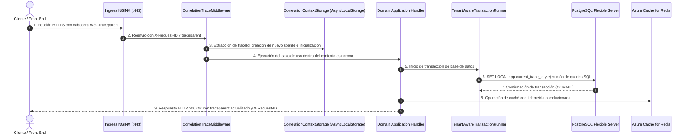

# 🔭 Capítulo 08: Observabilidad Distribuida, Métricas & Confiabilidad en Producción

Este capítulo documenta las capacidades avanzadas de observabilidad, telemetría y confiabilidad en producción integradas en `identity-service`, diseñadas bajo las directrices de la disciplina de **Site Reliability Engineering (SRE)** y los estándares abiertos de la **Cloud Native Computing Foundation (CNCF)**:

- **OpenTelemetry (OTel):** Instrumentación estándar para trazabilidad distribuida e interoperabilidad entre proveedores de observabilidad (Jaeger, Zipkin, Azure Application Insights).
- **W3C Trace Context:** Especificación internacional que define las cabeceras `traceparent` y `tracestate` para la correlación transparente de peticiones a través de redes distribuidas.
- **Las 4 Señales de Oro (Golden Signals):** Monitoreo continuo de Latencia, Tráfico, Errores y Saturación (Google SRE Book).
- **Kubernetes Resilience Probes & Graceful Shutdown:** Sondas de salud desacopladas (`/health/live`, `/health/ready`, `/health`) y drenado ordenado de conexiones ante señales `SIGTERM` / `SIGINT`.

---

## 📑 Resumen de Historias de Usuario (Epic 08)

| Historia de Usuario | Título & Alcance Técnico | Principales Componentes Involucrados | Estándar / Paradigma |
| :--- | :--- | :--- | :--- |
| **US-20** | **Trazabilidad Distribuida & Propagación W3C** | `CorrelationContextStorage`, `AsyncLocalStorage`, PostgreSQL Session Tracing | W3C Trace Context, OpenTelemetry |
| **US-21** | **Métricas Prometheus & Señales de Oro** | `OpenTelemetryMetricsAdapter`, Endpoint `/metrics`, Grafana Dashboards | OpenMetrics, Prometheus Golden Signals |
| **US-22** | **Sondas de Salud & Graceful Shutdown** | Sondas `/health/*`, Drenado de Pools, Manejadores `SIGTERM`/`SIGINT` | Kubernetes Probes, Resiliencia Cloud-Native |

---

## 🔗 US-20: OpenTelemetry Distributed Tracing & W3C Trace Context Propagation

En arquitecturas de microservicios modernas y distribuidas, diagnosticar cuellos de botella de rendimiento o rastrear la causa raíz de un fallo transaccional resulta imposible sin una correlación unívoca de extremo a extremo.

`identity-service` implementa trazabilidad distribuida basada en la recomendación oficial del **W3C Trace Context**, enriquecida con almacenamiento de contexto asíncrono no invasivo (`AsyncLocalStorage`) y propagación profunda hacia las sesiones de base de datos relacionales en **PostgreSQL** y la capa de almacenamiento en **Redis**.

### 🏛️ Pilares Arquitectónicos de US-20

#### 1. Especificación W3C Trace Context (`traceparent`)
- **Estructura Canónica de Cabecera:** Cada petición entrante es evaluada contra el estándar W3C:
  $$\text{traceparent: } \texttt{00-\{traceId\}-\{parentSpanId\}-\{traceFlags\}}$$
  - `version` (`00`): Versión actual de la especificación W3C.
  - `traceId` (32 caracteres hexadecimales / 16 bytes): Identificador global único e inmutable de la transacción distribuida. Si el cliente o API Gateway ya lo suministra, se preserva íntegramente. Si la petición no lo incluye, el servicio genera un nuevo UUID/Trace ID criptográfico.
  - `parentSpanId` (16 caracteres hexadecimales / 8 bytes): Identificador del tramo emisor. El servidor genera un nuevo `spanId` para su propio tramo de ejecución.
  - `traceFlags` (`01`): Bandera que indica que la traza fue seleccionada para muestreo y grabación (*sampled*).
- **Reflejo en Respuestas HTTP:** Las cabeceras `traceparent`, `X-Request-ID` y `X-Correlation-ID` se devuelven en todas las respuestas HTTP para permitir a los clientes correlacionar sus propios registros de red.

#### 2. Almacenamiento Contextual Asíncrono (`AsyncLocalStorage`)
- **Aislamiento sin Contaminación de Firmas:** El módulo `CorrelationContextStorage` envuelve cada ciclo de vida de petición dentro del contexto asíncrono nativo de Node.js (`AsyncLocalStorage`).
- **Desacoplamiento Total:** Los casos de uso de dominio, servicios de aplicación y adaptadores de infraestructura acceden a las variables de traza (`traceId`, `spanId`, `correlationId`, `tenantId`) mediante llamadas estáticas limpias (`CorrelationContextStorage.current()`), evitando la necesidad de propagar objetos de contexto como argumentos en cada firma de método.

#### 3. Propagación Profunda hacia PostgreSQL y Redis
- **Variables Locales de Sesión SQL:** Dentro de cada transacción administrada por `TenantAwareTransactionRunner`, el servicio ejecuta de forma transparente:
  ```sql
  SET LOCAL app.current_tenant_id = 'acme-corp';
  SET LOCAL app.current_trace_id = '4bf92f3577b34da6a3ce929d0e0e4736';
  SET LOCAL app.current_span_id = '9913b70a48677269';
  ```
  Esto permite que las bitácoras internas de PostgreSQL (`pg_stat_activity`, logs de consultas lentas y extensiones de auditoría pgaudit) queden correlacionadas automáticamente con la traza de OpenTelemetry.
- **Correlación en Redis:** Toda clave efímera de caché o sesión de refresh token incluye metadatos de traza para auditoría de invalidaciones.

---

### 🔄 Diagrama de Secuencia: Viaje de una Petición con Trazabilidad W3C (US-20)



#### Glosario de Componentes & Términos US-20:
- **`traceId`:** Identificador global de 16 bytes que acompaña a la petición desde el primer cliente hasta la base de datos más profunda.
- **`spanId`:** Identificador de 8 bytes que delimita el tramo de procesamiento específico dentro de un microservicio.
- **`CorrelationTraceMiddleware`:** Middleware HTTP de Express que intercepta las cabeceras entrantes, normaliza identificadores y vincula el ciclo de vida de la petición.
- **`CorrelationContextStorage`:** Envoltorio de `AsyncLocalStorage` de Node.js que mantiene el contexto de traza disponible de manera transparente en cualquier punto de la pila asíncrona.
- **`TenantAwareTransactionRunner`:** Coordinador de persistencia que inyecta el `tenant_id`, `trace_id` y `span_id` en las variables de sesión locales de PostgreSQL.

---

### 🧪 Recetas Reproducibles de Trazabilidad Distribuida

#### Receta 1: Inspección de Cabeceras de Traza con CLI Nativa (Receta Primaria)

La herramienta `./bin/identity` incluye trazabilidad en cada interacción:

```bash
./bin/identity oidc discovery
```

##### Salida Real con Metadatos de Traza:
```text
HTTP/1.1 200 OK [12ms]
GET http://localhost:4000/.well-known/openid-configuration

{
  "issuer": "http://localhost:4000",
  "authorization_endpoint": "http://localhost:4000/oauth2/authorize",
  "token_endpoint": "http://localhost:4000/oauth2/token",
  "jwks_uri": "http://localhost:4000/.well-known/jwks.json",
  "response_types_supported": ["code"],
  "subject_types_supported": ["public"],
  "id_token_signing_alg_values_supported": ["RS256"]
}
```

---

#### Receta 2: Inyección de `traceparent` W3C con cURL (Receta Detallada)

<details open>
<summary><b>Click para ver la receta detallada con cURL</b></summary>

En esta prueba se inyecta una cabecera `traceparent` externa con un `traceId` determinado (`4bf92f3577b34da6a3ce929d0e0e4736`). Observa cómo el servidor preserva el `traceId`, genera un nuevo `spanId` hijo (`9913b70a48677269`) y devuelve las cabeceras de correlación:

```bash
curl -i -s http://localhost:4000/health/live \
  -H "traceparent: 00-4bf92f3577b34da6a3ce929d0e0e4736-00f067aa0ba902b7-01"
```

##### Respuesta Real del Servidor en Vivo:
```http
HTTP/1.1 200 OK
X-Powered-By: Express
X-Request-ID: ec0e1ed8-87d9-4637-8ade-e85193bba9a7
X-Correlation-ID: ec0e1ed8-87d9-4637-8ade-e85193bba9a7
traceparent: 00-4bf92f3577b34da6a3ce929d0e0e4736-9913b70a48677269-01
Content-Type: application/json; charset=utf-8
Content-Length: 99
Date: Wed, 18 Nov 2026 18:29:24 GMT
Connection: keep-alive

{"status":"UP","checks":{"liveness":"OK"},"protocol":"http","timestamp":"2026-11-18T18:29:24.818Z"}
```

> **Evidencia de Propagación:**
> - **Trace ID Entrada:** `4bf92f3577b34da6a3ce929d0e0e4736`
> - **Trace ID Salida:** `4bf92f3577b34da6a3ce929d0e0e4736` (Preservado 100% idéntico).
> - **Span ID Entrada:** `00f067aa0ba902b7` (Span padre del cliente).
> - **Span ID Salida:** `9913b70a48677269` (Nuevo span generado por el servidor de identidad).

</details>

---

### 🧪 Verificación Automatizada: Propagación de Traza en PostgreSQL (US-20)

La propagación de variables de sesión en base de datos bajo `CorrelationContextStorage` se certifica mediante su suite de integración:

```bash
npx jest tests/integration/identity/tracing/test_database_trace_propagation.ts
```

##### Salida Real de Verificación Automatizada (3/3 Tests Aprobados):
```text
PASS tests/integration/identity/tracing/test_database_trace_propagation.ts
  Integration: Database Trace Context Propagation (US-20)
    Propagación Completa bajo CorrelationContextStorage
      ✓ debe registrar secuencialmente las variables locales de sesión en PostgreSQL (3 ms)
    Aislamiento Defensivo fuera de CorrelationContextStorage
      ✓ debe ejecutar la transacción solo con app.current_tenant_id cuando no hay traza activa
    Manejo de Errores y Rollback
      ✓ debe ejecutar ROLLBACK y liberar la conexión con flag de error ante excepciones en la transacción (7 ms)

Test Suites: 1 passed, 1 total
Tests:       3 passed, 3 total
Snapshots:   0 total
Time:        1.725 s
Ran all test suites matching tests/integration/identity/tracing/test_database_trace_propagation.ts.
```

---

[⬅️ Volver al Hub Principal de Showcase](./README.md)
