# 🎨 Capítulo 09: Portal Visual Enterprise Material Design 3 & Bounded Shell

Este capítulo documenta la capa visual de `identity-service`, construida de forma nativa sobre **React 19**, **Vite 8**, **Storybook 10** y un sistema de diseño propio alineado con **Google Material Design 3 (M3)** sin dependencias de librerías UI pesadas.

- **Design Tokens Centralizados (`tokens.css`):** Paleta Cloud/Security Console (`#1A73E8`), superficies tonales (`#F8FAFD`, `#F1F4F9`, `#E9EEF6`), tipografía `Inter` / `Roboto` + `JetBrains Mono` y estados semánticos WCAG 2.1 AA.
- **Separación Estricta de Contextos (Bounded Contexts en UI):** Superficies aisladas `/auth`, `/tenant` y `/platform` mediante `BoundedShell`, evitando la exposición de navegación administrativa a usuarios sin sesión o sin privilegios Root.
- **Trazabilidad W3C en Frontend:** El cliente HTTP compartido (`api_client.ts`) inyecta `X-Request-ID` en cada petición y expone `traceparent` para inspección directa en consola.

---

## 📑 Resumen de Historias de Usuario (Epic 09)

| Historia de Usuario | Título & Alcance Técnico | Principales Componentes Involucrados | Estándar / Paradigma |
| :--- | :--- | :--- | :--- |
| **US-23** | **Google Material Design 3 Design System & Bounded-Context Shell** | `tokens.css`, `M3Primitives.tsx`, `BoundedShell.tsx`, `api_client.ts`, Storybook 10 | Material Design 3, WCAG 2.1 AA, ADR-0009 |
| **US-24** | **Superficie `/auth`: Portal Usuario, OIDC Discovery/JWKS, PKCE S256 & Federación** | `AuthPortalView.tsx`, `OidcDiscoveryPanel.tsx`, `PkceAndSessionsPanel.tsx`, `FederationPanel.tsx` | RFC 7636 (PKCE S256), OIDC Discovery, W3C Trace |
| **US-25** | **Superficie `/tenant`: Client Registry, M2M Playground & Laboratorio RLS/Cross-Tenant** | `TenantConsoleView.tsx`, `ClientRegistryPanel.tsx`, `M2mPlaygroundPanel.tsx`, `RlsAndCrossTenantLabPanel.tsx` | OAuth2 Client Credentials, CORS, PostgreSQL RLS, Zero-Trust |
| **US-26** | **Consola `/platform`: Gobernanza Root, Bóveda Criptográfica, Auditoría & SRE** | `PlatformConsoleView.tsx`, `SecurityPosturePanel.tsx`, `VaultAndRotationPanel.tsx`, `AuditExplorerPanel.tsx`, `SreObservabilityPanel.tsx` | ADR-0009, Vault CSI, Audit SSE, OpenTelemetry & Probes |
| **US-27** | **Showcase Interactivo & Evidencia Visual (`docs/showcase/01..09`)** | `scripts/capture-showcase.ts`, `docs/showcase/01..09`, `assets/screenshots/*.png` | Playwright Retina (`2x`), Walkthroughs E2E |

---

## 🧩 US-23: Material Design 3 Design System, Storybook 10 & Bounded-Context Shell

`US-23` establece la base visual y de seguridad en el cliente SPA para operar los distintos contextos del servicio de identidad bajo un modelo **Zero-Trust**:

1. **Invariante 1 — Design Tokens M3 Centralizados:** Todo color, elevación, radio de borde y tipografía reside en [`tokens.css`](../../interfaces/web/client/design-system/tokens.css) y es consumido mediante variables `--md-sys-*` desde [`styles.css`](../../interfaces/web/client/styles.css), con cero valores hexadecimales o `rgba(...)` literales fuera de `tokens.css`.
2. **Invariante 2 — Separación de Superficies (`/auth`, `/tenant`, `/platform`):** `BoundedShell` aísla el portal de autenticación centrado (`/auth`), el workspace multi-tenant (`/tenant`) y la consola Root (`/platform`), bloqueando el acceso en cliente con `403 Forbidden` si el usuario no pertenece al tenant `system` con rol `superadmin` (ADR-0009).
3. **Invariante 3 — Catálogo Storybook 10 & React 19:** Todas las primitivas (`M3Card`, `M3Button`, `M3Chip`, `M3AlertBanner`, `M3NavigationRail`, `M3TextField`, `M3JsonViewer`) se documentan y compilan de forma estática con `npm run build-storybook`.

---

### 📸 Evidencia Visual de los 4 Escenarios BDD (US-23)

#### 1. Superficie `/auth` sin sesión activa
Portal centrado estilo *Google Account / Sign-In* sin exponer elementos de navegación de `/tenant` ni de `/platform`.


#### 2. Guardia de ruta `/platform` (`403 Forbidden` para inquilino comercial)
Un usuario autenticado en `acme-corp` con rol `member` es bloqueado por `BoundedShell`, mostrando el banner M3 de acceso denegado (`403 Forbidden`) y recomendando operar con `system:superadmin`.

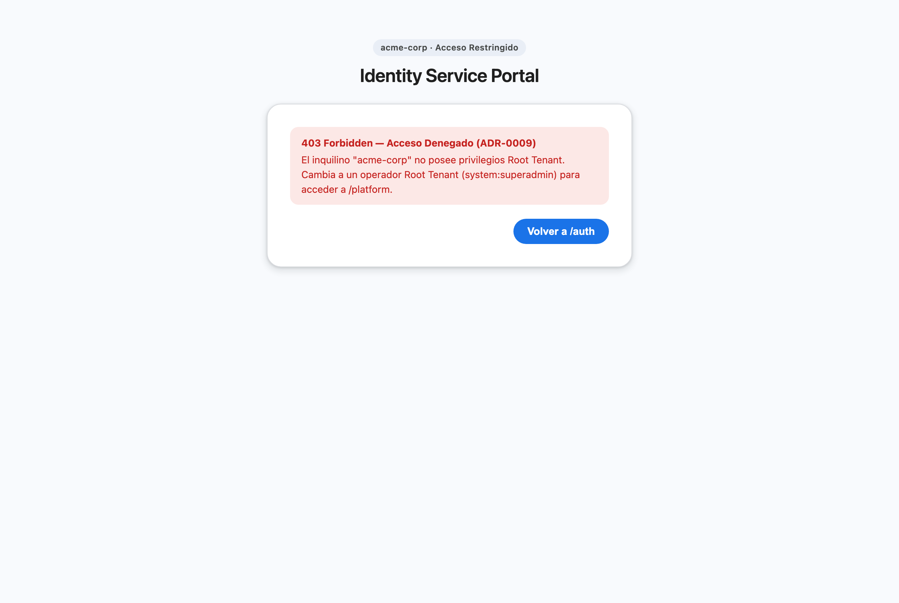

#### 3. Workspace `/platform` para Root Superadmin (`system · superadmin`)
Un operador autenticado en el inquilino `system` con rol `superadmin` accede a la **Platform Governance Console** con el `M3NavigationRail` y el badge activo `system · superadmin`.

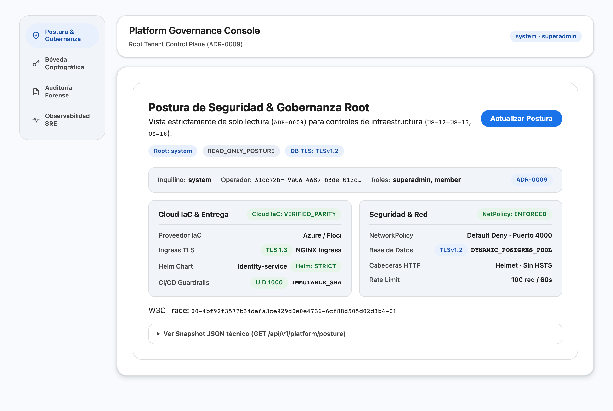

#### 4. Catálogo de Primitivas M3 en Storybook 10
Compilación estática y catálogo interactivo de `M3Primitives.stories.tsx` sobre Storybook 10.6.6 (`npm run build-storybook`).

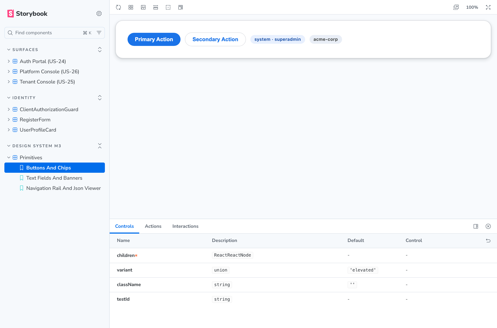

---

## 🔐 US-24: Superficie `/auth` — Portal Usuario, OIDC Discovery/JWKS, PKCE S256 & Federación

`US-24` unifica todo el ciclo de autenticación e identidad en `/auth` mediante el selector M3 **"Flujo de Identidad"** (`role="listbox"` en [`AuthPortalView.tsx`](../../interfaces/web/client/contexts/auth/ui/AuthPortalView.tsx)), ejecutando operaciones reales contra el backend sin datos simulados:

1. **Invariante 1 — PKCE S256 Nativo en Navegador:** `PkceAndSessionsPanel` calcula `code_verifier` y `code_challenge` (`BASE64URL(SHA256(...))`) en vivo mediante `crypto.subtle.digest('SHA-256', ...)` (RFC 7636).
2. **Invariante 2 — Endpoints Reales & Trazabilidad W3C:** Cada llamada (`/.well-known/openid-configuration`, `/.well-known/jwks.json`, `/oauth2/authorize`, `/api/v1/oauth2/token`, `/oauth2/refresh`, `/oauth2/revoke` y `/api/v1/auth/federation/*`) pasa por `apiRequest` y muestra el header `traceparent` en `M3JsonViewer`.
3. **Invariante 3 — Selector M3 & Refinamientos UX:** Transición suave entre los 4 flujos (**Cuenta**, **OIDC & JWKS**, **PKCE & Sesiones**, **Federación**), cierre de sesión integrado en `UserProfileCard`, tabla de semáforos de proveedores en `FederationPanel` y laboratorio OIDC manual en `<details>`.

---

### 📸 Evidencia Visual de los 4 Flujos de `/auth` (US-24)

#### 1. Flujo `Cuenta`: Perfil Autenticado Multi-Tenant (`US-01`, `US-02`)
`UserProfileCard` renderizando la sesión activa en `acme-corp` con cierre de sesión integrado en el footer.

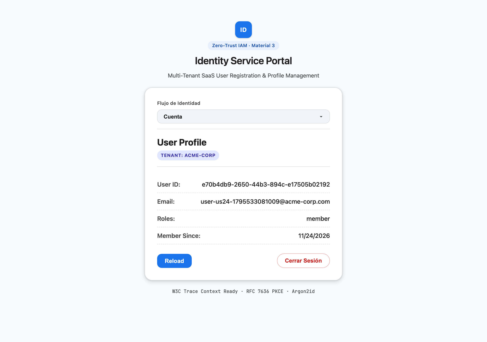

#### 2. Flujo `OIDC & JWKS`: Discovery y Claves RSA en Vivo (`US-07`)
Consulta real de `GET /.well-known/openid-configuration` y `GET /.well-known/jwks.json` con propagación de `traceparent` W3C.

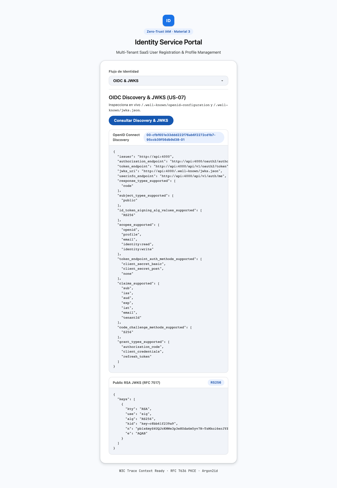

#### 3. Flujo `PKCE & Sesiones`: WebCrypto S256, Exchange y Refresh (`US-08`, `US-09`)
Generación de par PKCE S256 en navegador, intercambio en `/oauth2/authorize` + `/api/v1/oauth2/token` y emisión de `access_token` / `id_token` con traza W3C.

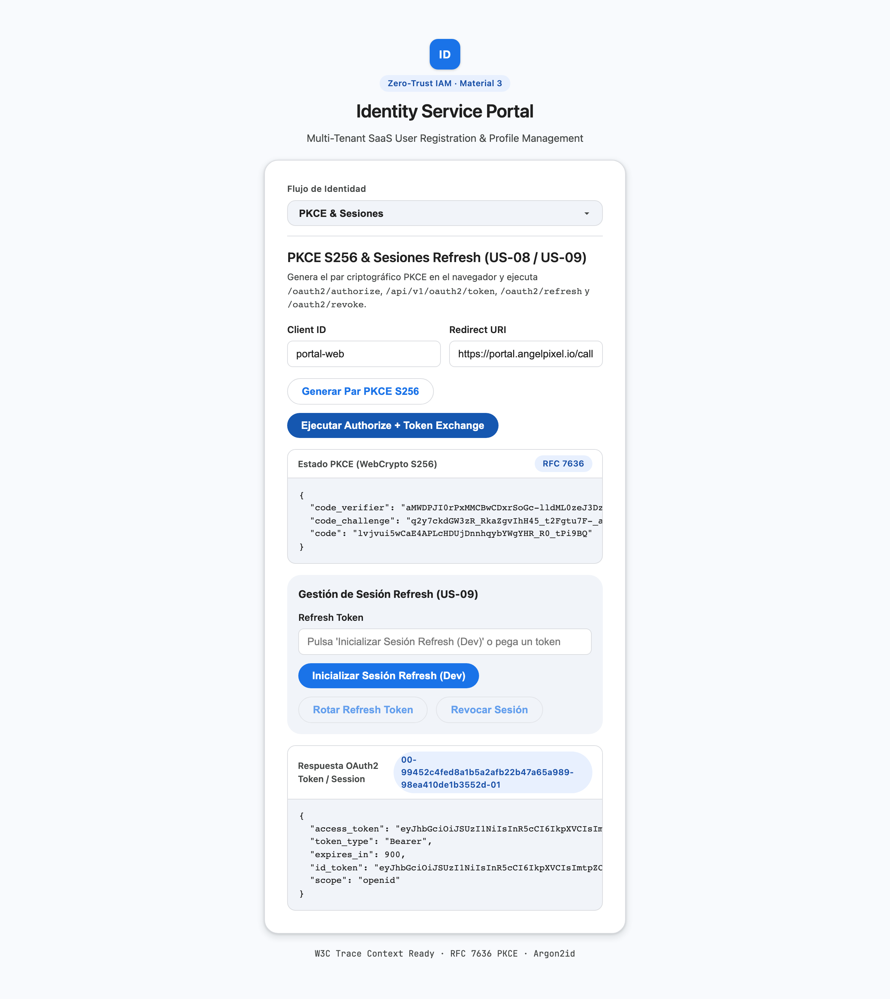

#### 4. Flujo `Federación`: Semáforo de Proveedores y JIT Provisioning (`US-10`, `US-11`)
Estado en vivo de **Google OIDC** y **Microsoft Entra ID**, popover informativo y laboratorio OIDC manual colapsable.

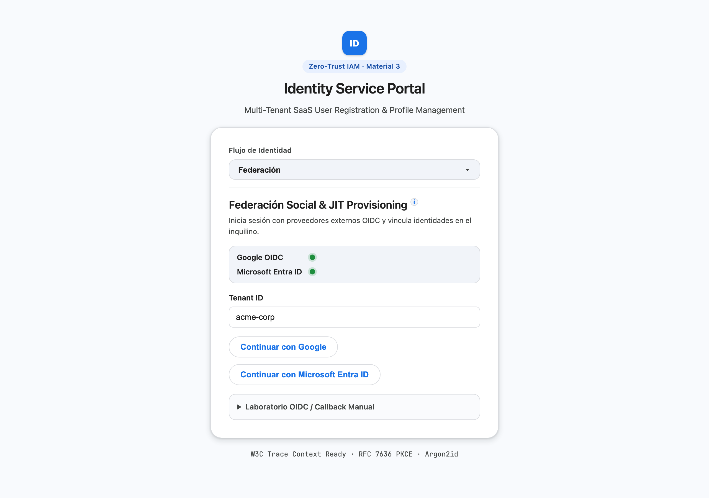

---

## 🏢 US-25: Superficie `/tenant` — Client Registry, M2M Playground & Laboratorio RLS/Cross-Tenant

`US-25` dota a los administradores de inquilinos autenticados de una consola M3 en `/tenant` ([`TenantConsoleView.tsx`](../../interfaces/web/client/contexts/tenant/ui/TenantConsoleView.tsx)) organizada en 3 pestañas accesibles (**Clientes & CORS**, **M2M Playground** y **Laboratorio RLS / Cross-Tenant**):

1. **Invariante 1 — Proyección Segura Sin Secretos (`US-03`):** `GET /api/v1/oauth2/clients` proyecta los clientes OAuth2 registrados del inquilino sin exponer `clientSecretHash` ni credenciales confidenciales.
2. **Invariante 2 — Validación CORS y Emisión M2M Reales (`US-03`, `US-04`):** `ClientRegistryPanel` valida orígenes en vivo (`POST /api/v1/oauth2/clients/validate`) y `M2mPlaygroundPanel` solicita tokens `Bearer` reales (`POST /api/v1/oauth2/token` con `client_credentials`).
3. **Invariante 3 — Aislamiento RLS y Bloqueo Zero-Trust (`US-05`, `US-06`):** `RlsAndCrossTenantLabPanel` demuestra en vivo cómo un intento de consulta con `X-Tenant-ID` ajeno recibe `HTTP 403 Forbidden` y emite el evento de auditoría `CROSS_TENANT_VIOLATION`.

---

### 📸 Evidencia Visual de los 3 Escenarios de `/tenant` (US-25)

#### 1. Pestaña `Clientes & CORS`: Listado Seguro y Validación en Vivo (`US-03`)
Clientes OAuth2 cargados desde PostgreSQL sin exposición de `clientSecretHash` y validación CORS exitosa (`authorized: true`) con `traceparent` W3C.

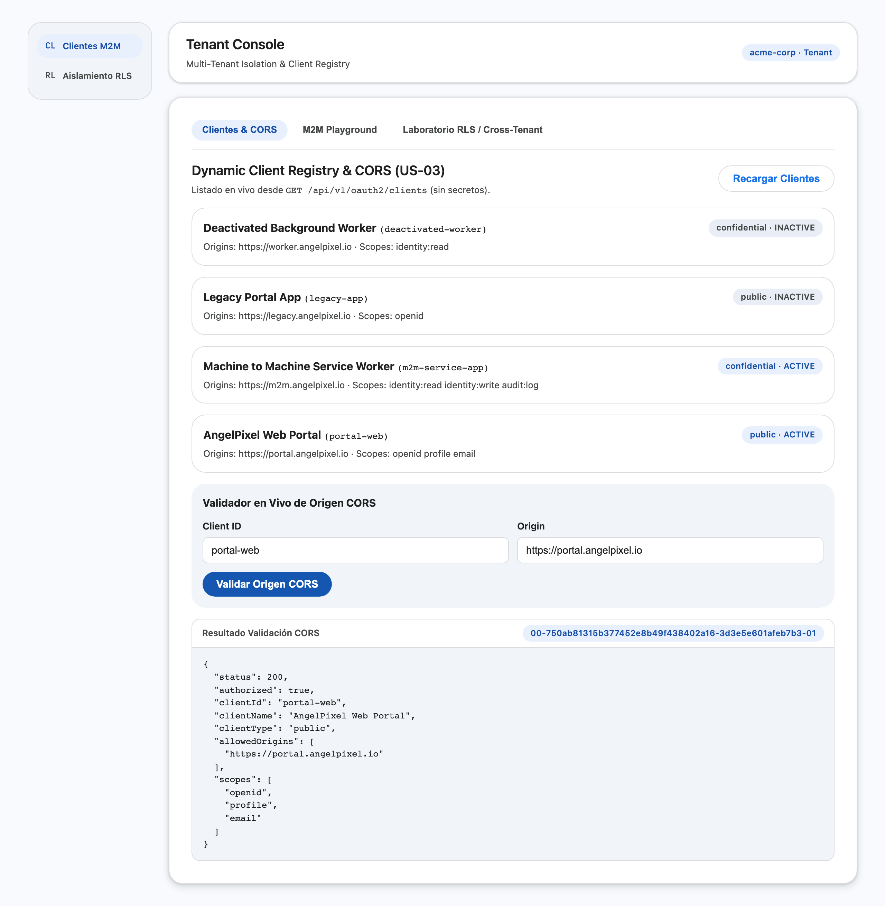

#### 2. Pestaña `M2M Playground`: Emisión de Token `client_credentials` (`US-04`)
Intercambio real contra `POST /api/v1/oauth2/token` para `m2m-service-app`, mostrando el `access_token` emitido y su trazabilidad W3C.

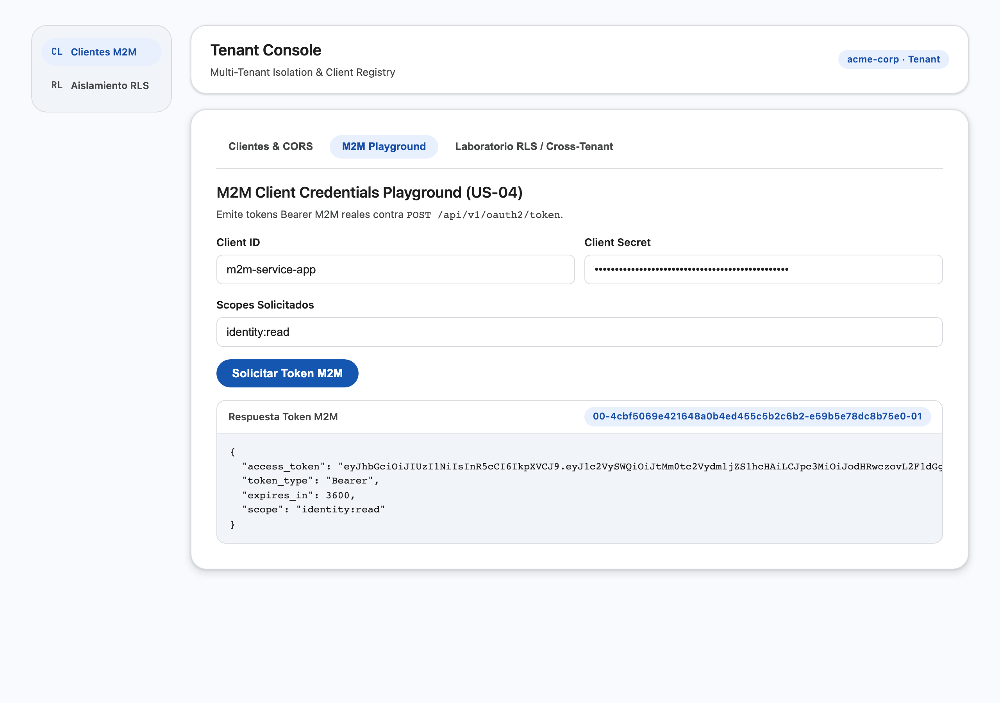

#### 3. Pestaña `Laboratorio RLS / Cross-Tenant`: Bloqueo `403 Forbidden` (`US-05`, `US-06`)
Intento de salto cross-tenant hacia `beta-corp` desde `acme-corp`, interceptado con `HTTP 403 Forbidden` y banner M3 Zero-Trust.

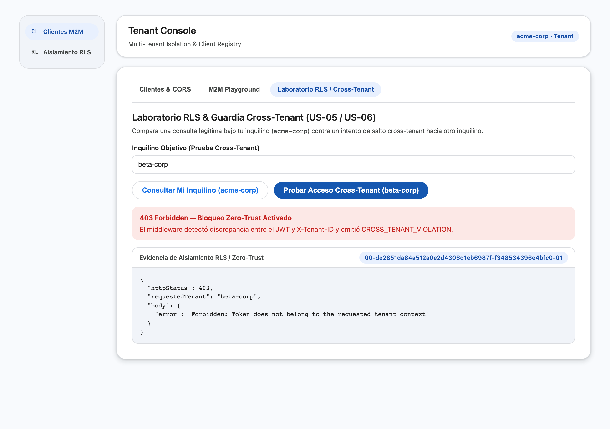

---

## 🛡️ US-26: Consola `/platform` — Gobernanza Root, Bóveda Criptográfica, Auditoría & SRE

`US-26` unifica en `/platform` ([`PlatformConsoleView.tsx`](../../interfaces/web/client/contexts/platform/ui/PlatformConsoleView.tsx)) el plano de control para operadores `system:superadmin` (`ADR-0009`), organizado en 4 vistas mediante `M3NavigationRail`:

1. **Postura de Seguridad & Gobernanza Root (`US-12`–`US-15`, `US-18`):** Vista estrictamente de solo lectura alimentada por `GET /api/v1/platform/posture` (`platform_controller.ts`), sin controles mutables de defensa ni exposición de secretos.
2. **Bóveda Criptográfica (`US-16`, `US-17`):** Metadatos de llaves activas/rotadas y rotación controlada (`POST /api/v1/secrets/rotate`) con confirmación explícita.
3. **Explorador de Auditoría Forense (`US-19`):** Stream SSE en vivo (`/api/v1/audit/events`), filtros reactivos parciales case-insensitive (`severity`, `eventType`, `tenantId`, `traceId`), paginación, ordenamiento por timestamp, copia de `traceId` y snackbar fijo.
4. **Observabilidad SRE (`US-20`–`US-22`):** Strip copiable de `traceparent` W3C, Golden Signals Prometheus (`/metrics`) y sondas detalladas incluyendo PostgreSQL y Redis (`/health/live`, `/health/ready`, `/health`).

---

### 📸 Evidencia Visual de las 4 Vistas de `/platform` (US-26)

#### 1. Postura de Seguridad & Gobernanza Root (`US-12`–`US-15`, `US-18`)
Vista de solo lectura exponiendo postura IaC, Ingress TLS 1.3, Helm, NetworkPolicy y Rate Limit.

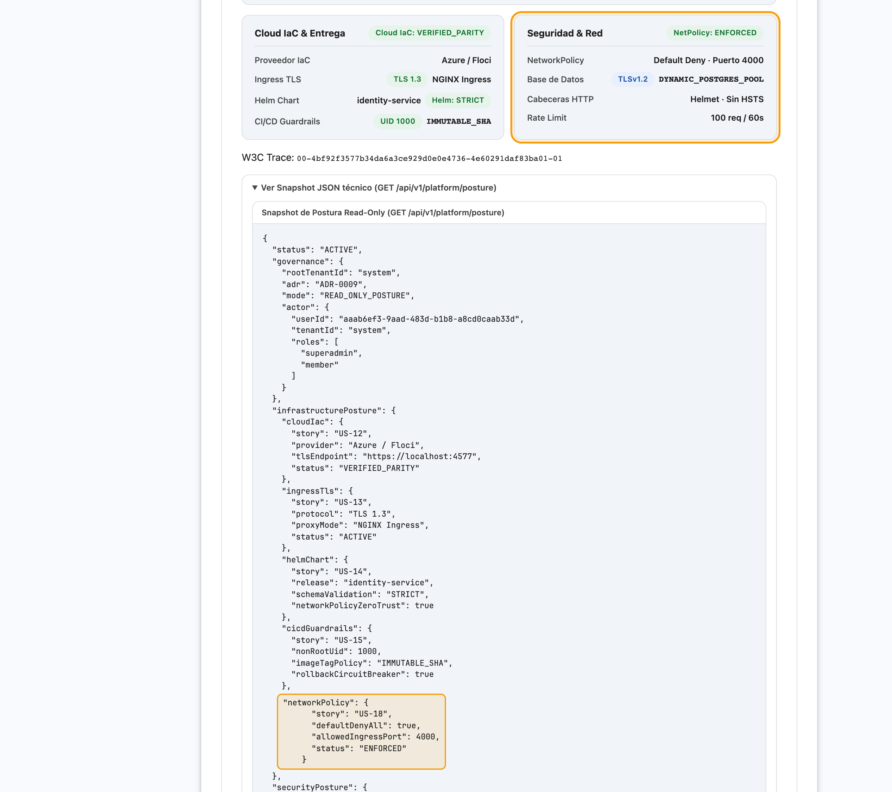

#### 2. Bóveda Criptográfica & Rotación Confirmada (`US-16`, `US-17`)
Metadatos de llaves RS256 sin exponer material secreto y rotación confirmada en vivo.

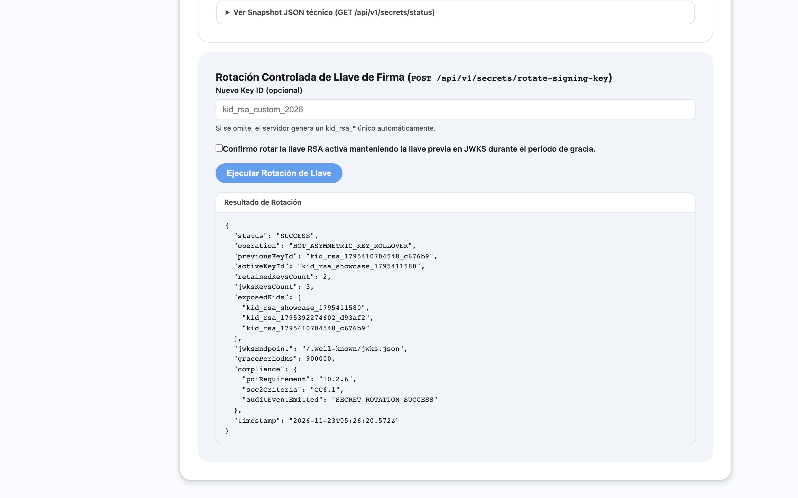

#### 3. Explorador de Auditoría Forense (`US-19`)
Filtrado parcial reactivo, tabla paginada ordenable por timestamp, botón de copia para `traceId` y stream SSE en tiempo real.

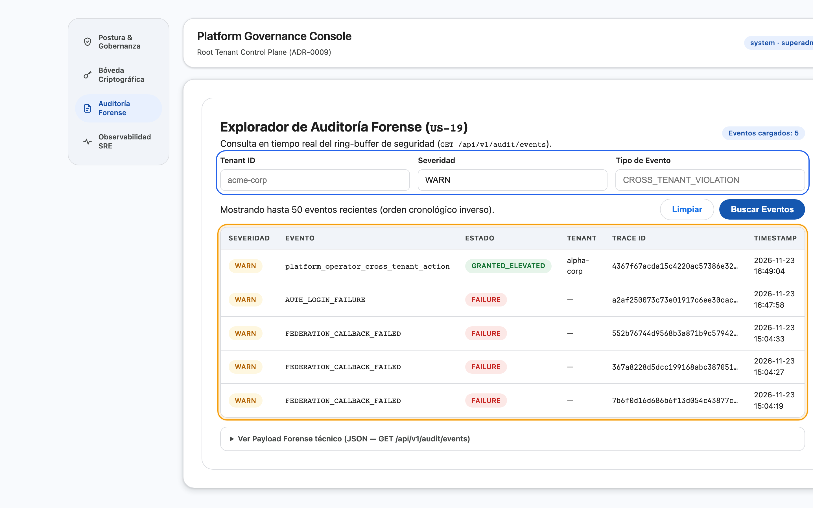

#### 4. Observabilidad SRE: Métricas RED, Golden Signals y Probes (`US-20`–`US-22`)
Tarjetas en vivo de métricas Prometheus (`/metrics`), `traceparent` W3C copiable y diagnóstico de sondas.

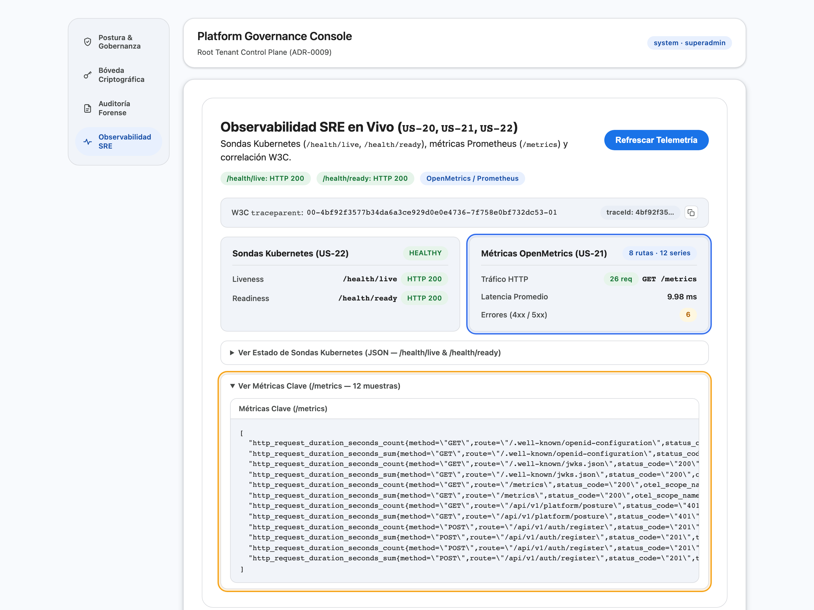

---

## 📸 US-27: Showcase Interactivo & Evidencia Visual (`docs/showcase/01..09`)

`US-27` cierra `EPIC-09` integrando walkthroughs visuales y capturas Playwright en alta densidad Retina (`deviceScaleFactor: 2`) contra el backend (`:4000`) y el frontend (`:3000`) reales a lo largo de los **9 capítulos** del Showcase:

- **Automatización Playwright (`scripts/capture-showcase.ts` / `npm run showcase:capture`):** Genera las 9 capturas base `ui_*.png` (`ui_auth_account.png`, `ui_auth_oidc_jwks.png`, `ui_auth_pkce_sessions.png`, `ui_auth_federation.png`, `ui_tenant_clients_m2m.png`, `ui_tenant_rls_lab.png`, `ui_platform_posture.png`, `ui_platform_vault_audit.png`, `ui_platform_sre.png`) sin mocks ni exposición de secretos en claro.
- **Cobertura Integral `01..09`:** Cada capítulo (`01`–`08`) incluye la sección `### 🖥️ Interfaz Visual (UI) & Walkthrough en Navegador`, y el capítulo `09` consolida la arquitectura M3, Storybook 10 y el walkthrough detallado de `US-23` a `US-27` con verificación de enlaces (`0` enlaces rotos).

---

## 🧪 Verificación Técnica Asociada

```bash
# 1. Auditoría de Design Tokens (0 colores literales fuera de tokens.css)
rg -n "#[0-9a-fA-F]{3,8}|rgba?\(|hsla?\(" interfaces/web/client/styles.css

# 2. Compilación de producción SPA (Vite 8)
npm run build:web

# 3. Compilación estática del catálogo de componentes (Storybook 10)
npm run build-storybook

# 4. Suites E2E Web (US-23 a US-26)
npm run test:e2e -- tests/e2e/web/m3_shell_and_route_guards.spec.tsx tests/e2e/web/auth_portal_oidc_federation.spec.tsx tests/e2e/web/tenant_console.spec.tsx tests/e2e/web/platform_console.spec.tsx
```
