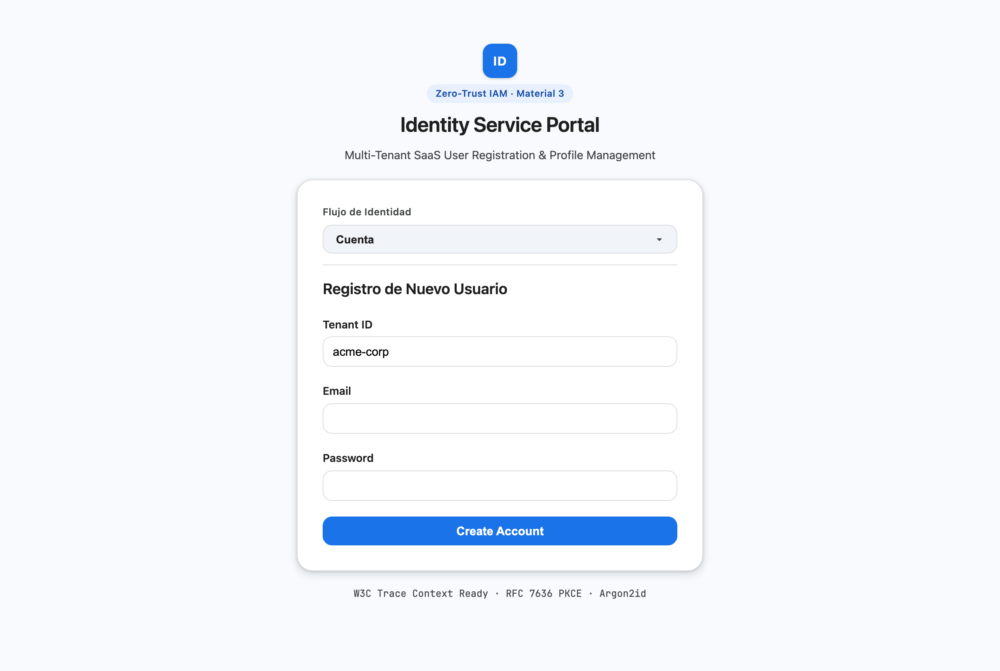

# 🎨 Capítulo 09: Portal Visual Enterprise Material Design 3 & Bounded Shell

Este capítulo documenta la capa visual de `identity-service`, construida de forma nativa sobre **React 19**, **Vite 8**, **Storybook 10** y un sistema de diseño propio alineado con **Google Material Design 3 (M3)** sin dependencias de librerías UI pesadas.

- **Design Tokens Centralizados (`tokens.css`):** Paleta Cloud/Security Console (`#1A73E8`), superficies tonales (`#F8FAFD`, `#F1F4F9`, `#E9EEF6`), tipografía `Inter` / `Roboto` + `JetBrains Mono` y estados semánticos WCAG 2.1 AA.
- **Separación Estricta de Contextos (Bounded Contexts en UI):** Superficies aisladas `/auth`, `/tenant` y `/platform` mediante `BoundedShell`, evitando la exposición de navegación administrativa a usuarios sin sesión o sin privilegios Root.
- **Trazabilidad W3C en Frontend:** El cliente HTTP compartido (`api_client.ts`) inyecta `X-Request-ID` en cada petición y expone `traceparent` para inspección directa en consola.

---

## 📑 Resumen de Historias de Usuario (Epic 09)

| Historia de Usuario | Título & Alcance Técnico | Principales Componentes Involucrados | Estándar / Paradigma |
| :--- | :--- | :--- | :--- |
| **US-23** | **Google Material Design 3 Design System & Bounded-Context Shell** | `tokens.css`, `M3Primitives.tsx`, `BoundedShell.tsx`, `api_client.ts`, Storybook 10 | Material Design 3, WCAG 2.1 AA, ADR-0009 |

---

## 🧩 US-23: Material Design 3 Design System, Storybook 10 & Bounded-Context Shell

`US-23` establece la base visual y de seguridad en el cliente SPA para operar los distintos contextos del servicio de identidad bajo un modelo **Zero-Trust**:

1. **Invariante 1 — Design Tokens M3 Centralizados:** Todo color, elevación, radio de borde y tipografía reside en [`tokens.css`](../../interfaces/web/client/design-system/tokens.css) y es consumido mediante variables `--md-sys-*` desde [`styles.css`](../../interfaces/web/client/styles.css), con cero valores hexadecimales o `rgba(...)` literales fuera de `tokens.css`.
2. **Invariante 2 — Separación de Superficies (`/auth`, `/tenant`, `/platform`):** `BoundedShell` aísla el portal de autenticación centrado (`/auth`), el workspace multi-tenant (`/tenant`) y la consola Root (`/platform`), bloqueando el acceso en cliente con `403 Forbidden` si el usuario no pertenece al tenant `system` con rol `superadmin` (ADR-0009).
3. **Invariante 3 — Catálogo Storybook 10 & React 19:** Todas las primitivas (`M3Card`, `M3Button`, `M3Chip`, `M3AlertBanner`, `M3NavigationRail`, `M3TextField`, `M3JsonViewer`) se documentan y compilan de forma estática con `npm run build-storybook`.

---

### 📸 Evidencia Visual de los 4 Escenarios BDD (US-23)

#### 1. Superficie `/auth` sin sesión activa
Portal centrado estilo *Google Account / Sign-In* sin exponer elementos de navegación de `/tenant` ni de `/platform`.



#### 2. Guardia de ruta `/platform` (`403 Forbidden` para inquilino comercial)
Un usuario autenticado en `acme-corp` con rol `member` es bloqueado por `BoundedShell`, mostrando el banner M3 de acceso denegado (`403 Forbidden`) y recomendando operar con `system:superadmin`.


#### 3. Workspace `/platform` para Root Superadmin (`system · superadmin`)
Un operador autenticado en el inquilino `system` con rol `superadmin` accede a la **Platform Governance Console** con el `M3NavigationRail` y el badge activo `system · superadmin`.


#### 4. Catálogo de Primitivas M3 en Storybook 10
Compilación estática y catálogo interactivo de `M3Primitives.stories.tsx` sobre Storybook 10.6.6 (`npm run build-storybook`).


---

## 🧪 Verificación Técnica Asociada

```bash
# 1. Auditoría de Design Tokens (0 colores literales fuera de tokens.css)
rg -n "#[0-9a-fA-F]{3,8}|rgba?\(|hsla?\(" interfaces/web/client/styles.css

# 2. Compilación de producción SPA (Vite 8)
npm run build:web

# 3. Compilación estática del catálogo de componentes (Storybook 10)
npm run build-storybook

# 4. Suite E2E Web (Shell M3 y guardias de ruta)
npm run test:e2e -- tests/e2e/web/m3_shell_and_route_guards.spec.tsx
```
