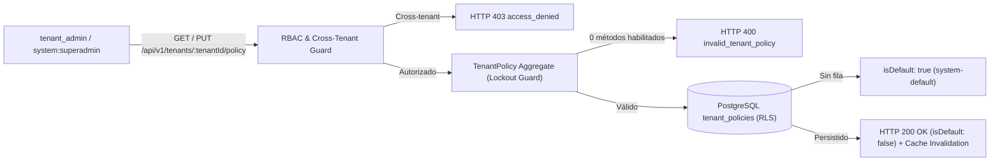
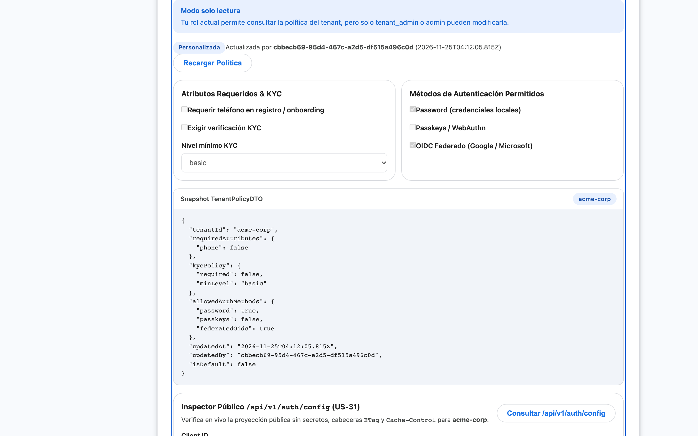
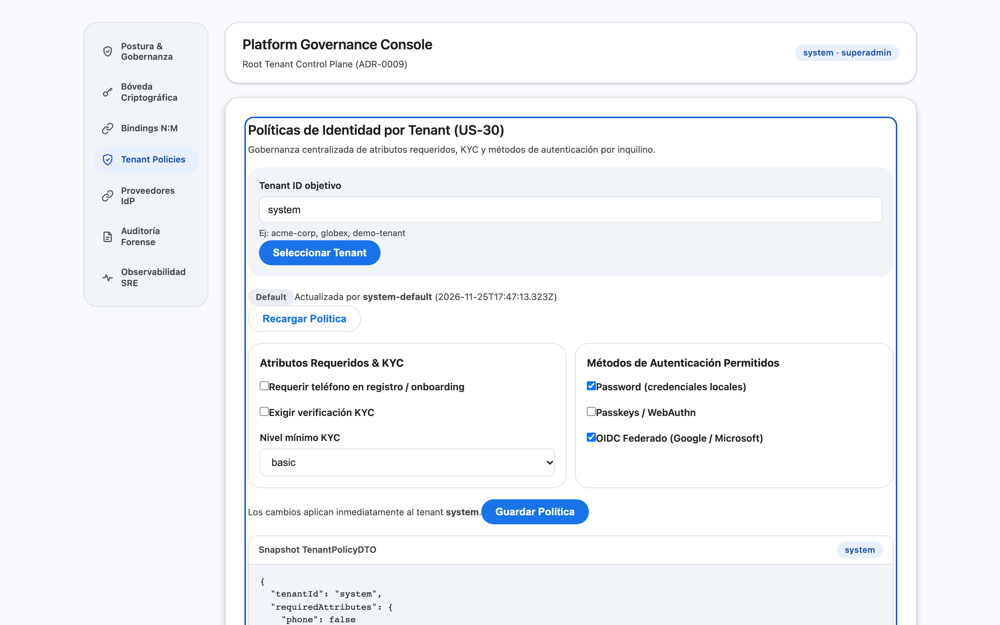
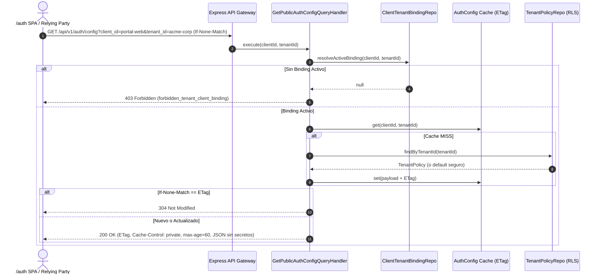
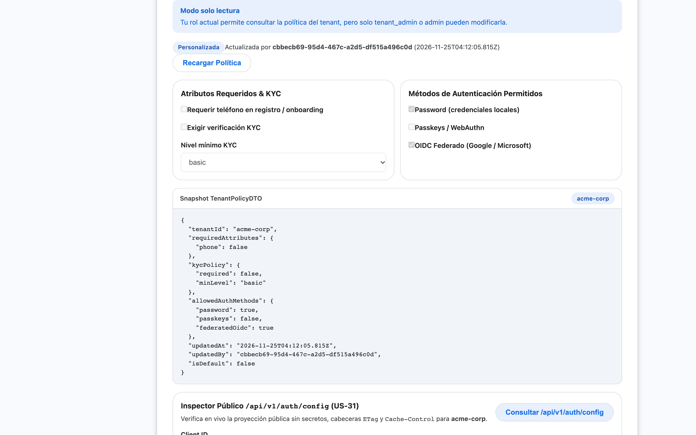
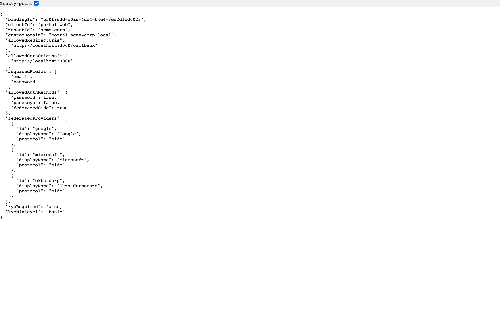
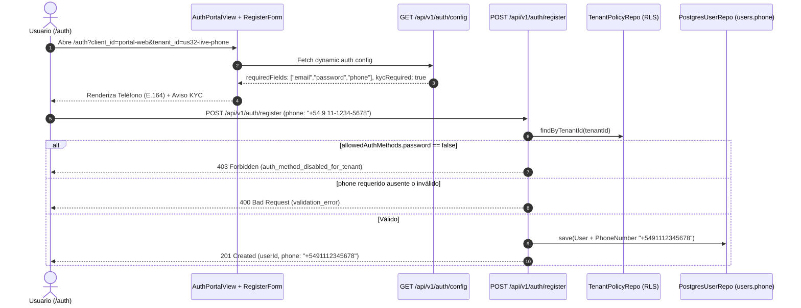
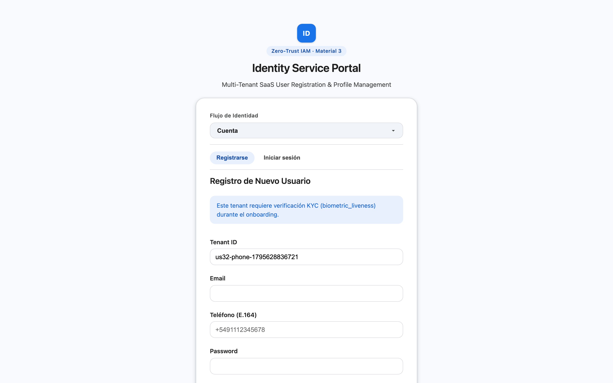
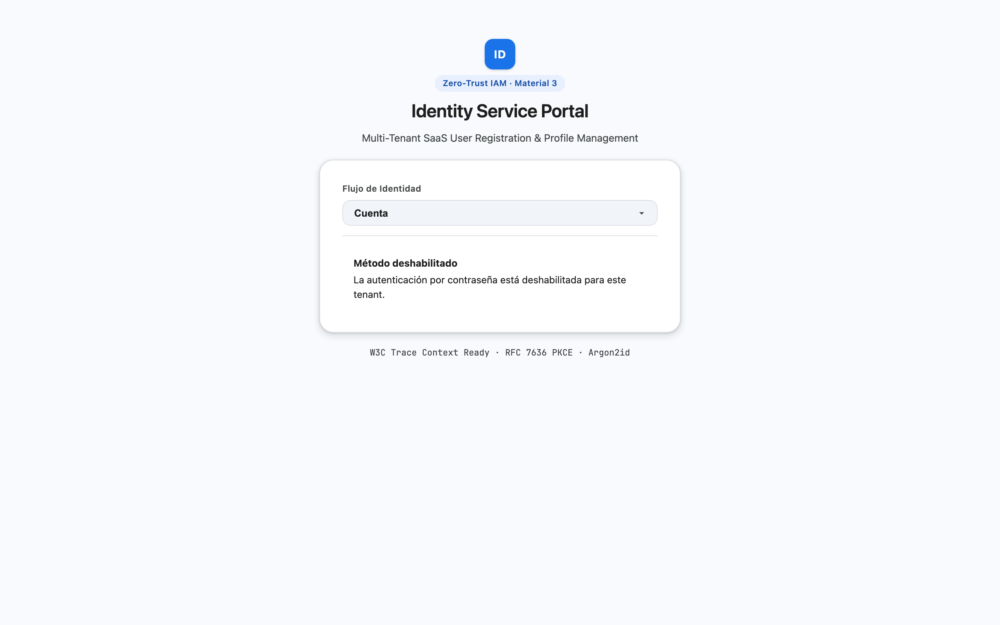

# 🎛️ Epic 10: Políticas Dinámicas por Tenant y Onboarding Adaptativo

[](http://localhost:4000/api/docs/)
[](#)
[](#)
[](#)

Este capítulo documenta el **Épico 10: Políticas Dinámicas por Tenant y Onboarding Adaptativo** (`ADR-0010`), permitiendo que cada aplicación cliente y cada inquilino resuelvan dinámicamente sus requisitos de registro, métodos de autenticación y nivel KYC sin exponer secretos ni desplegar código específico por tenant.

---

## 📌 Historias de Usuario

| Historia | Descripción | Estado |
| :--- | :--- | :---: |
| **US-30** | Agregado `TenantPolicy` y Gestión de Capacidades por Tenant (RBAC, Lockout Guard y Auditoría) | ✅ En Producción |
| **US-31** | Contrato Público Dinámico del Flujo de Autenticación (`GET /api/v1/auth/config`) | ✅ En Producción |
| **US-32** | Onboarding Dinámico y Validación Estricta en `/auth` y Backend | ✅ En Producción |

---

## ⚙️ US-30: Agregado `TenantPolicy` y Gestión de Capacidades por Tenant

### 1. Arquitectura, Invariantes de Dominio (`Lockout Guard`) & Aislamiento RBAC

`US-30` modela las capacidades y requisitos de identidad de cada inquilino a través del agregado `TenantPolicy`, desacoplando las reglas de negocio por tenant del código de la plataforma:

1. **Fallback Determinista (`isDefault: true`):** Si un tenant aún no posee una política personalizada en `tenant_policies`, `GET /api/v1/tenants/:tenantId/policy` sintetiza el contrato por defecto (`phone: false`, `kycPolicy: { required: false, minLevel: "basic" }`, `allowedAuthMethods: { password: true, passkeys: false, federatedOidc: true }`, `updatedBy: "system-default"`, `isDefault: true`).
2. **Invariante Anti-Bloqueo (`Lockout Guard`):** El agregado rechaza con `HTTP 400 invalid_tenant_policy` cualquier mutación que intente deshabilitar simultáneamente todos los métodos de autenticación (`password`, `passkeys` y `federatedOidc`), garantizando que ningún administrador pueda dejar inaccesible su propio tenant.
3. **Aislamiento RBAC Cross-Tenant & Auditoría:** Solo `tenant_admin` del mismo tenant o `system:superadmin` pueden consultar o modificar la política (`PUT /api/v1/tenants/:tenantId/policy`). Los intentos cross-tenant son rechazados con `HTTP 403 access_denied`. Cada actualización invalida la caché de `US-31` y registra `updatedBy` y timestamp.



---

### 2. Evidencia Real en Vivo (`http://localhost:4000`)

#### A. Lectura Inicial con Fallback por Defecto (`GET /api/v1/tenants/:tenantId/policy` → `200 OK`)

```json
{
  "tenantId": "tusherramientas-us30-1795623018642",
  "requiredAttributes": {
    "phone": false
  },
  "kycPolicy": {
    "required": false,
    "minLevel": "basic"
  },
  "allowedAuthMethods": {
    "password": true,
    "passkeys": false,
    "federatedOidc": true
  },
  "updatedBy": "system-default",
  "isDefault": true
}
```

#### B. Actualización Persistida (`PUT /api/v1/tenants/:tenantId/policy` → `200 OK`)

Al habilitar teléfono obligatorio, KYC `biometric_liveness` y los tres métodos de autenticación (`password`, `passkeys`, `federatedOidc`), el agregado persiste el override (`isDefault: false`):

```json
{
  "requiredAttributes": {
    "phone": true
  },
  "kycPolicy": {
    "required": true,
    "minLevel": "biometric_liveness"
  },
  "allowedAuthMethods": {
    "password": true,
    "passkeys": true,
    "federatedOidc": true
  },
  "isDefault": false
}
```

#### C. Lockout Guard Negativo (`400 Bad Request` — `invalid_tenant_policy`)

Intentar guardar `allowedAuthMethods: { "password": false, "passkeys": false, "federatedOidc": false }` es bloqueado por el dominio:

```json
{
  "error": "invalid_tenant_policy",
  "message": "At least one authentication method (password, passkeys, or federatedOidc) must be enabled"
}
```

#### D. Aislamiento Cross-Tenant Negativo (`403 Forbidden` — `access_denied`)

Un administrador autenticado en `acme-corp` intentando `PUT /api/v1/tenants/globex/policy` recibe:

```json
{
  "error": "access_denied",
  "error_description": "Forbidden: tenant_admin or system:superadmin role required to modify policy for \"globex\"",
  "message": "Forbidden: tenant_admin or system:superadmin role required to modify policy for \"globex\""
}
```

---

### 3. Recorrido Visual en Consola (`/tenant` y `/platform`)

El editor de políticas permite configurar atributos requeridos, política KYC y métodos de autenticación tanto desde el portal de tenant (`/tenant`) como desde el gobierno global (`/platform`):





---

### 4. Cobertura TDD (4 Capas — `29 passed, 29 total`)

| Capa | Suite | Resultado |
| :--- | :--- | :---: |
| **Unit (Domain)** | `tests/unit/identity/domain/test_tenant_policy.ts` | `4/4 passed` |
| **Integration (API + DB)** | `tests/integration/identity/interfaces/test_tenant_policy_api.ts` | `7/7 passed` |
| **Acceptance (BDD)** | `tests/acceptance/step_defs/test_tenant_policy_management_steps.ts` | `4/4 passed` |
| **E2E Web (Tenant & Platform)** | `tests/e2e/web/tenant_console.spec.tsx` (Scenario 6) & `tests/e2e/web/platform_console.spec.tsx` (Scenario 7) | `14/14 passed` (`7/7` + `7/7`) |

---

## 📡 US-31: Contrato Público Dinámico del Flujo de Autenticación (`GET /api/v1/auth/config`)

### 1. Arquitectura, Anti-Enumeración, `ETag` & Invalidación de Caché

`US-31` expone el contrato público `GET /api/v1/auth/config` consumido por `/auth` y por aplicaciones *Relying Party* antes de renderizar formularios de registro/login:

1. **Validación Previa de Binding (`US-29`):** Antes de consultar `TenantPolicy`, `GetPublicAuthConfigQueryHandler` verifica `(client_id, tenant_id | domain)` contra `client_tenant_bindings`. Si no existe binding activo o el cliente está suspendido, rechaza con `HTTP 403 forbidden_tenant_client_binding` (previniendo enumeración de tenants).
2. **Proyección Estricta Sin Secretos:** Devuelve exclusivamente `bindingId`, `clientId`, `tenantId`, `customDomain`, `allowedRedirectUris`, `allowedCorsOrigins`, `requiredFields`, `allowedAuthMethods`, `federatedProviders`, `kycRequired` y `kycMinLevel`. Jamás incluye `clientSecret`, hashes ni secretos de proveedores OIDC.
3. **Caché Corta + `ETag` (`RFC 9110`) e Invalidación:** Emite `ETag` y `Cache-Control: private, max-age=60`. Soporta revalidación condicional `If-None-Match` (`304 Not Modified`) e invalida automáticamente la caché al mutar `TenantPolicy` (`US-30`) o `ClientTenantBinding` (`US-29`).



---

### 2. Ejecución en Vivo & Verificación Interactiva Paso a Paso

#### Escenario A: Consulta Pública con `ETag` y `Cache-Control` (`200 OK`)

```bash
curl -i -s "http://localhost:4000/api/v1/auth/config?client_id=portal-web&tenant_id=acme-corp"
```

##### Cabeceras y Respuesta Real Obtenida (`HTTP 200 OK`):
```http
HTTP/1.1 200 OK
ETag: "e64e5f5ec3e9bfb6111560ff"
Cache-Control: private, max-age=60
Content-Type: application/json; charset=utf-8
```
```json
{
  "bindingId": "c50f9e3d-e0ae-4de4-b4e4-3ee2d1ed6023",
  "clientId": "portal-web",
  "tenantId": "acme-corp",
  "customDomain": "portal.acme-corp.local",
  "allowedRedirectUris": ["http://localhost:3000/callback"],
  "allowedCorsOrigins": ["http://localhost:3000"],
  "requiredFields": ["email", "password"],
  "allowedAuthMethods": {
    "password": true,
    "passkeys": false,
    "federatedOidc": true
  },
  "federatedProviders": [
    { "id": "google", "displayName": "Google", "protocol": "oidc" },
    { "id": "microsoft", "displayName": "Microsoft", "protocol": "oidc" }
  ],
  "kycRequired": false,
  "kycMinLevel": "basic"
}
```

#### Escenario B: Revalidación Condicional (`If-None-Match` → `304 Not Modified`)

```bash
curl -i -s "http://localhost:4000/api/v1/auth/config?client_id=portal-web&tenant_id=acme-corp" \
  -H 'If-None-Match: "e64e5f5ec3e9bfb6111560ff"'
# HTTP/1.1 304 Not Modified
```

#### Escenario C: Invalidación Automática al Mutar `TenantPolicy` (`PUT /policy` → Nuevo `ETag`)

Al actualizar la política de `acme-corp` con `phone: true` y `kycPolicy: { required: true, minLevel: "biometric_liveness" }` vía `PUT /api/v1/tenants/acme-corp/policy`, la siguiente consulta a `GET /api/v1/auth/config` invalida la entrada previa, rota el `ETag` (`"e64e5f5ec3e9bfb6111560ff"` → `"ea7e012046fbe17647301c1b"`) y refleja inmediatamente los nuevos requisitos:
```json
{
  "requiredFields": ["email", "password", "phone"],
  "kycRequired": true,
  "kycMinLevel": "biometric_liveness"
}
```

#### Escenario D: Seguridad Negativa — Anti-Enumeración (`403 forbidden_tenant_client_binding`)

```bash
curl -s "http://localhost:4000/api/v1/auth/config?client_id=portal-web&tenant_id=unbound-tenant" | jq .
```
```json
{
  "error": "forbidden_tenant_client_binding",
  "error_description": "Client \"portal-web\" is not bound to the requested tenant/domain",
  "message": "Client \"portal-web\" is not bound to the requested tenant/domain"
}
```

---

### 3. 🌐 Demostración Interactiva en la UI & Navegador (`US-31`)

1. **Inspector Público en `/tenant` (`Política de Identidad` → `TenantPolicyPanel.tsx`):** Permite consultar en vivo `/api/v1/auth/config` para cualquier `client_id` del tenant activo, inspeccionando `Status`, `ETag`, `Cache-Control` y el JSON proyectado sin secretos.



2. **Contrato JSON Pretty-Print en Navegador (`GET /api/v1/auth/config`):**



---

### 4. Cobertura de Pruebas Automatizadas (`US-31` — TDD 4 Capas)

Verificada en las 4 capas (**4 suites / 15 tests pasando**):

```bash
npx jest \
  tests/unit/identity/application/test_get_public_auth_config_handler.ts \
  tests/integration/identity/interfaces/test_public_auth_config_api.ts \
  tests/acceptance/step_defs/test_public_auth_config_contract_steps.ts \
  tests/e2e/web/tenant_console.spec.tsx
```

- **Unit (`test_get_public_auth_config_handler.ts`):** proyección segura sin secretos, cálculo de `requiredFields`, caché + invalidación y rechazo `403` (3/3 passing).
- **Integration (`test_public_auth_config_api.ts`):** `200 OK`, `ETag`, `Cache-Control`, `304 Not Modified`, invalidación tras `PUT /policy` y rechazo `403` (3/3 passing).
- **Acceptance BDD (`public_auth_config_contract.feature` / `test_public_auth_config_contract_steps.ts`):** contratos multi-vertical (`tusherramientas-a` vs `academia-beisbol`) y rechazo `403` (3/3 passing).
- **E2E Web (`tenant_console.spec.tsx`):** consola `/tenant` completa incluyendo Scenario 7 (`US-31` Inspector Público con `ETag`) (6/6 passing).

---

## 📱 US-32: Onboarding Dinámico y Validación Estricta en `/auth` y Backend

### 1. Arquitectura, Value Object `PhoneNumber` (E.164) & Validación Simétrica

`US-32` conecta el contrato público `GET /api/v1/auth/config` (`US-31`) con la UI adaptativa en `/auth` (`AuthPortalView.tsx`, `register_form.tsx`, `login_form.tsx`) y la validación simétrica en backend (`RegisterUserCommandHandler` y `LoginUserCommandHandler`):

1. **Adaptación Automática en `/auth`:** Al recibir `?client_id=...&tenant_id=...` (o `domain`), `/auth` consulta `/api/v1/auth/config`, renderiza el campo **`Teléfono (E.164)`** como obligatorio cuando `requiredFields` incluye `"phone"`, muestra el aviso **`register-kyc-notice`** cuando `kycRequired === true`, y deshabilita el onboarding por contraseña si `allowedAuthMethods.password === false`.
2. **Value Object `PhoneNumber` (E.164):** Normaliza espacios, guiones y paréntesis antes de validar el patrón internacional `^\+[1-9]\d{6,14}$` y persiste en `users.phone` bajo PostgreSQL RLS *Fail-Closed*.
3. **Defensa Simétrica en Backend:** Aunque un cliente intente omitir la UI enviando `POST /api/v1/auth/register` o `/login` directamente, el backend consulta `TenantPolicy` y responde `400 validation_error` (si falta `phone` o no es E.164) o `403 auth_method_disabled_for_tenant` (si `password: false`).



---

### 2. Ejecución en Vivo & Verificación Interactiva Paso a Paso

#### Escenario A: Falta Teléfono en Tenant Obligatorio (`400 validation_error`)

```bash
curl -s -X POST "http://localhost:4000/api/v1/auth/register" \
  -H "X-Tenant-ID: us32-live-phone-1795581128642" \
  -H "Content-Type: application/json" \
  -d '{ "email": "user.missing@acme.com", "password": "EnterpriseSecurity2026!" }' | jq .
```
```json
{
  "error": "validation_error",
  "errorCode": "validation_error",
  "message": "Phone number in E.164 format is required for tenant \"us32-live-phone-1795581128642\""
}
```

#### Escenario B: Registro con Normalización E.164 (`201 Created`) & Proyección en `/auth/me`

```bash
curl -s -X POST "http://localhost:4000/api/v1/auth/register" \
  -H "X-Tenant-ID: us32-live-phone-1795581128642" \
  -H "Content-Type: application/json" \
  -d '{ "email": "user.ok@acme.com", "password": "EnterpriseSecurity2026!", "phone": "+54 9 11-1234-5678" }' | jq .
```
```json
{
  "userId": "cf54de84-dab6-45f9-9d0c-e87a9f38a800",
  "email": "user.ok.1795581128642@acme.com",
  "tenantId": "us32-live-phone-1795581128642",
  "phone": "+5491112345678"
}
```
Y `GET /api/v1/auth/me` devuelve `HTTP 200 OK` proyectando `"phone": "+5491112345678"`.

#### Escenario C: Método `password` Deshabilitado (`403 auth_method_disabled_for_tenant`)

```json
{
  "error": "auth_method_disabled_for_tenant",
  "message": "Password registration is disabled for tenant \"us32-live-nopass-1795581128642\""
}
```

---

### 3. 🌐 Demostración Interactiva en la UI (`/auth` — `US-32`)

1. **Formulario Adaptativo con Teléfono E.164 Obligatorio & Aviso KYC:**



2. **Onboarding con Método `password` Deshabilitado por Política:**



---

### 4. Cobertura de Pruebas Automatizadas (`US-32` — TDD 4 Capas)

Verificada en las 4 capas (**5 suites / 19 tests pasando**):

```bash
npx jest \
  tests/unit/identity/domain/test_phone_number.ts \
  tests/unit/identity/application/test_register_and_login_policy.ts \
  tests/integration/identity/interfaces/test_dynamic_onboarding_api.ts \
  tests/acceptance/step_defs/test_dynamic_onboarding_validation_steps.ts \
  tests/e2e/web/auth_portal_oidc_federation.spec.tsx
```

- **Unit (`test_phone_number.ts`, `test_register_and_login_policy.ts`):** normalización E.164, rechazo de teléfonos inválidos y enforcement de `TenantPolicy` en registro/login (4/4 passing).
- **Integration (`test_dynamic_onboarding_api.ts`):** persistencia de `users.phone` bajo RLS y rechazo `400` / `403` (3/3 passing).
- **Acceptance BDD (`dynamic_onboarding_validation.feature` / `test_dynamic_onboarding_validation_steps.ts`):** onboarding multi-vertical y bloqueo `auth_method_disabled_for_tenant` (3/3 passing).
- **E2E Web (`auth_portal_oidc_federation.spec.tsx`):** portal `/auth` completo incluyendo Scenarios 5 y 6 (`US-32`) (9/9 passing).

---

[⬅️ Volver al Hub Principal de Showcase](./README.md)
