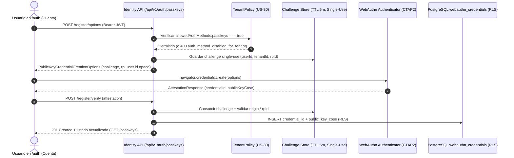
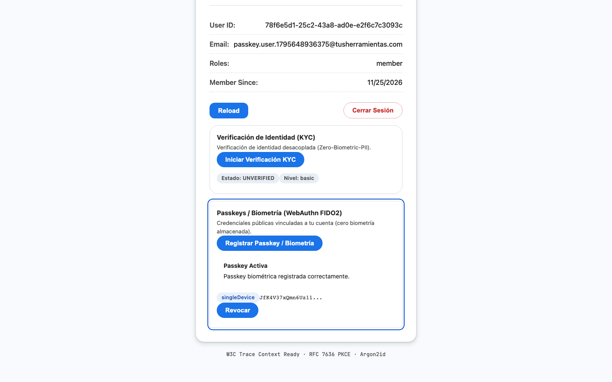
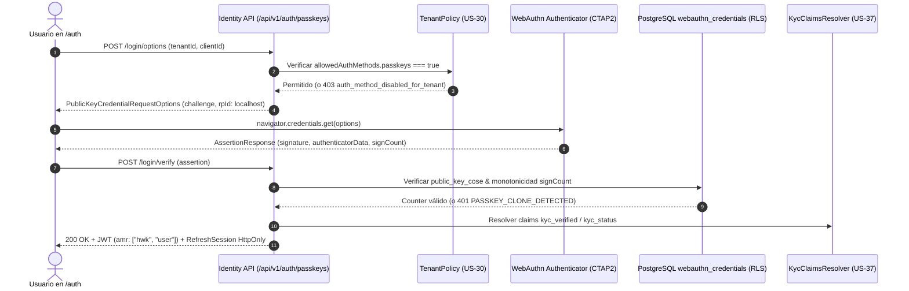
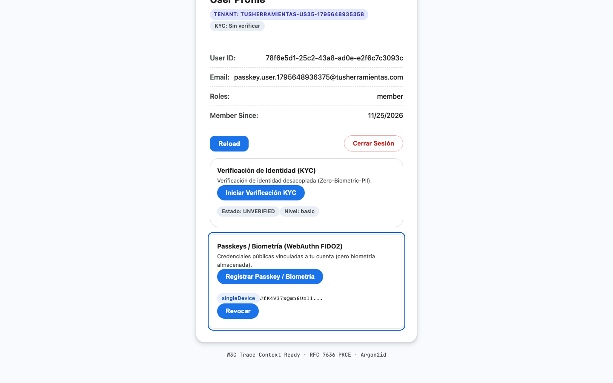
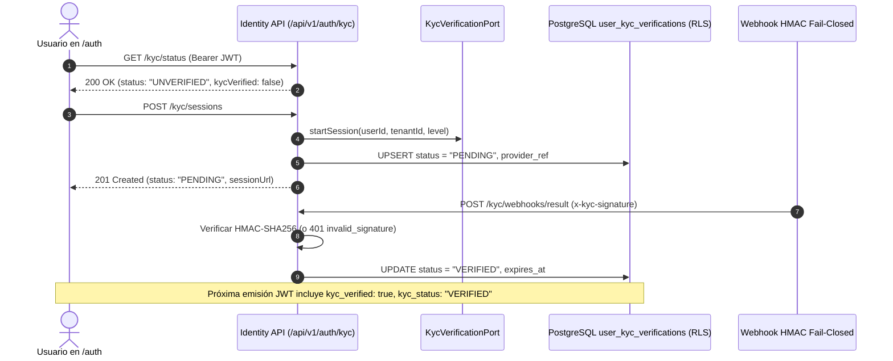
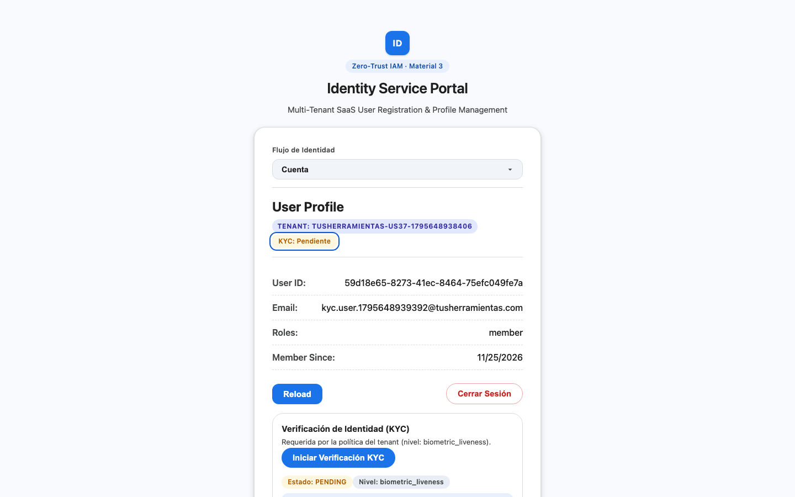

# 🔐 Epic 11: Passkeys (WebAuthn/FIDO2) & Verificación KYC Desacoplada

[](#)
[](#)
[](#)
[](#)

Este capítulo documenta el **Épico 11: Passkeys (WebAuthn/FIDO2) & Verificación KYC Desacoplada** (`ADR-0011`), habilitando autenticación biométrica *passwordless* basada en criptografía asimétrica sin almacenar jamás datos biométricos en el servidor.

---

## 📌 Historias de Usuario

| Historia | Descripción | Estado |
| :--- | :--- | :---: |
| **US-35** | Registro de Credenciales Biométricas Passwordless (WebAuthn / FIDO2 Passkeys, `publicKeyCose` y RLS) | ✅ En Producción |
| **US-36** | Autenticación con Passkey, Detección de Clonación (`signCount`) y Pasaporte RFC 9068 (`amr`) | ✅ En Producción |
| **US-37** | Orquestación de Verificación KYC (`KycVerificationPort`), Webhook HMAC *Fail-Closed* y Claims `kyc_verified` en JWT | ✅ En Producción |

---

## 🔑 US-35: Registro de Credenciales Biométricas Passwordless (WebAuthn / FIDO2 Passkeys)

### 1. Arquitectura `Zero-Biometric-PII`, Modelo `WebAuthnCredential` & Seguridad

`US-35` permite que cualquier usuario autenticado en `/auth` (pestaña `Cuenta`) registre una Passkey nativa de su dispositivo (Face ID, Touch ID, Windows Hello o biometría Android) cuando `TenantPolicy.allowedAuthMethods.passkeys === true` (`US-30`):

1. **Arquitectura `Zero-Biometric-PII`:** El servidor jamás recibe ni persiste huellas, rasgos faciales ni material privado. La entidad `WebAuthnCredential` almacena únicamente `credential_id` y la clave pública `public_key_cose` (`BYTEA`) junto con `counter`, `transports`, `device_type` y `backed_up`.
2. **Retos Efímeros *Single-Use* & Validación `rpId` / `origin`:** Cada ceremonia genera un `challenge` aleatorio con TTL de 5 minutos vinculado a `(userId, tenantId, rpId)` que se consume una sola vez (`400 invalid_webauthn_challenge` ante replay). El `origin` de `clientDataJSON` se valida contra los orígenes autorizados del binding activo (`US-29`).
3. **PostgreSQL RLS *Fail-Closed* & Auditoría:** La tabla `webauthn_credentials` exige `tenant_id = current_setting('app.current_tenant_id', true)` y emite eventos forenses NDJSON (`PASSKEY_REGISTERED`, `PASSKEY_REGISTRATION_REJECTED`).



---

### 2. Evidencia Real en Vivo (`http://localhost:4000`)

#### A. Generación de Opciones WebAuthn (`POST /api/v1/auth/passkeys/register/options` → `200 OK`)

Con `TenantPolicy.allowedAuthMethods.passkeys = true`:

```json
{
  "challenge": "H4BRsbb-Jpj9MksXiChp7B8Z-dZgJueDze2o-TQsgEY",
  "rp": {
    "name": "Identity Service (us35-live-1795629997094)",
    "id": "localhost"
  },
  "user": {
    "id": "ZWFiZTg0MTEtNDRhZS00Njg2LWI4N2EtMDU0NmQyNzExZTYx",
    "name": "eabe8411-44ae-4686-b87a-0546d2711e61",
    "displayName": ""
  },
  "pubKeyCredParams": [
    { "alg": -48, "type": "public-key" },
    { "alg": -8, "type": "public-key" },
    { "alg": -7, "type": "public-key" },
    { "alg": -257, "type": "public-key" }
  ],
  "timeout": 60000,
  "attestation": "none",
  "excludeCredentials": [],
  "authenticatorSelection": {
    "residentKey": "preferred",
    "userVerification": "preferred",
    "requireResidentKey": false
  }
}
```

#### B. Listado de Passkeys Sin Secretos (`GET /api/v1/auth/passkeys` → `200 OK`)

```json
{
  "count": 0,
  "passkeys": []
}
```

#### C. Guardrail Negativo por Política de Tenant (`passkeys: false` → `403 Forbidden`)

Al deshabilitar Passkeys en `TenantPolicy`, la solicitud de opciones se bloquea de forma inmediata:

```json
{
  "error": "auth_method_disabled_for_tenant",
  "message": "Passkeys are disabled for tenant \"us35-live-1795629997094\""
}
```

---

### 3. Recorrido Visual en `/auth` → `Cuenta` (CDP Virtual Authenticator)

Al pulsar **`Registrar Passkey / Biometría`**, el navegador ejecuta `navigator.credentials.create()` contra el autenticador virtual CTAP2, verifica el *attestation* en `/api/v1/auth/passkeys/register/verify` y renderiza inmediatamente la nueva credencial en la lista sin exponer material biométrico:



---

### 4. Cobertura TDD (4 Capas — `5 passed, 5 total` / `21 passed, 21 total`)

| Capa | Suite | Resultado |
| :--- | :--- | :---: |
| **Unit (Domain)** | `tests/unit/identity/domain/test_webauthn_credential.ts` | `3/3 passed` |
| **Unit (Application)** | `tests/unit/identity/application/test_register_passkey_handlers.ts` | `2/2 passed` |
| **Integration (API + Postgres RLS)** | `tests/integration/identity/interfaces/test_passkey_registration_api.ts` | `3/3 passed` |
| **Acceptance (BDD)** | `tests/acceptance/step_defs/test_webauthn_passkey_registration_steps.ts` | `3/3 passed` |
| **E2E Web (`/auth` → `Cuenta`)** | `tests/e2e/web/auth_portal_oidc_federation.spec.tsx` (incluye Scenario 7 `US-35`) | `10/10 passed` |

---

## 🛡️ US-36: Autenticación con Passkey y Emisión de Pasaporte Criptográfico (`amr`)

### 1. Arquitectura, `signCount` Anti-Clonación & Pasaporte RFC 9068 (`amr`)

`US-36` habilita el inicio de sesión *passwordless* en `/auth` mediante Passkeys previamente registradas (`US-35`), cuando `TenantPolicy.allowedAuthMethods.passkeys === true` (`US-30`):

1. **Verificación Criptográfica & Anti-Clonación (`signCount`):** `AuthenticatePasskeyVerifyCommandHandler` valida la firma asimétrica contra `public_key_cose`, el `rp.id` y el `origin` autorizado (`US-29`). Para autenticadores `singleDevice` con `counter > 0`, cualquier regresión (`newCounter <= storedCounter`) aborta el login con `401 invalid_grant` y registra `PASSKEY_CLONE_DETECTED`.
2. **Pasaporte JWT RFC 9068 (`amr: ["hwk", "user"]`) & Sesión HttpOnly:** Emite el `access_token` con el claim `amr: ["hwk", "user"]` (*Hardware Key* + *User Verification*), enriquece claims KYC mediante `KycClaimsResolver` (`US-37`) y genera una `RefreshSession` en cookie `HttpOnly`.
3. **Auditoría Forense NDJSON:** Registra `PASSKEY_AUTH_SUCCESS`, `PASSKEY_AUTH_FAILED` y `PASSKEY_CLONE_DETECTED`.



---

### 2. Evidencia Real en Vivo (`http://localhost:4000`)

#### A. Generación de Opciones de Login WebAuthn (`POST /api/v1/auth/passkeys/login/options` → `200 OK`)

```json
{
  "rpId": "localhost",
  "challenge": "bKNIMkQwMgxuHKZTX4FJZ_VrwpnZuC8s19azkfBx1rk",
  "allowCredentials": [],
  "timeout": 60000,
  "userVerification": "preferred"
}
```

#### B. Guardrail Negativo por Política de Tenant (`passkeys: false` → `403 Forbidden`)

```json
{
  "error": "auth_method_disabled_for_tenant",
  "message": "Passkeys are disabled for tenant \"us36-live-1795645813288\""
}
```

---

### 3. Recorrido Visual en `/auth` (CDP Virtual Authenticator)

Tras cerrar sesión y cambiar al formulario **`Iniciar sesión`**, pulsar **`Iniciar sesión con Passkey`** (`[data-testid="passkey-login-btn"]`) ejecuta `navigator.credentials.get()` contra el autenticador virtual CTAP2 y restablece la sesión autenticada sin contraseña:



---

### 4. Cobertura TDD (4 Capas — `4 passed, 4 total` / `19 passed, 19 total`)

| Capa | Suite | Resultado |
| :--- | :--- | :---: |
| **Unit (Application)** | `tests/unit/identity/application/test_authenticate_passkey_handlers.ts` | `3/3 passed` |
| **Integration (API + Postgres RLS)** | `tests/integration/identity/interfaces/test_passkey_authentication_api.ts` | `3/3 passed` |
| **Acceptance (BDD)** | `tests/acceptance/step_defs/test_webauthn_passkey_authentication_steps.ts` | `3/3 passed` |
| **E2E Web (`/auth`)** | `tests/e2e/web/auth_portal_oidc_federation.spec.tsx` (incluye Scenario 8 `US-36`) | `10/10 passed` |

---

## 🪪 US-37: Orquestación de Verificación KYC (`KycVerificationPort`) y Claims JWT

### 1. Arquitectura, Máquina de Estados & Webhook HMAC *Fail-Closed*

`US-37` orquesta flujos de verificación de identidad (**KYC / Prueba de Vida por cámara**) cuando `TenantPolicy.kycPolicy.required === true` (`US-30`), manteniendo el principio *Zero-Biometric-PII*:

1. **Puerto Hexagonal `KycVerificationPort` & *Zero-Biometric-PII*:** Delega la captura de documentos o video de prueba de vida a un proveedor externo (en dev/local: adaptador determinista simulado). El `identity-service` jamás almacena fotos ni biometría cruda; solo persiste `status`, `level` (`basic` | `biometric_liveness`), `provider_ref`, `verified_at` y `expires_at` en `user_kyc_verifications` bajo PostgreSQL RLS *Fail-Closed*.
2. **Máquina de Estados (`UNVERIFIED → PENDING → VERIFIED | REJECTED`):** Al iniciar sesión KYC (`POST /api/v1/auth/kyc/sessions`), la entidad transiciona a `PENDING`. El resultado final llega mediante webhook (`POST /api/v1/auth/kyc/webhooks/result`) validado por firma **HMAC-SHA256 *Fail-Closed*** (`KYC_WEBHOOK_SECRET`), rechazando cualquier firma ausente o inválida con `401 invalid_signature`.
3. **Proyección en Pasaporte JWT RFC 9068 & Auditoría:** Al emitir tokens, `KycClaimsResolver` evalúa `expires_at > now()` y proyecta `kyc_verified` y `kyc_status`. Los eventos quedan trazados en NDJSON (`KYC_SESSION_STARTED`, `KYC_VERIFICATION_UPDATED`, `KYC_WEBHOOK_SIGNATURE_INVALID`).



---

### 2. Evidencia Real en Vivo (`http://localhost:4000`)

#### A. Consulta de Estado Inicial (`GET /api/v1/auth/kyc/status` → `200 OK`)

```json
{
  "userId": "c9d5f69d-7fa5-444a-8239-e61bebda9845",
  "tenantId": "us37-live-1795649131373",
  "status": "UNVERIFIED",
  "level": "biometric_liveness",
  "kycVerified": false,
  "providerRef": null,
  "verifiedAt": null,
  "expiresAt": null
}
```

#### B. Inicio de Sesión KYC (`POST /api/v1/auth/kyc/sessions` → `201 Created`)

```json
{
  "userId": "c9d5f69d-7fa5-444a-8239-e61bebda9845",
  "tenantId": "us37-live-1795649131373",
  "status": "PENDING",
  "level": "biometric_liveness",
  "kycVerified": false,
  "providerRef": "kyc_ref_us37-live-1795649131373_9b831cd4-df2",
  "verifiedAt": null,
  "expiresAt": null,
  "sessionUrl": "/auth?kyc_session=kyc_ref_us37-live-1795649131373_9b831cd4-df2&level=biometric_liveness",
  "mode": "deterministic_dev"
}
```

#### C. Estado Persistido Posterior (`GET /api/v1/auth/kyc/status` → `200 OK`)

```json
{
  "userId": "c9d5f69d-7fa5-444a-8239-e61bebda9845",
  "tenantId": "us37-live-1795649131373",
  "status": "PENDING",
  "level": "biometric_liveness",
  "kycVerified": false,
  "providerRef": "kyc_ref_us37-live-1795649131373_9b831cd4-df2",
  "verifiedAt": null,
  "expiresAt": null
}
```

#### D. Guardrail Negativo Webhook HMAC *Fail-Closed* (`POST /api/v1/auth/kyc/webhooks/result` → `401 Unauthorized`)

```json
{
  "error": "invalid_signature",
  "message": "Invalid or missing KYC webhook HMAC signature"
}
```

---

### 3. Recorrido Visual en `/auth`

En un tenant con `kycPolicy.required = true` (`biometric_liveness`), `UserProfileCard` muestra el badge KYC y el botón **`Iniciar Verificación KYC`** (`[data-testid="start-kyc-btn"]`), actualizando el estado visual a **`KYC: Pendiente`** al iniciar la sesión:



---

### 4. Cobertura TDD (4 Capas — `5 passed, 5 total` / `19 passed, 19 total`)

| Capa | Suite | Resultado |
| :--- | :--- | :---: |
| **Unit (Domain)** | `tests/unit/identity/domain/test_user_kyc_verification.ts` | `3/3 passed` |
| **Unit (Application)** | `tests/unit/identity/application/test_kyc_handlers.ts` | `1/1 passed` |
| **Integration (API + Postgres RLS)** | `tests/integration/identity/interfaces/test_kyc_verification_api.ts` | `2/2 passed` |
| **Acceptance (BDD)** | `tests/acceptance/step_defs/test_kyc_verification_and_jwt_claims_steps.ts` | `3/3 passed` |
| **E2E Web (`/auth`)** | `tests/e2e/web/auth_portal_oidc_federation.spec.tsx` (incluye Scenario 9 `US-37`) | `10/10 passed` |

---

[⬅️ Volver al Hub Principal de Showcase](./README.md)
