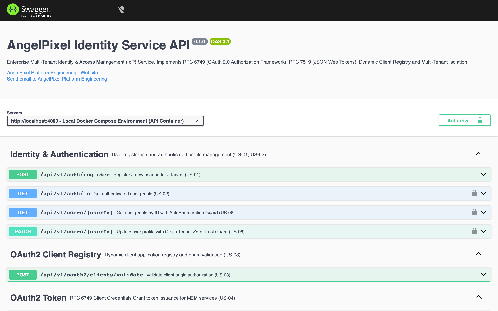
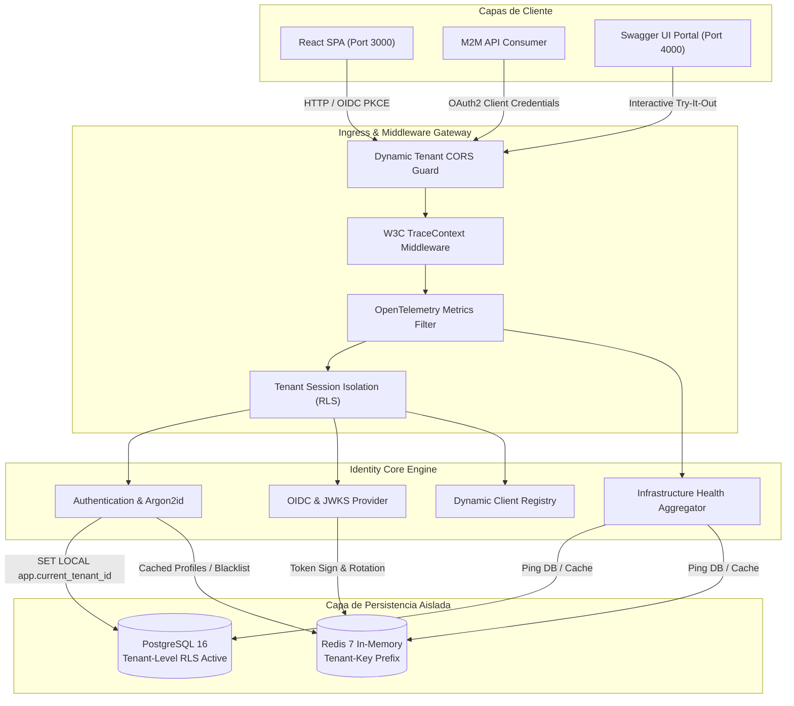

# 🛡️ Enterprise Multi-Tenant Identity & Access Management Service (Showcase Hub)

[](http://localhost:4000/api/docs/)
[](#-entorno-de-ejecución-rápida-1-minute-quickstart)
[](#)
[](#)
[](#)
[-success.svg)](#)
[](#)

Bienvenido al **Interactive Showcase & Walkthrough de Arquitectura** de `identity-service`. Este espacio documenta, demuestra y permite interactuar paso a paso con las **29 Historias de Usuario (User Stories)** distribuidas a lo largo de los **9 Épicos (Epics)** del servicio de identidad de grado empresarial.

---

## ⚡ Acceso Inmediato & Live Gateways

Con la plataforma levantada localmente (`npm run docker:dev`), puedes interactuar directamente con los portales de desarrollo y producción:

| Interfaz / Endpoint | URL Local | Propósito Principal |
| :--- | :--- | :--- |
| **Swagger UI (OpenAPI 3.1)** | [`http://localhost:4000/api/docs/`](http://localhost:4000/api/docs/) | Consola interactiva para probar cada endpoint con esquemas JSON validados y autenticación Bearer JWT. |
| **React Web Portal** | [`http://localhost:3000/`](http://localhost:3000/) | SPA interactiva para registro multi-tenant, login y visualización de sesión activa con bypass de cache. |
| **OpenID Configuration** | [`http://localhost:4000/.well-known/openid-configuration`](http://localhost:4000/.well-known/openid-configuration) | Endpoint canónico de descubrimiento OIDC (JWKS URI, issuer, endpoints de tokens y autorización). |
| **Health Diagnostics** | [`http://localhost:4000/health`](http://localhost:4000/health) | Diagnóstico integral con sondas de liveness/readiness para PostgreSQL y Redis con métricas de latencia. |
| **Prometheus Metrics** | [`http://localhost:4000/metrics`](http://localhost:4000/metrics) | Telemetría OpenTelemetry (RED: Rate, Errors, Duration) expuesta en formato canónico de Prometheus. |



---

## 🚀 Entorno de Ejecución Rápida (1-Minute Quickstart)

Levanta la arquitectura completa (Base de datos PostgreSQL 16 con RLS, Redis 7, Backend Express API y Frontend React SPA) con un solo comando:

```bash
# 1. Clonar el repositorio y posicionarse en la raíz
cd apps/sites/portfolio/identity-service

# 2. Levantar el stack completo con volumen fresco y build limpio
npm run docker:dev

# 3. Comprobar salud de los contenedores
docker compose ps

# 4. (Opcional) Ejecutar suite de captura Playwright en alta resolución
npm run showcase:capture
```

Para detener los servicios o revisar logs:
```bash
# Ver logs unificados en tiempo real
npm run docker:dev:logs

# Detener los contenedores preservando volúmenes
npm run docker:dev:down

# Limpieza total de contenedores y volúmenes
npm run docker:dev:clean
```

---

## 🏗️ Blueprint de Arquitectura & Flujo de Datos

El servicio opera bajo un modelo **Zero-Trust Multi-Tenant** estricto:



---

## 🧭 Matriz Interactiva de Navegación del Showcase (29 Historias de Usuario)

Cada documento modular contiene:
- Explicación de la arquitectura y decisiones de diseño (ADRs).
- Capturas de pantalla en alta resolución o evidencia terminal de ejecución en vivo.
- Recetas cURL listas para copiar y pegar con respuestas JSON reales.
- Comprobación de integridad y tests de cobertura asociados.

| Épico | Historias de Usuario (US) | Enfoque Tecnológico | Guía Paso a Paso |
| :--- | :--- | :--- | :---: |
| **Epic 01: Multi-Tenant Identity & Lifecycle** | **US-01:** Registro de Usuarios Multi-Tenant<br>**US-02:** Perfil Autenticado y Caché In-Memory | Argon2id, Zod, Redis Caching, PII Masking | [Ver Capítulo 01 ➡️](./01-identity-management.md) |
| **Epic 02: Dynamic Client Registry & M2M Auth** | **US-03:** Registro Dinámico de Clientes & CORS<br>**US-04:** Autenticación M2M (Client Credentials)<br>**US-28:** Ciclo de Vida & Rotación Zero-Downtime de Secretos<br>**US-29:** Bindings N:M Multi-Tenant & Dominios Custom | OAuth2 Client Credentials, Origin Validation, Scopes, Argon2id Secret Rotation, Multi-Domain N:M Bindings | [Ver Capítulo 02 ➡️](./02-client-registry.md) |
| **Epic 03: Tenant Isolation & Zero-Trust Access** | **US-05:** Aislamiento con PostgreSQL RLS<br>**US-06:** Guardia Cross-Tenant Zero-Trust | Row Level Security (RLS), `app.current_tenant_id` | [Ver Capítulo 03 ➡️](./03-rls-isolation.md) |
| **Epic 04: OIDC Identity Server & Session Security** | **US-07:** Servidor OIDC & JWKS Criptográfico<br>**US-08:** Flujo de Autorización con PKCE<br>**US-09:** Rotación de Refresh Tokens & Revocación | RFC 7636 (PKCE), Asymmetric RSA JWKS, Token Revocation | [Ver Capítulo 04 ➡️](./04-oidc-server-sessions.md) |
| **Epic 05: Identity Federation & External Providers** | **US-10:** Conectores Sociales (Google & Microsoft)<br>**US-11:** Vinculación JIT de Cuentas Externas | OpenID Connect Federation, Account Linking, JIT Provisioning | [Ver Capítulo 05 ➡️](./05-identity-federation.md) |
| **Epic 06: Cloud Infrastructure & Automated Delivery** | **US-12:** Infraestructura como Código (Terraform)<br>**US-13:** Ingress Seguro con Let's Encrypt<br>**US-14:** Helm Chart de Grado Empresarial<br>**US-15:** Pipeline Automatizado de CI/CD | Terraform HCL, Kubernetes Ingress, Helm v3, GitHub Actions | [Ver Capítulo 06 ➡️](./06-cloud-infrastructure.md) |
| **Epic 07: FinTech Compliance & Defense in Depth** | **US-16:** Secretos Azure KeyVault CSI<br>**US-17:** Conexiones TLS Encriptadas (mTLS/SSL)<br>**US-18:** Network Policies Zero-Trust en K8s<br>**US-19:** Registro de Auditoría Inmutable (WORM) | K8s Secrets Store CSI, TLS 1.3, Calico/K8s NetPol, WORM Audit | [Ver Capítulo 07 ➡️](./07-fintech-compliance.md) |
| **Epic 08: Distributed Observability & Resiliency** | **US-20:** Trazabilidad Distribuida W3C TraceContext<br>**US-21:** Telemetría OpenTelemetry & Métricas RED<br>**US-22:** Sondas de Salud e Inspección de Infraestructura | OpenTelemetry SDK, Prometheus Metrics, RFC K8s Probes | [Ver Capítulo 08 ➡️](./08-distributed-observability.md) |
| **Epic 09: Enterprise M3 Visual Portal** | **US-23:** Sistema de Diseño M3, Storybook 10 & Bounded Shell<br>**US-24:** Superficie `/auth`: Portal, OIDC/JWKS, PKCE S256 & Federación<br>**US-25:** Superficie `/tenant`: Client Registry, M2M & RLS Lab<br>**US-26:** Consola `/platform`: Gobernanza Root, Bóveda, Auditoría & SRE<br>**US-27:** Showcase Interactivo & Capturas Playwright Retina (`01..09`) | React 19, Material Design 3 Tokens, Storybook 10, Playwright, SRE | [Ver Capítulo 09 ➡️](./09-enterprise-ui-portal.md) |

---

## 🧪 Certificación Cuantitativa de Calidad

El 100% de los componentes e integraciones han sido validados exhaustivamente:

- **804 Tests Automatizados Ejecutados (`npm test`)** (599 Unitarios en 83 suites + 205 de Integración/RLS en 39 suites).
- **0 Vulnerabilidades en Auditoría de Dependencias**.
- **100% de Cobertura en Políticas RLS y Aislamiento de Inquilinos**.
- **Contratos de API OpenAPI 3.1 Validados Estrictamente**.

```bash
# Para ejecutar la suite completa de pruebas en cualquier momento:
npm test
```
